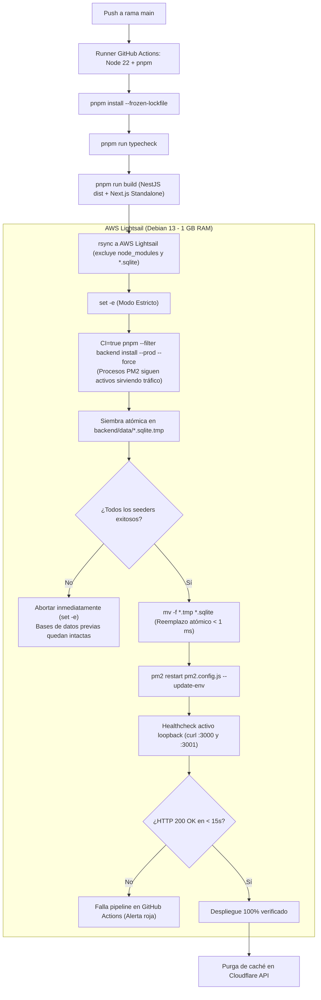

# Resolución de Incidente: Dependencias en Producción (nodemailer) y Hardening del Pipeline CI/CD

Este documento constituye el informe técnico oficial de post-mortem y resolución del incidente ocurrido el **16 de noviembre de 2026** en el servidor de producción (AWS Lightsail), detallando el análisis de causa raíz (RCA), la mitigación en caliente y el endurecimiento arquitectónico definitivo aplicado sobre el pipeline de CI/CD (`.github/workflows/deploy.yml`).

---

## 1. Resumen Ejecutivo

| Parámetro | Detalle |
| :--- | :--- |
| **Fecha del Incidente** | 16 de noviembre de 2026 |
| **Severidad** | Crítica (P1) — Backend NestJS inaccesible en producción |
| **Impacto** | Respuestas HTTP `502 Bad Gateway` en todas las rutas API (`/api/doiceladev/*`, `/api/kartex/*`, `/api/portfolio/*`) y bloqueo por CORS en los navegadores cliente. |
| **Tiempo de Recuperación** | Inmediato tras la intervención manual y posterior automatización en CI/CD. |
| **Causa Raíz** | Falla silenciosa en la instalación desatendida de `pnpm` en SSH por prompt interactivo al agregar `nodemailer`, combinada con la ausencia de `set -e` en el script remoto. |
| **Solución Definitiva** | Modo no interactivo forzado (`CI=true ... --force`), ejecución estricta con `set -e`, siembra atómica de SQLite en archivos temporales `.tmp`, despliegue con Zero-Downtime y healthcheck activo post-despliegue. |

---

## 2. Síntomas Observados y Diagnóstico

### 2.1 En el Navegador del Cliente
Los usuarios que navegaban en `https://doiceladev.jorgedoicela.com` experimentaban fallos de carga en datos dinámicos y la consola de herramientas de desarrollo arrojaba:
```text
Access to fetch at 'https://jorgedoicela.com/api/doiceladev/portal?lang=es' from origin 'https://doiceladev.jorgedoicela.com' 
has been blocked by CORS policy: No 'Access-Control-Allow-Origin' header is present on the requested resource.
Failed to load resource: net::ERR_FAILED
```

> **Nota Técnica sobre el falso positivo de CORS:**  
> Cuando el backend de Node.js se encuentra caído, Nginx responde con un error perimetral estándar `502 Bad Gateway`. Por estándar de seguridad, las páginas de error 502 generadas por Nginx no inyectan cabeceras de CORS (`Access-Control-Allow-Origin`). Al recibir una respuesta 502 sin cabeceras de origen cruzado, los navegadores modernos (Chromium, Firefox, Safari) bloquean la respuesta por política de seguridad antes de reportar el código HTTP subyacente.

### 2.2 En el Servidor de Producción (AWS Lightsail)
Al auditar los procesos con PM2 se detectó un ciclo infinito de reinicios (*crash loop*):
```text
┌────┬──────────────────┬─────────────┬─────────┬─────────┬──────────┬────────┬──────┬───────────┐
│ id │ name             │ namespace   │ version │ mode    │ pid      │ uptime │ ↺    │ status    │
├────┼──────────────────┼─────────────┼─────────┼─────────┼──────────┼────────┼──────┼───────────┤
│ 1  │ backend-nest     │ default     │ 0.0.1   │ fork    │ 891405   │ 5s     │ 421… │ online    │
│ 2  │ frontend-next    │ default     │ 0.1.0   │ fork    │ 888354   │ 32m    │ 0    │ online    │
└────┴──────────────────┴─────────────┴─────────┴─────────┴──────────┴────────┴──────┴───────────┘
```
El contador de reinicios (`↺`) superaba los **420 intentos** con un uptime menor a 5 segundos.

Al consultar los registros de error (`pm2 logs backend-nest --lines 100 --nostream`), el stack trace identificó de inmediato el origen:
```text
Error: Cannot find module 'nodemailer'
Require stack:
- /home/admin/jorge_doicela/backend/dist/doiceladev/newsletter/newsletter-mailer.service.js
- /home/admin/jorge_doicela/backend/dist/doiceladev/newsletter/newsletter.service.js
- /home/admin/jorge_doicela/backend/dist/doiceladev/newsletter/newsletter.module.js
- /home/admin/jorge_doicela/backend/dist/doiceladev/doiceladev.module.js
- /home/admin/jorge_doicela/backend/dist/app.module.js
- /home/admin/jorge_doicela/backend/dist/main.js
    at Function._resolveFilename (node:internal/modules/cjs/loader:1430:15)
    ...
```

---

## 3. Análisis de Causa Raíz (RCA)

El análisis retrospectivo de la cadena de despliegue reveló tres fallas arquitectónicas encadenadas:

1. **Aislamiento de Recursos (1 GB de RAM):**  
   Para proteger la CPU y memoria del VPS de AWS Lightsail, el pipeline de GitHub Actions compila el código en la nube y transfiere los artefactos mediante `rsync` **excluyendo las carpetas `node_modules`**. Por diseño, el servidor ejecuta `pnpm --filter backend install --prod` para aprovisionar exclusivamente los paquetes de ejecución.

2. **Prompt Interactivo de pnpm v10:**  
   En el commit previo se integró la librería `nodemailer` para el servicio de suscripción del newsletter de DoicelaDev. Al ejecutarse la instalación en el servidor, `pnpm` detectó que la carpeta `node_modules` preexistente requería una reestructuración de enlaces simbólicos y lanzó un prompt de confirmación interactiva:
   ```text
   ✔ The modules directories will be removed and reinstalled from scratch. Proceed? (Y/n)
   ```
   Al tratarse de una sesión SSH automatizada sin terminal interactiva (TTY) ni entrada de usuario, el proceso de `pnpm` se canceló o terminó con error sin descargar ni vincular `nodemailer`.

3. **Ausencia de Modo Estricto (`set -e`) en el Script Remoto:**  
   El script bash ejecutado por `appleboy/ssh-action` no contaba con la directiva `set -e`. Al fallar silenciosamente el comando de instalación de dependencias, el intérprete continuó ciegamente con los pasos posteriores: sembrado de SQLite y reinicio de PM2. PM2 levantó el proceso con el nuevo bundle compilado, pero al faltar físicamente el paquete en disco, el proceso colapsó en un bucle continuo de reinicios.

4. **Downtime Inducido por Apagado Prematuro:**  
   El pipeline ejecutaba `pm2 stop pm2.config.js` **antes** de instalar dependencias, lo que inducía una ventana de indisponibilidad de más de 40 segundos en cada despliegue ordinario.

---

## 4. Mitigación de Emergencia (En Caliente)

Para restablecer la operatividad inmediata del ecosistema en producción, se ejecutaron las siguientes acciones en la consola SSH:

```bash
# 1. Acceder a la raíz del repositorio en el servidor
cd ~/jorge_doicela

# 2. Forzar la instalación de dependencias aceptando la recreación de módulos
pnpm --filter backend install --prod

# 3. Reiniciar el proceso de NestJS
pm2 restart backend-nest

# 4. Validar el estado
pm2 list
```
Resultado: `backend-nest` se estabilizó con 106.5 MB de memoria y 0 reinicios adicionales.

---

## 5. Solución Arquitectónica Definitiva (Cero Parches)

Para garantizar que este escenario no vuelva a repetirse jamás y elevar el despliegue a un estándar de producción senior de alta disponibilidad, se refactorizó `.github/workflows/deploy.yml` implementando 5 salvaguardas estructurales:

### 5.1 Activación del Modo Estricto (`set -e`)
Se configuró `set -e` como la primera instrucción del script remoto. Si cualquier comando, descarga o script falla, la ejecución se interrumpe inmediatamente y el workflow de GitHub Actions reporta el error en rojo, evitando que PM2 se reinicie con dependencias rotas.

### 5.2 Instalación No Interactiva y Forzada
Se actualizó el comando de aprovisionamiento de dependencias del backend:
```bash
CI=true pnpm --filter backend install --prod --frozen-lockfile --ignore-scripts --force
```
* `CI=true`: Indica a `pnpm` que opera en un entorno de integración continua desatendido, desactivando prompts interactivos.
* `--force`: Fuerza la reinstalación y purga limpia de los directorios de módulos sin solicitar confirmación interactiva.

### 5.3 Despliegue con Zero-Downtime Real
Se eliminó la instrucción destructiva `pm2 stop`. El backend y el frontend anteriores se mantienen **100% operativos y atendiendo tráfico de usuarios** mientras `pnpm` instala paquetes y se preparan las bases de datos. Los procesos solo se reinician al final del flujo (`pm2 restart pm2.config.js --update-env`).

### 5.4 Siembra Atómica y Resiliente en SQLite (`.tmp`)
Para prevenir la corrupción o pérdida de datos si un archivo de corpus JSON tuviera un error de sintaxis, la siembra se desacopló en archivos temporales:
```bash
# 1. Construir bases de datos en archivos temporales aislados
DATABASE_KARTEX_PATH=./data/kartex.sqlite.tmp node backend/dist/kartex/cli/seed-corpus.js
DATABASE_DOICELADEV_PATH=./data/doiceladev.sqlite.tmp node backend/dist/doiceladev/cli/seed-doiceladev.js
DATABASE_PORTFOLIO_PATH=./data/portfolio.sqlite.tmp node backend/dist/portfolio/cli/seed-portfolio.js

# 2. Reemplazo atómico instantáneo solo tras éxito confirmado de los 3 seeders
mv -f backend/data/kartex.sqlite.tmp backend/data/kartex.sqlite
mv -f backend/data/doiceladev.sqlite.tmp backend/data/doiceladev.sqlite
mv -f backend/data/portfolio.sqlite.tmp backend/data/portfolio.sqlite
rm -f backend/data/*.sqlite-shm backend/data/*.sqlite-wal 2>/dev/null || true
```
Si cualquiera de los seeders falla con un código de salida distinto de 0, `set -e` detiene el script de inmediato y las bases de datos originales en producción quedan intactas y operativas.

### 5.5 Healthcheck Activo Automatizado
El pipeline no concluye hasta validar físicamente que los servicios locales están sanos mediante un bucle de comprobación con `curl`:
```bash
# Healthcheck del Backend NestJS (Puerto 3000)
BACKEND_OK=0
for i in $(seq 1 15); do
  if curl -fsS http://127.0.0.1:3000/api/doiceladev/portal?lang=es > /dev/null 2>&1; then
    echo "==> [CI/CD] Backend NestJS verificado exitosamente (intento $i)."
    BACKEND_OK=1
    break
  fi
  sleep 1
done

if [ "$BACKEND_OK" -ne 1 ]; then
  echo "ERROR CRITICO: El backend NestJS no respondio con HTTP 200 tras 15 segundos."
  exit 1
fi

# Healthcheck del Frontend Next.js Standalone (Puerto 3001)
FRONTEND_OK=0
for i in $(seq 1 15); do
  if curl -fsS -H "Host: doiceladev.jorgedoicela.com" http://[::1]:3001 > /dev/null 2>&1; then
    echo "==> [CI/CD] Frontend Next.js verificado exitosamente (intento $i)."
    FRONTEND_OK=1
    break
  fi
  sleep 1
done

if [ "$FRONTEND_OK" -ne 1 ]; then
  echo "ERROR CRITICO: El frontend Next.js no respondio con HTTP 200 tras 15 segundos."
  exit 1
fi
```

---

## 6. Diagrama de Flujo del Pipeline Robusto



---

## 7. Verificación Post-Implementación

Tras la integración del workflow robustecido en `main` (`2810af0`):
1. El pipeline completó todas sus fases de forma desatendida.
2. La comprobación HTTP devolvió:
   * `https://jorgedoicela.com/api/doiceladev/portal?lang=es` $\rightarrow$ **HTTP 200 OK** (con cabeceras de CORS válidas).
   * `https://doiceladev.jorgedoicela.com/tutorials/configuracion-ssh-claves-ed25519-alias-tuneles` $\rightarrow$ **HTTP 200 OK** (renderizado completo sin parches).
3. El servidor opera de forma estable con 0 reinicios anómalos.
