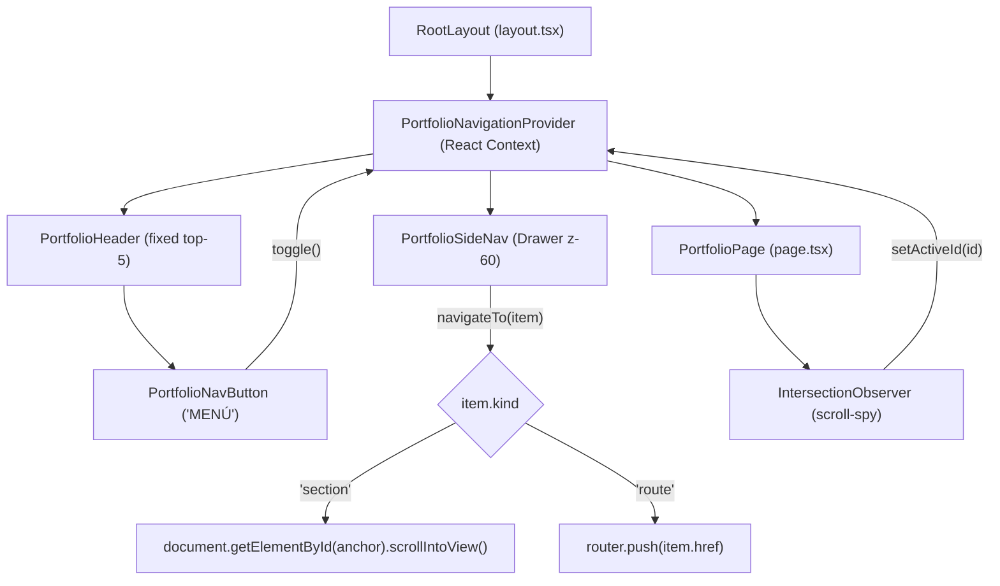

# Portafolio - Frontend y Terminal SSH (Next.js)

Este documento detalla la arquitectura macro y micro, componentes y funcionamiento de la terminal SSH virtual interactiva del Portafolio (`portfolio.jorgedoicela.com`).

---

## 1. Contexto Arquitectónico Macro y Micro

> [!IMPORTANT]
> **Arquitectura Macro y Enrutamiento Canónico Limpio:**
> * **Subdominio Canónico:** `portfolio.jorgedoicela.com` (o `http://portfolio.localhost:3001` en desarrollo local).
> * **Arquitectura Multipágina SSR/ISR:** La raíz `/` presenta un resumen ejecutivo consolidado (`featured: true`) con enlace a páginas dedicadas (`/about`, `/projects`, `/stack`, `/experience`, `/engineering`, `/terminal`, `/contact` y `/sandbox`), manteniendo la política **Zero-WebSocket en Home**.
> * **Redirección Canónica 308 Permanente:** En `src/middleware.ts`, cualquier solicitud con el prefijo redundante `/portfolio` o `/portfolio/*` en el subdominio se redirige automáticamente mediante HTTP 308 a la ruta limpia correspondiente (`/` o `/<ruta>`), protegiendo el SEO y evitando contenido duplicado.
> * **Reescritura Interna Transparente:** Next.js reescribe internamente las rutas del subdominio hacia el directorio físico `frontend/web/src/app/(portfolio)/portfolio/*` para evitar colisiones entre proyectos consolidados.
> * **Compatibilidad Localhost Directa:** Solicitudes directas sin subdominio a `localhost:3001/portfolio` y sus subrutas (`/portfolio/*`) responden `200 OK` directamente, con resolución adaptativa de enlaces en `shared/lib/routes.ts`.
> * **Consolidación Física:** Se ejecuta en el único servidor Next.js 16 (puerto `3001`) para optimizar el límite de **1 GB de RAM** del VPS.
> * **Aislamiento:** Cero importaciones de otros subdominios (`kartex`, `doiceladev`, `landing`). Estilos encapsulados en `(portfolio)/globals.css`.
>
> **Arquitectura Micro:**
> * **Feature-Sliced Design (FSD):** El código se organiza en 9 features autocontenidas (`navigation`, `about`, `projects`, `stack`, `experience`, `engineering`, `labs`, `terminal`, `contact`) más la capa `shared/` aislada, con `0` importaciones cruzadas entre features.
> * **Jerarquía de Componentes:** Componentes compartidos del subdominio en `(portfolio)/components/` vs componentes específicos en `features/<feature>/components/`.
> * **Estética Dark Luxury y Tipografías Locales:** Fondos oscuros profundos, acentos metálicos y dorados sutiles, tipografías auto-hospedadas bajo `(portfolio)/fonts/` (`Geist-Variable.woff2` y `GeistMono-Variable.woff2`) cargadas mediante `next/font/local` con licencia **SIL OFL 1.1** (Zero-External Network Fonts). La fuente monoespaciada se inyecta directamente a la emulación `@xterm/xterm` vía `var(--font-geist-mono)`.
> * **Amplitud Horizontal y Layout Editorial Equilibrado:** Contenedor unificado `PortfolioPageShell` (`max-w-[1380px] mx-auto`) compartido por el Home, las 7 subpáginas dedicadas, `PortfolioHeader` y `PortfolioFooter`, calibrado para coexistir con el sidebar lateral fijo de `184px` manteniendo proporciones de lectura óptimas y simetría visual tanto en escritorio como al colapsar la navegación.

---

## 2. Estructura de Directorios (Feature-Sliced Design)

```text
frontend/web/src/app/(portfolio)/
├── fonts/                     # Tipografías locales autocontenidas (Geist-Variable, GeistMono-Variable)
├── globals.css                # Estilos aislados del portafolio (Dark Luxury Look)
├── layout.tsx                 # Layout raíz con localFont(), ThemeProvider local y PortfolioJsonLd
├── theme-provider.tsx         # Proveedor de tema claro/oscuro
├── portfolio/
│   ├── page.tsx               # Contenedor principal de vistas (Resumen ejecutivo + terminal + contacto)
│   ├── about/
│   │   └── page.tsx           # Página dedicada (/about) con perfil extendido, filosofía y líneas de enfoque
│   ├── projects/
│   │   └── page.tsx           # Página dedicada (/projects) con el catálogo completo de proyectos
│   ├── stack/
│   │   └── page.tsx           # Página dedicada (/stack) con catálogo de tecnologías y entorno Linux
│   ├── experience/
│   │   └── page.tsx           # Página dedicada (/experience) con línea de tiempo laboral y formación detallada
│   ├── engineering/
│   │   └── page.tsx           # Página dedicada (/engineering) con arquitectura Cloud, DevSecOps, IA y telemetría real
│   ├── terminal/
│   │   └── page.tsx           # Página dedicada (/terminal) con Consola Tri-Modal + Tablero Interactivo CTF (features/labs)
│   ├── contact/
│   │   └── page.tsx           # Página dedicada (/contact) con formulario de contacto y áreas de compromiso
│   └── sandbox/
│       └── page.tsx           # Vista dedicada a pantalla completa para SandboxTerminal
│
├── components/                # COMPONENTES COMPARTIDOS DEL SUBDOMINIO
│   ├── PortfolioHeader.tsx    # Cabecera flotante con visibilidad dinámica y sincronización de colapso
│   ├── BackToPortalButton.tsx # Retorno directo al portal principal con soporte de id y estilos desacoplados
│   ├── ThemeToggle.tsx        # Conmutador de tema visual minimalista
│   ├── LanguageToggle.tsx     # Selector de idioma minimalista (ES/EN)
│   ├── PortfolioPreferences.tsx # Componente reutilizable que agrupa idioma y modo claro/oscuro
│   ├── TypewriterRole.tsx     # Animación de escritura de roles
│   ├── ScrollToTopButton.tsx  # Botón flotante reutilizable (inferior derecha) con rAF y ocultamiento en /sandbox
│   └── PortfolioJsonLd.tsx        # Marcado estructurado Schema.org ProfilePage
│
├── hooks/                     # HOOKS TRANSVERSALES DEL SUBDOMINIO
│   └── usePortfolioHeaderScroll.ts # Control de visibilidad por scroll con histeresis y rAF
│
├── features/                  # FEATURE-SLICED DESIGN (FSD)
│   ├── navigation/            # FEATURE: NAVEGACIÓN HÍBRIDA (SECCIONES Y RUTAS DEDICADAS)
│   │   ├── components/
│   │   │   ├── PortfolioSideNav.tsx    # Sidebar lateral colapsable desde la línea divisoria (cursor-col-resize)
│   │   │   └── NavIcon.tsx             # Mapeo tipado y desacoplado de iconos Lucide
│   │   ├── config/
│   │   │   └── navItems.ts             # Registro declarativo de navegación: Inicio (/) + 7 módulos dedicados (kind: 'route')
│   │   ├── context/
│   │   │   └── PortfolioNavigationContext.tsx # Fuente única de verdad reactiva (React Context)
│   │   ├── hooks/
│   │   │   └── usePortfolioNavigation.ts      # Hook consumidor tipado con guard clause
│   │   ├── types.ts                    # Contratos TypeScript (PortfolioNavItem, unión discriminada)
│   │   └── index.ts                    # Barril de exportación pública de la feature
│   │
│   ├── about/                 # FEATURE: PERFIL BIOGRÁFICO Y FILOSOFÍA
│   │   ├── api/
│   │   │   └── getProfile.ts           # Cliente HTTP SSR/ISR desacoplado dentro de la feature
│   │   ├── components/
│   │   │   ├── AboutSection.tsx        # Resumen biográfico y contactos rápidos en Home con enlace a /about
│   │   │   └── AboutDetailView.tsx     # Vista completa de perfil, filosofía (SQLite) y áreas de enfoque para /about
│   │   ├── types.ts                    # Contratos PortfolioProfileData y ProfilePillar
│   │   └── index.ts                    # Barril de exportación pública de la feature
│   │
│   ├── projects/              # FEATURE: SHOWCASE DE PROYECTOS Y CASOS DE ESTUDIO
│   │   ├── api/
│   │   │   └── getProjects.ts          # Cliente HTTP SSR/ISR desacoplado dentro de la feature
│   │   ├── components/
│   │   │   ├── ProjectShowcase.tsx     # Galería 2x2 con filtros reactivos, botones Dark Luxury y link opcional a /projects
│   │   │   ├── ProjectDetailModal.tsx  # Visor orbital 3D in-page de Casos de Estudio (createPortal)
│   │   │   └── ProjectSlideCard.tsx    # Tarjeta polimórfica de sección/galería para la pasarela orbital
│   │   ├── hooks/
│   │   │   ├── useProjects.ts          # Estado de filtrado por categoría y selección modal
│   │   │   └── useOrbitalCarousel.ts   # Física de arrastre (PointerEvents), rueda, teclado y arco 3D GPU
│   │   ├── utils/
│   │   │   └── buildProjectSlides.ts   # Constructor determinista de slides (secciones + media) por proyecto
│   │   ├── types.ts                    # Interfaces de proyectos, métricas, media y unión discriminada ProjectSlide
│   │   └── index.ts                    # Barril de exportación pública de la feature
│   │
│   ├── stack/                 # FEATURE: STACK TECNOLÓGICO Y ENTORNO LINUX
│   │   ├── api/
│   │   │   └── getStack.ts             # Cliente HTTP SSR/ISR desacoplado dentro de la feature
│   │   ├── components/
│   │   │   ├── StackSection.tsx        # Cinta marquee continua en 3 columnas para el Home con enlace a /stack
│   │   │   └── StackDetailView.tsx     # Catálogo completo filtrable por 5 categorías para /stack
│   │   ├── types.ts                    # Contratos PortfolioStackItem y StackCategoryType
│   │   └── index.ts                    # Barril de exportación pública de la feature
│   │
│   ├── experience/            # FEATURE: TRAYECTORIA LABORAL Y FORMACIÓN ACADÉMICA
│   │   ├── api/
│   │   │   └── getExperience.ts        # Cliente HTTP SSR/ISR desacoplado dentro de la feature
│   │   ├── components/
│   │   │   ├── ExperienceSection.tsx   # Resumen ejecutivo en Home con enlace a /experience
│   │   │   └── ExperienceDetailView.tsx # Línea de tiempo detallada y tarjetas de formación para /experience
│   │   ├── types.ts                    # Contratos PortfolioExperienceItem y ExperienceType
│   │   └── index.ts                    # Barril de exportación pública de la feature
│   │
│   ├── engineering/           # FEATURE: ARQUITECTURA, CLOUD, SEGURIDAD E IA
│   │   ├── api/
│   │   │   └── getEngineering.ts       # Cliente HTTP para pilares (ISR) y telemetría en vivo (no-store)
│   │   ├── components/
│   │   │   ├── EngineeringSection.tsx  # Resumen en 3 columnas para el Home con enlace a /engineering
│   │   │   └── EngineeringDetailView.tsx # Panel de telemetría real + pilares filtrables por dominio para /engineering
│   │   ├── types.ts                    # Contratos PortfolioEngineeringPillar y ServerTelemetrySnapshot
│   │   └── index.ts                    # Barril de exportación pública de la feature
│   │
│   ├── labs/                  # FEATURE: RETOS CAPTURE THE FLAG (CTF)
│   │   ├── api/
│   │   │   └── labsApi.ts              # Consulta de retos GET y validación SHA-256 POST (/portfolio/labs/verify)
│   │   ├── components/
│   │   │   └── LabsBoard.tsx           # Tablero interactivo CTF con marcador, pistas progresivas y progreso localStorage
│   │   ├── types.ts                    # Contratos PortfolioLabChallenge y VerifyFlagResponse
│   │   └── index.ts                    # Barril de exportación pública de la feature
│   │
│   ├── terminal/              # FEATURE: SISTEMA TRI-MODAL DE TERMINAL
│   │   ├── components/
│   │   │   ├── TerminalConsole.tsx       # Conmutador de modo y ventana interactiva
│   │   │   ├── TerminalTeaserSection.tsx # Tarjeta de acceso rápido Zero-WebSocket en el Home hacia /terminal
│   │   │   ├── SandboxTerminal.tsx       # Terminal Linux Real en Vivo (xterm.js + FitAddon)
│   │   │   ├── TerminalClipboardFooter.tsx # Barra inferior estilo AWS Lightsail para SandboxTerminal (popover y portapapeles)
│   │   │   ├── ServerOfflineBanner.tsx   # Banner Dark Luxury de Servidor Offline y Solicitud Telegram
│   │   │   ├── SandboxSecurityModal.tsx  # Modal para límites de concurrencia, cooldown y traspaso
│   │   │   ├── TerminalHeader.tsx        # Barra superior tmux y controles
│   │   │   ├── MatrixRain.tsx            # Animación de lluvia Matrix
│   │   │   └── MobileTerminalBanner.tsx  # Banner adaptativo para móviles
│   │   ├── hooks/
│   │   │   ├── useTerminalSocket.ts      # WebSocket de la terminal guiada (/terminal)
│   │   │   └── useSandboxTerminal.ts     # WebSocket + xterm.js del Sandbox (/sandbox)
│   │   ├── utils/
│   │   │   └── ansiParser.tsx            # Renderizado de colores y secuencias ANSI
│   │   ├── types.ts                      # Interfaces de pestañas, paneles e historial
│   │   └── index.ts                      # Barril de exportación pública de la feature
│   │
│   └── contact/               # FEATURE: FORMULARIO DE CONTACTO
│       ├── components/
│       │   ├── ContactForm.tsx       # Formulario con validación en tiempo real
│       │   ├── ContactSection.tsx    # Vista completa (formulario + 3 áreas de compromiso) para /contact
│       │   └── ContactTeaserSection.tsx # Bloque CTA ejecutivo en Home con disponibilidad y enlace a /contact
│       ├── hooks/
│       │   └── useContact.ts         # Llamada HTTP POST al backend y estados reactivos
│       ├── types.ts                  # DTOs y tipos del formulario de contacto
│       └── index.ts                  # Barril de exportación pública de la feature
│   │
│   └── shared/                # CAPA SHARED FSD (AISLADA DEL SLICE PORTFOLIO)
│       ├── lib/
│       │   ├── api.ts                # Clientes y URLs base del portafolio (API_URL, SOCKET_URL, SANDBOX_TUNNEL_URL)
│       │   ├── routes.ts             # Utilidades puras de clasificación y resolución de rutas (subdominio vs /portfolio/*)
│       │   └── index.ts              # Barril de utilidades y librerías shared
│       ├── ui/
│       │   ├── PortfolioLink.tsx     # Enlace interno adaptativo (portfolio.* y /portfolio/*) sin romper ISR
│       │   └── index.ts              # Barril de componentes UI shared
│       └── index.ts                  # Exportación pública consolidada de shared
```

---

## 3. Sistema de Navegación Híbrida y Drawer Editorial (`features/navigation/`)

La navegación del portafolio está concebida bajo una arquitectura orientada a datos que soporta de forma nativa dos fases operativas: scroll suave a secciones en la vista principal y enrutamiento hacia páginas o módulos dedicados de Next.js, sin requerir reescrituras de componentes ni parches.



### 3.1 Modelo de Datos y Contratos Tipados (`types.ts` & `config/navItems.ts`)
* **Unión Discriminada `PortfolioNavItem`:**
  * `kind: 'route'`: Utilizado por `Inicio` (`/`) y los 7 módulos dedicados (`/about`, `/projects`, `/stack`, `/experience`, `/engineering`, `/terminal`, `/contact`), resolviendo la navegación mediante `router.push(resolvePortfolioHref(pathname, item.href))`.
  * `kind: 'section'`: Reservado y soportado en el contrato (`PortfolioNavigationContext`) para eventuales anclas internas en el Home (`${getPortfolioHomeHref(pathname)}#${item.anchor}`).
* **Registro Canónico (`PORTFOLIO_NAV_ITEMS`):**
  * Tres grupos semánticos uniformes: `root` (`PORTAFOLIO`: Inicio `/`), `overview` (`PERFIL`: Sobre Mí, Proyectos, Stack, Experiencia) e `engineering` (`INGENIERÍA`: Arquitectura, Terminal, Contacto).
  * `Inicio` (`/`) se marca activo cuando `isPortfolioHomePath(pathname)` es verdadero.
  * `← PORTAL` permanece reservado en la cabecera superior para salir hacia `jorgedoicela.com`.
  * Enlaces internos del Home encapsulados en `PortfolioLink` (`shared/ui/PortfolioLink.tsx`) para resolver de forma transparente tanto subdominio (`portfolio.*`) como acceso directo (`/portfolio/*`) sin perder ISR.
  * Iconografía desacoplada mediante el componente `NavIcon.tsx` mapeando tipadamente a `lucide-react`.

### 3.2 Fuente Única de Verdad (`PortfolioNavigationContext.tsx`)
* **Proveedor Centralizado en Layout (`layout.tsx`):** `PortfolioNavigationProvider` envuelve todo el árbol del subdominio, garantizando que el estado `isOpen`, `activeId` y las acciones `open()`, `close()`, `toggle()`, `navigateTo()` estén sincronizados entre la cabecera fija, el panel lateral y cualquier página actual o futura.
* **Scroll-Spy Eficiente:** `IntersectionObserver` con margen `rootMargin: '-18% 0px -62% 0px'` calcula la sección activa en tiempo real sin saturar el hilo principal ni registrar listeners repetitivos de scroll.
* **Accesibilidad (WCAG AA):**
  * Cierre por tecla `Escape`.
  * Bloqueo reactivo de scroll en el documento (`document.body.style.overflow = 'hidden'`) mientras el menú permanece abierto.
  * `role="dialog"`, `aria-modal="true"` y atributos `aria-expanded` / `aria-current` dinámicos.

### 3.3 Componentes de Interfaz Dark/Light Luxury
* **Cabecera Pura y Trigger Móvil (`PortfolioHeader.tsx`):**
  * Sincronizada con el estado de colapso del sidebar: en pantallas grandes (`lg`), cuando el sidebar está visible, la cabecera superior se oculta suavemente evitando duplicidad de controles; al colapsar el sidebar en `lg`, o en pantallas móviles/tablets (`< lg`) donde el sidebar permanece oculto, la cabecera superior reaparece a ancho completo con `BackToPortalButton` y `PortfolioPreferences`.
  * **Disparador Móvil de 3 Líneas (`Menu`) y Enlace al Portal:** Ubicado en el extremo izquierdo antecediendo a `PORTAL` exclusivamente en viewports móviles y táctiles (`< lg`), permitiendo desplegar el drawer lateral. El enlace `PORTAL` adapta la visibilidad de su flecha dorada de retorno de forma responsiva (`arrowClassName="hidden lg:inline-block"`), mostrándose limpia sin flecha junto al menú hamburguesa en móvil y recuperando la flecha clásica (`← PORTAL`) en modo escritorio (PC).
* **Sidebar Lateral Editorial y Drawer Móvil (`PortfolioSideNav.tsx`):**
  * **Sidebar Desktop (`lg+`):** Estilizado sobre el lienzo (`w-[184px] fixed left-0 top-0 bottom-0 bg-background/95 backdrop-blur-md border-r border-border/40`), con cabecera y pie centrados, categorías centradas (`text-center`) y enlaces alineados a la izquierda sin truncamiento.
  * **Drawer Móvil Ergonómico (`< lg`):** Panel deslizable calibrado a `w-[220px] max-w-[75vw]` (holgura horizontal sutil y equilibrada para pantalla táctil), con cabecera de marca centrada (`JORGE DOICELA`) y pie de preferencias (`PortfolioPreferences`) bajo la misma tipografía, tamaño y espaciado que el modo PC (`text-xs font-mono tracking-wider text-foreground/75`), líneas divisorias simétricas (`border-b/border-t border-border/40`), enlaces con altura homologada de 38px (`h-[38px]`), y cierre intuitivo por tap exterior en el backdrop o al seleccionar cualquier enlace.
  * Sidebar estilizado sobre el mismo lienzo del portafolio (`w-[184px] fixed left-0 top-0 bottom-0 bg-background/95 backdrop-blur-md border-r border-border/40`), sin bloques oscuros pesados ni cajas alrededor de los ítems.
  * **Cabecera Superior del Sidebar:** Integra el botón `BackToPortalButton` (`← PORTAL`) centrado simétricamente en el compartimento superior con línea sutil de separación inferior (`border-b border-border/40`).
  * **Pie Inferior del Sidebar:** Integra el grupo de preferencias `PortfolioPreferences` centrado simétricamente en el compartimento inferior con selector de idioma (`ES/EN`) y conmutador de tema claro/oscuro con línea sutil de separación superior (`border-t border-border/40`).
  * **Títulos de Sección y Lista Editorial:** Los encabezados de grupo (`PERFIL`, `INGENIERÍA`) se presentan centrados con tracking amplio (`tracking-[0.26em]`) como pausas rítmicas de capítulo, mientras que los enlaces conservan su alineación izquierda fluida con indicador vertical activo en oro satinado (`border-gold-300`) y ancho calibrado a 184px para evitar cualquier truncamiento tipográfico.
  * **Colapso Puro desde el Borde con Indicador Fino:** La línea divisoria derecha del sidebar actúa como zona de colapso con `cursor-col-resize`, proyectando un indicador visual dorado fino de 1.5px en hover sin franjas gruesas. Al hacer clic, el sidebar se oculta suavemente hacia la izquierda (`-translate-x-full`).
  * **Re-apertura Invisible:** Cuando está colapsado, una franja en el borde izquierdo extremo de la pantalla con indicador fino de 1.5px permite reabrir el sidebar con un clic directo.
  * **Desplazamiento Simétrico del Layout (`globals.css`):** Mediante `.portfolio-shell` y `.portfolio-shell-header`, el contenido del portafolio se desplaza `calc(184px + 3rem)` al abrirse y regresa a `padding-left: 3rem` al colapsarse, manteniendo simetría horizontal perfecta con `padding-right: 3rem` (`lg:px-12`) y alineando `PortfolioHeader` a ras con el contenido.
* **Anclas Semánticas en Contenido:** Cada una de las 7 secciones del Resumen Ejecutivo en Home (`AboutSection.tsx`, `ProjectShowcase.tsx`, `StackSection.tsx`, `ExperienceSection.tsx`, `EngineeringSection.tsx`, `TerminalTeaserSection.tsx` y `ContactTeaserSection.tsx`) cuenta con su respectivo atributo `id` semántico (`about`, `projects`, `stack`, `experience`, `engineering`, `terminal`, `contact`) y `scroll-mt-24`. Filosofía y Principios se consolidan exclusivamente en `/about` (`AboutDetailView.tsx`) y el formulario completo en `/contact` (`ContactSection.tsx`), evitando duplicación entre el Home y las páginas dedicadas.

---

## 4. Showcase de Proyectos y Casos de Estudio de Ingeniería (`features/projects/`)

### 3.1 Tarjetas de Catálogo (`ProjectShowcase.tsx`)
* **Filtrado por Categorías:** Clasificación dinámica por etiquetas técnicas (`Full Stack`, `Cloud & DevSecOps`, `IA & Sistemas`).
* **Botones Táctiles de Alta Gama:**
  * **Demostración (Acción Principal):** Botón cápsula en oro satinado (`bg-gold-400/15 border border-gold-400/40 text-gold-300 hover:bg-gold-400 hover:text-black font-semibold`).
  * **Código (Acción Secundaria):** Botón estilizado con icono SVG de GitHub y superficie elevada.
  * **Caso de estudio (Disparador Inmersivo):** Enlace interactivo que abre el caso de estudio técnico al hacer clic.

### 3.2 Visor Orbital 3D de Caso de Estudio (`ProjectDetailModal.tsx` & `ProjectSlideCard.tsx`)
* **Aislamiento en `createPortal`:** Se inyecta como hijo directo de `document.body` con `z-[9999]`, evitando que cualquier propiedad `transform` o animación de contenedores padre atrape el modal.
* **Preservación de Conexiones WebSocket:** Al ser un visor in-page, el usuario puede inspeccionar detalles arquitectónicos sin desmontar la página ni desconectar la sesión interactiva de la terminal.
* **Pasarela Orbital 3D Independiente por Proyecto (`useOrbitalCarousel.ts`):**
  * Cada proyecto construye dinámicamente su propia secuencia de tarjetas mediante `buildProjectSlides.ts` (unión discriminada `ProjectSlide`), manteniendo fija la cabecera (rol, título, cierre) y el dock inferior (índice directo de secciones y CTAs de GitHub/Demostración).
  * Las tarjetas orbitan en un arco convexo acelerado por GPU (`perspective(1200px)` por tarjeta, `translate3d`, `rotateY`, `scale`, `blur` progresivo y estratificación determinista de `z-index`), donde la sección activa se muestra completamente plana y enfocada al frente (`z-index: 50`) mientras las adyacentes retroceden en profundidad a izquierda y derecha sin colisiones ni solapamientos invertidos de renderizado.
  * Soporta arrastre táctil y con cursor (`PointerEvents` con resistencia elástica en extremos), clic directo en tarjetas laterales, rueda horizontal de trackpad, selector de capítulos inferior y atajos de teclado (`←`, `→`, `Esc`).
* **Secciones Polimórficas y Escalabilidad Multimedia:**
  * **Cabecera Limpia de Tarjeta (`ProjectSlideCard.tsx`):** Título de sección en tipografía monoespaciada dorada (`text-xs font-mono uppercase tracking-[0.14em] text-gold-300`) flotando limpiamente sin números ordinales ni bordes divisorios horizontales superiores.
  1. *Visión General del Sistema (`overview`):* Propósito y alcance del software.
  2. *El Desafío Técnico & Restricciones (`challenge`):* Problemas complejos de memoria, concurrencia o indexación resueltos.
  3. *Arquitectura & Decisiones de Ingeniería (`architecture`):* Decisiones numeradas de diseño, persistencia SQLite WAL y microarquitectura.
  4. *Stack Tecnológico & Telemetría (`stack-telemetry`):* Badges de herramientas junto a la ficha técnica editorial con líneas punteadas continuas (`border-dotted`).
  5. *Galería Multimedia (`media`):* Soporte nativo para imágenes y videos (`ProjectMedia`) que se inyectan automáticamente como slides adicionales en cuanto el proyecto incluye activos multimedia.

### 3.3 Ingestión Dinámica desde NestJS REST API (`portfolio.sqlite`)
* **Consumo Directo:** La página del portafolio consulta directamente el endpoint `GET ${API_URL}/portfolio/projects?lang=${locale}` servido por `PortfolioProjectsController` en NestJS con revalidación ISR (`next: { revalidate: 60 }`).
* **Cero Hardcoding:** No existen proyectos ni textos técnicos duplicados en el frontend; toda la información de casos de estudio, métricas y tecnologías proviene de la base de datos `portfolio.sqlite` sembrada desde el corpus canónico `backend/src/portfolio/corpus/projects.json`.

---

## 5. Sistema Tri-Modal de Terminal Interactiva (WebSockets)

El Portafolio implementa un selector de 3 vías conmutado mediante `TerminalConsole.tsx`, con estética Dark Luxury, soporte de pantalla completa mediante `createPortal` y multitarea Unix.

### 5.1 Modo 1: Terminal Guiada (`useTerminalSocket.ts`)
* **Namespace:** Conecta a `${API_URL}/terminal` (puerto 3000) sobre WebSockets bidireccionales con Socket.io.
* **Propósito:** Navegación guiada sin fricción para conocer proyectos, biografía, habilidades y comandos Unix preprogramados (`skills`, `about`, `projects`, `contact`, `neofetch`, `matrix`, `tmux`).
* **Multiplexor de Terminal (Modo tmux):**
  * División en dos columnas (`split-v` / `Ctrl+B %` / botón `[split]`) o dos filas (`split-h` / `Ctrl+B "`).
  * Paneles independientes con su propio historial, autocompletado y prompt `jorge@debian:~$`.
  * Foco inteligente inmediato al hacer clic en cualquier parte del panel.
* **Pantalla Completa Inmersiva (`createPortal`):**
  * Teletransporta la terminal como hijo directo de `document.body` con `z-[99999]`.
  * Tecla de escape rápida (`Esc`) para salir del modo pantalla completa.
* **Seguridad en el Frontend y Backend:**
  * `window.open(payload, '_blank', 'noopener,noreferrer')` — aislamiento de contexto en apertura de URLs externas.
  * Ningún input del usuario se imprime en la consola del navegador (`console.log` de teclado eliminado).
  * **Rate Limiting Deslizante por Socket (`PortfolioGateway`):** Ventana deslizante estricta de 15 comandos por segundo por conexión para impedir ataques de denegación de servicio (DoS) o agotamiento de CPU en el event loop de Node.js.
  * **Truncado Preventivo de Comandos:** Comandos limitados estrictamente a 1024 caracteres (`cmd.slice(0, 1024)`) para evitar saturación de memoria en strings in-memory.

### 5.2 Modo 2: Terminal en la Nube — AWS Lightsail (`useSandboxTerminal.ts?mode=vps`)
* **Namespace:** Conecta a `${API_URL}/sandbox` con `targetMode: 'vps'`.
* **Badge e Identidad en terminal:** `EN VIVO • AWS CLOUD`.
* **Banner de bienvenida dinámico en shell:**
  * Subtítulo: `Servidor Cloud en AWS (Amazon Web Services) • Entorno Aislado y Seguro`
  * Prompt: `guest@aws-cloud:~$`
  * Mensaje: Explica al visitante que está en un servidor cloud en AWS Lightsail con aislamiento seguro.
* **Hardware y Aislamiento:** 64 MB RAM, 0.25 vCPU, `pids-limit=50` (ver sección de seguridad en backend).
* **Lanzamiento:** Botón `[ Iniciar Terminal en la Nube ]` → `/sandbox?mode=vps`.
* **Comandos Interactivos Nativos del Servidor:**
  * `about`, `projects`, `skills`, `contact`: Fichas de perfil y proyectos destacados.
  * `architecture`: Demostración del reto de consolidación en 1 GB de RAM.
  * `benchmark`: Test de velocidad matemática de CPU y lectura de memoria en tiempo real.
  * `api-live`: Respuesta JSON estructurada de telemetría del sistema.
  * `matrix`: Efecto visual de lluvia digital de código.
  * `neofetch`, `htop`, `nano`, `tree`: Herramientas completas del sistema Linux.
  * `help`: Listado completo con descripción de todos los comandos disponibles.

### 5.3 Modo 3: Terminal en Servidor Propio (`useSandboxTerminal.ts?mode=tunnel`)
* **Namespace:** Conecta a `${SANDBOX_TUNNEL_URL}/sandbox` (`https://tunnel.jorgedoicela.com/sandbox` o variable `NEXT_PUBLIC_SANDBOX_TUNNEL_URL`) con `targetMode: 'tunnel'`.
* **Badge e Identidad en terminal:** `EN VIVO • SERVIDOR LOCAL`.
* **Banner de bienvenida dinámico en shell:**
  * Subtítulo: `Servidor Físico Propio • Conexión Cifrada mediante Túnel`
  * Prompt: `guest@servidor-local:~$`
  * Mensaje: Explica que el visitante está conectado a hardware físico privado a través de un túnel cifrado punto a punto sin intermediarios en AWS.
* **Hardware y Aislamiento:** 256 MB RAM, 1.0 CPU, `pids-limit=100`.
* **Lanzamiento:** Botón `[ Iniciar Terminal en Servidor Propio ]` → `/sandbox?mode=tunnel`.
* **Pre-flight Health Probe con AbortSignal:** Antes de inicializar el WebSocket en modo túnel, `startSession()` realiza una consulta previa ultraliviana `GET ${SANDBOX_TUNNEL_URL}/portfolio/sandbox/health` con timeout estricto de 3 segundos (`AbortSignal.timeout(3000)`). Si el túnel de Cloudflare está caído (Error 1033 o host apagado), la petición falla en menos de 400 ms sin colgar el cliente Socket.IO ni dejar conexiones zombis.
* **Mismos comandos interactivos nativos que el Modo 2**, con la diferencia de identidad del host y recursos expandidos.

### 5.4 Barra de Control Inferior (Footer Consolidado estilo AWS CloudShell)
* **Apertura de Ventana Emergente Dedicada:** El botón de lanzamiento calcula el centro de la pantalla del usuario (`1080x680px`) y abre una ventana popup independiente con `toolbar=no,location=no,status=no,menubar=no,scrollbars=no,resizable=yes,noopener,noreferrer`, aislando el proceso y evitando colisiones de atajos de teclado de Linux (`Ctrl+W`, `Ctrl+T`) con el navegador.
* **Consola Superior Pura:** El canvas xterm.js inicia desde el pixel superior del viewport sin barras distractoras arriba.
* **Barra de Herramientas Inferior (Footer Adaptativo sin Saltos de Layout):**
  * **Ocultamiento Condicional Inteligente:** El footer se oculta por completo (`{!isSecurityState && !isTunnelOffline && (<footer ... />)}`) cuando se despliega un modal de seguridad o el banner de servidor físico apagado, garantizando máxima pureza visual e impidiendo estados contradictorios (como indicadores de "EN VIVO" cuando la máquina no está disponible).
  * Izquierda: Botón de retorno/cierre inteligente (`← Volver al Portafolio`), badge del modo (`EN VIVO • AWS CLOUD` / `EN VIVO • SERVIDOR LOCAL`).
  * Derecha:
    * Botón `[Copiar selección]` y `[Pegar en terminal]`.
    * Temporizador dinámico de sesión activa (`04:33`).
    * Botón de salida `[ Finalizar ]` / `[ Reconectar ]`, y selectores `LanguageToggle` / `ThemeToggle`.

### 5.5 Seguridad y Sincronización en el Hook `useSandboxTerminal.ts`
* **Sincronización Multiventana Local (`BroadcastChannel`):** Canal `portfolio_sandbox_multitab` que coordina pestañas locales en tiempo real con `senderTabId` inmutable. Cuando una pestaña inicia o transfiere la terminal, las demás pestañas abiertas lo detectan inmediatamente y pasan al estado `replaced` sin generar llamadas redundantes al servidor.
* **Modal Dark Luxury de Seguridad y Concurrencia (`SandboxSecurityModal.tsx`):** Cuando la sesión entra en un estado de seguridad (`concurrency_limit`, `replaced`, `cooldown`, `rate_limited` o `blocked`), la interfaz renderiza una tarjeta centrada con estética Dark Luxury idéntica a `ServerOfflineBanner.tsx` (resplandor ambiental dorado, badge superior, título claro, reloj regresivo en cooldown, botón de acción y enlace directo `[ ← Volver al Portafolio ]`).
* **Handover PTY en Caliente y Replay de Scrollback:** Al confirmar la transferencia, el socket emite `{ forceReplace: true }`. El backend transfiere el stream interactivo del contenedor Docker sin destruirlo, y la nueva pestaña recibe el buffer de salida previo (`scrollback`), restaurando instantáneamente el prompt, comandos y texto sin parpadeos ni pérdidas de datos.
* **Protección de Ingesta PTY (Buffer Flood Protection):** En `SandboxService.writeInput`, cada fragmento de entrada emitido por el socket se valida y trunca a un máximo de 4096 bytes (`chunk.slice(0, 4096)`), previniendo desbordamientos de buffer en la consola interactiva o saturación del pipe stdin del contenedor.
* **Privacidad de input:** El evento `onData` de xterm.js **no loguea** el contenido de las pulsaciones del visitante (`console.log` eliminado) para proteger datos privados en la consola del navegador.
* **Filtrado de secuencias de ratón:** Se ignoran secuencias `\x1b[<` y `\x1b[M` (SGR / X10 Mouse events) para evitar basura en el stream PTY al hacer clic en la terminal.
* **Limpieza en desmontaje:** `socket.disconnect()` + `xterm.dispose()` + `channel.close()` garantizan cero fugas de memoria o listeners huérfanos.
* **Reconexión limitada:** `reconnectionAttempts: 5` para evitar tempestades de reconexión en sesiones caídas.

### 5.6 Manejo de Servidor Físico Fuera de Línea (`ServerOfflineBanner.tsx`)
* **Detección sin Fallback Forzado a AWS:** Cuando el visitante selecciona el Modo 3 (`targetMode === 'tunnel'`) y el servidor físico privado está apagado o inaccesible, el sistema **no** redirige silenciosamente a AWS. Se respeta la transparencia del hardware físico propio.
* **Presentación Dark Luxury & Light Luxury Unificada:**
  * Renderiza `ServerOfflineBanner.tsx` como un modal overlay centrado sobre la terminal (`absolute inset-0 z-20`), manteniendo el canvas xterm montado debajo sin destruirlo.
  * Oculta el footer inferior para evitar mostrar indicadores de "EN VIVO" o controles de sesión cuando el hardware está inactivo.
  * Cabecera editorial limpia con punto de estado dorado (`bg-gold-400`) y título directo `SERVIDOR PRIVADO`.
  * **Navegación Intuitiva de Retorno:** Incluye un botón secundario `[ ← Volver al Portafolio ]` ubicado estratégicamente al lado de la acción principal tanto en el formulario inicial como en el estado de aviso entregado.
  * Lenguaje directo y comprensible: Cero jerga técnica inaccesible para el público general (eliminados términos como *"on-premises"*, *"on-demand"*, *"bajo demanda"* o *"fuera de servicio"*).
* **Solicitud de Aviso y Notificación Desacoplada:**
  * El visitante puede enviar un aviso de interés con su nombre, correo/teléfono y nota opcional mediante el botón `[ Enviar Aviso de Conexión ]`.
  * Despacha una petición HTTP `POST /portfolio/sandbox/wake-request` protegida por rate limiting (`ContactThrottleGuard`).
* **Protección Anti-Bucle y Persistencia de Estado (`sessionStorage`):**
  * Al completar el envío, el banner pasa al estado de confirmación (`AVISO ENTREGADO`) con mensaje cortés y educado, sin promesas falsas de encendido inmediato.
  * **Ciclo de Reintento con Retroalimentación Visual Estable:** Al pulsar `[ Entrar a la Terminal ]`, el banner se mantiene visible mostrando el botón en estado de carga animada (`Comprobando conexión...` con `Loader2`) mientras Socket.IO fuerza un nuevo handshake limpio (`forceNew: true`, `multiplex: false`). Si el enlace falla porque el hardware o el túnel aún no responden, el banner no parpadea ni se desmonta: muestra una alerta informativa amigable (`retryFailedDesc`) invitando al usuario a aguardar o volver a pulsar cuando el arranque termine.
  * **Transición y Limpieza Exitosa:** En cuanto el backend emite `session-ready`, el hook limpia la clave `portfolio_wake_requested` de `sessionStorage` y desmonta el banner para dar paso directo a la consola interactiva.

---

## 6. Centro de Comunicación

La vista dedicada `/contact` (`ContactSection.tsx`) implementa una arquitectura editorial balanceada de 3 columnas (`gap-10 lg:gap-14 items-stretch`), mientras que el Home (`/`) presenta un acceso ejecutivo ligero (`ContactTeaserSection.tsx`) con disponibilidad, correo directo y CTA hacia `/contact`:
* **Cabecera Editorial General:**
  * Título de tesis cercano y reflexivo (`¿Tienes una idea, consulta o proyecto?`) y párrafo explicativo para el público general, unificando la entrada a toda la sección de forma sobria y directa (sin sobretítulos redundantes).
* **Cuadrícula de Interacción Alineada (Formulario y Fichas al mismo nivel):**
  * **Columna Principal (`md:col-span-2`):** Formulario de contacto amplio (`ContactForm.tsx`) con tarjeta de lujo (`p-6 sm:p-8`), campos de *Nombre completo* y *Correo electrónico* en 2 columnas (`grid grid-cols-1 sm:grid-cols-2 gap-4`), maximizando el espacio de captura y evitando formularios comprimidos.
  * **Columna Lateral de Compromiso (`md:col-span-1` con `md:pl-8 md:border-l border-border/40`):**
    * Inicia exactamente al mismo nivel superior que el formulario, distribuyéndose en tres tercios armónicos (`flex-1 flex flex-col justify-center`):
      1. *01 / Proyectos & Desarrollo:* Aplicaciones web completas, diseño de APIs robustas y optimización de software de extremo a extremo.
      2. *02 / Consultas Técnicas:* Espacio abierto y cercano para dudas sobre la terminal interactiva, módulos bíblicos o el monorepo.
      3. *03 / Atención Personal:* Respuesta personal directa según disponibilidad (Quito, Ecuador).
    * Estética tipográfica pura sin iconos SVG decorativos, con separadores sutiles de lujo (`border-b border-border/40`) a distancia proporcional y calibrada.

---

## 7. Internacionalización, SEO Dinámico y Dossier para IA (next-intl, Schema.org & GEO)

* **Arquitectura Bilingüe Simétrica (100% Español / Inglés):**
  * Diccionarios deterministas y desacoplados en `frontend/web/src/app/(portfolio)/messages/es.json` y `en.json`, cubriendo la totalidad de secciones (Header, About, Projects, Stack, Experience, Cloud, Tools, Philosophy, Terminal, Contact, Footer, Nav, SideNav, SandboxTerminal, SandboxStandalone y SandboxSecurityModal).
  * **Categorías Técnicas Localizadas (`Stack`):** Traducción idiomática rigurosa (`Cliente & Frontend` / `Client & Frontend`, `Servidor & Backend` / `Server & Backend`, `Datos & DevSecOps` / `Data & DevSecOps`, y `Expo (Móvil)` / `Expo (Mobile)`), manteniendo nombres propios tecnológicos invariables (`React`, `Next.js 16`, `NestJS 11`, `AWS Lightsail`, etc.).
  * **Consola y WebSocket Bilingües:** La terminal emulada y el sandbox Linux adaptan dinámicamente sus respuestas, mensajes de estado del sistema, banners de ayuda y avisos de reconexión según el `locale` activo negociado en el handshake del socket (`?lang=es|en`).
  * **Controles Globales de Accesibilidad:** Conmutadores de tema y lenguaje con atributos `title` y `aria-label` completamente localizados sin literales estáticos en el código.
* **Metadatos SEO Dinámicos (`generateMetadata`):** Conectado al namespace `Portfolio.Metadata` en `src/messages/es.json` y `src/messages/en.json`, con tarjetas completas Open Graph y Twitter.
* **Datos Estructurados Schema.org (`PortfolioJsonLd.tsx`):** Inyección de esquema `ProfilePage` y `Person` para indexación de perfil y proyectos en buscadores web e IA.
* **Dossier Especializado para IA (`public/portfolio/llms.txt`):** Resumen detallado del perfil técnico, proyectos y comandos de terminal en `portfolio.jorgedoicela.com/llms.txt`.
* **Manifiesto PWA Independiente (`public/portfolio/manifest.json`):** Configuración de aplicación web independiente con tema `#08080a`.
* **Etiquetas `hreflang`:** Emite `alternates.languages` (`es-EC` y `en-US`) apuntando a `https://portfolio.jorgedoicela.com`.
* **Cero Parpadeos (SSR):** El layout raíz `(portfolio)/layout.tsx` resuelve el `locale` en el servidor con `getLocale()`, envolviendo a los hijos en `NextIntlClientProvider`.

---

## 8. Estética Visual y Dark Luxury

* **Paleta de Negros Profundos:** Fondo `#08080a` con elevaciones graduales en `#111116` y bordes oscuros de alta definición.
* **Acentos Metálicos y Dorados:** Resaltes sutiles en tonos oro suave / bronce / titanio para insignias, estado de terminal y focos de acción.
* **Tipografía de Lujo:** Uso de Geist y fuentes monoespaciadas de precisión para dar aspecto de terminal ejecutiva de élite.
* **Terminal xterm.js de Alta Gama (Dark Luxury Theme):**
  * Fondo `#080705`, cursor dorado `#c5a87a`, selección semitransparente dorada.
  * `cursorBlink: true`, `cursorStyle: 'block'`, `scrollback: 1000`.
  * Paleta de colores ANSI completamente mapeada al vocabulario Gold & Dark Gray del portafolio.
