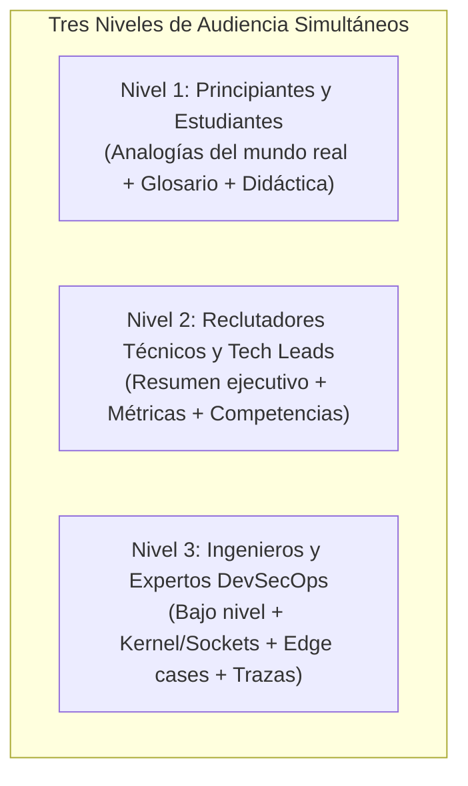

# DoicelaDev - Estándares Editoriales, Pedagogía Multinivel y Reglas de Redacción

Este documento define las directrices editoriales mandatorias para la creación, revisión y publicación de contenidos técnicos en los 8 módulos de **DoicelaDev** (`doiceladev.jorgedoicela.com`).

---

## 1. Filosofía Editorial: Rigor Técnico sin Hype ni Marketing

En toda la plataforma de DoicelaDev rige un principio fundamental: **Ingeniería Sobria y Objetiva**.

### 1.1 Prohibición Estricta de Palabras Marketineras y Superlativos Vacíos
Queda terminantemente prohibido utilizar términos sensacionalistas, publicitarios o de venta vacía, tales como:
* **Prohibido:** *"El mejor"* / *"La mejor"*
* **Prohibido:** *"La solución definitiva"*
* **Prohibido:** *"Increíble"* / *"Asombroso"*
* **Prohibido:** *"Revolucionario"*
* **Prohibido:** *"Mágico"*
* **Prohibido:** *"Perfecto"* / *"Insuperable"*

### 1.2 Enfoque de Reemplazo Profesional
Toda afirmación debe basarse en arquitectura, pruebas y mediciones empíricas:
* En lugar de *"El mejor firewall para servidores"*, escribir: *"Arquitectura de filtrado en espacio de kernel para servidores Linux"*.
* En lugar de *"La solución definitiva al conflicto con Docker"*, escribir: *"Resolución arquitectónica del conflicto de reglas entre Docker y UFW"*.
* En lugar de *"Una herramienta increíble y mágica"*, escribir: *"Utilidad de bajo impacto en memoria (< 5 MB) con ejecución en espacio de kernel"*.

### 1.3 Cero Meta-Etiquetas de Audiencia (No Clasificar Explícitamente al Lector)
* **Regla de Oro Periodística y de Ingeniería:** Un medio o publicación de alta reputación (como *The New York Times*, *IEEE Software*, *Stripe Engineering* o *Cloudflare Blog*) jamás le dice en la cara a su lector: *"este párrafo es para millonarios"* o *"esta sección es para líderes/reclutadores"*.
* **Prohibición de Etiquetas:** Queda terminantemente prohibido incluir encabezados o textos que digan:
  * **Prohibido:** *"Para reclutadores"* / *"Para Tech Leads"*
  * **Prohibido:** *"Para principiantes"* / *"Para estudiantes"*
  * **Prohibido:** *"Para expertos"* / *"Para seniors"*
* **Tratamiento Universal y Elegante:** La pedagogía multinivel es un criterio de **diseño interior** del artículo. Los títulos deben ser sobrios y universales:
  * En lugar de *"Resumen Ejecutivo para Reclutadores"*, titular simplemente: `**Resumen Ejecutivo:**`.
  * En lugar de *"Analogía Intuitiva para Principiantes"*, titular: `## Modelo Conceptual: Anatomía del Perímetro de Red`.
  * En lugar de *"Sección Avanzada para Expertos"*, titular: `## Diagnóstico de Bajo Nivel y Parámetros de Kernel`.
  El lector experimentado apreciará el rigor sin sentirse condescendido, y el lector aprendiz comprenderá los conceptos sin sentirse subestimado.

---

## 2. Arquitectura Pedagógica Multinivel

Toda publicación debe diseñarse con capas de lectura para que **cualquier perfil técnico** obtenga valor inmediato:

### 2.1 Para Principiantes y Estudiantes (Aprender desde Cero)
* **Analogías del Mundo Real:** Abrir con comparaciones cotidianas e intuitivas (ej. el edificio corporativo, la aduana, la central telefónica) antes de entrar en líneas de comando.
* **Glosario de Conceptos Fundamentales:** Definir con precisión y sin asumir saberes previos términos como *Socket, Bind Address, Handshake TCP, Conntrack, Buffer*.
* **El "Por Qué" antes del Código:** Explicar qué hace cada comando y qué problema previene antes de pedirle al usuario que lo ejecute.

### 2.2 Para Reclutadores Técnicos y Hiring Managers (Validar Seniority en 60 Segundos)
* **Resumen Ejecutivo Superior:** Destacar el problema de infraestructura o software resuelto, el enfoque de diseño y el impacto cuantitativo (ej. 0 ms CPU drop, 99.9% de reducción de ruido).
* **Checklist de Competencias Demostradas:** Lista estructurada al final que sintetiza las capacidades técnicas exhibidas en la publicación.

### 2.3 Para Desarrolladores Seniors y Especialistas (Aprender Cosas Nuevas y Avanzadas)
* **Diagnóstico de Bajo Nivel:** Inspección real de sockets (`ss -tlnp`, `lsof`), paquetes de kernel (Netfilter hooks), parámetros del kernel (`sysctl.d`).
* **Resolución de Conflictos y Casos Límite (Edge Cases):** Abordar problemas reales que la documentación oficial suele omitir (ej. bypass de iptables con Docker, soporte Dual-Stack IPv6 descuidado).
* **Auditoría Forense y Verificación:** Tácticas de validación externa (ej. escaneo sigiloso con Nmap, análisis de flags TCP `SYN`, `RST`, estados `filtered`).

---

## 3. Estructura Estándar de una Publicación

Toda publicación en cualquiera de las 8 categorías (`infrastructure`, `tutorials`, `blog`, `news`, `security`, `ai`, `projects`, `forum`) debe estructurarse con la siguiente progresión:

1. **Título Técnico y Subtítulo Descriptivo:** Sin adjetivos grandilocuentes.
2. **Resumen Ejecutivo (Callout `[!IMPORTANT]`):** Problema, arquitectura y métricas de impacto.
3. **Analogía Intuitiva o Marco Conceptual:** Para nivelación didáctica inmediata.
4. **Glosario de Términos:** Tabla de conceptos clave.
5. **Desarrollo Técnico Progresivo:**
   * Diagnóstico inicial.
   * Procedimiento seguro (prevención de incidentes / fallos de configuración).
   * Configuración paso a paso con bloques de código comentados.
   * Resolución de casos de borde y edge cases.
   * Endurecimiento avanzado o buenas prácticas de producción.
6. **Auditoría y Comandos Operativos:** Tablas de referencia rápida de comandos y monitoreo.
7. **Conclusión y Checklist de Validación:** Lista de verificación interactiva (`[x]`).

---

## 4. Bilingüismo Simétrico Obligatorio

* Toda publicación debe redactarse simultáneamente en español (`es`) e inglés (`en`).
* Ambas versiones deben tener la misma calidad gramatical, el mismo rigor técnico y compartir los mismos diagramas Mermaid y tablas de especificaciones.
* Los archivos se preparan en:
  * `frontend/web/src/app/(doiceladev)/entities/<categoria>/drafts/es.<slug>.md`
  * `frontend/web/src/app/(doiceladev)/entities/<categoria>/drafts/en.<slug>.md`
* Y se sincronizan con `backend/src/doiceladev/corpus/<categoria>.json`.

---

## 5. Jerarquía Semántica y Pureza del Cuerpo Markdown (Regla de Oro H1 / DRY)

* **El Título Vive en los Metadatos:** En cumplimiento de la regla de *Fuente Única de Verdad (SSOT)* y estándares W3C/WCAG 2.1 (un único `<h1>` por documento), el título y subtítulo se almacenan exclusivamente en las columnas relacionales `title` y `subtitle` (o `excerpt`/`description`).
* **Cuerpo Markdown Puro (`contentMarkdown`):** Los archivos de borrador `.md` y el campo `contentMarkdown` en el corpus **nunca deben comenzar con `# Título`**, ya que el componente de cabecera de la página (`DoiceladevArticleLayout`) es el dueño canónico del `<h1>`.
* **Estructura de Encabezados Interna:** El cuerpo del artículo debe arrancar directamente con el bloque de introducción o resumen ejecutivo (`> [!IMPORTANT]`), y todas las secciones principales deben emplear exclusivamente nivel 2 (`## Título de Sección`), subsecciones nivel 3 (`### Paso o Concepto`) y sub-bloques nivel 4 (`#### Detalle`).

---

## 6. Estándar Visual de Portadas y Recursos Gráficos

Las imágenes de portada de cada publicación (`coverImage` en `frontend/web/public/doiceladev/images/covers/`) deben respetar la misma sobriedad que el texto escrito:

* **Directriz Maestra (Modelo Infraestructura):** La portada de la guía de firewall Linux (`guia-firewall-linux-ufw.webp`) define el estándar de sobriedad, realismo tangible y ausencia de hype publicitario.
* **Prohibición de Tipografía Publicitaria en la Imagen:** Queda terminantemente prohibido incluir títulos flotantes gigantes en 3D ("MODEL CONTEXT PROTOCOL", "MONOLITO MODULAR", etc.) dentro del arte gráfico. Los títulos, etiquetas y autores son gestionados semánticamente por los componentes web de Next.js en HTML/CSS.
* **Diferenciación Temática con Sujetos Tangibles Únicos:** Cada publicación debe tener su propio encuadre, entorno y sujeto físico representativo de su tema, evitando repetir la misma composición:
  * *IA / Model Context Protocol:* Macrofotografía de procesador neural de silicio sobre placa de circuito con osciloscopio de laboratorio.
  * *Tutoriales / Consola Interactiva:* Monitor sin marcos en escritorio de desarrollo nocturno con consola interactiva y teclado mecánico.
  * *Blog / Monolitos Modulares:* Escultura geométrica de cajas negras modulares en aluminio y cristal ahumado sobre concreto pulido.
  * *Foro / Optimización de RAM VPS:* Módulo de memoria RAM física y disco SSD NVMe sobre grafito cepillado.
  * *Noticias / Next.js 16 & RSC:* Laptop de ingeniería abierta en ángulo con código y diagrama de flujo de datos en pantalla.
  * *Ciberseguridad / Acceso SSH:* Llave física de seguridad criptográfica de titanio y candado industrial de acero endurecido.
  * *Infraestructura / Perímetro Linux:* Servidor rack 1U con escudo perimetral translúcido Netfilter.

---

## 7. Delimitación de Alcance en Servidores Linux e Infraestructura

En el área temática de **Infraestructura y Servidores Linux** (`infrastructure`, `security`, `hardening`), el contenido técnico, los laboratorios, guías paso a paso y producción audiovisual se delimitan de forma estricta y exclusiva a la **Familia Debian y Ubuntu**:

* **Distribuciones Oficiales:**
  * **Ubuntu Server (LTS 22.04 / 24.04)**
  * **Debian GNU/Linux (Stable 12 Bookworm / 13 Trixie)**
* **Justificación de Arquitectura y Mercado:**
  * Representan más del 70% de las instancias desplegadas en nubes públicas (AWS EC2 / Lightsail, GCP, Azure, DigitalOcean, Hetzner).
  * Garantiza consistencia absoluta de comandos, rutas de configuración (`/etc/default/`, `/etc/ufw/`, `/etc/sysctl.d/`), gestión de paquetes (`apt`, repositorios `.deb`) y servicios (`systemd`).
* **Estándar de Seguridad y Firewall:**
  * El firewall perimetral predeterminado es **UFW** (*Uncomplicated Firewall*) operando sobre Netfilter hooks en espacio de kernel.
  * Mitigación de intrusiones mediante `fail2ban` integrado con el backend `systemd`.
* **Prohibición de Dispersión:** No se cubren herramientas o familias dispares (como `firewalld`, `dnf`, `rpm` o `SELinux` de RHEL/CentOS/Rocky), salvo mención contextual mínima si un análisis comparativo lo exigiera. Todo el foco técnico práctico y ejecutable permanece 100% en el stack Debian/Ubuntu.

---

## 8. Manual de Estilo Tipográfico y Editorial Nativo de DoicelaDev

DoicelaDev cuenta con un motor de interfaz enriquecida propio (`MarkdownRenderer.tsx`, `GlossaryTermPopover.tsx`, `glossary-matcher.tsx` y `TableBlock`) que ya aplica estilos automáticos de alto nivel. Para evitar colisiones visuales entre el formato Markdown manual y los componentes interactivos de la plataforma, toda publicación en los 8 módulos debe seguir de forma estricta estas 4 reglas nativas:

1. **Términos del Glosario y Nombres Propios de Tecnologías en Texto Plano:**
   * Los términos registrados en `backend/src/doiceladev/corpus/glossary.json` (`Netfilter`, `UFW`, `DROP`, `REJECT`, `Conntrack`, `Firewall con Estado` / `Stateful Firewall`, `CIDR`, `mTLS`, `eBPF`, `WAL`, `Zero Trust`, `CVE`, `cgroups`, `systemd`, `RAG`, `MCP`, `Idempotencia` / `Idempotence`, `SAPI`, `PHP-FPM`, `Best-Fit Mapping`) y los nombres propios de software en prosa (Linux, Docker, Nginx, PostgreSQL, Debian, Ubuntu) deben escribirse **siempre en texto plano**, sin encerrarlos en backticks ni en negritas.
   * **Por qué:** Al dejarlos en texto plano, `glossary-matcher.tsx` detecta automáticamente su primera aparición y la transforma en un `GlossaryTermPopover` con **subrayado punteado azul uniforme** (`border-b-2 border-dotted border-blue-500/70`), mientras que las apariciones siguientes fluyen limpiamente sin sobrecargar el párrafo.
2. **Código en Línea (`` `...` ``) Exclusivo para Sintaxis de Consola, Rutas y Direcciones:**
   * Reservado estrictamente para comandos ejecutables (`sudo ufw enable`), flags (`-tlnp`), rutas de archivos (`/etc/default/ufw`), variables de configuración (`IPV6=yes`), funciones (`useSpotlight()`) y direcciones IP/puertos (`127.0.0.1:5432`, `0.0.0.0`).
   * **Por qué:** `glossary-matcher.tsx` ignora los nodos `inlineCode` para que la caja gris (`InlineCode`) represente inequívocamente sintaxis técnica de consola y jamás compita con el Glosario Interactivo.
3. **Negrita (`**...**`) Solo Estructural y Métricas Cuantitativas:**
   * Empleada únicamente para el arranque de viñetas (`* **Puertos:** ...`), títulos de Callouts (`**Resumen Ejecutivo:**`) y métricas cuantitativas puntuales (**0 ms de CPU**, **99.9%**, **PHP 8.3.12+**).
   * **Cero negrita ni backticks en la primera columna de tablas (`TableBlock`):** El componente `td` de `MarkdownRenderer.tsx` ya aplica por diseño `first:font-mono first:font-semibold` con fondo diferenciado a toda la primera columna. Escribir `| **Clave** |` o ``| `Clave` |`` es redundante y está prohibido; debe escribirse limpio: `| Clave |`.
   * **Cero negritas dentro de párrafos de prosa:** Dentro de los párrafos normales no se aplican negritas a frases ni conceptos porque el Glosario Interactivo y los Callouts ya cumplen la función de anclaje visual.
4. **Cursiva (`*...*`) Mínima y Puntual:**
   * Reservada solo para anglicismos crudos puntuales en medio de la prosa (*loopback*, *bypass*, *spoofing*, *handshake*) cuando sea estrictamente necesario.

### Tabla de Referencia Rápida: Patrones de Redacción Nativa

| Caso de Uso | Patrón Incorrecto | Estándar Correcto (Nativo DoicelaDev) | Justificación Arquitectónica |
|---|---|---|---|
| **Términos del Glosario (`glossary.json`)** | `` `DROP` ``, `` `Netfilter` ``, `**UFW**`, `**PHP-FPM**` | DROP, Netfilter, UFW, PHP-FPM (texto plano) | Permite que `glossary-matcher.tsx` inyecte el subrayado punteado azul uniforme (`GlossaryTermPopover`) sin chocar con cajas `InlineCode`. |
| **Tecnologías y marcas en prosa** | `` `Docker` ``, `` `Linux` ``, `` `Nginx` `` | Docker, Linux, Nginx (texto plano) | Los nombres propios no son comandos. Solo llevan backticks al invocar el binario (`` `docker run` ``, `` `nginx -t` ``). |
| **Primera columna de tablas (`TableBlock`)** | `\| **Política** \|` o ``\| `Política` \|`` | `\| Política \|` (texto plano) | `MarkdownRenderer.tsx` ya estiliza automáticamente `td:first-child` con `font-mono font-semibold`. |
| **Párrafos de prosa técnica** | Párrafos llenos de `**conceptos en negrita**` y `` `cajas` `` | Prosa limpia + Glosario Interactivo + Callouts | Evita que el párrafo compita visualmente con los 6 componentes ricos de la página (Callouts, Glosario, Mermaid, CodeBlock, TableBlock, Checklists). |
| **Encabezados de listas didácticas** | `* **Los Puertos (Ports):** Son...` | `* **Puertos:** Puertas numeradas...` | Síntesis directa en el arranque de viñeta sin artículos gramaticales innecesarios. |
