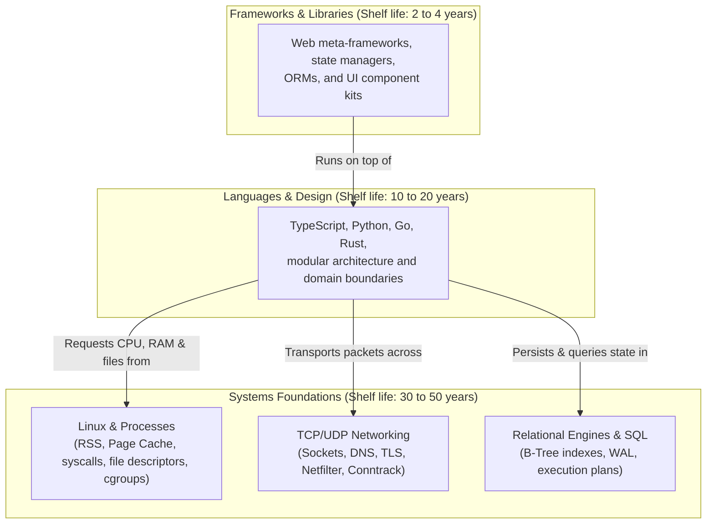
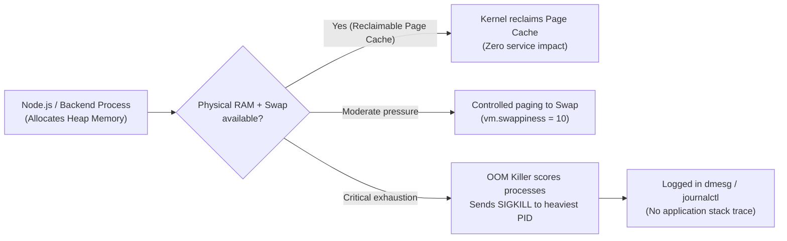
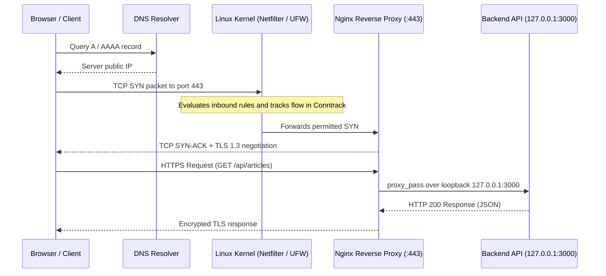
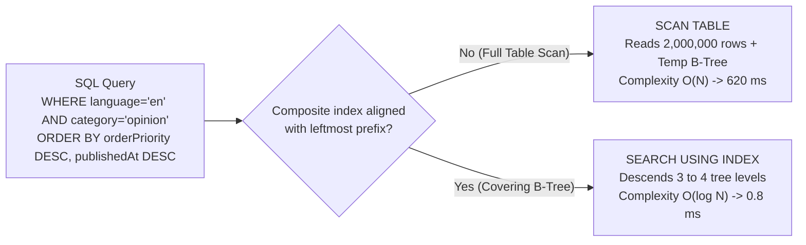
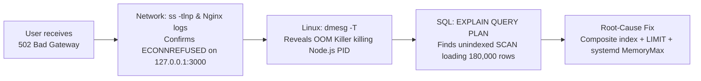

> [!IMPORTANT]
> **Executive Summary:**  
> During my early years building software, I poured almost all of my energy into chasing the latest web framework or ORM. The turning point arrived when operating real production platforms with concurrent traffic, WebSockets, and databases inside a **1 GB RAM** server: when a deployment breaks at two in the morning, high-level abstractions cannot explain a `502 Bad Gateway`, a process silently terminated by the kernel OOM Killer, or an SQL query jumping from **2 ms** to **6.2 s**. Mastering the three long-lived foundations—Linux, TCP/UDP networking, and relational SQL engines—cut my production incident diagnostics from hours of blind restarts down to under **5 minutes** of deterministic inspection, regardless of the language or framework in use.

---

## Why I Am Writing This From Production

If you had asked me a few years ago what I needed to study to grow as a software engineer, I would have recited a checklist of trending libraries. Every semester brought a new meta-framework, a state manager promising zero boilerplate, or an ORM designed so you would never have to write raw SQL again.

I followed that path for a long time, until I had to keep real systems running in production without the safety net of endlessly throwing larger hardware at every problem. The moment a user reports that the application will not load, the reverse proxy returns `502 Bad Gateway`, and your application logs are completely empty, an uncomfortable truth sets in: libraries turn over every two or three years, while the operating system, the TCP/IP stack, and the database query planner have governed everything built on top of them for decades.

Modern abstractions are not the enemy. The problem starts when we mistake knowing a framework's syntax for understanding the machine running beneath it. When everything runs locally against fifty seed rows, any abstraction feels sufficient. When real traffic hits disk I/O, exhausts network file descriptors, or competes for physical memory on a resource-constrained Debian server, leaky abstractions expose exactly which layer you never learned.

---

## Conceptual Model: The Building and the Knowledge Shelf-Life Pyramid

Before opening a terminal or inspecting query plans, it helps to visualize how the layers of any modern application fit together through a real-world analogy. Picture a twenty-story office building:

* **Frameworks and libraries:** They are the interior decor, desks, and lobby furniture. They get refreshed every few years to match new styles and make daily work faster and more comfortable.
* **Linux and the operating system:** They are the reinforced concrete, power grid, and elevators. If a breaker trips or the elevators stall, it does not matter how modern the lobby looks—nobody can get work done.
* **TCP/UDP networking:** They are the access roads, security gate, and phone lines. They decide whether a visitor reaches the right door, gets turned away at reception, or is silently dropped at the perimeter.
* **Databases and SQL:** They are the central records room. You can stack ten thousand folders in unlabeled boxes and scan them one by one on every request, or maintain an alphabetical index that leads straight to the exact file in three steps.

Engineering knowledge does not depreciate evenly across layers. Pouring all of your time into the top layer locks you into a permanent reset cycle every few years; mastering the foundations makes every new framework transparent because you immediately recognize the underlying OS, network, or database primitive it wraps.



---

## Glossary of Core Concepts

So anyone can follow the low-level diagnostics without hidden prerequisites, these are the core terms used in the terminal examples and production configurations below:

| Concept | Technical Meaning | Why It Matters in Production |
|---|---|---|
| PID | Unique numeric identifier assigned by the kernel to each running process. | Lets you inspect the exact memory footprint, CPU usage, and open sockets belonging to a specific service. |
| RSS (Resident Set Size) | Actual physical RAM currently occupied by a process. | The metric the kernel tracks when evaluating memory pressure on the host. |
| Page Cache | Spare physical RAM that Linux borrows to cache frequently read disk blocks. | Makes `free -m` look nearly full even on healthy servers; the kernel reclaims it immediately when an app needs RAM. |
| Load Average | Average number of processes running or waiting on CPU or disk over **1**, **5**, and **15** minutes. | Reveals CPU saturation or disk I/O bottlenecks (`iowait`) when compared against core count (`nproc`). |
| File Descriptor (FD) | Integer handle representing an open file, pipe, or network socket in Unix/Linux. | Leaking unclosed connections exhausts `LimitNOFILE` and halts incoming traffic with `EMFILE`. |
| Socket | Network communication endpoint defined by an IP address, protocol (TCP/UDP), and port. | Knowing whether a socket binds to `127.0.0.1` versus `0.0.0.0` determines if a service is private or exposed to the Internet. |
| TCP Handshake | Initial three-way negotiation (`SYN`, `SYN-ACK`, `ACK`) before HTTP data flows. | If the first step fails, the fault lies in networking or firewall rules, never in your API controller. |
| Loopback (`127.0.0.1`) | Internal virtual network interface restricted strictly to traffic inside the same host. | Allows Nginx to reach your local backend without exposing port `3000` externally. |
| SYN Backlog | Kernel queue holding incoming TCP connections while the process calls `accept()`. | If it overflows under traffic bursts, clients experience **1 s** to **3 s** retransmission stalls. |
| B-Tree Index | Balanced sorted tree structure that locates records in logarithmic time (**O(log N)**). | Prevents the database engine from scanning millions of rows sequentially (**O(N)**) on every HTTP request. |
| Leftmost Prefix Rule | Composite index property requiring queries to match leading columns from left to right. | An index on `(a, b, c)` accelerates `WHERE a = ? AND b = ?`, but does not accelerate `WHERE b = ?` alone. |
| Execution Plan | Internal strategy chosen by the SQL planner to resolve a query (`SCAN` versus `SEARCH`). | Reveals in milliseconds whether an ORM emitted an indexed lookup or a silent bottleneck. |

---

## Pillar 1: Linux — Your Code Does Not Run in a Vacuum

To an application developer, a backend is a clean tree of controllers, services, and components. To the Linux kernel, all of it is simply a process with a `PID`, a resident memory footprint (`RSS`), a cgroups slice, and a table of open file descriptors.

In my early deployments, whenever a service stopped responding behind Nginx, my instinct was to restart the process manager or wrap more code in `try-catch`. It bought a few hours until the next crash. Moving past patches started the day I began reading what the operating system itself was reporting before touching application code.

### The illusion of free memory and the OOM Killer

One of the most common mistakes when managing Debian or Ubuntu servers is running `free -m`, seeing only **40 MB** under the `free` column, and assuming the server is about to crash. Linux treats unused RAM as wasted RAM: it uses spare memory as *page cache* to speed up disk reads and releases it immediately whenever an application requests memory.

What actually matters is the `available` column, swap activity (`si`/`so` in `vmstat`), and whether the kernel OOM Killer (*Out-Of-Memory Killer*) silently terminated your process with `SIGKILL`—a signal no `try-catch` block in JavaScript, Python, or Go can ever catch.



### Memory and descriptor diagnostics in 30 seconds

When a service vanishes without leaving a single error in application logs, these four commands uncover the root cause before you open your editor:

```bash
# 1. Check real available memory ('available' column) and swap usage
free -m

# 2. Confirm whether the kernel OOM Killer terminated a process
sudo dmesg -T | grep -i -E "oom|killed process|out of memory"

# 3. List the top 10 processes by resident physical memory (RSS)
ps -eo pid,ppid,cmd,%mem,rss --sort=-rss | head -n 11

# 4. Watch swap-in / swap-out pressure (sustained 'si'/'so' > 0 indicates thrashing)
vmstat 1 5
```

When the OOM Killer intervenes, it leaves an unmistakable signature in the kernel ring buffer. Recognizing this output on sight saves hours of debugging in the wrong layer:

```text
[Tue Nov 18 02:14:09 2026] oom-kill:constraint=CONSTRAINT_NONE,nodemask=(null),cpuset=/,mems_allowed=0,global_oom,task_memcg=/system.slice/pm2-admin.service,task=node,pid=18422,uid=1000
[Tue Nov 18 02:14:09 2026] Out of memory: Killed process 18422 (node) total-vm:1348120kB, anon-rss:412840kB, file-rss:0kB, shmem-rss:0kB, UID:1000 pgtables:1488kB oom_score_adj:0
```

The key field is `anon-rss:412840kB`: it confirms the Node.js process anonymous heap exceeded **403 MB** of non-reclaimable physical RAM until the host ran out of headroom. If you also suspect memory leaks or file descriptor exhaustion (`EMFILE: too many open files`), the `/proc` virtual filesystem gives you direct kernel visibility with zero extra packages:

```bash
# Replace <PID> with your backend's actual process ID
# 1. Exact breakdown of private, shared, and swapped memory for the process
cat /proc/<PID>/smaps_rollup

# 2. Count how many descriptors (files + sockets) are currently open
ls /proc/<PID>/fd | wc -l

# 3. Compare against the active ceiling for that specific process
grep -i "open files" /proc/<PID>/limits

# 4. Trace live network and file system calls directly from the kernel
sudo strace -f -e trace=network,openat -p <PID>
```

> [!WARNING]
> **Production edge case under systemd and containers:** Raising `ulimit -n` inside an interactive SSH shell does not change the limit of your production daemon. A service managed by systemd inherits its ceilings exclusively from its unit file (`/etc/systemd/system/my-app.service`) and cgroups v2 directives (`MemoryHigh`, `MemoryMax`, `TasksMax`, and `LimitNOFILE`).

```ini
# /etc/systemd/system/backend-api.service — Clean cgroups v2 containment
[Service]
LimitNOFILE=65536
MemoryHigh=384M
MemoryMax=450M
TasksMax=256
OOMPolicy=continue
Restart=on-failure
RestartSec=3
```

### CPU, Load Average, and the invisible I/O bottleneck (`iowait`)

Another diagnostic skill rarely taught by framework tutorials is explaining why an API takes **4 seconds** per request while the dashboard reports only **15% CPU usage**. On Linux, the `load average` printed by `uptime` does not measure CPU alone: it counts runnable processes (`R`) plus processes in uninterruptible sleep (`D`), typically blocked waiting on disk I/O.

If a **1-core** server (`nproc = 1`) reports a `load average` of **4.50** while user CPU (`us`) in `vmstat` stays low and `wa` (`iowait`) climbs above **40%**, adding more Node.js workers or rewriting the service in another language will fix nothing: the bottleneck lives in storage throughput, swap paging, or unbatched synchronous disk writes.

```bash
# 1. Compare available CPU cores against current load averages
nproc && uptime

# 2. Measure real disk utilization and average I/O wait latency (requires sysstat)
iostat -xz 1 3

# 3. Inspect processes stuck in 'D' state (uninterruptible disk I/O wait)
ps -eo pid,stat,wchan:24,cmd | awk '$2 ~ /D/'
```

In single-threaded Node.js runtimes, the opposite failure mode also occurs: a heavy synchronous operation (serializing a **30 MB** JSON payload, a catastrophic regex, or synchronous compression) pins one core at **100%** and starves the event loop. Even with plenty of free RAM, incoming requests queue inside the kernel socket buffer until Nginx aborts with a timeout. Identifying whether the stall is `us` (user-space CPU), `sy` (excessive kernel syscalls), or `wa` (disk wait) points to the right fix in under a minute.

---

## Pillar 2: TCP/UDP Networking — Tracing the Full Packet Journey

Few sentences waste more engineering hours than *"it works on my machine, but hangs on the server."* Without a clear mental model of a packet's actual path, you end up toggling random environment variables hoping luck restores the deployment.

Before your HTTP route reads a single JSON byte, that request traversed DNS resolution, a three-way TCP *handshake*, TLS negotiation, UFW rules inside Netfilter in the kernel, the Conntrack state table, and a local *loopback* socket on `127.0.0.1`.



### Distinguishing immediate rejection from silent timeout

Knowing how to tell these two failures apart saves hours of guesswork:

* **Connection Refused (`ECONNREFUSED`):** Your packet reached the target host and passed the firewall, but no process was listening on that IP and port combination. The kernel replied with an immediate `TCP RST` (or an explicit REJECT rule). Almost always, the service crashed on startup or bound only to `127.0.0.1` while you tried connecting from another container or external interface.
* **Silent Timeout:** The packet left your machine, yet not even a rejection came back. Almost always, a firewall applied a silent DROP policy in Netfilter, a cloud security group blocked the port, or the return route is missing.

### Inspecting live sockets, TCP states, and per-phase latency

These commands let you test each network segment independently and deterministically:

```bash
# 1. List all listening TCP/UDP sockets, bound IP addresses, and owning PIDs
sudo ss -tlnp

# 2. Detect buildup of TIME-WAIT or CLOSE-WAIT connections
ss -tan | awk '{print $1}' | sort | uniq -c | sort -rn

# 3. Measure exact latency per phase (DNS, TCP, TLS, and Time to First Byte)
curl -o /dev/null -s -w "dns=%{time_namelookup}s tcp=%{time_connect}s tls=%{time_appconnect}s ttfb=%{time_starttransfer}s total=%{time_total}s\n" https://doiceladev.jorgedoicela.com

# 4. Capture live packets on the backend loopback port to confirm traffic arrival
sudo tcpdump -ni lo port 3000 -nn -c 20
```

Pay close attention to the second command (`ss -tan`). A moderate count of `TIME-WAIT` sockets is normal on hosts serving short-lived connections (the kernel holds them for **60 seconds** so delayed packets cannot corrupt a reused port). By contrast, a steadily growing count of `CLOSE-WAIT` sockets signals a bug inside your application: the remote peer already closed the connection with `FIN`, the kernel notified your process, yet your code never closed the socket or released the descriptor. Over hours, leaked `CLOSE-WAIT` handles exhaust the descriptor table and bring the service down.

### Listen queues, `keepalive`, and the Nginx reverse proxy edge case

A very common oversight when deploying Nginx in front of NestJS or Next.js is leaving `proxy_pass` on its default HTTP/1.0 behavior. Without `proxy_http_version 1.1` and `keepalive`, Nginx opens and tears down a brand-new TCP connection to `127.0.0.1:3000` on every single incoming request. Under sustained traffic, this burns through local ephemeral ports, fills the `TIME-WAIT` table, and adds avoidable internal handshake latency.

```nginx
# /etc/nginx/sites-available/jorgedoicela.com — Persistent upstream with keepalive
upstream backend_nest {
    server 127.0.0.1:3000 max_fails=3 fail_timeout=10s;
    keepalive 32;
}

server {
    listen 443 ssl http2;
    server_name api.jorgedoicela.com;

    location / {
        proxy_pass http://backend_nest;
        proxy_http_version 1.1;
        proxy_set_header Connection "";
        proxy_set_header Host $host;
        proxy_set_header X-Forwarded-For $proxy_add_x_forwarded_for;
        proxy_connect_timeout 5s;
        proxy_read_timeout 30s;
    }
}
```

> [!NOTE]
> **Why `127.0.0.1` versus `0.0.0.0` is a security boundary, not a cosmetic choice:** Binding an internal database or backend to `0.0.0.0` instructs the kernel to accept connections on every network interface, including the public IP. Binding strictly to `127.0.0.1` guarantees at the socket layer that no external actor can reach the service directly, even if a future UFW or Docker rule misconfigures the perimeter. When the edge also enforces mTLS between Cloudflare and Nginx, origin identity is cryptographically verified before traffic ever reaches *loopback*.

Understanding TCP versus UDP and parameters like MTU at this level also clarifies why modern protocols such as HTTP/3 (QUIC) and WireGuard choose UDP: they eliminate *Head-of-Line Blocking* during packet loss on mobile networks, avoid silent fragmentation by sizing payloads to the tunnel, and establish encrypted sessions with lower per-connection state *overhead* on the server.

---

## Pillar 3: SQL and Relational Engines — The Bottleneck No ORM Fixes

Modern ORMs make shipping early features fast. The bill arrives months later, when a table of articles, events, or users grows from **200 test rows** to **2,000,000 records**. At that point, a harmless-looking query translated into `SELECT ... ORDER BY ... OFFSET 50000` starts saturating CPU and disk I/O.

No framework upgrade or ad-hoc cache fixes a missing index. The root-cause solution is reading the engine's actual execution plan and designing B-Tree indexes aligned with your read patterns.

### How a composite index works and the leftmost prefix rule

A recurring mistake is adding single-column indexes everywhere and expecting the planner to combine them automatically. In a composite B-Tree index `(language, category, orderPriority DESC, publishedAt DESC)`, keys are sorted hierarchically from left to right—just like a directory sorted by `(last_name, first_name)`. You can look up by `last_name` or by `(last_name, first_name)` in a few logarithmic hops, but searching by `first_name` alone cannot use that order and forces a full scan.



### Why `OFFSET` degrades linearly and how Keyset Pagination fixes it

When you run `OFFSET 50000 LIMIT 20`, the engine does not magically jump to row 50,001: it must locate, sort, and discard **50,000 rows** before returning **20**. Its cost grows linearly (**O(N)**). Replacing it with *keyset pagination* (cursor-based pagination) backed by a composite index—equality columns first, sort columns second—makes page 5,000 execute in the exact same time as page 1 (**O(log N)**).

```sql
-- 1. Composite covering index: equality columns first (language, category), sort columns second
CREATE INDEX IDX_articles_feed_cover
ON articles (language, category, orderPriority DESC, publishedAt DESC, id DESC);

-- 2. Inspect the actual SQLite query plan before deploying
EXPLAIN QUERY PLAN
SELECT id, slug, title, publishedAt
FROM articles
WHERE language = 'en'
  AND category = 'opinion'
  AND (
    orderPriority < 80
    OR (orderPriority = 80 AND publishedAt < '2026-10-18T00:00:00.000Z')
  )
ORDER BY orderPriority DESC, publishedAt DESC, id DESC
LIMIT 20;
```

Running `EXPLAIN QUERY PLAN` in SQLite immediately exposes whether a query will hold steady under growth or degrade:

```text
-- Degraded plan (no aligned composite index):
|--SCAN articles
`--USE TEMP B-TREE FOR ORDER BY

-- Optimized plan (composite covering index):
`--SEARCH articles USING INDEX IDX_articles_feed_cover (language=? AND category=?)
```

In PostgreSQL, the equivalent command that reports actual timings, filtered rows, and shared buffer cache hits versus disk reads is:

```sql
-- PostgreSQL: measure actual execution time and shared buffer hits vs. disk reads
EXPLAIN (ANALYZE, BUFFERS)
SELECT id, slug, title, published_at
FROM articles
WHERE language = 'en'
  AND category = 'opinion'
ORDER BY order_priority DESC, published_at DESC
LIMIT 20;
```

### Real SQLite concurrency and production pragmas

Another widespread misconception is that SQLite cannot serve concurrent web workloads. In classic rollback journal mode, writes block readers. However, enabling WAL (`PRAGMA journal_mode = WAL;`) alongside explicit durability and memory settings lets SQLite serve concurrent reads under **1 ms** within a **~20 MB** RAM footprint:

```sql
-- Production SQLite pragmas for a 1 GB RAM VPS
PRAGMA journal_mode = WAL;
PRAGMA foreign_keys = ON;
PRAGMA synchronous = NORMAL;
PRAGMA busy_timeout = 5000;
PRAGMA cache_size = -20000;
PRAGMA journal_size_limit = 67108864;
PRAGMA temp_store = MEMORY;
```

Every directive serves a verifiable purpose: `synchronous = NORMAL` cuts synchronous disk flushes by roughly **80%** while preserving WAL durability, `busy_timeout = 5000` prevents `SQLITE_BUSY` errors during brief write bursts, `cache_size = -20000` allocates a **20 MB** page cache in RAM, and `journal_size_limit` caps the `.sqlite-wal` file at **64 MB** to protect server disk space.

### Atomic transactions, Idempotence, and the ORM N+1 trap

Most performance regressions in ORM-backed APIs stem from the same antipattern: loading a parent list and then querying a child relation inside a loop. Fetching **50 articles** and loading tags one by one fires **51 database round-trips** inside a single HTTP request:

```typescript
// N+1 pattern (51 queries per HTTP request)
const posts = await postRepo.find({ where: { language: 'en' }, take: 50 });
for (const post of posts) {
  post.tags = await tagRepo.find({ where: { contentId: post.id } });
}

// Batched pattern (2 fixed queries whether there are 50 or 500 rows)
const posts = await postRepo.find({ where: { language: 'en' }, take: 50 });
const postIds = posts.map((post) => post.id);
const allTags = await tagRepo.find({ where: { contentId: In(postIds) } });
```

Similarly, whenever an endpoint mutates multiple tables (such as inserting a forum reply and incrementing `repliesCount`), running two standalone statements without a transaction leaves corrupted counts if the second query fails or if a client retries. Wrapping mutations inside an atomic transaction backed by `UNIQUE` constraints and Idempotence keys keeps state consistent even under concurrent network retries.

> [!TIP]
> **Rule of thumb before adding Redis or resizing servers:** Inspect `EXPLAIN QUERY PLAN` or `EXPLAIN (ANALYZE, BUFFERS)` on your top five endpoints. In most web applications, fixing one missing composite index or an N+1 loop drops latency from **800 ms** to **< 5 ms** at **0 USD** extra infrastructure cost.

---

## Anatomy of a Real Incident: From `502 Bad Gateway` to Root Cause in 4 Minutes

To see how all three pillars interlock in practice, walk through a real failure pattern on a **1 GB RAM** Debian server running Nginx in front of a Node.js API backed by a relational database. The user-visible symptom is singular: the site returns `502 Bad Gateway` intermittently under moderate traffic.



Instead of blindly restarting PM2, deterministic triage moves layer by layer:

1. **Minute 1 — Network Layer (Nginx and sockets):** `sudo tail -n 20 /var/log/nginx/error.log` reports `connect() failed (111: Connection refused) while connecting to upstream, upstream: "http://127.0.0.1:3000/api/feed"`. Immediately after, `sudo ss -tlnp | grep 3000` confirms the port is momentarily down while the process manager restarts the worker. Firewall and DNS are ruled out in seconds.
2. **Minute 2 — Operating System Layer (Linux):** `sudo dmesg -T | grep -i oom` prints `Out of memory: Killed process (node) anon-rss:448210kB`. The process did not crash from an uncaught exception; the kernel terminated it because heap usage spiked under concurrency.
3. **Minute 3 — Data Layer (SQL):** Correlating the timestamp with Nginx access logs points to `/api/feed?tag=linux`. The ORM code ran an unbounded `findAll()` and filtered results in JavaScript memory after triggering a full `SCAN` of **180,000 rows** including full `contentMarkdown` columns on every concurrent request. Ten simultaneous requests duplicated those payloads in the V8 heap and tripped the OOM Killer.
4. **Minute 4 — Root-cause fix:** Replace in-memory filtering with explicit column projection (omitting `contentMarkdown` in list queries), a composite index on `(language, orderPriority DESC, publishedAt DESC)`, and SQL-level pagination. Per-request heap drops from **42 MB** to **< 200 KB**, and latency falls from **1,400 ms** to **1.8 ms**.

Staying exclusively inside the framework layer would have led to resizing the VPS or slapping a short-lived cache over an intact structural bug.

---

## Diagnostic Matrix: Common Patch Versus Root Cause

This table summarizes the nine production incidents I have seen repeat most often and how troubleshooting shifts once you inspect one layer down:

| Observable Symptom | Common Reaction (Patch) | Root-Cause Diagnosis via Foundations |
|---|---|---|
| Nginx 502 Bad Gateway | Blindly restart PM2 or Docker until it recovers. | `ss -tlnp` verifies if the backend listens on `127.0.0.1:3000`; `journalctl -u nginx -n 30` distinguishes `Connection refused` from upstream timeout. |
| Process vanishes without logs | Sprinkle more `console.log` calls in HTTP routes. | `dmesg -T` reveals `Out of memory: Killed process`: the kernel OOM Killer sent `SIGKILL`. |
| EMFILE: too many open files | Upgrade VPS specs without investigating. | `ls /proc/<PID>/fd \| wc -l` exposes unclosed socket leaks (`CLOSE-WAIT`) or an undersized `LimitNOFILE` in systemd. |
| Silent connection timeout | Open random ports or disable the firewall. | A `SYN` discarded via DROP in Netfilter/UFW produces silence; `tcpdump` and `ufw status verbose` pinpoint the exact rule. |
| Slow pagination past page 50 | Slap a short-TTL cache in front of the endpoint. | `EXPLAIN` reveals linear `OFFSET` or `SCAN TABLE`; a composite index + *keyset pagination* holds latency at **< 1 ms**. |
| SQLITE_BUSY under traffic | Rewrite the entire data layer to another database. | Enabling WAL, setting `busy_timeout = 5000`, and batching writes in atomic transactions resolves lock contention. |
| High latency with low CPU usage | Add more backend replicas. | `vmstat 1` and `iostat -xz 1` expose swap *thrashing* (`si`/`so`) or high `iowait`; `curl -w` isolates slow DNS/TLS phases. |
| Local ephemeral port exhaustion | Restart Nginx nightly via cron. | `ss -tan` reveals thousands of `TIME-WAIT` sockets to `127.0.0.1`; enabling `proxy_http_version 1.1` and `keepalive` reuses connections. |
| Slow endpoints loading relations | Increase container memory limits. | SQL logging exposes an N+1 loop (**51 queries** per view); batching with `JOIN` or `IN (...)` cuts it to **2 queries**. |

---

## Incident Operations Reference Sheet

When an incident hits a Debian or Ubuntu server, following a disciplined top-to-bottom sequence eliminates guesswork:

| Layer | Inspection Command | What It Proves |
|---|---|---|
| Memory | `free -m && vmstat 1 3` | Real available RAM (`available`) and absence of aggressive swap paging (`si`/`so`). |
| CPU & I/O | `nproc && uptime && iostat -xz 1 3` | True core saturation versus disk wait bottlenecks (`iowait`). |
| Kernel | `sudo dmesg -T \| tail -n 30` | OOM Killer terminations, storage I/O errors, or kernel packet drops. |
| Processes | `ps -eo pid,cmd,%cpu,%mem,rss --sort=-rss \| head -n 10` | Which PID holds physical RAM (`RSS`) and which saturates CPU. |
| Descriptors | `ls /proc/<PID>/fd \| wc -l && grep "open files" /proc/<PID>/limits` | Current open files/sockets versus the active ceiling for that PID. |
| Sockets | `sudo ss -tlnp && ss -tan \| awk '{print $1}' \| sort \| uniq -c` | Listening interfaces (`127.0.0.1` vs `0.0.0.0`) and `CLOSE-WAIT`/`TIME-WAIT` accumulation. |
| Traffic | `sudo tcpdump -ni any port 443 -nn -c 20` | Whether packets physically enter and leave the server's network interface. |
| SQLite | `sqlite3 db.sqlite "EXPLAIN QUERY PLAN SELECT ..."` | Whether the query uses a B-Tree index (`SEARCH`) or scans the entire table (`SCAN`). |

---

## Using Frameworks as Force Multipliers, Not Crutches

Respecting foundations does not mean rejecting modern tools or rewriting HTTP servers in C for every project. I use Next.js, NestJS, and TypeScript daily because they accelerate delivery, enforce clean boundaries, and eliminate repetitive mistakes.

The difference lies in your relationship with the abstraction. When you use an ORM while inspecting the SQL and query plan it generates, deploy behind Nginx while knowing how to audit sockets with `ss -tlnp` and configure `keepalive`, and manage systemd services understanding `RSS`, `iowait`, cgroups, and file descriptors, the framework stops being an opaque black box and becomes a genuine engineering multiplier.

Five or ten years from now, many of the library names dominating headlines today will be gone. Yet you will still be opening Linux terminals, tracing TCP/UDP packets, and designing SQL indexes to solve the problems that actually keep production systems alive.

### Operational Foundations Verification Checklist

- [x] Check real available memory (`available` in `free -m`), `iowait` (`iostat -xz`), and kernel OOM logs (`dmesg -T`) before restarting failing services.
- [x] Verify file descriptor limits (`LimitNOFILE`) and cgroups v2 memory bounds inside systemd unit files.
- [x] Confirm with `ss -tlnp` that internal services bind strictly to `127.0.0.1` rather than `0.0.0.0` without perimeter controls.
- [x] Configure `proxy_http_version 1.1` and `keepalive` in Nginx to prevent `TIME-WAIT` storms against local *loopback*.
- [x] Distinguish in seconds between `ECONNREFUSED` (`TCP RST`) and silent timeout (DROP in Netfilter/UFW) using `ss` and `tcpdump`.
- [x] Audit critical queries with `EXPLAIN QUERY PLAN` or `EXPLAIN (ANALYZE, BUFFERS)`, verifying leftmost-prefix composite indexes and zero `SCAN TABLE`.
- [x] Replace deep `OFFSET` with *keyset pagination*, enable WAL mode in SQLite, and eliminate N+1 queries before scaling hardware.
