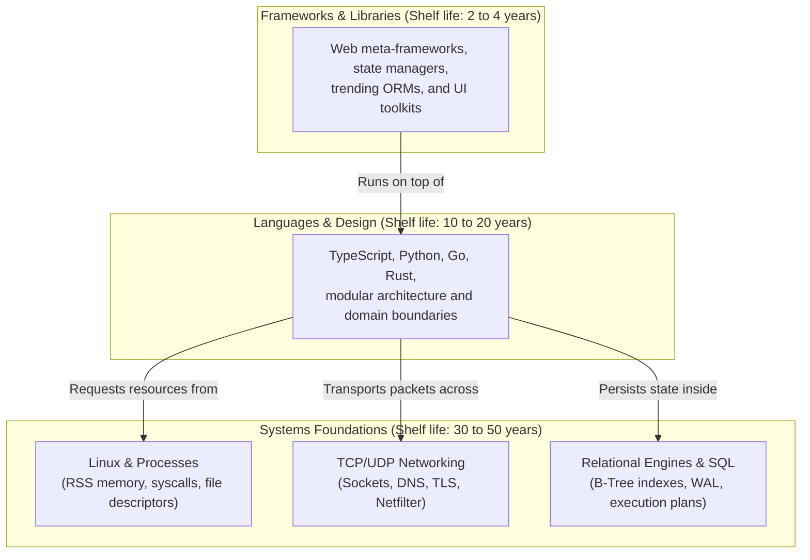

A few years ago, if you had asked me what I needed to master to grow as a developer, my answer would have been a checklist of trending libraries. Every semester brought a new meta-framework, an ORM promising to hide SQL forever, or a wrapper claiming to abstract infrastructure away completely.

The wake-up call arrives the day you ship a real system with real users and tight hardware—in my case, running multiple web platforms, WebSockets, and SQLite databases inside a single **1 GB RAM** server—and something breaks at two in the morning. That is when an uncomfortable truth hits: the framework you spent months memorizing cannot explain why Nginx returns `502 Bad Gateway`, why your backend process vanished with zero log output, or why a query taking **3 ms** on your laptop suddenly stalls the API for **6 seconds**.

---

## The Shelf-Life Pyramid of Engineering Knowledge

Over time I realized that software engineering knowledge does not depreciate at a uniform rate. Some layers expire before you finish mastering them, while others compound across your entire career:



When you pour nearly all your energy into the top layer, you stay trapped in a permanent loop of starting over every two or three years. When you understand the foundations underneath, every new framework becomes trivial: instead of memorizing recipes, you immediately recognize which abstraction it builds over sockets, processes, or SQL queries.

> Every hour invested in understanding how Linux allocates memory, how a TCP connection negotiates state, or how your database traverses a B-Tree index multiplies across every language you will touch over the next twenty years.

---

## The Day I Learned Restarting the Server Is Not Debugging

In my early projects, whenever a service stopped responding behind Nginx, my instinct matched almost everyone else's: restart the process manager, bump the timeout, or wrap more blocks in `try-catch`. It bought a few hours until the next crash.

Moving past quick patches started the day I stopped looking solely at application code and started reading what the operating system was reporting. Nearly every mysterious production failure has a straightforward explanation one layer down:

| Browser Symptom | What I Used to Do (Patch) | What Foundations Reveal |
|---|---|---|
| 502 Bad Gateway | Blindly restart the process manager. | `ss -tlnp` immediately reveals whether the backend is listening on `127.0.0.1:3000` or crashed on boot. |
| Process vanishes without logs | Add more `console.log` calls inside HTTP routes. | `dmesg -T` exposes `Out of memory: Killed process`: the kernel OOM Killer terminated it with `SIGKILL`. |
| Too many open files error | Upgrade server specs without knowing why. | In Unix every socket is a file; connection leaks exhausted the descriptor limit (`ulimit -n`). |
| Silent connection timeout | Randomly swap ports or open the whole firewall. | A `SYN` packet silently discarded via DROP by UFW/Netfilter produces silence, not `ECONNREFUSED`. |

---

## Linux: Your Code Does Not Run in a Vacuum

To us, an application is an organized tree of controllers, services, and UI components. To the Linux kernel, all of it is simply a process with a `PID`, a resident memory footprint (`RSS`), and a table of open file descriptors.

One of the most practical lessons from operating low-memory nodes was unlearning how to misread `free -m`. At first glance it looks alarming when free RAM reads near zero—until you understand that Linux uses spare memory as a disk page cache and reclaims it instantly whenever a process needs RAM. What actually matters is the `available` column and whether the kernel is swapping pages to disk (`si`/`so` in `vmstat`):

```bash
# Three commands that tell the truth about server health in 2 seconds
free -m
sudo dmesg -T | grep -i -E "oom|killed process"
ps -eo pid,cmd,%mem,rss --sort=-rss | head -n 10
```

With those three lines, you know in seconds whether an outage came from an application bug or from the kernel protecting the host by killing the heaviest consumer.

---

## Networking: Tracing the Full Packet Journey

Few bugs waste more hours than *"it works on my machine, but hangs on the server."* Without a clear mental model of a packet's actual path, you end up flipping random framework flags hoping luck fixes it.

In reality, before your backend reads a single JSON byte, that request traversed DNS resolution, a three-way TCP handshake, TLS negotiation, UFW rules inside Netfilter, and a local loopback socket on `127.0.0.1`. Knowing how to tell two basic failures apart saves hours of guesswork:

* **Connection Refused (`ECONNREFUSED`):** Your packet reached the target host, but no process was listening on that port, so the kernel returned an immediate `TCP RST`. Either the service failed to start or it bound to a different IP (such as `127.0.0.1` when another container tries to connect).
* **Silent Timeout:** The packet left your machine, yet not even a rejection came back. Almost always, an intermediate firewall applied a silent DROP or the return route is missing.

This also transforms how you secure deployments. An internal service or database bound to `0.0.0.0` is reachable on every network interface; binding it strictly to `127.0.0.1` guarantees at the socket level that no external actor can touch it directly, even if a firewall rule is later misconfigured.

> [!NOTE]
> Understanding TCP versus UDP at this depth also clarifies why modern protocols such as HTTP/3 (QUIC) and WireGuard choose UDP: they eliminate Head-of-Line Blocking and complete handshakes in a single round-trip without carrying heavy per-connection kernel state.

---

## SQL: The Bottleneck No ORM Fixes for You

Modern ORMs make shipping early features fast. The bill arrives months later, when a table of articles, users, or logs grows from a hundred test rows to several million. At that scale, a harmless-looking query translated into `SELECT ... ORDER BY ... OFFSET 5000` starts saturating CPU and disk I/O.

You rarely need a new database engine or a complex distributed cache to fix this; most of the time, reading the actual execution plan (`EXPLAIN QUERY PLAN` in SQLite or `EXPLAIN ANALYZE` in PostgreSQL) and designing a proper B-Tree index solves it at the root:

```sql
-- Without a composite index, the engine scans the entire table (SCAN) and sorts in memory
-- With an index putting equality columns first and sort columns second, latency drops below 1 ms
CREATE INDEX IDX_articles_feed
ON articles (language, category, orderPriority DESC, publishedAt DESC);

SELECT id, slug, title, publishedAt
FROM articles
WHERE language = 'en'
  AND category = 'opinion'
  AND (orderPriority < 80 OR (orderPriority = 80 AND publishedAt < '2026-10-18T00:00:00Z'))
ORDER BY orderPriority DESC, publishedAt DESC
LIMIT 20;
```

Replacing `OFFSET` with Keyset Pagination backed by a composite B-Tree index makes page 500 execute in the exact same time as page 1. Understanding why SQLite in WAL mode handles concurrent reads without blocking writes, or spotting a poorly ordered index, yields more real performance than any cosmetic frontend tweak.

---

## Using Frameworks Without Depending on Them

Respecting foundations does not mean rejecting modern frameworks or writing raw HTTP parsers in C for every project. I use tools like Next.js and NestJS daily because they accelerate delivery, enforce clean boundaries, and keep codebases consistent.

The difference lies in your relationship with the tool. When you use an ORM while inspecting the SQL it emits, deploy behind Nginx while knowing how to check sockets with `ss -tulpn`, and configure systemd understanding memory and file descriptors, the framework stops being a crutch and becomes a force multiplier.

Five or ten years from now, the library names dominating headlines today will have changed completely. Yet you will still be opening Linux terminals, tracing TCP/UDP connections, and designing SQL indexes to solve the problems that actually matter in production.
