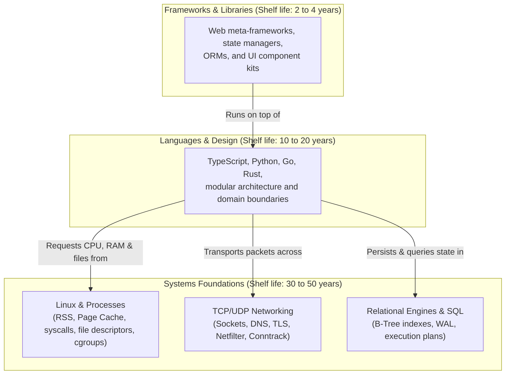
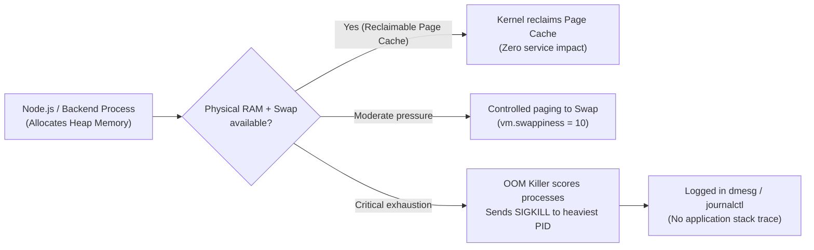
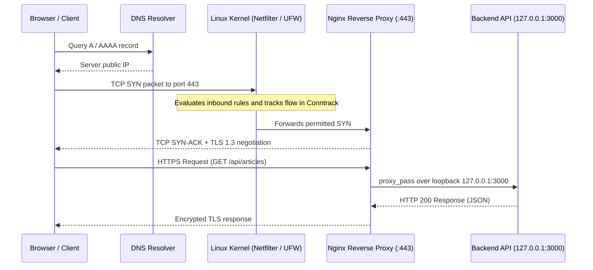

> [!IMPORTANT]
> **Executive Summary:**  
> During my early years building software, I poured almost all of my energy into chasing the latest web framework or ORM. The turning point arrived when operating real production platforms with concurrent traffic, WebSockets, and databases inside a **1 GB RAM** server: when a deployment breaks at two in the morning, high-level abstractions cannot explain a `502 Bad Gateway`, a process silently terminated by the kernel OOM Killer, or an SQL query jumping from **2 ms** to **6.2 s**. Mastering the three long-lived foundations—Linux, TCP/UDP networking, and relational SQL engines—cut my production incident diagnostics from hours of blind restarts down to under **5 minutes** of deterministic inspection, regardless of the language or framework in use.

---

## Why I Am Writing This From Production

If you had asked me a few years ago what I needed to study to grow as a software engineer, I would have recited a checklist of trending libraries. Every semester brought a new meta-framework, a state manager promising zero boilerplate, or an ORM designed so you would never have to write raw SQL again.

I followed that path for a long time, until I had to keep real systems running in production without the safety net of endlessly throwing larger hardware at every problem. The moment a user reports that the application will not load and your application logs are completely empty, an uncomfortable truth sets in: libraries turn over every two or three years, while the operating system, the TCP/IP stack, and the database query planner have governed everything built on top of them for decades.

---

## Conceptual Model: The Building and the Knowledge Shelf-Life Pyramid

Before opening a terminal or inspecting query plans, it helps to visualize how the layers of any modern application fit together through a real-world analogy. Picture a twenty-story office building:

* **Frameworks and libraries:** They are the interior decor, desks, and lobby furniture. They get refreshed every few years to match new styles and make daily work faster and more comfortable.
* **Linux and the operating system:** They are the reinforced concrete, power grid, and elevators. If a breaker trips or the elevators stall, it does not matter how modern the lobby looks—nobody can get work done.
* **TCP/UDP networking:** They are the access roads, security gate, and phone lines. They decide whether a visitor reaches the right door, gets turned away at reception, or is silently dropped at the perimeter.
* **Databases and SQL:** They are the central records room. You can stack ten thousand folders in unlabeled boxes and scan them one by one on every request, or maintain an alphabetical index that leads straight to the exact file in three steps.

Engineering knowledge does not depreciate evenly across layers. Pouring all of your time into the top layer locks you into a permanent reset cycle every few years; mastering the foundations makes every new framework transparent because you immediately recognize the underlying OS, network, or database abstraction it wraps.



---

## Glossary of Core Concepts

So anyone can follow the low-level diagnostics without hidden prerequisites, these are the core terms used in the terminal examples below:

| Concept | Technical Meaning | Why It Matters in Production |
|---|---|---|
| PID | Unique numeric identifier assigned by the kernel to each running process. | Lets you inspect the exact memory footprint and open sockets belonging to your backend. |
| RSS (Resident Set Size) | Actual physical RAM currently occupied by a process. | The metric the kernel tracks when evaluating memory pressure on the host. |
| Page Cache | Spare physical RAM that Linux borrows to cache frequently read disk blocks. | Makes `free -m` look nearly full even on healthy servers; the kernel reclaims it immediately when an app needs RAM. |
| File Descriptor (FD) | Integer handle representing an open file, pipe, or network socket in Unix/Linux. | Leaking unclosed connections exhausts `ulimit -n` and halts incoming traffic with `EMFILE`. |
| Socket | Network communication endpoint defined by an IP address, protocol (TCP/UDP), and port. | Knowing whether a socket binds to `127.0.0.1` versus `0.0.0.0` determines if a service is private or exposed to the Internet. |
| TCP Handshake | Initial three-way negotiation (`SYN`, `SYN-ACK`, `ACK`) before HTTP data flows. | If the first step fails, the fault lies in networking or firewall rules, never in your API controller. |
| Loopback (`127.0.0.1`) | Internal virtual network interface restricted strictly to traffic inside the same host. | Allows Nginx to reach your local backend without exposing port `3000` externally. |
| B-Tree Index | Balanced sorted tree structure that locates records in logarithmic time (**O(log N)**). | Prevents the database engine from scanning millions of rows sequentially (**O(N)**) on every HTTP request. |
| Execution Plan | Internal strategy chosen by the SQL planner to resolve a query (`SCAN` versus `SEARCH`). | Reveals in milliseconds whether an ORM emitted an indexed lookup or a silent bottleneck. |

---

## Pillar 1: Linux — Your Code Does Not Run in a Vacuum

To an application developer, a backend is a clean tree of controllers, services, and components. To the Linux kernel, all of it is simply a process with a `PID`, a resident memory footprint (`RSS`), a cgroups slice, and a table of open file descriptors.

In my early deployments, whenever a service stopped responding behind Nginx, my instinct was to restart the process manager or wrap more code in `try-catch`. It bought a few hours until the next crash. Moving past patches started the day I began reading what the operating system itself was reporting.

### The illusion of free memory and the OOM Killer

One of the most common mistakes when managing Debian or Ubuntu servers is running `free -m`, seeing only **40 MB** under the `free` column, and assuming the server is about to crash. Linux treats unused RAM as wasted RAM: it uses spare memory as *page cache* to speed up disk reads and releases it immediately whenever an application requests memory.

What actually matters is the `available` column, swap activity (`si`/`so` in `vmstat`), and whether the kernel **OOM Killer** (Out-Of-Memory Killer) silently terminated your process with `SIGKILL`—a signal no `try-catch` block in JavaScript, Python, or Go can ever catch.



### Low-level diagnostics in 30 seconds

When a service vanishes without leaving a single error in application logs, these four commands uncover the root cause before you touch a line of code:

```bash
# 1. Check real available memory ('available' column) and swap usage
free -m

# 2. Confirm whether the kernel OOM Killer terminated a process
sudo dmesg -T | grep -i -E "oom|killed process|out of memory"

# 3. List the top 10 processes by resident physical memory (RSS)
ps -eo pid,ppid,cmd,%mem,rss --sort=-rss | head -n 11

# 4. Watch swap-in / swap-out pressure (sustained 'si'/'so' > 0 indicates thrashing)
vmstat 1 5
```

If you suspect memory leaks or file descriptor exhaustion (`EMFILE: too many open files`), the `/proc` virtual filesystem gives you direct kernel visibility with zero extra packages:

```bash
# Replace <PID> with your backend's actual process ID
# 1. Exact breakdown of private, shared, and swapped memory for the process
cat /proc/<PID>/smaps_rollup

# 2. Count how many descriptors (files + sockets) are currently open
ls /proc/<PID>/fd | wc -l

# 3. Compare against the active ceiling for that specific process
grep -i "open files" /proc/<PID>/limits

# 4. Trace live network and file system calls directly from the kernel
sudo strace -f -e trace=network,openat -p <PID>
```

> [!WARNING]
> **Production edge case under systemd and containers:** Raising `ulimit -n` inside an interactive SSH shell does not change the limit of your production daemon. A service managed by systemd inherits its ceilings exclusively from its unit file (`/etc/systemd/system/my-app.service`) and cgroups v2 directives (`MemoryHigh`, `MemoryMax`, and `LimitNOFILE`).

```ini
# /etc/systemd/system/backend-api.service — Clean cgroups v2 containment
[Service]
LimitNOFILE=65536
MemoryHigh=384M
MemoryMax=450M
Restart=on-failure
RestartSec=3
```

---

## Pillar 2: TCP/UDP Networking — Tracing the Full Packet Journey

Few sentences waste more engineering hours than *"it works on my machine, but hangs on the server."* Without a clear mental model of a packet's actual path, you end up toggling random framework settings hoping luck fixes the outage.

Before your HTTP route reads a single JSON byte, that request traversed DNS resolution, a three-way TCP *handshake*, TLS negotiation, UFW rules inside Netfilter in the kernel, the Conntrack state table, and a local *loopback* socket on `127.0.0.1`.



### Distinguishing immediate rejection from silent timeout

Knowing how to tell these two failures apart saves hours of guesswork:

* **Connection Refused (`ECONNREFUSED`):** Your packet reached the target host and passed the firewall, but no process was listening on that IP and port combination. The kernel replied with an immediate `TCP RST` (or an explicit REJECT rule). Almost always, the service crashed on startup or bound only to `127.0.0.1` while you tried connecting from another container or external interface.
* **Silent Timeout:** The packet left your machine, yet not even a rejection came back. Almost always, a firewall applied a silent DROP policy in Netfilter, a cloud security group blocked the port, or the return route is missing.

### Inspecting live sockets, queues, and per-phase latency

These commands let you test each network segment independently and deterministically:

```bash
# 1. List all listening TCP/UDP sockets, bound IP addresses, and owning PIDs
sudo ss -tlnp

# 2. Detect buildup of TIME-WAIT or CLOSE-WAIT connections (possible HTTP client leaks)
ss -tan | awk '{print $1}' | sort | uniq -c | sort -rn

# 3. Measure exact latency per phase (DNS, TCP, TLS, and Time to First Byte)
curl -o /dev/null -s -w "dns=%{time_namelookup}s tcp=%{time_connect}s tls=%{time_appconnect}s ttfb=%{time_starttransfer}s total=%{time_total}s\n" https://doiceladev.jorgedoicela.com

# 4. Capture live packets on the backend loopback port to confirm traffic arrival
sudo tcpdump -ni lo port 3000 -nn -c 20
```

> [!NOTE]
> **Why `127.0.0.1` versus `0.0.0.0` is a security boundary, not a cosmetic choice:** Binding an internal database or backend to `0.0.0.0` instructs the kernel to accept connections on every network interface, including the public IP. Binding strictly to `127.0.0.1` guarantees at the socket layer that no external actor can reach the service directly, even if a future UFW or Docker rule misconfigures the perimeter.

Understanding TCP versus UDP at this level also clarifies why modern protocols such as HTTP/3 (QUIC) and WireGuard choose UDP: they eliminate *Head-of-Line Blocking* during packet loss on mobile networks and establish encrypted sessions faster without carrying heavy per-connection kernel state.

---

## Pillar 3: SQL and Relational Engines — The Bottleneck No ORM Fixes

Modern ORMs make shipping early features fast. The bill arrives months later, when a table of articles, events, or users grows from **200 test rows** to **2,000,000 records**. At that point, a harmless-looking query translated into `SELECT ... ORDER BY ... OFFSET 50000` starts saturating CPU and disk I/O.

No framework upgrade or ad-hoc cache fixes a missing index. The root-cause solution is reading the engine's actual execution plan and designing B-Tree indexes aligned with your read patterns.

### Why `OFFSET` degrades linearly and how Keyset Pagination fixes it

When you run `OFFSET 50000 LIMIT 20`, the engine does not magically jump to row 50,001: it must locate, sort, and discard **50,000 rows** before returning **20**. Its cost grows linearly (**O(N)**). Replacing it with *keyset pagination* (cursor-based pagination) backed by a composite index—equality columns first, sort columns second—makes page 5,000 execute in the exact same time as page 1 (**O(log N)**).

```sql
-- 1. Composite covering index: equality columns first (language, category), sort columns second
CREATE INDEX IDX_articles_feed_cover
ON articles (language, category, orderPriority DESC, publishedAt DESC, id DESC);

-- 2. Inspect the actual SQLite query plan before deploying
EXPLAIN QUERY PLAN
SELECT id, slug, title, publishedAt
FROM articles
WHERE language = 'en'
  AND category = 'opinion'
  AND (
    orderPriority < 80
    OR (orderPriority = 80 AND publishedAt < '2026-10-18T00:00:00.000Z')
  )
ORDER BY orderPriority DESC, publishedAt DESC, id DESC
LIMIT 20;
```

In SQLite, a healthy plan reports `SEARCH articles USING INDEX IDX_articles_feed_cover` with no `USE TEMP B-TREE FOR ORDER BY`. If you see `SCAN articles`, the engine is reading the entire table row by row. In PostgreSQL, the equivalent command that reveals actual timings and cache versus disk buffer hits is:

```sql
-- PostgreSQL: measure actual execution time and shared buffer hits vs. disk reads
EXPLAIN (ANALYZE, BUFFERS)
SELECT id, slug, title, published_at
FROM articles
WHERE language = 'en'
  AND category = 'opinion'
ORDER BY order_priority DESC, published_at DESC
LIMIT 20;
```

### Real SQLite concurrency and the silent N+1 trap

Two widespread misconceptions—that SQLite cannot handle web concurrency and that ORMs optimize joins automatically—cost teams enormous performance:

* **Production WAL mode and pragmas in SQLite:** In classic rollback journal mode, writes block readers. Enabling WAL (`PRAGMA journal_mode = WAL;`) alongside `PRAGMA synchronous = NORMAL;` and `PRAGMA busy_timeout = 5000;` allows concurrent reads without blocking writes and keeps queries under **1 ms** within a **~20 MB** RAM footprint.
* **Hunting down ORM N+1 queries:** Fetching **50 articles** in one query and then running a loop that fetches tags per article fires **51 database round-trips** inside a single HTTP request. Collapsing it into a `JOIN` or `WHERE content_id IN (...)` cuts **51 queries** down to **2** and eliminates congestion under load.

> [!TIP]
> **Rule of thumb before adding Redis or resizing servers:** Inspect `EXPLAIN QUERY PLAN` or `EXPLAIN (ANALYZE, BUFFERS)` on your top five endpoints. In most web applications, fixing one missing composite index or an N+1 loop drops latency from **800 ms** to **< 5 ms** at **0 USD** extra infrastructure cost.

---

## Diagnostic Matrix: Common Patch Versus Root Cause

This table summarizes the seven production incidents I have seen repeat most often and how troubleshooting shifts once you inspect one layer down:

| Observable Symptom | Common Reaction (Patch) | Root-Cause Diagnosis via Foundations |
|---|---|---|
| Nginx 502 Bad Gateway | Blindly restart PM2 or Docker until it recovers. | `ss -tlnp` verifies if the backend listens on `127.0.0.1:3000`; `journalctl -u nginx -n 30` distinguishes `Connection refused` from upstream timeout. |
| Process vanishes without logs | Sprinkle more `console.log` calls in HTTP routes. | `dmesg -T` reveals `Out of memory: Killed process`: the kernel OOM Killer sent `SIGKILL`. |
| EMFILE: too many open files | Upgrade VPS specs without investigating. | `ls /proc/<PID>/fd \| wc -l` exposes unclosed socket leaks or an undersized `LimitNOFILE` in systemd. |
| Silent connection timeout | Open random ports or disable the firewall. | A `SYN` discarded via DROP in Netfilter/UFW produces silence; `tcpdump` and `ufw status verbose` pinpoint the exact rule. |
| Slow pagination past page 50 | Slap a short-TTL cache in front of the endpoint. | `EXPLAIN` reveals linear `OFFSET` or `SCAN TABLE`; a composite index + *keyset pagination* holds latency at **< 1 ms**. |
| SQLITE_BUSY under traffic | Rewrite the entire data layer to another database. | Enabling WAL, setting `busy_timeout = 5000`, and batching writes in atomic transactions resolves lock contention. |
| High latency with low CPU usage | Add more backend replicas. | `vmstat 1` exposes heavy swap *thrashing* (`si`/`so`), or `curl -w` isolates slow DNS resolution / TLS handshakes. |

---

## Incident Operations Reference Sheet

When an incident hits a Debian or Ubuntu server, following a disciplined top-to-bottom sequence eliminates guesswork:

| Layer | Inspection Command | What It Proves |
|---|---|---|
| Memory | `free -m && vmstat 1 3` | Real available RAM (`available`) and absence of aggressive swap paging (`si`/`so`). |
| Kernel | `sudo dmesg -T \| tail -n 30` | OOM Killer terminations, storage I/O errors, or kernel packet drops. |
| Processes | `ps -eo pid,cmd,%cpu,%mem,rss --sort=-rss \| head -n 10` | Which PID holds physical RAM (`RSS`) and which saturates CPU. |
| Sockets | `sudo ss -tlnp` | Open listening ports, bound IP interface (`127.0.0.1` vs `0.0.0.0`), and owning process. |
| Traffic | `sudo tcpdump -ni any port 443 -nn -c 20` | Whether packets physically enter and leave the server's network interface. |
| SQLite | `sqlite3 db.sqlite "EXPLAIN QUERY PLAN SELECT ..."` | Whether the query uses a B-Tree index (`SEARCH`) or scans the entire table (`SCAN`). |

---

## Using Frameworks as Force Multipliers, Not Crutches

Respecting foundations does not mean rejecting modern tools or rewriting HTTP servers in C for every project. I use Next.js, NestJS, and TypeScript daily because they accelerate delivery, enforce clean boundaries, and eliminate repetitive mistakes.

The difference lies in your relationship with the abstraction. When you use an ORM while inspecting the SQL and query plan it generates, deploy behind Nginx while knowing how to audit sockets with `ss -tlnp`, and configure systemd understanding `RSS`, cgroups, and file descriptors, the framework stops being an opaque black box and becomes a genuine engineering multiplier.

Five or ten years from now, many of the library names dominating headlines today will be gone. Yet you will still be opening Linux terminals, tracing TCP/UDP packets, and designing SQL indexes to solve the problems that actually keep production systems alive.

### Operational Foundations Verification Checklist

- [x] Check real available memory (`available` in `free -m`) and kernel OOM logs (`dmesg -T`) before restarting failing services.
- [x] Verify file descriptor limits (`LimitNOFILE`) and cgroups v2 memory bounds inside systemd unit files.
- [x] Confirm internal services bind strictly to `127.0.0.1` rather than `0.0.0.0` without perimeter controls.
- [x] Distinguish in seconds between `ECONNREFUSED` (`TCP RST`) and silent timeout (DROP in Netfilter/UFW) using `ss` and `tcpdump`.
- [x] Audit critical queries with `EXPLAIN QUERY PLAN` or `EXPLAIN (ANALYZE, BUFFERS)` confirming composite index usage and zero `SCAN TABLE`.
- [x] Replace deep `OFFSET` with *keyset pagination* and eliminate N+1 loops before scaling hardware.
