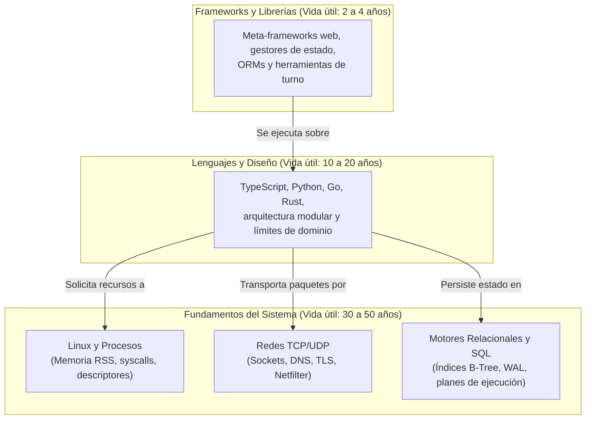

Hace unos años, si me preguntabas qué necesitaba dominar para crecer como desarrollador, mi respuesta habría sido una lista de librerías de moda. Cada semestre aparecía un nuevo meta-framework, un ORM que prometía ocultar el SQL para siempre o una herramienta que aseguraba abstraer la infraestructura por completo.

El golpe de realidad llega el día en que despliegas un sistema real, con usuarios reales y hardware limitado —en mi caso, mantener plataformas web completas, WebSockets y bases de datos operando dentro de un único servidor de **1 GB de RAM**— y algo falla a las dos de la mañana. En ese momento descubres una verdad incómoda: el framework que tanto tiempo te costó memorizar no sabe explicarte por qué devuelve un error `502 Bad Gateway`, por qué tu proceso desapareció sin dejar rastro en los logs o por qué una consulta que tardaba **3 ms** en tu laptop ahora bloquea la API durante **6 segundos**.

---

## La Pirámide de Vida Útil del Conocimiento Técnico

Con el tiempo entendí que el conocimiento en ingeniería de software no se deprecia al mismo ritmo. Hay capas que caducan antes de que termines de dominarlas y otras que te acompañan durante toda tu carrera:



Cuando inviertes tu energía casi por completo en la capa superior, quedas atrapado en un ciclo permanente de empezar desde cero cada dos o tres años. Cuando entiendes los cimientos, cualquier framework nuevo se vuelve trivial: en lugar de memorizar recetas, reconoces de inmediato qué abstracción está construyendo sobre sockets, procesos o consultas SQL.

> Cada hora invertida en entender cómo asigna memoria Linux, cómo negocia una conexión TCP o cómo recorre un índice B-Tree tu base de datos se multiplica en todos los lenguajes que vayas a usar en los próximos veinte años.

---

## El Día que Aprendí que Reiniciar el Servidor No Es Diagnosticar

En mis primeros proyectos, cuando un servicio dejaba de responder detrás de Nginx, mi instinto era el mismo que el de casi todos: reiniciar el proceso, subir un poco el timeout o envolver más bloques en `try-catch`. Funcionaba unas horas y volvía a caer.

Dejar de aplicar parches empezó el día en que dejé de mirar únicamente el código de la aplicación y empecé a observar lo que veía el sistema operativo. Casi todos los colapsos misteriosos en producción tienen una explicación directa cuando bajas un nivel:

| Síntoma en el Navegador | Lo que Hacía Antes (Parche) | Lo que Revelan los Fundamentos |
|---|---|---|
| Error 502 Bad Gateway | Reiniciar el gestor de procesos a ciegas. | `ss -tlnp` muestra al instante si el backend realmente escucha en `127.0.0.1:3000` o si murió al arrancar. |
| Proceso desaparecido sin errores | Añadir más `console.log` en las rutas HTTP. | `dmesg -T` revela `Out of memory: Killed process`: el OOM Killer del kernel lo terminó con `SIGKILL`. |
| Error de demasiados archivos abiertos | Subir la capacidad del servidor sin entender por qué. | En Unix cada socket es un archivo; se agotó el límite de descriptores (`ulimit -n`) por fugas de conexiones. |
| Timeout silencioso al conectar | Cambiar puertos al azar o abrir todo en el firewall. | Un paquete `SYN` descartado con DROP por UFW/Netfilter produce silencio, no `ECONNREFUSED`. |

---

## Linux: Tu Código No Corre en el Vacío

Para nosotros, una aplicación es un conjunto ordenado de controladores, servicios y componentes. Para el kernel de Linux, todo eso es simplemente un proceso con un `PID`, una huella de memoria residente (`RSS`) y una lista de descriptores de archivo abiertos.

Uno de los aprendizajes más útiles al administrar nodos con poca memoria fue dejar de malinterpretar el comando `free -m`. Al principio asusta ver la memoria aparentemente casi llena, hasta que comprendes que Linux aprovecha la RAM libre como caché de páginas de disco para acelerar lecturas y la libera al instante cuando un proceso la reclama. Lo que importa vigilar no es el porcentaje bruto, sino la columna `available` y si el sistema está intercambiando memoria a disco (`si`/`so` en `vmstat`):

```bash
# Tres comandos que dicen la verdad sobre la salud de un servidor en 2 segundos
free -m
sudo dmesg -T | grep -i -E "oom|killed process"
ps -eo pid,cmd,%mem,rss --sort=-rss | head -n 10
```

Con esas tres líneas sabes en segundos si una caída fue culpa de un bug en tu código o de que el kernel protegió el sistema matando al proceso más pesado.

---

## Redes: Seguir el Viaje Completo del Paquete

Pocas cosas generan tanta frustración como el clásico *"en mi máquina funciona y en el servidor no responde"*. Cuando no visualizas el recorrido real de un paquete, terminas tocando configuraciones aleatorias del framework esperando que algo funcione por suerte.

En la práctica, antes de que tu código vea una sola línea JSON, esa petición atravesó resolución DNS, un handshake TCP de tres vías, negociación TLS, reglas de UFW en Netfilter y un socket loopback local en `127.0.0.1`. Saber distinguir entre dos errores básicos ahorra horas enteras:

* **Connection Refused (`ECONNREFUSED`):** Tu paquete llegó hasta la máquina destino, pero el puerto no tenía ningún proceso escuchando y el kernel devolvió un `TCP RST` inmediato. El problema está en que el servicio no arrancó o está escuchando en otra IP (por ejemplo, solo en `127.0.0.1` cuando intentas llegar desde otro contenedor).
* **Timeout silencioso:** El paquete salió, pero nadie respondió ni siquiera un rechazo. Casi siempre hay un firewall en el camino aplicando DROP silencioso o una ruta de retorno inexistente.

También cambia por completo cómo proteges tus despliegues. Un servicio interno o base de datos enlazado a `0.0.0.0` queda expuesto en todas las interfaces de red; enlazarlo exclusivamente a `127.0.0.1` garantiza a nivel de socket que ningún actor externo pueda tocarlo directamente, aunque alguien cometa un error modificando el firewall más adelante.

> [!NOTE]
> Cuando entiendes TCP frente a UDP a este nivel, también comprendes por qué tecnologías modernas como HTTP/3 (QUIC) o WireGuard eligen UDP: evitan el bloqueo de cabecera (*Head-of-Line Blocking*) y permiten handshakes en un único viaje sin cargar estado pesado por cada conexión en el servidor.

---

## SQL: El Cuello de Botella que Ningún ORM Resuelve por Ti

Los ORM modernos hacen que construir las primeras funcionalidades sea rapidísimo. El problema aparece meses después: cuando la tabla de artículos, usuarios o logs pasa de cien registros de prueba a varios millones. En ese punto, una consulta aparentemente inocente que el ORM tradujo a `SELECT ... ORDER BY ... OFFSET 5000` empieza a devorar CPU y disco.

No hace falta cambiar de motor ni montar una arquitectura distribuida compleja para arreglar esto; casi siempre basta con leer el plan de ejecución real (`EXPLAIN QUERY PLAN` en SQLite o `EXPLAIN ANALYZE` en PostgreSQL) y entender cómo funciona un índice B-Tree:

```sql
-- Sin índice compuesto, el motor recorre toda la tabla (SCAN) y ordena en memoria
-- Con un índice que respeta igualdad primero y ordenamiento después, la lectura cae debajo de 1 ms
CREATE INDEX IDX_articles_feed
ON articles (language, category, orderPriority DESC, publishedAt DESC);

SELECT id, slug, title, publishedAt
FROM articles
WHERE language = 'es'
  AND category = 'opinion'
  AND (orderPriority < 80 OR (orderPriority = 80 AND publishedAt < '2026-10-18T00:00:00Z'))
ORDER BY orderPriority DESC, publishedAt DESC
LIMIT 20;
```

Cambiar `OFFSET` por paginación por cursor (*Keyset Pagination*) apoyada en un índice B-Tree compuesto logra que la página 500 tarde exactamente lo mismo que la página 1. Entender por qué SQLite en modo WAL permite lecturas concurrentes sin bloquear escrituras, o cuándo un índice está mal ordenado, te da más rendimiento real que cualquier optimización cosmética en el frontend.

---

## Usar el Framework Sin Depender de Él

Ser defensor de los fundamentos no significa rechazar los frameworks modernos ni volver a escribir servidores HTTP en C para cada proyecto. Yo mismo uso herramientas como Next.js y NestJS todos los días porque aceleran la entrega, ordenan el dominio y mantienen consistencia en el equipo.

La diferencia está en la relación que tienes con la herramienta. Cuando usas un ORM pero revisas el SQL que emite, cuando despliegas detrás de Nginx pero sabes inspeccionar sockets con `ss -tulpn`, y cuando configuras systemd entendiendo memoria y descriptores de archivo, el framework deja de ser una muleta y pasa a ser un acelerador.

Dentro de cinco o diez años, los nombres de las librerías que hoy dominan las portadas habrán cambiado por completo. Sin embargo, seguirás abriendo terminales Linux, inspeccionando conexiones TCP/UDP y diseñando índices SQL para resolver los problemas que de verdad importan en producción.
