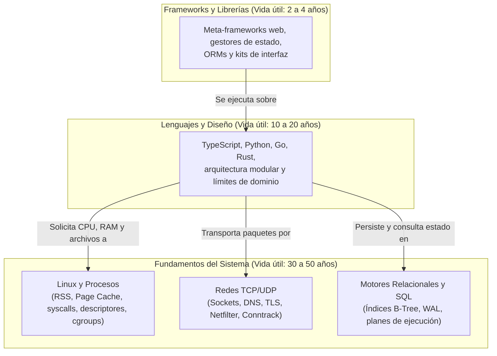
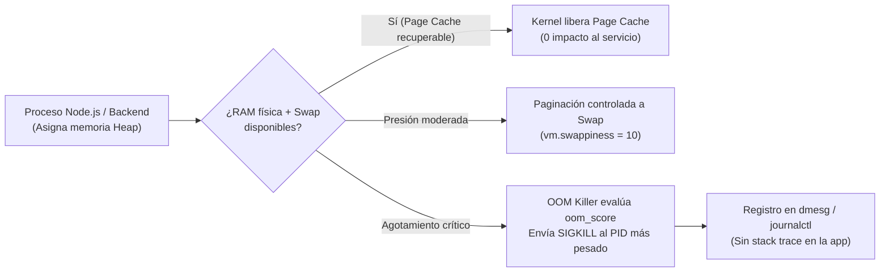
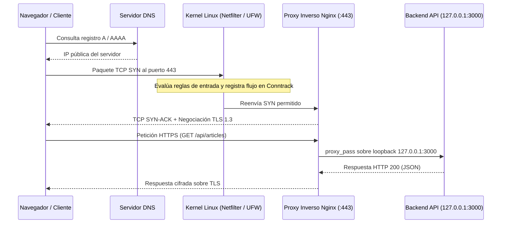

> [!IMPORTANT]
> **Resumen Ejecutivo:**  
> Durante mis primeros años desarrollando software invertía casi toda mi energía en perseguir el framework web o el ORM de turno. El punto de quiebre llegó al operar plataformas reales con tráfico concurrente, WebSockets y bases de datos dentro de un servidor limitado a **1 GB de RAM**: cuando un despliegue falla a las dos de la mañana, la abstracción de alto nivel no explica un `502 Bad Gateway`, un proceso terminado por el OOM Killer del kernel ni una consulta SQL que pasa de **2 ms** a **6.2 s**. Dominar los tres cimientos de vida útil larga —Linux, redes TCP/UDP y motores relacionales SQL— redujo mis tiempos de diagnóstico en producción de horas de reinicios a ciegas a menos de **5 minutos** de inspección determinista, independientemente del lenguaje o framework elegido.

---

## Por Qué Escribo Esto Desde la Trinchera

Si hace unos años me hubieras preguntado qué necesitaba estudiar para crecer como ingeniero de software, te habría recitado una lista de librerías de moda. Cada semestre aparecía un nuevo meta-framework, un gestor de estado que prometía simplificar todo o un ORM diseñado para que nunca tuvieras que volver a escribir una consulta SQL a mano.

Seguí ese camino durante un buen tiempo, hasta que me tocó sostener sistemas completos en producción sin la red de seguridad de escalar hardware indefinidamente. En el momento en que un usuario reporta que la aplicación no carga y los logs de tu aplicación están completamente vacíos, descubres una realidad incómoda: las librerías cambian cada dos o tres años, pero el sistema operativo, la pila TCP/IP y el planificador de consultas de la base de datos llevan décadas gobernando todo lo que construimos encima.

---

## Modelo Conceptual: El Edificio y la Pirámide de Vida Útil

Antes de abrir una terminal o revisar planes de ejecución, conviene visualizar cómo se relacionan las capas de cualquier aplicación moderna usando una analogía cotidiana. Imagina un edificio corporativo de veinte pisos:

* **Frameworks y librerías:** Son la decoración interior, los escritorios y la pintura de la recepción. Se renuevan cada pocos años según las tendencias y hacen que el trabajo diario sea más cómodo y rápido.
* **Linux y el sistema operativo:** Son la estructura de hormigón, el sistema eléctrico y los ascensores. Si falla un fusible o se satura el ascensor, da igual lo moderna que sea la recepción: nadie puede trabajar.
* **Redes TCP/UDP:** Son las carreteras de acceso, la garita de seguridad en la entrada y las líneas telefónicas. Determinan si una visita llega a la puerta correcta, si es rechazada en recepción o si el guardia de la entrada la ignora en silencio.
* **Bases de datos y SQL:** Es el archivo central del edificio. Puedes guardar diez mil expedientes apilados en cajas sin orden y revisar carpeta por carpeta cada vez que alguien pide un documento, o mantener un catálogo alfabético que te lleva a la carpeta exacta en tres pasos.

El conocimiento técnico no se deprecia al mismo ritmo en todas las capas. Cuando concentras todo tu esfuerzo en la capa superior, quedas atrapado en un ciclo permanente de reaprendizaje cada pocos años; cuando dominas los cimientos, cualquier framework nuevo se vuelve transparente porque reconoces al instante qué abstracción está construyendo debajo.



---

## Glosario de Conceptos Fundamentales

Para que cualquier persona pueda seguir el diagnóstico técnico sin huecos previos, estos son los conceptos base que aparecerán en los ejemplos de consola:

| Concepto | Significado Técnico | Por Qué Importa en Producción |
|---|---|---|
| PID | Identificador numérico único que el kernel asigna a cada proceso en ejecución. | Permite inspeccionar exactamente cuánta memoria y cuántos sockets abiertos consume tu backend. |
| RSS (Resident Set Size) | Memoria RAM física real que ocupa un proceso en este instante. | Es la métrica que vigila el kernel para decidir si un proceso provoca saturación de memoria. |
| Page Cache | Porción de RAM libre que Linux utiliza temporalmente para almacenar bloques de disco frecuentes. | Hace que `free -m` aparente tener poca RAM libre aunque el sistema esté sano; el kernel la libera al instante si una app la pide. |
| Descriptor de archivo (FD) | Número entero que representa un archivo abierto, una tubería o un socket de red en Unix/Linux. | Si tu aplicación abre conexiones y no las cierra, agota el límite `ulimit -n` y deja de aceptar usuarios con error `EMFILE`. |
| Socket | Extremo de comunicación de red definido por una dirección IP, un protocolo (TCP/UDP) y un puerto. | Saber en qué IP escucha un socket (`127.0.0.1` frente a `0.0.0.0`) define si un servicio es privado o está expuesto a Internet. |
| Handshake TCP | Negociación inicial de tres pasos (`SYN`, `SYN-ACK`, `ACK`) antes de intercambiar datos HTTP. | Si falla en el primer paso, el problema es de red o firewall, nunca del código de tu API. |
| Loopback (`127.0.0.1`) | Interfaz de red virtual interna que solo permite tráfico dentro de la misma máquina. | Permite que Nginx hable con tu backend local sin exponer el puerto `3000` hacia el exterior. |
| Índice B-Tree | Estructura de árbol balanceado ordenada que permite localizar registros en tiempo logarítmico (**O(log N)**). | Evita que el motor lea millones de filas secuencialmente (**O(N)**) en cada petición HTTP. |
| Plan de ejecución | Estrategia interna elegida por el motor SQL para resolver una consulta (`SCAN` frente a `SEARCH`). | Revela en milisegundos si un ORM generó una consulta eficiente o un cuello de botella silencioso. |

---

## Pilar 1: Linux — Tu Código No Corre en el Vacío

Para un desarrollador, una aplicación es un conjunto ordenado de controladores, servicios y componentes. Para el kernel de Linux, todo eso es simplemente un proceso con un `PID`, una huella de memoria `RSS`, un grupo de control en cgroups y una tabla de descriptores de archivo abiertos.

En mis primeros despliegues, cuando un servidor dejaba de responder detrás de Nginx, mi instinto era reiniciar el gestor de procesos o envolver más bloques en `try-catch`. Funcionaba unas horas y volvía a caer. Dejar de aplicar parches empezó el día en que aprendí a leer lo que reportaba el sistema operativo.

### El espejismo de la memoria libre y el OOM Killer

Uno de los errores más frecuentes al administrar servidores Debian o Ubuntu es ejecutar `free -m`, ver que la columna `free` marca apenas **40 MB** y entrar en pánico. Linux considera que la RAM sin usar es RAM desperdiciada: toma esa memoria sobrante como *page cache* para acelerar lecturas de disco y la devuelve instantáneamente a cualquier proceso que la solicite.

Lo que realmente debes vigilar es la columna `available`, la actividad de paginación a disco (`si`/`so` en `vmstat`) y si el **OOM Killer** (Out-Of-Memory Killer) del kernel terminó silenciosamente tu proceso con una señal `SIGKILL` que ningún bloque `try-catch` en JavaScript, Python o Go puede interceptar.



### Diagnóstico de bajo nivel en 30 segundos

Cuando un servicio desaparece sin dejar rastro en los logs de la aplicación, estos cuatro comandos revelan la causa raíz antes de tocar una sola línea de código:

```bash
# 1. Revisar memoria disponible real (columna 'available') y uso de swap
free -m

# 2. Confirmar si el OOM Killer del kernel mató algún proceso
sudo dmesg -T | grep -i -E "oom|killed process|out of memory"

# 3. Identificar los 10 procesos con mayor memoria física residente (RSS)
ps -eo pid,ppid,cmd,%mem,rss --sort=-rss | head -n 11

# 4. Observar presión de intercambio a disco (columnas 'si' y 'so' > 0 sostenido = thrashing)
vmstat 1 5
```

Si sospechas de fugas de memoria o de agotamiento de descriptores de archivo (`EMFILE: too many open files`), el sistema de archivos virtual `/proc` te entrega radiografía directa del kernel sin instalar herramientas adicionales:

```bash
# Reemplaza <PID> por el identificador real de tu backend
# 1. Desglose exacto de memoria privada, compartida y swap del proceso
cat /proc/<PID>/smaps_rollup

# 2. Contar cuántos descriptores (archivos + sockets) tiene abiertos actualmente
ls /proc/<PID>/fd | wc -l

# 3. Comparar contra el límite máximo permitido para ese proceso específico
grep -i "open files" /proc/<PID>/limits

# 4. Ver qué llamadas al sistema (sockets/archivos) está ejecutando en vivo
sudo strace -f -e trace=network,openat -p <PID>
```

> [!WARNING]
> **Caso de borde en contenedores y servicios bajo systemd:** Aumentar `ulimit -n` en tu sesión SSH interactiva no cambia el límite del servicio en producción. Un servicio gestionado por systemd hereda sus techos exclusivamente de su archivo de unidad (`/etc/systemd/system/mi-app.service`) y sus límites de cgroups v2 (`MemoryHigh`, `MemoryMax` y `LimitNOFILE`).

```ini
# /etc/systemd/system/backend-api.service — Contención limpia en cgroups v2
[Service]
LimitNOFILE=65536
MemoryHigh=384M
MemoryMax=450M
Restart=on-failure
RestartSec=3
```

---

## Pilar 2: Redes TCP/UDP — Seguir el Viaje Completo del Paquete

Pocas frases consumen más horas en ingeniería que *"en mi máquina funciona, pero en el servidor no responde"*. Sin un modelo mental claro del recorrido real de un paquete, terminas cambiando banderas aleatorias en el framework esperando que algo funcione por suerte.

Antes de que tu ruta HTTP lea un solo byte JSON, esa petición atravesó resolución DNS, un *handshake* TCP de tres vías, negociación TLS, las reglas de UFW en Netfilter dentro del kernel, la tabla Conntrack y un socket *loopback* local en `127.0.0.1`.



### Distinguir entre rechazo inmediato y silencio absoluto

Saber interpretar la diferencia entre estos dos síntomas ahorra horas enteras de depuración:

* **Connection Refused (`ECONNREFUSED`):** Tu paquete llegó hasta la máquina destino y atravesó el firewall, pero ningún proceso estaba escuchando en esa combinación de IP y puerto. El kernel devolvió un paquete `TCP RST` inmediato (o una regla REJECT explícita). Casi siempre el servicio murió al arrancar o quedó enlazado únicamente a `127.0.0.1` cuando intentabas llegar desde otro contenedor o interfaz.
* **Timeout silencioso:** El paquete salió de tu equipo, pero jamás volvió ni siquiera un rechazo. En casi todos los casos existe un firewall aplicando política DROP silenciosa en Netfilter, un grupo de seguridad en la nube bloqueando el puerto o una ruta de retorno inexistente.

### Inspección real de sockets, colas y latencia por fase

Estos comandos te permiten probar cada tramo de red de forma aislada y verificable:

```bash
# 1. Listar todos los sockets TCP/UDP en escucha, IP de enlace y proceso dueño
sudo ss -tlnp

# 2. Detectar acumulación de conexiones en TIME-WAIT o CLOSE-WAIT (posible fuga de clientes HTTP)
ss -tan | awk '{print $1}' | sort | uniq -c | sort -rn

# 3. Medir latencia exacta por fase (DNS, TCP, TLS y tiempo hasta primer byte)
curl -o /dev/null -s -w "dns=%{time_namelookup}s tcp=%{time_connect}s tls=%{time_appconnect}s ttfb=%{time_starttransfer}s total=%{time_total}s\n" https://doiceladev.jorgedoicela.com

# 4. Capturar tráfico real en el puerto local del backend para verificar si el paquete llega
sudo tcpdump -ni lo port 3000 -nn -c 20
```

> [!NOTE]
> **Por qué `127.0.0.1` frente a `0.0.0.0` es una decisión de seguridad, no estética:** Enlazar una base de datos o un backend interno a `0.0.0.0` instruye al kernel a aceptar conexiones en todas las interfaces de red, incluida la IP pública. Enlazarlo explícitamente a `127.0.0.1` garantiza a nivel de socket que ningún actor externo pueda alcanzar el servicio directamente, incluso si un cambio futuro en UFW o Docker altera las reglas perimetrales.

Además, comprender TCP frente a UDP a este nivel explica por qué protocolos modernos como HTTP/3 (QUIC) o WireGuard eligen UDP: eliminan el bloqueo de cabecera (*Head-of-Line Blocking*) cuando se pierde un paquete en redes móviles y reducen el costo de establecimiento de sesión sin mantener máquinas de estado pesadas por cada conexión en el servidor.

---

## Pilar 3: SQL y Motores Relacionales — El Cuello de Botella que Ningún ORM Resuelve

Los ORM modernos aceleran enormemente la entrega de las primeras funcionalidades. La factura llega meses después, cuando la tabla de publicaciones, eventos o usuarios pasa de **200 filas** de prueba a **2.000.000 de registros**. En ese instante, una consulta aparentemente inofensiva que el ORM tradujo a `SELECT ... ORDER BY ... OFFSET 50000` empieza a saturar CPU y disco.

Ningún framework ni caché improvisado arregla una consulta sin índice. La solución raíz consiste en leer el plan de ejecución real del motor y diseñar índices B-Tree alineados al patrón de lectura.

### Por qué `OFFSET` degrada linealmente y cómo lo resuelve Keyset Pagination

Cuando ejecutas `OFFSET 50000 LIMIT 20`, el motor no salta mágicamente a la fila 50.001: debe localizar, ordenar y descartar **50.000 filas** antes de devolverte **20**. Su complejidad crece de forma lineal (**O(N)**). Al reemplazarlo por *keyset pagination* (paginación por cursor) sobre un índice compuesto donde las columnas de igualdad van primero y las de ordenamiento después, la página 5.000 tarda exactamente lo mismo que la página 1 (**O(log N)**).

```sql
-- 1. Índice compuesto cubriente: igualdad primero (language, category), ordenamiento después
CREATE INDEX IDX_articles_feed_cover
ON articles (language, category, orderPriority DESC, publishedAt DESC, id DESC);

-- 2. Verificar el plan real en SQLite antes de desplegar
EXPLAIN QUERY PLAN
SELECT id, slug, title, publishedAt
FROM articles
WHERE language = 'es'
  AND category = 'opinion'
  AND (
    orderPriority < 80
    OR (orderPriority = 80 AND publishedAt < '2026-10-18T00:00:00.000Z')
  )
ORDER BY orderPriority DESC, publishedAt DESC, id DESC
LIMIT 20;
```

En SQLite, la salida saludable debe mostrar `SEARCH articles USING INDEX IDX_articles_feed_cover` sin `USE TEMP B-TREE FOR ORDER BY`. Si aparece `SCAN articles`, el motor está recorriendo toda la tabla fila por fila. En PostgreSQL, el comando equivalente que muestra tiempos y lecturas de memoria/disco reales es:

```sql
-- En PostgreSQL: medir tiempo real y bloques leídos desde caché vs. disco
EXPLAIN (ANALYZE, BUFFERS)
SELECT id, slug, title, published_at
FROM articles
WHERE language = 'es'
  AND category = 'opinion'
ORDER BY order_priority DESC, published_at DESC
LIMIT 20;
```

### Concurrencia real en SQLite y el problema N+1 silencioso

Otro mito extendido es creer que SQLite no sirve en producción web o que un ORM siempre optimiza relaciones. Dos reglas prácticas marcan una diferencia medible de órdenes de magnitud:

* **Modo WAL y pragmas de producción en SQLite:** En modo *rollback journal* clásico, una escritura bloquea a todos los lectores. Activar WAL (`PRAGMA journal_mode = WAL;`) junto con `PRAGMA synchronous = NORMAL;` y `PRAGMA busy_timeout = 5000;` permite lecturas concurrentes simultáneas sin bloqueos y mantiene latencias por debajo de **1 ms** con una huella de RAM de **~20 MB**.
* **Caza del problema N+1 en ORMs:** Si cargas **50 artículos** en una consulta y luego un bucle consulta las etiquetas de cada artículo por separado, tu aplicación acaba de disparar **51 viajes a la base de datos** en una sola petición HTTP. Resolverlo con un `JOIN` o una cláusula `WHERE content_id IN (...)` reduce **51 consultas** a **2** y elimina la congestión bajo concurrencia.

> [!TIP]
> **Regla de oro antes de añadir Redis o escalar servidor:** Activa el registro de consultas lentas o inspecciona `EXPLAIN QUERY PLAN` / `EXPLAIN (ANALYZE, BUFFERS)` en tus cinco endpoints más visitados. En la mayoría de aplicaciones web, corregir un índice compuesto faltante o un N+1 reduce la latencia de **800 ms** a **< 5 ms** con **0 USD** de infraestructura adicional.

---

## Matriz de Diagnóstico: Parche Común Frente a Causa Raíz

Esta tabla resume los siete incidentes que más veces he visto repetirse en producción y cómo cambia el diagnóstico cuando miras una capa más abajo:

| Síntoma Observable | Reacción Habitual (Parche) | Diagnóstico de Causa Raíz con Fundamentos |
|---|---|---|
| Error 502 Bad Gateway en Nginx | Reiniciar PM2 o Docker a ciegas hasta que vuelva. | `ss -tlnp` confirma si el backend escucha en `127.0.0.1:3000`; `journalctl -u nginx -n 30` muestra si fue `Connection refused` o *upstream timeout*. |
| Proceso desaparecido sin errores | Agregar más `console.log` en las rutas HTTP. | `dmesg -T` expone `Out of memory: Killed process`: el OOM Killer terminó el PID con `SIGKILL`. |
| Error EMFILE: too many open files | Subir el tamaño del VPS sin investigar. | `ls /proc/<PID>/fd \| wc -l` revela fugas de sockets sin cerrar o un `LimitNOFILE` insuficiente en systemd. |
| Timeout silencioso al conectar | Abrir puertos al azar o desactivar el firewall. | Un `SYN` descartado con DROP en Netfilter/UFW produce silencio; `tcpdump` y `ufw status verbose` localizan el bloqueo exacto. |
| Paginación lenta desde la página 50 | Poner un caché temporal con TTL corto. | `EXPLAIN` revela `OFFSET` lineal o `SCAN TABLE`; migrar a índice compuesto + *keyset pagination* estabiliza la latencia en **< 1 ms**. |
| Error SQLITE_BUSY bajo tráfico | Cambiar de motor de base de datos completo. | Habilitar WAL, fijar `busy_timeout = 5000` y agrupar escrituras en transacciones atómicas elimina la contención. |
| Latencia alta en servidor con CPU baja | Aumentar réplicas del backend. | `vmstat 1` muestra `si`/`so` altos (*thrashing* de swap) o `curl -w` evidencia demora en resolución DNS / negociación TLS. |

---

## Hoja de Referencia Operativa para Incidentes

Cuando algo se rompe en un servidor Debian o Ubuntu, seguir un orden disciplinado evita adivinar:

| Capa | Comando de Inspección | Qué Confirma Exactamente |
|---|---|---|
| Memoria | `free -m && vmstat 1 3` | RAM disponible real (`available`) y ausencia de paginación agresiva (`si`/`so`). |
| Kernel | `sudo dmesg -T \| tail -n 30` | Terminaciones por OOM Killer, errores de disco o descartes de red del kernel. |
| Procesos | `ps -eo pid,cmd,%cpu,%mem,rss --sort=-rss \| head -n 10` | Qué proceso consume memoria física real y cuál satura CPU. |
| Sockets | `sudo ss -tlnp` | Qué puertos están abiertos, en qué interfaz IP (`127.0.0.1` vs `0.0.0.0`) y qué PID los posee. |
| Tráfico | `sudo tcpdump -ni any port 443 -nn -c 20` | Si los paquetes realmente entran y salen de la interfaz de red del servidor. |
| SQLite | `sqlite3 db.sqlite "EXPLAIN QUERY PLAN SELECT ..."` | Si la consulta usa un índice B-Tree (`SEARCH`) o recorre la tabla completa (`SCAN`). |

---

## Usar el Framework Como Acelerador, No Como Muleta

Defender los fundamentos no significa rechazar las herramientas modernas ni volver a programar servidores HTTP en C para cada proyecto. Yo mismo trabajo a diario con Next.js, NestJS y TypeScript porque aceleran la entrega, ordenan la arquitectura y reducen errores repetitivos.

La diferencia está en la relación que mantienes con la herramienta. Cuando usas un ORM pero revisas el SQL y el plan de ejecución que emite, cuando despliegas detrás de Nginx pero sabes inspeccionar sockets con `ss -tlnp`, y cuando configuras systemd entendiendo `RSS`, cgroups y descriptores de archivo, el framework deja de ser una caja negra mágica y se convierte en un multiplicador real de ingeniería.

Dentro de cinco o diez años, muchos de los nombres de librerías que hoy dominan las portadas habrán desaparecido. Sin embargo, seguirás abriendo terminales Linux, siguiendo paquetes TCP/UDP y diseñando índices SQL para resolver los problemas que de verdad sostienen un sistema en producción.

### Lista de Verificación de Fundamentos Operativos

- [x] Verificar memoria disponible real (`available` en `free -m`) y registros del OOM Killer (`dmesg -T`) antes de reiniciar servicios.
- [x] Inspeccionar límites de descriptores (`LimitNOFILE`) y memoria en cgroups v2 bajo systemd.
- [x] Validar que los servicios internos escuchen en `127.0.0.1` y nunca queden expuestos en `0.0.0.0` sin control perimetral.
- [x] Distinguir en segundos entre `ECONNREFUSED` (`TCP RST`) y timeout silencioso (DROP en Netfilter/UFW) usando `ss` y `tcpdump`.
- [x] Auditar las consultas críticas con `EXPLAIN QUERY PLAN` o `EXPLAIN (ANALYZE, BUFFERS)` verificando uso de índices compuestos y ausencia de `SCAN TABLE`.
- [x] Sustituir `OFFSET` profundo por *keyset pagination* y eliminar consultas N+1 antes de escalar hardware.
