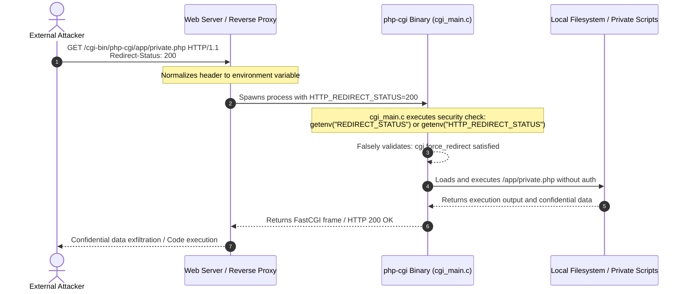
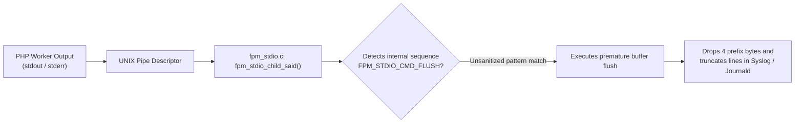

> [!IMPORTANT]
> **Executive Summary & Threat Specification Sheet:**  
> The official security disclosures for the PHP ecosystem catalog two critical vulnerabilities impacting perimeter execution boundaries and operational audit integrity in production servers: CVE-2024-8927 (**CVSS 7.5**), enabling bypass of the mandatory `cgi.force_redirect` directive via HTTP header injection in legacy PHP-CGI environments to facilitate Arbitrary File Inclusion (AFI) and unauthorized code execution; and CVE-2024-9026 (CWE-117), a log output corruption and truncation flaw within PHP-FPM when processing child worker output streams under `catch_workers_output`, enabling malicious actors to corrupt forensic audit trails and blind SIEM/SOC telemetry.  
> Definitive production remediation demands an immediate upgrade to verified upstream patched releases: **PHP 8.3.12+**, **PHP 8.2.24+**, or **PHP 8.1.30+**, the complete eradication of legacy CGI runtimes in favor of PHP-FPM over restricted local UNIX domain sockets (`0660`), disabling unneeded worker output capture, and deploying defensive ingress sanitization within the Nginx reverse proxy tier.

---

## Technical Security Specification

| Parameter | CVE-2024-8927 | CVE-2024-9026 |
|---|---|---|
| Vulnerability Class | Security Control Bypass / HTTP Header Injection | Log Output Corruption / Log Poisoning & Truncation |
| Impacted Component | SAPI `php-cgi` (`cgi_main.c`) | PHP-FPM Master Daemon (`fpm_stdio.c`) |
| CVSS v3.1 Severity | **7.5 (High)** — `CVSS:3.1/AV:N/AC:L/PR:N/UI:N/S:U/C:H/I:N/A:N` | **3.3 (Low / Moderate in Enterprise Audit)** — CWE-117 |
| Ingress Attack Vector | Injected HTTP `Redirect-Status` request header | Embedded `FPM_STDIO_CMD_FLUSH` control sequence in `stdout`/`stderr` |
| Primary Impact | Direct execution of restricted scripts / AFI | Deletion of up to 4 bytes, line truncation in Syslog/SIEM |
| Minimum Secure Release | **8.3.12**, **8.2.24**, **8.1.30** | **8.3.12**, **8.2.24**, **8.1.30** |
| Zero-Downtime Mitigation | Strip headers within Nginx reverse proxy FastCGI block | Set `catch_workers_output = no` in `www.conf` |

---

## Conceptual Model: Multilevel Pedagogy of the Attack Surfaces

To grasp the low-level mechanics of these vulnerabilities clearly without getting lost in isolated syntax abstractions, we break down both attack vectors using real-world tangible analogies:

```mermaid
flowchart TD
    subgraph Flow1 ["CVE-2024-8927: The Forged Badge Breach in PHP-CGI"]
        ExtReq["Malicious External HTTP Request\nHeader: Redirect-Status: 200"] --> WebServer["Insecure Web Server (Nginx / Apache / IIS)"]
        WebServer -->|"Automatic environment variable mapping\nHTTP_REDIRECT_STATUS = 200"| CGIRuntime["php-cgi Interpreter"]
        CGIRuntime -->|"Inspects variable and falsely assumes\nan authorized internal redirect occurred"| CheckBypass{"cgi.force_redirect\nbypassed"}
        CheckBypass -->|"Grants execution"| ArbitraryExec["Direct script execution outside document root\nor Arbitrary File Inclusion (AFI)"]
    end

    subgraph Flow2 ["CVE-2024-9026: The Erased Logbook Breach in PHP-FPM"]
        WorkerProcess["PHP-FPM Worker processes untrusted user input\n(catch_workers_output = yes)"] -->|"Emits malformed stdout with\nFPM_STDIO_CMD_FLUSH marker"| MasterFPM["PHP-FPM Master Daemon"]
        MasterFPM -->|"Desynchronized buffer parsing"| LogStream["Log Stream (Syslog / Journald)"]
        LogStream -->|"Drops up to 4 bytes and cuts the log line"| LogEvasion["SIEM alert evasion / Forensic audit tampering"]
    end
```



### 1. The Security Guard and the Forged Badge (CVE-2024-8927)
Imagine a corporate headquarters with an inner loading dock door where the PHP-CGI engine operates. To prevent random pedestrians from walking through the back door, the building assigns a guard stationed with a strict directive: `cgi.force_redirect`. The rule is simple: *"Nobody enters this door unless they present an internal authorization pass stamped by the main front lobby (`REDIRECT_STATUS`)"*.  
The vulnerability occurs because the guard fails to verify the authenticity of the stamp: if an attacker writes `Redirect-Status: 200` on an index card in their pocket (an external HTTP header), the web server turns it into an environment variable, and the guard mistakes the attacker's note for the official lobby pass. The attacker walks straight into the restricted backend, executing private scripts and reading internal system files without ever being stopped by front-door access policies.

### 2. The Logbook with Invisible Ink (CVE-2024-9026)
In a high-security facility, a master supervisor meticulously transcribes every word spoken by factory workers into the official permanent audit log (`catch_workers_output = yes`). This log is sent downstream to compliance auditors and intrusion monitoring centers (SIEMs such as Splunk, Datadog, or Wazuh).  
In this vulnerability, if a worker process echoes untrusted user input containing a specific internal command sequence (`FPM_STDIO_CMD_FLUSH`), the supervisor's typewriter glitches: it erases up to 4 characters from the previous sentence and abruptly cuts off the rest of the line. An attacker uses this mechanical glitch to wipe their IP address from error logs, invalidate alert parsers, and erase forensic traces of an active attack.

---

## Comprehensive PHP Security Glossary

| Term | Technical Definition |
|---|---|
| SAPI (Server API) | The architectural abstraction layer governing how the PHP core interfaces with web servers (e.g., `fpm-fcgi`, `cli`, `cgi-fcgi`, `apache2handler`). |
| cgi.force_redirect | A vital `php.ini` configuration directive requiring the `php-cgi` binary to ensure it was invoked through an internal web server rewrite rather than directly by an external client. |
| PHP-FPM (FastCGI Process Manager) | An enterprise-grade FastCGI daemon maintaining pre-warmed worker pools isolated in memory, handling requests via binary frames without invoking shell processes. |
| catch_workers_output | A pool directive in PHP-FPM capturing standard output (`stdout`) and standard error (`stderr`) from worker processes to pipe them into the master error log. |
| CWE-117 (Improper Output Neutralization for Logs) | A software security weakness where unvalidated input is written into log files without escaping control sequences, leading to log injection or truncation. |
| UNIX Domain Socket | High-performance local inter-process communication (IPC) channel managed directly by the Linux kernel in the virtual filesystem (`/run/php/php8.3-fpm.sock`), free of TCP networking overhead. |
| SIEM (Security Information and Event Management) | A centralized system aggregating, correlating, and alerting on real-time operational logs and telemetry across server fleets. |
| Arbitrary File Inclusion (AFI) | A vulnerability vector allowing attackers to force a server runtime to load and execute unintended local files. |

---

## 1. Low-Level Root Cause Code Analysis

### 1.1 Anatomy of CVE-2024-8927: Environment Header Collision in `cgi_main.c`

Under the standard CGI specification (RFC 3875), when a client submits custom HTTP request headers, web servers convert them into environment variables accessible to CGI binaries by uppercasing the name, replacing hyphens with underscores, and prepending `HTTP_`:
$$\text{Header: } \texttt{Redirect-Status: 200} \longrightarrow \text{Environment Variable: } \texttt{HTTP\_REDIRECT\_STATUS=200}$$



#### The Defect in the PHP C Source Code
Inside `sapi/cgi/cgi_main.c`, the redirection validation block accepted alternate variable names populated directly from user-controlled HTTP headers:

```c
/* Simplified C source logic from cgi_main.c */
if (CGIG(force_redirect)) {
    /* If the authentic REDIRECT_STATUS variable set by the web server is absent,
       the codebase evaluated alternative environment variables */
    char *redirect_status = getenv("REDIRECT_STATUS");
    if (!redirect_status) {
        redirect_status = getenv("HTTP_REDIRECT_STATUS");
    }
    
    if (!redirect_status) {
        /* Legitimate security block if nobody supplied the status */
        cgi_error("Security Alert! The PHP CGI cannot be accessed directly.");
        exit(1);
    }
}
```

Because `HTTP_REDIRECT_STATUS` was permitted as a valid substitute, any HTTP client transmitting `Redirect-Status: 200` effectively bypassed `cgi.force_redirect`. Attackers can invoke `php-cgi` directly to execute non-public scripts, circumventing access control rules defined in web server configurations (such as `.htaccess`, Nginx internal locations, or Apache directory blocks).

---

### 1.2 Anatomy of CVE-2024-9026: Buffer Desynchronization in `fpm_stdio.c`

PHP-FPM operates under a master-worker process model. When an administrator enables `catch_workers_output = yes` within `/etc/php/8.3/fpm/pool.d/www.conf`, the master process creates UNIX pipes to capture `stdout` and `stderr` streams emitted by child workers.



#### The Defect in the Pipe Reader Parser
Inside `sapi/fpm/fpm/fpm_stdio.c`, the stream reader routine inspects data packets for internal control signals. Specifically, the macro `FPM_STDIO_CMD_FLUSH` serves as an internal 4-byte marker signaling that a worker requested an immediate buffer flush to persistent storage.

Because the parser lacked strict framing boundaries between raw application data and FPM master control commands:
1. Application output containing byte patterns mirroring the flush command causes the master reader to misinterpret application payload as an internal protocol directive.
2. The master reader recalculates its buffer offsets, dropping up to 4 bytes of legitimate message data.
3. When logs are routed to `/dev/log` (`syslog`), embedded null or carriage return markers cause `syslogd` or `systemd-journald` to terminate line processing prematurely, corrupting forensic audit trails and blinding security monitoring pipelines.

---

## 2. Production Hazards and Real-World Blast Radius

Assessing the technical severity of vulnerabilities requires evaluating their impact in real production environments:

### Hazard 1: Arbitrary Script Execution & File Inclusion (CVE-2024-8927)
* **Vulnerable Surface:** Deployments where PHP is exposed via CGI binaries (legacy shared hosting environments, misconfigured Apache hosts with `ScriptAlias /cgi-bin/`, or developer stacks like XAMPP exposed to corporate LANs).
* **Attack Scenario:** An attacker discovers the URL to `php-cgi` and bypasses web server rewrite gates to execute administrative scripts, installer scripts left behind, or uploaded temporary payloads in `/tmp`, achieving Remote Code Execution (*RCE*) under the web server user identity.
* **Perimeter Invalidation:** Renders `.htaccess` and proxy ingress restrictions ineffective.

### Hazard 2: Forensic Blindness & Audit Trail Tampering (CVE-2024-9026)
* **Vulnerable Surface:** High-density enterprise environments configuring `catch_workers_output = yes` to ingest logs into `syslog`, `journald`, or SIEM forwarders like Fluentbit, Datadog, or Splunk.
* **Attack Scenario:** During an attack (e.g., SQL injection or brute force), an attacker crafts inputs triggering `FPM_STDIO_CMD_FLUSH`. Critical alert lines that should have alerted SOC teams are truncated or dropped.
* **Compliance Invalidation:** Under PCI-DSS, ISO 27001, and SOC 2, verifiable loss of audit trail integrity constitutes an automatic high-severity audit finding.

---

## 3. Comprehensive PHP Version Support & Patch Matrix

Infrastructure engineering teams must maintain strict clarity regarding active upstream branches versus unsupported *End of Life* runtimes:

| Branch | Upstream Lifecycle Status | Vulnerable Versions | Minimum Secure Release | Mandatory Action |
|---|---|---|---|---|
| PHP 8.3 | Active Support | `<= 8.3.11` | **8.3.12** (or higher) | Immediate upgrade via official package managers or base image tags. |
| PHP 8.2 | Active Support | `<= 8.2.23` | **8.2.24** (or higher) | Immediate upgrade via official package managers or base image tags. |
| PHP 8.1 | Security Fixes Only | `<= 8.1.29` | **8.1.30** (or higher) | Apply security release. Schedule upgrade to PHP 8.3. |
| PHP 8.0 | End of Life (EOL) | All releases | No upstream fix | **Critical Hazard:** Mandatory migration to PHP 8.2+. |
| PHP 7.4 | End of Life (EOL) | All releases | No upstream fix | **Critical Hazard:** Exposed to CVE-2024-8927. Immediate refactor required. |
| PHP 5.x | End of Life (EOL) | All releases | Unsupported for years | Critical perimeter risk. |

---

## 4. Master Step-by-Step Remediation Guide for Enterprise Linux

In strict alignment with production server guidelines, the following procedures are detailed exclusively for Debian 12 (Bookworm) / 13 (Trixie) and Ubuntu 22.04 / 24.04 LTS.

### Scenario A: Bare-Metal and VPS Hosts (Nginx + PHP-FPM)

#### Step 1: Active Runtime Diagnosis & Risk Assessment
Execute the following verification commands to inspect installed binaries, active SAPI, and process health:

```bash
# 1. Verify installed CLI binary version
php -v

# 2. Confirm the active Server API interface
php -r "echo 'Active SAPI: ' . php_sapi_name() . PHP_EOL;"

# 3. Check PHP-FPM service status under systemd
sudo systemctl is-active php8.3-fpm
```

* If `php_sapi_name()` returns `cgi-fcgi`, the server runs under the vulnerable CGI SAPI.
* If it returns `fpm-fcgi`, the architecture is modern, but binaries must be upgraded to `>= 8.3.12` to address CVE-2024-9026.

#### Step 2: Configure Verified Upstream Repositories (Ondřej Surý)
To receive official security releases immediately without waiting for distribution base freeze cycles, configure the verified upstream repository:

```bash
# 1. Install prerequisite utilities
sudo apt update && sudo apt install -y lsb-release ca-certificates apt-transport-https curl gnupg

# 2. For Ubuntu: Add verified PPA
sudo add-apt-repository -y ppa:ondrej/php
sudo apt update

# 2. For Debian: Deploy modern GPG keyring in /etc/apt/keyrings (Zero deprecated apt-key)
sudo mkdir -p /etc/apt/keyrings
curl -fsSL https://packages.sury.org/php/apt.gpg | sudo gpg --dearmor -o /etc/apt/keyrings/php.gpg
echo "deb [signed-by=/etc/apt/keyrings/php.gpg] https://packages.sury.org/php/ $(lsb_release -sc) main" | sudo tee /etc/apt/sources.list.d/php.list
sudo apt update
```

#### Step 3: Selective Package Upgrades
Upgrade exclusively PHP engine packages without touching unrelated operating system components:

```bash
# Selectively upgrade PHP 8.3 components to version >= 8.3.12
sudo apt --only-upgrade install -y \
    php8.3 \
    php8.3-fpm \
    php8.3-cli \
    php8.3-common \
    php8.3-opcache \
    php8.3-mbstring \
    php8.3-xml \
    php8.3-curl \
    php8.3-readline
```

#### Step 4: Syntax Validation & Zero-Downtime Graceful Service Reload
Never blindly restart production daemons. Validate configuration integrity prior to reloading:

```bash
# 1. Validate syntax across all FPM configuration files
sudo php-fpm8.3 -t

# Expected output:
# [05-Nov-2026 ...] NOTICE: configuration file /etc/php/8.3/fpm/php-fpm.conf test is successful

# 2. Trigger zero-downtime reload (systemd reload sends USR2 signal to master daemon)
# Active workers complete in-flight transactions while fresh workers accept new connections
sudo systemctl reload php8.3-fpm

# 3. Confirm operational health and verify active version
sudo php-fpm8.3 -v | head -n 1
sudo systemctl status php8.3-fpm --no-pager
```

---

### Scenario B: Containerized Runtimes (Docker & Kubernetes)

In containerized environments, patching is executed by updating immutable base images rather than executing package upgrades inside running containers.

#### Step 1: Updating the `Dockerfile`
Update the base image definition to the patched official Alpine Linux tag:

```dockerfile
# Production-hardened base image
FROM php:8.3.12-fpm-alpine

# Install essential production extensions
RUN apk add --no-cache \
    libpq-dev \
    libzip-dev \
    && docker-php-ext-install -j$(nproc) opcache pdo pdo_mysql

# Mitigate CVE-2024-9026: Disable worker output capture in default pool
RUN sed -i 's/;catch_workers_output = yes/catch_workers_output = no/g' /usr/local/etc/php-fpm.d/www.conf \
    && sed -i 's/catch_workers_output = yes/catch_workers_output = no/g' /usr/local/etc/php-fpm.d/www.conf

# Enforce least privilege execution
USER www-data

# FastCGI communication port
EXPOSE 9000

CMD ["php-fpm", "-F"]
```

#### Step 2: Clean Rebuild and Deployment
```bash
# Rebuild without caching ensuring fresh upstream layers
docker compose build --no-cache --pull app

# Deploy container with atomic replacement
docker compose up -d --remove-orphans app

# Verify active version inside container
docker compose exec app php -v
```

---

## 5. Emergency Zero-Downtime Mitigation Plan

If organizational change-freeze policies prevent immediate binary upgrades, deploy perimeter filtering within Nginx to neutralize both attack vectors immediately.

### Mitigation 1: Perimeter Header Sanitization in Nginx (Mitigating CVE-2024-8927)

Edit your FastCGI configuration snippet (`/etc/nginx/snippets/fastcgi-php.conf` or inside your active `server` block):

```nginx
# /etc/nginx/snippets/fastcgi-php.conf

# 1. Hardcode REDIRECT_STATUS to trusted values generated by Nginx
fastcgi_param REDIRECT_STATUS 200;

# 2. Strip external user-supplied Redirect-Status headers
fastcgi_param HTTP_REDIRECT_STATUS "";

# 3. Reject inbound requests attempting to supply anomalous redirect headers
if ($http_redirect_status) {
    return 400 "Bad Request: Malformed Header Injection Detected\n";
}
```

### Mitigation 2: Disabling Worker Output Capture (Mitigating CVE-2024-9026)

If your applications log directly to application-level disk logs (e.g., Monolog in Laravel/Symfony), `catch_workers_output` is redundant and introduces unnecessary risk.

Edit `/etc/php/8.3/fpm/pool.d/www.conf`:

```ini
; /etc/php/8.3/fpm/pool.d/www.conf
; Disable piping worker stdout/stderr into master daemon
catch_workers_output = no

; Disable output decoration
decorate_workers_output = no
```

Apply changes gracefully:
```bash
sudo nginx -t && sudo systemctl reload nginx
sudo php-fpm8.3 -t && sudo systemctl reload php8.3-fpm
```

---

## 6. Comprehensive Defense-in-Depth Hardening

Professional infrastructure security demands defense in depth: ensuring that even if an unpatched zero-day flaw exists in the application layer, perimeter and kernel isolation contain the blast radius.

### 6.1 Hardening `/etc/php/8.3/fpm/php.ini`

Apply the following production specifications:

```ini
# /etc/php/8.3/fpm/php.ini - Production Hardening Specification

# 1. Block remote resource inclusion (Zero RFI)
allow_url_fopen = Off
allow_url_include = Off

# 2. Suppress PHP banner headers (Mitigate fingerprinting)
expose_php = Off

# 3. Secure error handling (Zero stack trace leaks to clients)
display_errors = Off
display_startup_errors = Off
log_errors = On
error_log = /var/log/php/fpm-error.log

# 4. Enforce strict resource constraints against DoS vectors
max_execution_time = 30
max_input_time = 30
memory_limit = 128M
post_max_size = 16M
upload_max_filesize = 10M
max_input_vars = 1500

# 5. Strict process execution blacklist
# Disables shell execution primitives even if arbitrary PHP execution occurs
disable_functions = exec,passthru,shell_exec,system,proc_open,popen,curl_multi_exec,parse_ini_file,show_source,phpinfo,dl

# 6. Restrict filesystem access to web document root and temporary storage
open_basedir = /var/www/html:/tmp

# 7. Enforce secure session cookies
session.cookie_httponly = 1
session.cookie_secure = 1
session.use_strict_mode = 1
session.cookie_samesite = "Lax"
```

---

### 6.2 PHP-FPM Pool Isolation (`/etc/php/8.3/fpm/pool.d/www.conf`)

Bind worker pools strictly to local UNIX domain sockets with `0660` POSIX permissions, eliminating TCP network exposure:

```ini
# /etc/php/8.3/fpm/pool.d/www.conf
[www]
user = www-data
group = www-data

# Restrict communication strictly to local UNIX socket
listen = /run/php/php8.3-fpm.sock
listen.owner = www-data
listen.group = www-data
listen.mode = 0660

# Calibrated dynamic process manager (Optimized for 1 GB - 2 GB RAM servers)
pm = dynamic
pm.max_children = 10
pm.start_servers = 2
pm.min_spare_servers = 1
pm.max_spare_servers = 3
pm.max_requests = 1000

# Restrict execution solely to trusted .php extensions
security.limit_extensions = .php

# Proactive CVE-2024-9026 mitigation
catch_workers_output = no
```

---

### 6.3 Operating System Sandboxing with Systemd

Modern Linux distributions allow administrators to restrict PHP-FPM in kernel space using systemd unit drop-ins:

Create an override configuration:

```bash
sudo systemctl edit php8.3-fpm
```

Inject the following kernel-level sandboxing directives:

```ini
[Service]
# Mount the OS filesystem as READ-ONLY for the PHP daemon
ProtectSystem=strict

# Hide user home directories entirely (/home, /root)
ProtectHome=true

# Allocate an isolated, private ephemeral /tmp namespace
PrivateTmp=true

# Block privilege escalation and kernel namespace tampering
NoNewPrivileges=true

# Permit write access strictly to application roots, sockets, and logs
ReadWritePaths=/var/www/html /run/php /var/log/php /tmp
```

Apply sandboxing:
```bash
sudo systemctl daemon-reload
sudo systemctl reload php8.3-fpm
```

---

## 7. Forensic Audit: Verifying Potential Compromise

If you managed an exposed server without these updates, run the following forensic audit to detect indicators of compromise:

```bash
# 1. Search access logs for Redirect-Status header injection attempts
sudo zgrep -Ei "Redirect-Status" /var/log/nginx/*access*.log* /var/log/apache2/*access*.log* 2>/dev/null

# 2. Detect suspicious attempts to invoke php-cgi executables directly
sudo zgrep -Ei "(php-cgi|\/cgi-bin\/)" /var/log/nginx/*access*.log* 2>/dev/null

# 3. Inspect active processes running under the www-data identity
ps aux | grep "www-data" | grep -vE "(php-fpm|nginx|apache2)"

# 4. Search for unauthorized executable files created in temporary storage
sudo find /tmp /var/tmp /dev/shm -type f -mtime -30 -ls
```

If command 1 or 2 returns matches with `HTTP 200` status codes, isolate the instance immediately, audit web directory integrity with `git status` / `debsums`, and rotate all database credentials and application encryption keys.

---

## 8. Daily Operational Command Reference

| Command | Operational Purpose |
|---|---|
| php -v | Displays installed Command Line Interface (CLI) binary version. |
| php -r "echo php_sapi_name();" | Outputs active Server API (SAPI) name (`cli`, `fpm-fcgi`, etc.). |
| sudo php-fpm8.3 -t | Validates syntax integrity across all PHP-FPM configuration files. |
| sudo systemctl reload php8.3-fpm | Reloads PHP-FPM configuration on the fly without dropped connections. |
| sudo systemctl restart php8.3-fpm | Fully restarts the master process and worker pools. |
| sudo systemctl status php8.3-fpm | Displays operational status, master PID, and memory footprint. |

---

## Conclusion and Verification Checklist

Deploying these mitigations solidifies your infrastructure under the principle of defense in depth:

- [x] **Verified Upstream Binaries:** Upgraded to secure releases (**8.3.12+**, **8.2.24+**, or **8.1.30+**).
- [x] **Purged CGI Handlers:** Production stack operates 100% under PHP-FPM, with no public CGI executables.
- [x] **Neutralized FPM Log Flaw:** Directive `catch_workers_output = no` enforced to mitigate CVE-2024-9026.
- [x] **Ingress Header Sanitization:** Parameter `fastcgi_param HTTP_REDIRECT_STATUS ""` deployed in Nginx.
- [x] **UNIX Socket Isolation:** FastCGI communication bound to local UNIX socket (`0660` owned by `www-data`).
- [x] **Hardened `php.ini`:** High-risk primitives blocked via `disable_functions` alongside `expose_php = Off`.
- [x] **Kernel Sandboxing:** Systemd directives `ProtectSystem=strict`, `ProtectHome=true`, and `PrivateTmp=true` enforced.
- [x] **Forensic Auditing:** Error logging redirected to `/var/log/php/` with historical logs audited for probes.
