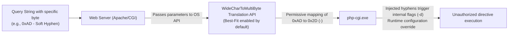

> [!IMPORTANT]
> **Executive Summary:**  
> Critical vulnerabilities affecting PHP execution environments, spearheaded by **CVE-2024-4577** (CVSS 9.8) and file upload parser flaws such as **CVE-2024-8927** and **CVE-2024-9026** (CVSS 7.5), represent severe perimeter risks for unpatched hosting architectures. The primary vulnerability stems from operating system character encoding routines (*Best-Fit Mapping*) when PHP is executed under legacy CGI mode, allowing anomalous character sequences to be translated into ASCII hyphens that lead to command-line argument injection into the interpreter binary. Definitive remediation requires upgrading immediately to **PHP 8.1.29+**, **PHP 8.2.20+**, or **PHP 8.3.8+**, migrating toward isolated **PHP-FPM** runtimes over UNIX domain sockets, and enforcing hardened directives across `php.ini` and the Nginx reverse proxy.

---

## Conceptual Model: Vulnerable Legacy vs. Isolated Production Architecture

To understand the origin of this attack surface, engineers must evaluate how web servers interact with the PHP runtime in legacy environments compared to modern containerized or bare-metal standards:

```mermaid
flowchart TD
    subgraph Insecure ["Insecure Legacy Model (Traditional PHP-CGI)"]
        Req1["HTTP Request with Query String"] --> WebServer1["Web Server (Apache / IIS / CGI)"]
        WebServer1 -->|"Binary Process Execution with Arguments\n(php-cgi.exe arg1 arg2)"| CGIProcess["Ephemeral PHP-CGI Process\n(Vulnerable surface to command flag injection)"]
    end

    subgraph Hardened ["Hardened Production Model (PHP-FPM + UNIX Sockets)"]
        Req2["HTTP Request"] --> Nginx["Nginx Reverse Proxy\n(Strict perimeter ingress filtering)"]
        Nginx -->|"Binary FastCGI Protocol over UNIX Socket\n(unix:/run/php/php8.3-fpm.sock)"| FPMDaemon["PHP-FPM Worker Pool\n(Persistent memory processes with zero CLI flags)"]
        FPMDaemon -->|"Sandboxed & restricted runtime"| ScriptPHP["Isolated PHP Script\n(disable_functions enforced)"]
    end
```



* **Legacy CGI Mode:** The web server invokes the interpreter binary on each incoming request, mapping URL query parameters directly into command-line arguments. This paradigm is fundamentally vulnerable to character translation anomalies.
* **PHP-FPM (*FastCGI Process Manager*):** A persistent master daemon maintains a pre-warmed pool of worker processes. Communication between the web proxy (Nginx) and PHP occurs strictly through binary FastCGI frames via local filesystem sockets, architecturally eliminating shell command invocation.

---

## Essential PHP Security Glossary

| Term | Technical Definition |
|---|---|
| **SAPI (*Server API*)** | The abstraction layer governing how PHP interfaces with web servers (e.g., `fpm-fcgi`, `cli`, `cgi-fcgi`, `apache2handler`). |
| **Best-Fit Mapping** | An operating system character translation behavior where unmapped Unicode characters are permissively converted to their closest visual ASCII equivalent. |
| **Argument Injection** | A vulnerability class where untrusted user input alters the parameters supplied to an underlying operating system process invocation. |
| **PHP-FPM** | A robust FastCGI implementation featuring advanced process management, isolated worker pools, and zero-downtime graceful reloads. |
| **UNIX Domain Socket** | A high-throughput inter-process communication (IPC) channel managed directly by the Linux kernel in the virtual filesystem, devoid of TCP/IP stack overhead. |

---

## 1. Root Cause Analysis: The Anatomy of CVE-2024-4577

The vulnerability tracked as **CVE-2024-4577** impacts PHP installations on Windows operating systems or environments where the PHP runtime is exposed via legacy CGI interfaces (such as specific Apache HTTP Server configurations or pre-packaged local stacks like XAMPP).



### The Character Translation Mechanism

1. **Ingress Payload:** An external client transmits an HTTP request containing specific byte sequences that do not represent standard ASCII hyphens (such as byte `0xAD`, representing a *soft hyphen*).
2. **Permissive Best-Fit Mapping:** The operating system's character conversion subsystem evaluates the byte. Lacking an exact 1:1 match in the active code page, it applies *Best-Fit* heuristics, converting the byte to an ASCII hyphen (`-`, byte code `0x2D`).
3. **Interpreter Flag Injection:** When the CGI handler spawns `php-cgi.exe`, the newly materialized hyphens are parsed as command-line switches (such as `-d` to override runtime settings), forcing the interpreter into unintended execution paths.

> [!NOTE]
> This vulnerability class does not affect Linux distributions where PHP executes exclusively through **PHP-FPM** connected to Nginx via UNIX domain sockets or loopback FastCGI listeners.

---

## 2. Multipart Form Upload Parser Vulnerabilities (CVE-2024-8927 & CVE-2024-9026)

Concurrently, upstream security patches across PHP 8.1, 8.2, and 8.3 resolved critical memory management flaws within the internal `multipart/form-data` request parser:

* **CVE-2024-8927:** Buffer overflow and out-of-bounds read vulnerabilities triggered when parsing fragmented boundary lines within complex multi-part payloads containing thousands of split boundaries.
* **CVE-2024-9026:** Denial of Service (DoS) and CPU exhaustion caused by malformed `Content-Type` headers that trap the parser into recursive validation routines before user application scripts are initialized.

---

## 3. Version Support & Patch Matrix

| PHP Branch | Upstream Support Status | Impacted Versions | Minimum Secure Version |
|---|---|---|---|
| **PHP 8.3** | Active Support | `<= 8.3.7` | **8.3.8** (or higher) |
| **PHP 8.2** | Active Support | `<= 8.2.19` | **8.2.20** (or higher) |
| **PHP 8.1** | Security Fixes Only | `<= 8.1.28` | **8.1.29** (or higher) |
| **PHP 8.0** | End of Life (*EOL*) | All | **Unpatched** (Mandatory upgrade to 8.2+) |
| **PHP 7.4 / 7.x** | End of Life (*EOL*) | All | **Unpatched** (Mandatory upgrade to 8.2+) |

---

## 4. Production Remediation and Upgrade Guide

On enterprise server environments running **Debian 12 / 13** and **Ubuntu 22.04 / 24.04 LTS**, updates must be executed cleanly to prevent version drift across active extension modules.

### Step 1: Verify Active Version and SAPI Interface

Confirm the active runtime version and interface type before initiating package updates:

```bash
# Verify CLI binary version
php -v

# Inspect active Server API interface
php -r "echo php_sapi_name();"
```

The output in hardened enterprise deployments should return `cli` on the terminal and `fpm-fcgi` from the web server context. If `cgi-fcgi` is returned from web requests, your infrastructure operates under an obsolete and vulnerable paradigm that requires immediate architectural migration.

### Step 2: Selective Package Upgrades on Debian and Ubuntu

Apply security patches leveraging the verified upstream repositories maintained by Ondřej Surý:

```bash
# Update repository package indices
sudo apt update

# Selectively upgrade core PHP runtime and FPM packages
sudo apt --only-upgrade install -y php8.3 php8.3-fpm php8.3-cli php8.3-common php8.3-mbstring php8.3-xml php8.3-curl
```

### Step 3: Zero-Downtime PHP-FPM Service Reload

Commit updated binaries into active memory by triggering a graceful service reload:

```bash
# Verify FPM configuration syntax
sudo php-fpm8.3 -t

# Reload daemon gracefully without terminating active transactions
sudo systemctl reload php8.3-fpm

# Confirm operational health
sudo systemctl status php8.3-fpm --no-pager
```

### Step 4: Upgrading Containerized Runtimes (Docker)

For container-native environments, update base image definitions to verified patched tags and rebuild without layer caching:

```dockerfile
# Dockerfile - Production hardened base
FROM php:8.3.12-fpm-alpine

# Enforce least privilege execution
USER www-data
```

```bash
# Rebuild containers ensuring clean layer pull
docker compose build --no-cache app
docker compose up -d app
```

---

## 5. Perimeter Ingress Mitigation via Nginx Reverse Proxy

When operational freeze windows delay instant binary upgrades, deploy immediate perimeter filtering rules within your Nginx reverse proxy configuration.

### Blocking Ingress Argument Injection in Nginx

Deploy inspection directives within the active `server` or `location ~ \.php$` block to drop anomalous payloads at line-rate:

```nginx
# /etc/nginx/snippets/php-security.conf
# Drop requests attempting CLI argument injection into PHP handlers
if ($query_string ~* "^(%2d|-)") {
    return 403;
}

# Block control character injection and unmapped byte sequences
if ($query_string ~* "[\x00-\x1f\x7f\xad]") {
    return 400;
}
```

```bash
# Validate Nginx syntax integrity
sudo nginx -t

# Apply rules on the fly
sudo systemctl reload nginx
```

---

## 6. Defensive Hardening Directives in `php.ini`

Hardening the core runtime configuration (`/etc/php/8.3/fpm/php.ini`) reduces blast radius should perimeter layers ever experience regression.

```ini
# /etc/php/8.3/fpm/php.ini - Production defense-in-depth specification

# 1. Disable remote resource inclusion
allow_url_fopen = Off
allow_url_include = Off

# 2. Suppress runtime signature headers
expose_php = Off

# 3. Secure error handling (Zero stack trace leaks to clients)
display_errors = Off
display_startup_errors = Off
log_errors = On
error_log = /var/log/php/error.log

# 4. Enforce strict upload limits against multipart DoS vectors
max_input_vars = 1000
max_file_uploads = 10
post_max_size = 16M
upload_max_filesize = 10M
memory_limit = 128M

# 5. Disable high-risk process execution primitives
disable_functions = exec,passthru,shell_exec,system,proc_open,popen,curl_multi_exec,parse_ini_file,show_source
```

### PHP-FPM Pool Isolation (`www.conf`)

Inside `/etc/php/8.3/fpm/pool.d/www.conf`, ensure the worker pool is strictly bound to a local UNIX domain socket with minimal POSIX permissions:

```ini
# /etc/php/8.3/fpm/pool.d/www.conf
[www]
user = www-data
group = www-data

# Restrict socket access to local web server user
listen = /run/php/php8.3-fpm.sock
listen.owner = www-data
listen.group = www-data
listen.mode = 0660

# Restrict execution solely to trusted script extensions
security.limit_extensions = .php
```

---

## 7. Verification and Post-Patch Auditing

Validate the operational posture across your server nodes using standard administrative tooling:

```bash
# 1. Verify active binary version
php-fpm8.3 -v | head -n 1

# 2. Validate socket permissions and ownership
ls -la /run/php/php8.3-fpm.sock

# 3. Stream real-time telemetry from PHP-FPM systemd journal
sudo journalctl -u php8.3-fpm -f --lines=50
```

---

## Conclusion and Verification Checklist

Hardening enterprise PHP infrastructure demands the continuous enforcement of **Defense in Depth**:

- [x] **Upstream Runtime Upgrade:** Binaries upgraded to officially patched releases (**8.1.29+**, **8.2.20+**, **8.3.8+**).
- [x] **Runtime Isolation:** Execution delegated exclusively to **PHP-FPM** over restricted UNIX domain sockets (`0660`), purging legacy CGI handlers.
- [x] **Perimeter Ingress Filtering:** Nginx configured to drop requests bearing leading hyphens or control bytes in query strings.
- [x] **Runtime Lockdown:** High-risk execution primitives neutralised via `disable_functions` alongside `allow_url_include = Off`.
- [x] **Audited Telemetry:** Error logging redirected to dedicated log files (`log_errors = On`) with zero public stack trace exposure.

