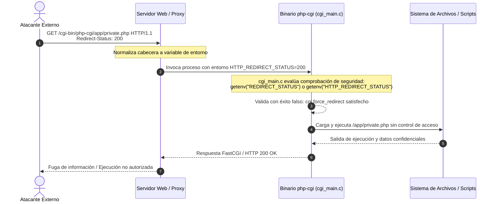
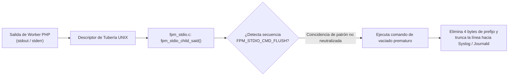

> [!IMPORTANT]
> **Resumen Ejecutivo y Ficha Técnica de Amenaza:**  
> Las divulgaciones oficiales de seguridad de octubre para el ecosistema PHP catalogan dos vulnerabilidades críticas que afectan directamente los límites de ejecución perimetral y la integridad de auditoría operativa en servidores web: CVE-2024-8927 (**CVSS 7.5**), que permite evadir la directiva de seguridad mandatoria `cgi.force_redirect` mediante inyección de cabeceras HTTP en entornos PHP-CGI, facilitando la inclusión arbitraria de archivos locales y la ejecución no autorizada de código; y CVE-2024-9026 (CWE-117), un fallo de corrupción y truncamiento de flujos de registro en PHP-FPM cuando se procesa la salida de procesos trabajadores mediante `catch_workers_output`, permitiendo a un atacante borrar trazas forenses y sabotear sistemas de monitoreo SIEM/SOC.  
> La remediación definitiva exige la actualización inmediata a las ramas parcheadas: **PHP 8.3.12+**, **PHP 8.2.24+** o **PHP 8.1.30+**, la erradicación total de arquitecturas CGI heredadas en favor de PHP-FPM sobre sockets UNIX locales con permisos `0660`, la neutralización de la directiva `catch_workers_output` y el endurecimiento perimetral mediante el proxy inverso Nginx.

---

## Ficha Técnica de Seguridad

| Parámetro | CVE-2024-8927 | CVE-2024-9026 |
|---|---|---|
| Tipo de Vulnerabilidad | Bypass de Mecanismo de Seguridad / Header Injection | Corrupción de Salida / Log Poisoning & Truncation |
| Componente Afectado | SAPI `php-cgi` (`cgi_main.c`) | Demonio maestro PHP-FPM (`fpm_stdio.c`) |
| Severidad CVSS v3.1 | **7.5 (Alta)** — `CVSS:3.1/AV:N/AC:L/PR:N/UI:N/S:U/C:H/I:N/A:N` | **3.3 (Baja / Moderada en Auditoría)** — CWE-117 |
| Vector de Entrada | Inyección de cabecera HTTP `Redirect-Status` | Secuencia de control `FPM_STDIO_CMD_FLUSH` en `stdout`/`stderr` |
| Impacto Primario | Ejecución directa de scripts restringidos / AFI | Eliminación de hasta 4 bytes, corte de logs en Syslog/SIEM |
| Versión Segura Mínima | **8.3.12**, **8.2.24**, **8.1.30** | **8.3.12**, **8.2.24**, **8.1.30** |
| Mitigación sin Reinicio | Supresión de cabeceras en proxy inverso Nginx | Desactivar `catch_workers_output = no` en `www.conf` |

---

## Modelo Conceptual: Pedagogía Multinivel de las Superficies de Ataque

Para que cualquier perfil técnico —desde estudiantes que configuran su primer servidor hasta administradores de sistemas y directores de tecnología— comprenda el alcance de estas vulnerabilidades sin perderse en tecnicismos aislados, analizamos ambos vectores mediante analogías tangibles del mundo real:

```mermaid
flowchart TD
    subgraph Flujo1 ["CVE-2024-8927: La Brecha del Gafete Falsificado en PHP-CGI"]
        ExtReq["Petición HTTP maliciosa desde Internet\nHeader: Redirect-Status: 200"] --> WebServer["Servidor Web Inseguro"]
        WebServer -->|"Mapeo automático a variable de entorno\nHTTP_REDIRECT_STATUS = 200"| CGIRuntime["Intérprete php-cgi"]
        CGIRuntime -->|"Comprueba variable y cree erróneamente\nque hubo una redirección interna legítima"| CheckBypass{"cgi.force_redirect\nevadido"}
        CheckBypass -->|"Permite ejecución"| ArbitraryExec["Ejecución de scripts fuera de la raíz pública\no Arbitrary File Inclusion (AFI)"]
    end

    subgraph Flujo2 ["CVE-2024-9026: La Brecha del Libro de Visitas Borrado en PHP-FPM"]
        WorkerProcess["Worker de PHP-FPM procesa datos de usuario\n(catch_workers_output = yes)"] -->|"Emite salida malformada a stdout\ncon marcador FPM_STDIO_CMD_FLUSH"| MasterFPM["Proceso Maestro PHP-FPM"]
        MasterFPM -->|"Desincronización de lectura de búfer"| LogStream["Flujo de Registro (Syslog / Journald)"]
        LogStream -->|"Se eliminan hasta 4 caracteres y se corta la línea"| LogEvasion["Evasión de alertas SIEM / Destrucción de auditoría"]
    end
```



### 1. La analogía del guardia y el gafete falso (CVE-2024-8927)
Imagina un edificio corporativo de alta seguridad. En la entrada principal hay una recepción que inspecciona a todos los visitantes. Para evitar que alguien entre por la puerta trasera del muelle de carga (donde opera el motor PHP-CGI), la empresa coloca un guardia que tiene una orden estricta: `cgi.force_redirect`. La regla del guardia es sencilla: *"Nadie puede pasar por aquí a menos que traiga un gafete interno sellado por la recepción principal (`REDIRECT_STATUS`)"*.  
El fallo ocurre porque el guardia es descuidado al revisar el gafete: si un atacante dibuja en un pedazo de papel la palabra `Redirect-Status: 200` y lo muestra en su solicitud HTTP externa, el sistema operativo le antepone el prefijo `HTTP_` y el guardia asume que el visitante fue autorizado por la recepción. El atacante entra directamente a los almacenes restringidos, pudiendo leer archivos privados o forzar al intérprete a ejecutar código que jamás debió exponerse a la red pública.

### 2. La analogía de la bitácora con tinta invisible (CVE-2024-9026)
En un centro de datos, un vigilante registra minuciosamente en un libro físico cada acción que realizan los trabajadores de mantenimiento (`catch_workers_output = yes`). Este libro se envía periódicamente a los auditores de seguridad (sistemas SIEM como Splunk, Wazuh o Datadog).  
En este fallo, si un trabajador manipulado por un atacante escribe en el informe una palabra clave secreta de control interno (`FPM_STDIO_CMD_FLUSH`), la máquina transcriptora del vigilante sufre un fallo mecánico: salta la línea, borra hasta 4 letras de la palabra anterior y corta abruptamente el resto del párrafo. El atacante utiliza esta anomalía para borrar su dirección IP, alterar el código de estado de un error fatal o eliminar pistas de un ataque de inyección SQL, dejando la bitácora limpia e imposibilitando cualquier reconstrucción forense posterior.

---

## Glosario Enciclopédico de Seguridad en PHP

| Término | Definición Técnica |
|---|---|
| SAPI (Server API) | Capa de abstracción arquitectónica que define cómo el núcleo de PHP interactúa con los servidores web externos (ej. `fpm-fcgi`, `cli`, `cgi-fcgi`, `apache2handler`). |
| cgi.force_redirect | Directiva de seguridad crítica en `php.ini` que exige que el binario ejecutable `php-cgi` verifique que la solicitud proviene de una redirección interna autorizada por el servidor web y no de una invocación HTTP directa. |
| PHP-FPM (FastCGI Process Manager) | Implementación de alto rendimiento que administra grupos de procesos pre-calentados (*worker pools*), procesando solicitudes web mediante paquetes binarios FastCGI sin invocar procesos del sistema en cada petición. |
| catch_workers_output | Directiva de configuración de pools en PHP-FPM que captura la salida estándar (`stdout`) y de error (`stderr`) de los workers para centralizarla en el registro del proceso maestro. |
| CWE-117 (Log Injection) | Debilidad de software que ocurre cuando una aplicación escribe datos no confiables en archivos de registro sin neutralizar caracteres de control o saltos de línea. |
| UNIX Domain Socket | Mecanismo de comunicación entre procesos (IPC) gestionado por el kernel de Linux dentro del sistema de archivos (`/run/php/php8.3-fpm.sock`), eliminando la latencia y la exposición de red de los puertos TCP locales (`127.0.0.1:9000`). |
| SIEM (Security Information and Event Management) | Plataforma centralizada que recopila, correlaciona y analiza eventos de seguridad y registros del sistema en tiempo real para detectar intrusiones. |
| Arbitrary File Inclusion (AFI) | Vector de vulnerabilidad que permite a un atacante forzar a la aplicación o al intérprete a cargar y ejecutar archivos no previstos en el servidor. |

---

## 1. Análisis de Causa Raíz de Bajo Nivel

### 1.1 Anatomía de CVE-2024-8927: Colisión de Cabeceras en `cgi_main.c`

En el estándar CGI (RFC 3875), cuando un cliente web envía una cabecera HTTP personalizada, el servidor web receptor la convierte en una variable de entorno accesible para el binario CGI transformándola a mayúsculas, sustituyendo los guiones por guiones bajos y anteponiendo el prefijo `HTTP_`. De este modo:
$$\text{Header: } \texttt{Redirect-Status: 200} \longrightarrow \text{Variable de Entorno: } \texttt{HTTP\_REDIRECT\_STATUS=200}$$



#### El Fallo en el Código Fuente de PHP
Dentro del archivo fuente `sapi/cgi/cgi_main.c`, la rutina de validación de redirección implementaba comprobaciones que consideraban la presencia de variables que podían ser alimentadas indirectamente por cabeceras del cliente HTTP:

```c
/* Fragmento simplificado del análisis de comprobación en cgi_main.c */
if (CGIG(force_redirect)) {
    /* Si no existe la variable oficial REDIRECT_STATUS establecida por el servidor web,
       el código evaluaba variables alternativas presentes en el entorno */
    char *redirect_status = getenv("REDIRECT_STATUS");
    if (!redirect_status) {
        redirect_status = getenv("HTTP_REDIRECT_STATUS");
    }
    
    if (!redirect_status) {
        /* Bloqueo legítimo si nadie proporcionó la variable */
        c入り_error("Security Alert! The PHP CGI cannot be accessed directly.");
        exit(1);
    }
}
```

Al admitir `HTTP_REDIRECT_STATUS`, cualquier solicitud HTTP con la cabecera `Redirect-Status: [código]` neutraliza la protección de `cgi.force_redirect`. Un atacante puede solicitar directamente la URL del ejecutable `php-cgi` apuntando a cualquier script local del servidor, evadiendo reglas de autenticación configuradas en el servidor web (como `.htaccess`, bloques `location` restringidos de Nginx o directivas de Apache).

---

### 1.2 Anatomía de CVE-2024-9026: Corrupción de Búfer en `fpm_stdio.c`

PHP-FPM implementa una arquitectura maestro-trabajador (*master-worker*). Cuando un administrador activa `catch_workers_output = yes` en el archivo de configuración del pool (`www.conf`), el demonio maestro crea tuberías (*pipes*) para capturar los descriptores estándar `stdout` y `stderr` de cada worker.



#### El Fallo en el Parser de Tuberías
En `sapi/fpm/fpm/fpm_stdio.c`, la función encargada de leer los datos procedentes de los workers analiza secuencias de control interno. Entre ellas, la macro `FPM_STDIO_CMD_FLUSH` se diseñó para permitir que los procesos hijos soliciten un vaciado inmediato del búfer hacia el almacenamiento persistente.

Debido a que el analizador no realizaba una desinfección estricta de la frontera entre los datos de la aplicación y los comandos de control del protocolo interno de FPM:
1. Una aplicación que imprima datos controlados por el usuario conteniendo la secuencia específica del comando de vaciado fuerza al proceso maestro a interpretar los datos como una instrucción de protocolo.
2. El lector maestro ajusta sus punteros de memoria descartando hasta 4 bytes del búfer legítimo.
3. Si el registro está enrutado hacia el socket `/dev/log` (`syslog`), la inserción de bytes nulos o secuencias de corte provoca que `syslogd` o `systemd-journald` finalicen anticipadamente la línea de registro, descartando la carga útil posterior y saboteando las alertas automatizadas.

---

## 2. Los Peligros y la Gravedad Real en Producción

Evaluar la gravedad técnica de una vulnerabilidad exige analizar su impacto en escenarios de infraestructura reales:

### Peligro 1: Ejecución Arbitraria e Inclusión de Archivos (CVE-2024-8927)
* **Superficie Vulnerable:** Servidores con arquitecturas heredadas donde PHP se expone mediante CGI (común en paneles de hosting compartido obsoletos, servidores Apache mal configurados con `ScriptAlias /cgi-bin/` o entornos locales Windows/XAMPP expuestos a redes corporativas).
* **Escenario de Ataque:** Un atacante descubre la ruta del binario `php-cgi` e invoca scripts de administración internos, instaladores no eliminados o archivos temporales cargados previamente en `/tmp`, logrando ejecución arbitraria de código (*RCE*) bajo el contexto del usuario del servidor web.
* **Bypass de Políticas de Seguridad:** Invalida cualquier regla perimetral que impida la ejecución directa de scripts en directorios privados.

### Peligro 2: Ceguera Forense y Sabotaje de Auditoría (CVE-2024-9026)
* **Superficie Vulnerable:** Servidores de alta densidad que centralizan logs de trabajadores mediante `catch_workers_output = yes` hacia recolectores `syslog`, `rsyslog` o agentes de telemetría como Fluentbit, Datadog o Splunk.
* **Escenario de Ataque:** Durante un intento de intrusión (ej. inyección SQL o fuerza bruta), el atacante envía cargas útiles diseñadas para activar `FPM_STDIO_CMD_FLUSH`. Los errores de nivel `CRITICAL` o `ALERT` que debieron alertar al equipo de guardia (SOC) son truncados o silenciados.
* **Ruptura de Cadena de Custodia:** En auditorías de cumplimiento (PCI-DSS, ISO 27001, SOC 2), la alteración o pérdida demostrable de registros de auditoría constituye una no conformidad crítica.

---

## 3. Matriz Exhaustiva de Versiones de PHP y Estado de Ciclo de Vida

Es vital que los equipos de infraestructura distingan con claridad entre ramas con soporte activo, ramas en solo parches y versiones abandonadas (*End of Life*):

| Rama | Estado Upstream | Versiones Afectadas | Versión Segura Oficial | Acción Requerida |
|---|---|---|---|---|
| PHP 8.3 | Soporte Activo | `<= 8.3.11` | **8.3.12** (o superior) | Actualizar de inmediato vía gestor de paquetes o imagen base. |
| PHP 8.2 | Soporte Activo | `<= 8.2.23` | **8.2.24** (o superior) | Actualizar de inmediato vía gestor de paquetes o imagen base. |
| PHP 8.1 | Solo Seguridad | `<= 8.1.29` | **8.1.30** (o superior) | Aplicar parche oficial. Planificar migración a PHP 8.3. |
| PHP 8.0 | Fin de Vida (EOL) | Todas las versiones | Sin parche upstream | **Peligro Crítico:** Migración arquitectónica obligatoria a 8.2+. |
| PHP 7.4 | Fin de Vida (EOL) | Todas las versiones | Sin parche upstream | **Peligro Crítico:** Sin parches para CVE-2024-8927. Migración urgente. |
| PHP 5.x | Fin de Vida (EOL) | Todas las versiones | Sin soporte hace años | Riesgo de compromiso perimetral inminente. |

---

## 4. Guía Maestra de Actualización Paso a Paso en Linux

En apego estricto a las directrices de arquitectura para servidores de producción, los siguientes procedimientos se detallan exclusivamente para las distribuciones empresariales Debian 12 (Bookworm) / 13 (Trixie) y Ubuntu 22.04 / 24.04 LTS.

### Escenario A: Servidores Físicos o VPS (Bare-Metal con Nginx + PHP-FPM)

#### Paso 1: Diagnóstico de Estado y Detección de Riesgo
Ejecuta los siguientes comandos para identificar la versión exacta, el SAPI y los módulos activos:

```bash
# 1. Comprobar la versión instalada en la interfaz de línea de comandos (CLI)
php -v

# 2. Confirmar el SAPI activo en la interfaz del servidor web
php -r "echo 'SAPI Activo: ' . php_sapi_name() . PHP_EOL;"

# 3. Verificar si el demonio PHP-FPM se encuentra activo bajo systemd
sudo systemctl is-active php8.3-fpm
```

* Si `php_sapi_name()` devuelve `cgi-fcgi`, el servidor está utilizando el SAPI vulnerable a CVE-2024-8927.
* Si devuelve `fpm-fcgi`, la arquitectura es moderna, pero requiere actualizar los binarios a `>= 8.3.12` para protegerse de CVE-2024-9026.

#### Paso 2: Configuración Segura de Repositorios Oficiales (Ondřej Surý)
Para garantizar la obtención inmediata de los parches oficiales sin depender de los ciclos lentos de los paquetes base de la distribución, utiliza el repositorio mantenido por el empaquetador oficial de Debian/Ubuntu:

```bash
# 1. Instalar utilidades esenciales para gestión segura de repositorios
sudo apt update && sudo apt install -y lsb-release ca-certificates apt-transport-https curl gnupg

# 2. Para Ubuntu: Agregar el PPA verificado oficial
sudo add-apt-repository -y ppa:ondrej/php
sudo apt update

# 2. Para Debian: Descargar la llave GPG moderna en /etc/apt/keyrings (Cero apt-key obsoleto)
sudo mkdir -p /etc/apt/keyrings
curl -fsSL https://packages.sury.org/php/apt.gpg | sudo gpg --dearmor -o /etc/apt/keyrings/php.gpg
echo "deb [signed-by=/etc/apt/keyrings/php.gpg] https://packages.sury.org/php/ $(lsb_release -sc) main" | sudo tee /etc/apt/sources.list.d/php.list
sudo apt update
```

#### Paso 3: Actualización Selectiva de Paquetes
Actualiza exclusivamente los binarios y extensiones del motor PHP sin alterar otros paquetes del sistema operativo:

```bash
# Actualizar selectivamente los componentes de PHP 8.3 a la versión >= 8.3.12
sudo apt --only-upgrade install -y \
    php8.3 \
    php8.3-fpm \
    php8.3-cli \
    php8.3-common \
    php8.3-opcache \
    php8.3-mbstring \
    php8.3-xml \
    php8.3-curl \
    php8.3-readline
```

#### Paso 4: Validación de Sintaxis y Recarga Elegante sin Caída de Servicio (*Zero-Downtime*)
Nunca reinicies a ciegas un servicio de producción. Valida siempre la integridad de la configuración antes de aplicar cambios:

```bash
# 1. Probar la sintaxis de todos los archivos de configuración de FPM
sudo php-fpm8.3 -t

# Salida esperada:
# [05-Nov-2026 ...] NOTICE: configuration file /etc/php/8.3/fpm/php-fpm.conf test is successful

# 2. Ejecutar recarga elegante (systemd reload envía la señal USR2 al proceso maestro)
# Los workers actuales terminan sus peticiones activas mientras nuevos workers toman las conexiones
sudo systemctl reload php8.3-fpm

# 3. Confirmar que el demonio está activo, saludable y con la nueva versión
sudo php-fpm8.3 -v | head -n 1
sudo systemctl status php8.3-fpm --no-pager
```

---

### Escenario B: Entornos Contenedorizados (Docker y Kubernetes)

En infraestructuras basadas en contenedores, la remediación no se realiza con `apt upgrade` dentro del contenedor en ejecución, sino actualizando la definición inmutable de la imagen base.

#### Paso 1: Actualización del `Dockerfile`
Ajusta la etiqueta base hacia la versión oficial corregida basada en Alpine Linux para una superficie mínima:

```dockerfile
# Dockerfile optimizado para producción segura
FROM php:8.3.12-fpm-alpine

# Instalar dependencias de producción y extensiones necesarias
RUN apk add --no-cache \
    libpq-dev \
    libzip-dev \
    && docker-php-ext-install -j$(nproc) opcache pdo pdo_mysql

# Desactivar la captura de workers en la configuración del pool
RUN sed -i 's/;catch_workers_output = yes/catch_workers_output = no/g' /usr/local/etc/php-fpm.d/www.conf \
    && sed -i 's/catch_workers_output = yes/catch_workers_output = no/g' /usr/local/etc/php-fpm.d/www.conf

# Endurecimiento del contenedor: ejecutar bajo usuario no privilegiado
USER www-data

# Puerto FastCGI interno expuesto al proxy
EXPOSE 9000

CMD ["php-fpm", "-F"]
```

#### Paso 2: Recompilación sin Capas en Caché y Despliegue
```bash
# Reconstruir asegurando la descarga del nuevo digest oficial de Docker Hub
docker compose build --no-cache --pull app

# Desplegar el nuevo contenedor en segundo plano con reemplazo atómico
docker compose up -d --remove-orphans app

# Verificar la versión exacta del binario dentro del contenedor activo
docker compose exec app php -v
```

---

## 5. Plan de Mitigación Inmediata de Emergencia

Si tu organización se encuentra en un periodo de congelamiento de cambios (*code freeze*) y no puedes reiniciar o actualizar los binarios de PHP hoy mismo, aplica las siguientes mitigaciones perimetrales en Nginx que neutralizan los dos vectores de ataque en caliente.

### Mitigación 1: Supresión Perimetral de Cabeceras Manipuladas en Nginx (Protección contra CVE-2024-8927)

Edita el bloque FastCGI de Nginx (`/etc/nginx/snippets/fastcgi-php.conf` o dentro del bloque `server` de tu sitio):

```nginx
# /etc/nginx/snippets/fastcgi-php.conf

# 1. Forzar que la variable interna REDIRECT_STATUS se establezca de forma fija por Nginx
fastcgi_param REDIRECT_STATUS 200;

# 2. Descartar cualquier valor malicioso que el cliente haya enviado en la cabecera Redirect-Status
fastcgi_param HTTP_REDIRECT_STATUS "";

# 3. Rechazar de inmediato cualquier petición que intente inyectar nombres de cabecera con prefijo redirect
if ($http_redirect_status) {
    return 400 "Bad Request: Malformed Header Injection Detected\n";
}
```

### Mitigación 2: Desactivación de Captura de Logs en PHP-FPM (Protección contra CVE-2024-9026)

Si tus aplicaciones web escriben sus propios logs en disco o base de datos (como hace Monolog en Laravel/Symfony o módulos de Node/Express), la directiva `catch_workers_output` es redundante y representa un riesgo innecesario.

Edita `/etc/php/8.3/fpm/pool.d/www.conf`:

```ini
; /etc/php/8.3/fpm/pool.d/www.conf
; Desactivar la captura de stdout/stderr de workers hacia el proceso maestro
catch_workers_output = no

; Desactivar la decoración de logs si estuviera habilitada
decorate_workers_output = no
```

Aplica la configuración sin interrumpir el servicio:
```bash
sudo nginx -t && sudo systemctl reload nginx
sudo php-fpm8.3 -t && sudo systemctl reload php8.3-fpm
```

---

## 6. Bastionado Defensivo Integral de Servidores (*Hardening Completo*)

La seguridad profesional no termina aplicando un parche de software: exige implementar defensa en profundidad para que, si una vulnerabilidad futura es descubierta, el atacante quede enjaulado sin posibilidad de movimiento lateral.

### 6.1 Endurecimiento del Archivo `/etc/php/8.3/fpm/php.ini`

Aplica las siguientes directivas exhaustivas comentadas:

```ini
# /etc/php/8.3/fpm/php.ini - Especificación de Bastionado para Producción

# 1. Prohibir apertura e inclusión de archivos remotos por red (Cero RFI)
allow_url_fopen = Off
allow_url_include = Off

# 2. Ocultar la firma de PHP en las cabeceras HTTP de respuesta (Previene fingerprinting)
expose_php = Off

# 3. Tratamiento riguroso de errores (Cero fugas de rutas o código en pantalla)
display_errors = Off
display_startup_errors = Off
log_errors = On
error_log = /var/log/php/fpm-error.log

# 4. Límites defensivos de memoria y tamaño de peticiones contra DoS
max_execution_time = 30
max_input_time = 30
memory_limit = 128M
post_max_size = 16M
upload_max_filesize = 10M
max_input_vars = 1500

# 5. Lista negra estricta de funciones de ejecución del sistema operativo
# Deshabilita la capacidad de ejecutar comandos de consola incluso si un atacante inyecta código PHP
disable_functions = exec,passthru,shell_exec,system,proc_open,popen,curl_multi_exec,parse_ini_file,show_source,phpinfo,dl

# 6. Enjaulado del sistema de archivos (Limita a PHP a su directorio web legítimo)
open_basedir = /var/www/html:/tmp

# 7. Endurecimiento de cookies de sesión
session.cookie_httponly = 1
session.cookie_secure = 1
session.use_strict_mode = 1
session.cookie_samesite = "Lax"
```

---

### 6.2 Aislamiento Estricto del Pool de PHP-FPM (`/etc/php/8.3/fpm/pool.d/www.conf`)

El pool de workers debe comunicarse exclusivamente mediante sockets UNIX locales con permisos POSIX `0660`, eliminando cualquier exposición a puertos de red TCP:

```ini
# /etc/php/8.3/fpm/pool.d/www.conf
[www]
user = www-data
group = www-data

# Comunicación mediante Socket UNIX local
listen = /run/php/php8.3-fpm.sock
listen.owner = www-data
listen.group = www-data
listen.mode = 0660

# Administración dinámica calibrada de procesos (Optimizado para 1 GB - 2 GB RAM)
pm = dynamic
pm.max_children = 10
pm.start_servers = 2
pm.min_spare_servers = 1
pm.max_spare_servers = 3
pm.max_requests = 1000

# Limitar extensiones procesadas estrictamente a scripts .php
security.limit_extensions = .php

# Neutralización preventiva CVE-2024-9026
catch_workers_output = no
```

---

### 6.3 Enjaulado a Nivel de Sistema Operativo con Systemd (*Sandboxing*)

En servidores Debian y Ubuntu modernos, puedes utilizar las capacidades de aislamiento del kernel de Linux mediante directivas de unidad en systemd para aislar el proceso PHP-FPM incluso si el usuario `www-data` fuese vulnerado.

Crea un archivo de anulación (*override*):

```bash
sudo systemctl edit php8.3-fpm
```

Agrega la siguiente configuración de seguridad en espacio de kernel:

```ini
[Service]
# Sistema de archivos del sistema operativo montado en modo SOLO LECTURA para PHP
ProtectSystem=strict

# Ocultar directorios personales de usuarios (/home, /root)
ProtectHome=true

# Asignar un directorio /tmp privado y efímero exclusivo para PHP (inmune a lectura de otros usuarios)
PrivateTmp=true

# Impedir que PHP eleve privilegios o cree nuevos namespaces de kernel
NoNewPrivileges=true

# Permitir escritura exclusivamente en el directorio web, sockets y logs
ReadWritePaths=/var/www/html /run/php /var/log/php /tmp
```

Aplica el aislamiento:
```bash
sudo systemctl daemon-reload
sudo systemctl reload php8.3-fpm
```

---

## 7. Procedimiento Forense: ¿Cómo Saber si tu Servidor fue Comprometido?

Si administrabas un servidor expuesto a Internet durante octubre sin los parches aplicados, ejecuta esta auditoría forense para descartar indicios de compromiso:

```bash
# 1. Buscar intentos de inyección de la cabecera Redirect-Status en logs históricos de Nginx/Apache
sudo zgrep -Ei "Redirect-Status" /var/log/nginx/*access*.log* /var/log/apache2/*access*.log* 2>/dev/null

# 2. Buscar peticiones sospechosas que intenten invocar binarios php-cgi directamente
sudo zgrep -Ei "(php-cgi|\/cgi-bin\/)" /var/log/nginx/*access*.log* 2>/dev/null

# 3. Inspeccionar procesos activos ejecutados por el usuario www-data en búsqueda de shells o binarios ajenos
ps aux | grep "www-data" | grep -vE "(php-fpm|nginx|apache2)"

# 4. Inspeccionar archivos sospechosos creados recientemente en directorios temporales compartidos
sudo find /tmp /var/tmp /dev/shm -type f -mtime -30 -ls
```

Si el comando 1 o 2 arroja coincidencias con códigos `HTTP 200`, es prioritario aislar el servidor de la red, auditar la integridad de los archivos web mediante `git status` / `debsums` y rotar todas las credenciales de base de datos y llaves de cifrado almacenadas en el archivo `.env`.

---

## Conclusión y Checklist de Validación de Producción

La seguridad en infraestructuras web modernas demuestra que el parche de software es solo el primer paso. El principio de defensa en profundidad garantiza que, aunque un componente de software presente un fallo, los anillos perimetrales (proxy inverso Nginx, sockets UNIX locales y sandboxing de systemd) contengan la amenaza de forma automática.

Verifica el estado de tu servidor con este checklist operativo:

- [x] **Binarios Actualizados:** PHP verificado en versión segura (**8.3.12+**, **8.2.24+** o **8.1.30+**).
- [x] **CGI Erradicado:** Servidor operando 100% bajo PHP-FPM, sin ejecutables CGI accesibles por web.
- [x] **Mitigación CVE-2024-9026:** Directiva `catch_workers_output = no` aplicada en todos los pools FPM de producción.
- [x] **Filtrado en Nginx:** Parámetro `fastcgi_param HTTP_REDIRECT_STATUS ""` implementado para purgar cabeceras inyectadas.
- [x] **Aislamiento por Socket:** Comunicación FastCGI vinculada a socket UNIX local con permisos `0660` propiedad de `www-data`.
- [x] **Blindaje en `php.ini`:** Funciones de ejecución del sistema operativo desactivadas mediante `disable_functions` y directiva `expose_php = Off`.
- [x] **Enjaulado en Systemd:** Directivas `ProtectSystem=strict`, `ProtectHome=true` y `PrivateTmp=true` activas.
- [x] **Auditoría Forense:** Registro centralizado de errores con `log_errors = On` y logs históricos revisados en búsqueda de anomalías.
