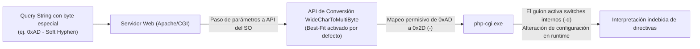

> [!IMPORTANT]
> **Resumen Ejecutivo:**  
> Las vulnerabilidades críticas en entornos de ejecución PHP, encabezadas por **CVE-2024-4577** (CVSS 9.8) y fallos en el procesador de subida de archivos como **CVE-2024-8927** y **CVE-2024-9026** (CVSS 7.5), representan riesgos perimetrales severos para infraestructuras desactualizadas. El fallo principal radica en el mecanismo de conversión de caracteres (*Best-Fit Mapping*) del sistema operativo cuando PHP se ejecuta en modo CGI, permitiendo que caracteres especiales se traduzcan en guiones y deriven en inyección de argumentos hacia el intérprete. La remediación definitiva exige actualizar de forma inmediata a **PHP 8.1.29+**, **PHP 8.2.20+** o **PHP 8.3.8+**, migrar hacia arquitecturas aisladas con **PHP-FPM** mediante sockets UNIX y endurecer las directivas de `php.ini` y del proxy inverso Nginx.

---

## Modelo Conceptual: Arquitectura Vulnerable vs. Arquitectura Aislada

Para entender el origen de esta superficie de ataque, es indispensable distinguir cómo interactúa el servidor web con el intérprete de PHP en infraestructuras heredadas frente a estándares modernos de producción:

```mermaid
flowchart TD
    subgraph Inseguro ["Modelo Heredado Inseguro (PHP-CGI tradicional)"]
        Req1["Petición HTTP con Query String"] --> WebServer1["Servidor Web (Apache / IIS / CGI)"]
        WebServer1 -->|"Ejecución de Proceso Binario con Argumentos\n(php-cgi.exe arg1 arg2)"| CGIProcess["Proceso PHP-CGI efímero\n(Superficie vulnerable a inyección de flags)"]
    end

    subgraph Bastionado ["Modelo Bastionado en Producción (PHP-FPM + Sockets UNIX)"]
        Req2["Petición HTTP"] --> Nginx["Proxy Inverso Nginx\n(Filtrado perimetral estricto)"]
        Nginx -->|"Protocolo FastCGI binario sobre Socket UNIX\n(unix:/run/php/php8.3-fpm.sock)"| FPMDaemon["Pool de Workers PHP-FPM\n(Procesos persistentes en memoria sin CLI flags)"]
        FPMDaemon -->|"Entorno enjaulado y restringido"| ScriptPHP["Script PHP aislado\n(disable_functions activo)"]
    end
```



* **Modo CGI Tradicional:** El servidor web invoca directamente el ejecutable del intérprete por cada petición entrante y traduce los parámetros de la URL en argumentos de línea de comandos. Este modelo es propenso a colisiones de codificación.
* **Modo PHP-FPM (*FastCGI Process Manager*):** Un demonio persistente administra un grupo de procesos precalentados (*worker pool*). La comunicación entre el servidor web (Nginx) y PHP ocurre mediante paquetes binarios FastCGI a través de sockets locales, eliminando por diseño la invocación de comandos en la consola del sistema operativo.

---

## Glosario Esencial de Seguridad en PHP

| Término | Definición Técnica |
|---|---|
| **SAPI (*Server API*)** | Interfaz de abstracción que define cómo PHP interactúa con el servidor web (ej. `fpm-fcgi`, `cli`, `cgi-fcgi`, `apache2handler`). |
| **Best-Fit Mapping** | Comportamiento del subsistema de codificación de Windows donde caracteres Unicode sin traducción directa son mapeados a su carácter ASCII visualmente más cercano. |
| **Argument Injection** | Clase de vulnerabilidad donde entradas del usuario manipulan la lista de argumentos pasados a un ejecutable del sistema operativo. |
| **PHP-FPM** | Implementación alternativa de FastCGI con funciones avanzadas para sitios de alto tráfico, manejo de pools aislados y reinicio sin caída de servicio. |
| **UNIX Domain Socket** | Canal bidireccional de comunicación entre procesos (IPC) gestionado por el kernel de Linux dentro del sistema de archivos, sin sobrecarga de red TCP/IP. |

---

## 1. Análisis de Causa Raíz: La Anatomía de CVE-2024-4577

El fallo catalogado como **CVE-2024-4577** afecta a implementaciones de PHP en sistemas operativos Windows o entornos donde el intérprete se encuentra expuesto mediante la interfaz CGI (como configuraciones de Apache HTTP Server o paquetes de desarrollo tipo XAMPP).



### El Mecanismo de Conversión de Caracteres

1. **La Entrada:** El atacante envía una solicitud HTTP con secuencias de bytes específicas que no representan guiones ASCII estándar (como el código `0xAD` correspondiente al guion suave o *soft hyphen*).
2. **El Mapeo Permisivo:** La biblioteca de traducción de caracteres del sistema operativo evalúa el byte y, al no encontrar una equivalencia directa en la tabla de códigos activa, aplica la heurística *Best-Fit*, sustituyendo el valor por el guion ASCII estándar (`-`, código `0x2D`).
3. **Inyección en el Intérprete:** Cuando el módulo CGI despacha la petición al binario `php-cgi.exe`, este interpreta los nuevos guiones como modificadores de línea de comandos (como `-d` para alterar directivas de configuración), forzando al motor a modificar su comportamiento interno.

> [!NOTE]
> Esta vulnerabilidad no afecta a instalaciones en sistemas operativos Linux donde PHP opera exclusivamente mediante el SAPI **PHP-FPM** conectado a Nginx mediante sockets UNIX o conexiones locales TCP FastCGI puras.

---

## 2. Vulnerabilidades en el Motor de Subida de Archivos (CVE-2024-8927 y CVE-2024-9026)

De forma complementaria, las revisiones de seguridad de PHP 8.1, 8.2 y 8.3 corrigieron fallas en la gestión de memoria durante el análisis de solicitudes con cabecera `multipart/form-data`:

* **CVE-2024-8927:** Desbordamiento de búfer y lectura fuera de límites en el componente interno encargado de procesar límites (*boundaries*) en formularios con miles de partes fragmentadas.
* **CVE-2024-9026:** Fuga de recursos y consumo excesivo de CPU/RAM provocado por cabeceras `Content-Type` malformadas que obligan al intérprete a entrar en bucles de reprocesamiento antes de que el script del usuario comience su ejecución.

---

## 3. Matriz de Versiones y Estado de Seguridad

| Rama de PHP | Estado de Soporte | Versiones Afectadas | Versión Segura Mínima |
|---|---|---|---|
| **PHP 8.3** | Soporte Activo | `<= 8.3.7` | **8.3.8** (o superior) |
| **PHP 8.2** | Soporte Activo | `<= 8.2.19` | **8.2.20** (o superior) |
| **PHP 8.1** | Solo Parches de Seguridad | `<= 8.1.28` | **8.1.29** (o superior) |
| **PHP 8.0** | Fin de Vida (*EOL*) | Todas | **Sin parche oficial** (Migración obligatoria a 8.2+) |
| **PHP 7.4 / 7.x** | Fin de Vida (*EOL*) | Todas | **Sin parche oficial** (Migración obligatoria a 8.2+) |

---

## 4. Guía de Parchado y Actualización en Servidores de Producción

En infraestructuras basadas en **Debian 12 / 13** y **Ubuntu 22.04 / 24.04 LTS**, la actualización debe aplicarse garantizando que no se introduzcan inconsistencias entre los módulos instalados.

### Paso 1: Verificación de la Versión y el SAPI Activo

Antes de actualizar, confirma qué versión y SAPI se encuentra atendiendo peticiones:

```bash
# Inspección de versión en línea de comandos
php -v

# Verificación del SAPI en ejecución
php -r "echo php_sapi_name();"
```

El resultado esperado en servidores bastheados debe ser `cli` en consola y `fpm-fcgi` en la interfaz del servidor web. Si obtienes `cgi-fcgi` en tu servidor web, la infraestructura opera bajo un modelo de alto riesgo que debe migrarse de inmediato.

### Paso 2: Actualización de Paquetes en Debian y Ubuntu

Asegura la actualización desde los repositorios oficiales de PHP mantenidos por Ondřej Surý:

```bash
# Actualizar los índices de repositorios
sudo apt update

# Actualizar exclusivamente los paquetes relacionados con PHP y FPM
sudo apt --only-upgrade install -y php8.3 php8.3-fpm php8.3-cli php8.3-common php8.3-mbstring php8.3-xml php8.3-curl
```

### Paso 3: Reinicio Seguro del Servicio PHP-FPM

Aplica la nueva versión en memoria recargando el demonio sin interrumpir conexiones en curso:

```bash
# Validar la sintaxis de configuración de FPM
sudo php-fpm8.3 -t

# Recargar el servicio con systemd
sudo systemctl reload php8.3-fpm

# Confirmar el estado activo y saludable del servicio
sudo systemctl status php8.3-fpm --no-pager
```

### Paso 4: Actualización en Entornos Contenedorizados (Docker)

Si tus aplicaciones corren en contenedores, actualiza la imagen base a la etiqueta parcheada y recompila sin memoria caché:

```dockerfile
# Dockerfile - Selección de base segura oficial
FROM php:8.3.12-fpm-alpine

# Endurecimiento del contenedor: usuario no privilegiado
USER www-data
```

```bash
# Reconstruir la imagen asegurando la descarga del último digest
docker compose build --no-cache app
docker compose up -d app
```

---

## 5. Mitigación Perimetral Inmediata y Bastionado de Nginx

Si por restricciones operativas no puedes reiniciar o actualizar los binarios de PHP de inmediato, aplica las siguientes directivas de filtrado perimetral en tu servidor proxy Nginx.

### Bloqueo de Inyección de Argumentos en el Bloque de PHP de Nginx

Agrega la siguiente regla de inspección dentro del bloque `server` o `location ~ \.php$` para descartar solicitudes anómalas:

```nginx
# /etc/nginx/snippets/php-security.conf
# Bloquear solicitudes con secuencias que intenten inyectar argumentos de CLI en PHP
if ($query_string ~* "^(%2d|-)") {
    return 403;
}

# Bloquear intentos de inyección de caracteres de escape y bytes de control
if ($query_string ~* "[\x00-\x1f\x7f\xad]") {
    return 400;
}
```

```bash
# Validar la sintaxis del archivo de configuración de Nginx
sudo nginx -t

# Aplicar las reglas en caliente
sudo systemctl reload nginx
```

---

## 6. Endurecimiento de la Configuración en `php.ini`

El archivo de configuración principal (`/etc/php/8.3/fpm/php.ini`) debe blindarse para minimizar la superficie de exposición ante cualquier falla que supere la capa perimetral.

```ini
# /etc/php/8.3/fpm/php.ini - Directivas de bastionado defensivo

# 1. Prohibir la inclusión y apertura de recursos remotos
allow_url_fopen = Off
allow_url_include = Off

# 2. Ocultar la firma tecnológica del servidor
expose_php = Off

# 3. Tratamiento estricto de errores (Cero fuga de rutas en pantalla)
display_errors = Off
display_startup_errors = Off
log_errors = On
error_log = /var/log/php/error.log

# 4. Límites defensivos contra ataques DoS en formularios multipart
max_input_vars = 1000
max_file_uploads = 10
post_max_size = 16M
upload_max_filesize = 10M
memory_limit = 128M

# 5. Restricción absoluta de funciones de ejecución del sistema
disable_functions = exec,passthru,shell_exec,system,proc_open,popen,curl_multi_exec,parse_ini_file,show_source
```

### Bastionado del Pool de PHP-FPM (`www.conf`)

En el archivo `/etc/php/8.3/fpm/pool.d/www.conf`, verifica que la comunicación esté acoplada estrictamente a un socket UNIX con permisos restringidos al usuario del servidor web:

```ini
# /etc/php/8.3/fpm/pool.d/www.conf
[www]
user = www-data
group = www-data

# Socket UNIX local con permisos mínimos
listen = /run/php/php8.3-fpm.sock
listen.owner = www-data
listen.group = www-data
listen.mode = 0660

# Limitar extensiones procesadas exclusivamente a scripts .php
security.limit_extensions = .php
```

---

## 7. Procedimiento de Auditoría y Verificación Post-Parchado

Para validar que la infraestructura ha quedado completamente protegida:

```bash
# 1. Verificar versión exacta de PHP-FPM en ejecución
php-fpm8.3 -v | head -n 1

# 2. Confirmar que el socket UNIX está activo con los permisos adecuados
ls -la /run/php/php8.3-fpm.sock

# 3. Monitorear logs de error de FPM en búsqueda de anomalías
sudo journalctl -u php8.3-fpm -f --lines=50
```

---

## Conclusión y Checklist de Validación

La defensa contra vulnerabilidades en el ecosistema PHP no depende únicamente de mantener el intérprete actualizado, sino de aplicar el principio de **Defensa en Profundidad**:

- [x] **Actualización de Runtimes:** Intérprete actualizado a las versiones oficiales parcheadas (**8.1.29+**, **8.2.20+**, **8.3.8+**).
- [x] **Arquitectura Aislada:** Operación exclusiva bajo **PHP-FPM** mediante sockets UNIX locales (`0660`), erradicando cualquier residuo de CGI tradicional.
- [x] **Filtrado en Nginx:** Reglas de validación en el proxy inverso para descartar secuencias con caracteres de control o inicios de guion en query strings.
- [x] **Blindaje de `php.ini`:** Funciones de ejecución del sistema desactivadas mediante `disable_functions` y directivas `allow_url_include` y `expose_php` en `Off`.
- [x] **Monitoreo Continuo:** Registro centralizado de errores con `log_errors = On` sin filtración de trazas hacia los clientes web.

