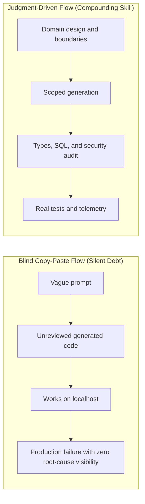

> [!IMPORTANT]
> **Discussion Framing:**  
> Today anyone can generate a REST API, a React component, or an Nginx configuration file in **30 seconds** with an AI assistant. Yet it is increasingly common to see projects that compile on the first try only to collapse in production with memory leaks, unindexed SQL queries, Prompt Injection vulnerabilities, or bloated dependencies because nobody on the team truly understands what the generated code does. How should we structure software engineering learning in this landscape so we capture AI speed without eroding technical judgment?

---

## The Real Dilemma: Apparent Velocity Versus Deep Understanding

A straightforward analogy captures the tension: a scientific calculator does not harm someone who already understands algebra and calculus—it saves mechanical effort so they can focus on modeling the problem. However, relying on a calculator before understanding what a fraction or derivative means removes your ability to notice when an output is nonsensical due to bad input.

Software engineering faces the exact same dynamic with LLM assistants and coding agents. The risk is not using AI itself, but reversing the order between understanding the problem and generating code. When generation happens before design, the developer shifts from author to operator, pasting solutions they can only validate by checking whether localhost boots without syntax errors.



---

## A Concrete Case: Code That Compiles Cleanly and Fails in Production

To ground the discussion outside abstract opinions, consider a pattern that shows up repeatedly in repositories built from quick prompts like *"create an endpoint to list a user's orders and filter them by search text"*:

```typescript
// Typical output generated without architectural or security constraints
@Get('orders')
async listOrders(@Query('userId') userId: string, @Query('q') q?: string) {
  const allOrders = await this.ordersRepo.find({ relations: ['items', 'customer'] });
  return allOrders.filter(
    (order) =>
      order.userId === Number(userId) &&
      (!q || order.notes.toLowerCase().includes(q.toLowerCase())),
  );
}
```

The snippet compiles in TypeScript with zero warnings, passes a manual check against **10 local rows**, and looks shippable. Yet an engineer with technical judgment immediately spots four serious flaws:

* **Broken authorization (IDOR):** It trusts `userId` directly from the query string instead of extracting identity from the server-side authenticated session; any client can read another user's orders by changing the parameter.
* **Memory and disk exhaustion:** It runs an unbounded `find()` with no `WHERE` clause or `LIMIT`, triggering a full `SCAN TABLE` plus joins across `items` and `customer` only to load thousands of rows into RAM and filter them in JavaScript.
* **Unhandled nullability:** If `order.notes` is `null` in the database, `order.notes.toLowerCase()` throws an unhandled `500` runtime exception.
* **Missing input validation:** `Number(userId)` silently evaluates to `NaN` and returns empty arrays instead of rejecting invalid input with a DTO-validated `400 Bad Request`.

That is the core of this discussion: an AI assistant can produce the fixed version in **10 seconds**, but only if the engineer knows what to ask and what to audit.

---

## What to Delegate and What Not to Delegate While Learning

Based on real code reviews and production systems, a healthy boundary usually breaks down like this:

| Engineering Task | Healthy Use of AI Assistants | Risk When Delegated Blindly |
|---|---|---|
| Syntax and boilerplate | Speeding up DTOs, repetitive mappers, or test scaffolding. | Losing fluency in the language when diagnosing non-trivial compiler errors. |
| Database design | Comparing normalization trade-offs or auditing composite indexes. | Accepting missing foreign keys, wrong column types, or full `SCAN TABLE` queries. |
| Incident debugging | Brainstorming hypotheses from real stack traces or kernel logs. | Looping through patches (empty `try-catch` blocks or forced casts) without fixing root causes. |
| Security and networking | Reviewing hardening checklists for UFW, Nginx, or input validation. | Exposing unauthenticated endpoints, binding to `0.0.0.0`, or leaking credentials. |
| Reading existing code | Tracing an unfamiliar call graph step by step before editing. | Modifying critical files without understanding side effects across other modules. |

---

## The Four Competing Positions in the Industry Today

Across engineering teams, universities, and technical communities, four clear positions keep colliding—each carrying real trade-offs worth weighing before voting in the poll:

| Position | Main Advantage | Risk or Blind Spot |
|---|---|---|
| Fundamentals first without AI | Builds genuine muscle memory for debugging without crutches and reading primary documentation. | Slower initial curve if stretched too long, and disconnect from modern day-to-day workflows. |
| AI as a Socratic tutor | Speeds up comprehension via explanations, counterexamples, and guided questions without handing over finished code. | Demands strong personal discipline; under deadline pressure it is easy to slip into asking for full solutions. |
| Focus on reading and architecture | Trains the most durable skills: auditing Pull Requests, modeling data, and reading execution plans. | Without writing code from scratch, architectural taste can remain purely theoretical. |
| Free AI use backed by tests | Maximizes iteration speed when anchored by automated tests, linters, and real benchmarks. | Weak or AI-generated tests written without scrutiny create a false sense of safety and coverage. |

> [!NOTE]
> **Open point of friction:** None of these four approaches fits every stage equally. What works for an engineer with **8 years** in production can actively hinder someone **3 months** into learning programming. Comparing real experiences across stages is what makes this thread useful.

---

## Open Questions for the Community

Vote in the poll below and share your real-world perspective in the replies:

1. If you were starting from scratch today, would you avoid AI assistants for the first few months or use them from day one strictly as a tutor without requesting full solutions?
2. In your team or personal projects, what practical rule do you enforce to guarantee you understand generated code before running `git commit`?
3. For those conducting interviews or reviewing Pull Requests: what concrete signal immediately reveals that code was generated without technical judgment?
4. In which specific areas (testing, SQL, Linux infrastructure, architecture) does AI deliver the highest reliable value today, and where does it still introduce dangerous silent failures?
5. Should technical interviews ban coding assistants, or specifically test how candidates audit and fix subtly flawed model-generated code?
