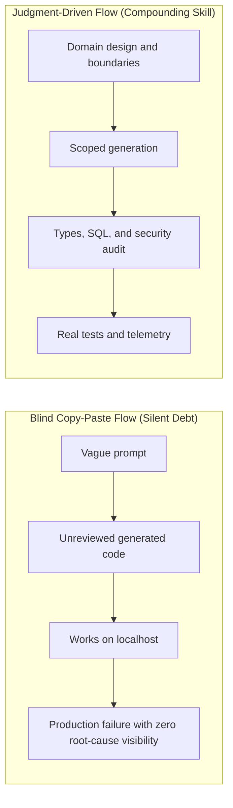

> [!IMPORTANT]
> **Discussion Framing:**  
> Today anyone can generate a REST API, a React component, or an Nginx configuration file in **30 seconds** with an AI assistant. Yet it is increasingly common to see projects that compile on the first try only to collapse in production with memory leaks, unindexed SQL queries, Prompt Injection vulnerabilities, or bloated dependencies because nobody on the team truly understands what the generated code does. How should we structure software engineering learning in this landscape so we capture AI speed without eroding technical judgment?

---

## The Real Dilemma: Apparent Velocity Versus Deep Understanding

A straightforward analogy captures the tension: a scientific calculator does not harm someone who already understands algebra and calculus—it saves mechanical effort so they can focus on modeling the problem. However, relying on a calculator before understanding what a fraction or derivative means removes your ability to notice when an output is nonsensical due to bad input.

Software engineering faces the exact same dynamic with LLM assistants and coding agents. The risk is not using AI itself, but reversing the order between **understanding the problem** and **generating code**:

---

## What to Delegate and What Not to Delegate While Learning

Based on real code reviews and production systems, a healthy boundary usually breaks down like this:

| Engineering Task | Healthy Use of AI Assistants | Risk When Delegated Blindly |
|---|---|---|
| Syntax and boilerplate | Speeding up DTOs, repetitive mappers, or test scaffolding. | Losing fluency in the language when diagnosing non-trivial compiler errors. |
| Database design | Comparing normalization trade-offs or auditing composite indexes. | Accepting missing foreign keys, wrong column types, or full `SCAN TABLE` queries. |
| Incident debugging | Brainstorming hypotheses from real stack traces or kernel logs. | Looping through patches (empty `try-catch` blocks or forced casts) without fixing root causes. |
| Security and networking | Reviewing hardening checklists for UFW, Nginx, or input validation. | Exposing unauthenticated endpoints, binding to `0.0.0.0`, or leaking credentials. |
| Reading existing code | Tracing an unfamiliar call graph step by step before editing. | Modifying critical files without understanding side effects across other modules. |

---

## Open Questions for the Community

Vote in the poll above and share your real-world perspective below:

1. If you were starting from scratch today, would you avoid AI assistants for the first few months or use them from day one strictly as a tutor without requesting full solutions?
2. In your team or personal projects, what practical rule do you enforce to guarantee you understand generated code before running `git commit`?
3. For those conducting interviews or reviewing Pull Requests: what immediate signal reveals that code was generated without technical judgment?
4. In which concrete areas (testing, SQL, Linux infrastructure, architecture) does AI deliver the highest reliable value today, and where does it still introduce dangerous mistakes?
