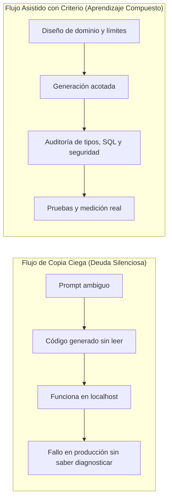

> [!IMPORTANT]
> **Planteamiento del Debate:**  
> Hoy cualquier persona puede generar una API REST, un componente React o un archivo de configuración de Nginx en **30 segundos** con un asistente de IA. Sin embargo, cada vez es más frecuente ver proyectos que compilan a la primera pero colapsan en producción con fugas de memoria, consultas SQL sin índice, vulnerabilidades de Inyección de Prompts o dependencias innecesarias porque nadie en el equipo entiende realmente qué hace el código generado. ¿Cómo deberíamos estructurar el aprendizaje de la ingeniería de software en este contexto para aprovechar la velocidad de la IA sin atrofiar el criterio técnico?

---

## El Dilema Real: Productividad Aparente Frente a Comprensión Profunda

Una analogía simple ilustra el problema: una calculadora científica no perjudica a quien ya comprende álgebra y cálculo; al contrario, le ahorra tiempo mecánico para concentrarse en modelar el problema. Pero si alguien depende de la calculadora antes de entender qué es una derivada o una fracción, pierde la capacidad de notar cuando un resultado es absurdo por un error de entrada.

En ingeniería de software ocurre exactamente lo mismo con los asistentes y agentes basados en modelos de lenguaje. El riesgo no es usar IA, sino invertir el orden entre **entender el problema** y **generar código**:

---

## Qué Delegar y Qué No Delegar Cuando Estás Aprendiendo

A partir de lo que he visto en revisiones de código y proyectos reales, la frontera saludable suele dividirse así:

| Tarea de Ingeniería | Uso Saludable de Asistentes IA | Riesgo Cuando Se Delega a Ciegas |
|---|---|---|
| Sintaxis y boilerplate | Acelerar DTOs, mapeos repetitivos o esqueletos de pruebas. | Perder familiaridad con el lenguaje cuando toca depurar un error de compilación. |
| Diseño de base de datos | Contrastar alternativas de normalización o pedir revisión de índices. | Aceptar relaciones sin llaves foráneas, tipos incorrectos o consultas con `SCAN TABLE`. |
| Depuración de errores | Pedir hipótesis posibles a partir de un stack trace o log real. | Aplicar parches en bucle (`try-catch` vacíos o casts forzados) sin atacar la causa raíz. |
| Seguridad y redes | Revisar checklists de endurecimiento en UFW, Nginx o validación de entradas. | Exponer endpoints sin autenticación, puertos en `0.0.0.0` o secretos filtrados. |
| Lectura de código ajeno | Explicar un flujo complejo paso a paso antes de modificarlo. | Modificar archivos críticos sin comprender efectos secundarios en otros módulos. |

---

## Preguntas Abiertas para el Debate

Participa en la encuesta superior y comparte tu experiencia real en los comentarios:

1. Si empezaras desde cero hoy, ¿prohibirías el uso de asistentes durante los primeros meses o los usarías desde el primer día en modo tutor sin pedir soluciones completas?
2. En tu equipo o proyectos personales, ¿qué regla práctica aplicas para asegurarte de que entiendes el código antes de hacer `git commit`?
3. Para quienes entrevistan o revisan Pull Requests: ¿qué señal delata de inmediato que un código fue generado con IA sin criterio técnico detrás?
4. ¿En qué áreas concretas (testing, SQL, infraestructura Linux, arquitectura) sientes que la IA aporta más valor real hoy y en cuáles sigue cometiendo errores peligrosos?
