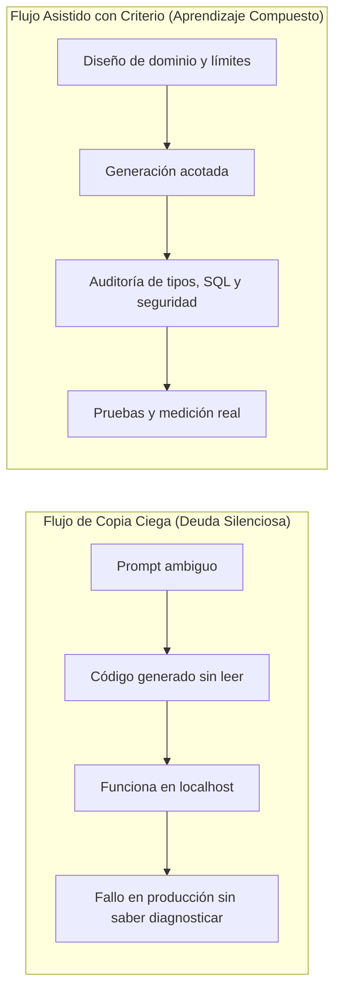

> [!IMPORTANT]
> **Planteamiento del Debate:**  
> Hoy cualquier persona puede generar una API REST, un componente React o un archivo de configuración de Nginx en **30 segundos** con un asistente de IA. Sin embargo, cada vez es más frecuente ver proyectos que compilan a la primera pero colapsan en producción con fugas de memoria, consultas SQL sin índice, vulnerabilidades de Inyección de Prompts o dependencias innecesarias porque nadie en el equipo entiende realmente qué hace el código generado. ¿Cómo deberíamos estructurar el aprendizaje de la ingeniería de software en este contexto para aprovechar la velocidad de la IA sin atrofiar el criterio técnico?

---

## El Dilema Real: Productividad Aparente Frente a Comprensión Profunda

Una analogía simple ilustra la tensión: una calculadora científica no perjudica a quien ya comprende álgebra y cálculo; al contrario, le ahorra tiempo mecánico para concentrarse en modelar el problema. Pero si alguien depende de la calculadora antes de entender qué es una derivada o una fracción, pierde la capacidad de notar cuando un resultado es absurdo por un error de entrada.

En ingeniería de software ocurre exactamente lo mismo con los asistentes y agentes basados en modelos de lenguaje. El riesgo no es usar IA, sino invertir el orden entre entender el problema y generar código. Cuando la generación ocurre antes del diseño, el desarrollador pasa de ser autor a ser un operador que pega soluciones que solo sabe validar si el servidor local arranca sin errores de sintaxis.



---

## Un Caso Concreto: Código Que Compila a la Primera y Falla en Producción

Para aterrizar el debate fuera de lo abstracto, basta mirar un patrón que aparece constantemente en repositorios generados con prompts rápidos como *"créame un endpoint para listar los pedidos de un usuario y buscarlos por texto"*:

```typescript
// Ejemplo típico generado sin restricciones de arquitectura ni seguridad
@Get('orders')
async listOrders(@Query('userId') userId: string, @Query('q') q?: string) {
  const allOrders = await this.ordersRepo.find({ relations: ['items', 'customer'] });
  return allOrders.filter(
    (order) =>
      order.userId === Number(userId) &&
      (!q || order.notes.toLowerCase().includes(q.toLowerCase())),
  );
}
```

El bloque compila en TypeScript sin advertencias, pasa una prueba manual con **10 registros** en local y parece listo para producción. Sin embargo, alguien con criterio técnico detecta de inmediato cuatro fallos graves:

* **Autorización rota (IDOR):** Lee `userId` directamente del query string en lugar de extraerlo de la sesión autenticada en el servidor; cualquier cliente puede consultar pedidos ajenos cambiando el parámetro.
* **Agotamiento de memoria y disco:** Ejecuta un `find()` sin filtro `WHERE` ni `LIMIT`, provocando un `SCAN TABLE` completo más joins de `items` y `customer` para cargar miles de filas en RAM y filtrarlas en JavaScript.
* **Nulabilidad sin defensa:** Si `order.notes` llega como `null` en base de datos, `order.notes.toLowerCase()` lanza una excepción `500` no controlada en tiempo de ejecución.
* **Falta de validación de entrada:** `Number(userId)` acepta `NaN` en silencio y devuelve arreglos vacíos en vez de un `400 Bad Request` validado con DTO.

Ese es precisamente el corazón del debate: la IA puede escribir la versión corregida en **10 segundos**, pero solo si el ingeniero sabe qué preguntar y qué auditar.

---

## Qué Delegar y Qué No Delegar Cuando Estás Aprendiendo

A partir de lo que se repite en revisiones de código y sistemas reales, la frontera saludable suele dividirse así:

| Tarea de Ingeniería | Uso Saludable de Asistentes IA | Riesgo Cuando Se Delega a Ciegas |
|---|---|---|
| Sintaxis y boilerplate | Acelerar DTOs, mapeos repetitivos o esqueletos de pruebas. | Perder familiaridad con el lenguaje cuando toca depurar un error de compilación. |
| Diseño de base de datos | Contrastar alternativas de normalización o pedir revisión de índices. | Aceptar relaciones sin llaves foráneas, tipos incorrectos o consultas con `SCAN TABLE`. |
| Depuración de errores | Pedir hipótesis posibles a partir de un stack trace o log real. | Aplicar parches en bucle (`try-catch` vacíos o casts forzados) sin atacar la causa raíz. |
| Seguridad y redes | Revisar checklists de endurecimiento en UFW, Nginx o validación de entradas. | Exponer endpoints sin autenticación, puertos en `0.0.0.0` o secretos filtrados. |
| Lectura de código ajeno | Explicar un flujo complejo paso a paso antes de modificarlo. | Modificar archivos críticos sin comprender efectos secundarios en otros módulos. |

---

## Las Cuatro Posturas Que Hoy Chocan en la Industria

En equipos de ingeniería, universidades y comunidades técnicas suelen aparecer cuatro posturas bien definidas, cada una con concesiones reales que vale la pena contrastar antes de votar en la encuesta:

| Postura | Ventaja Principal | Riesgo o Punto Ciego |
|---|---|---|
| Fundamentos primero sin IA | Construye memoria muscular real para depurar sin muletas y leer documentación primaria. | Curva inicial más lenta si se prolonga demasiado y desconexión frente a flujos modernos de trabajo. |
| IA como tutor socrático | Acelera la comprensión pidiendo explicaciones, contraejemplos y preguntas sin entregar código listo. | Requiere mucha disciplina personal; ante presión de tiempo es fácil deslizarse hacia pedir la solución completa. |
| Foco en lectura y arquitectura | Entrena las habilidades más duraderas: auditar Pull Requests, modelar datos y leer planes de ejecución. | Sin práctica escribiendo código propio desde cero, el criterio de diseño puede volverse meramente teórico. |
| Uso libre con pruebas y métricas | Maximiza velocidad de iteración apoyándose en tests automatizados, linters y benchmarks reales. | Los tests mal diseñados o también generados sin criterio dan una falsa sensación de cobertura y seguridad. |

> [!NOTE]
> **Punto de fricción abierto:** Ninguna de las cuatro posturas es universal para todos los niveles. Lo que funciona para un ingeniero con **8 años** en producción puede ser contraproducente para alguien que lleva **3 meses** aprendiendo programación. Por eso interesa contrastar experiencias reales según etapa y contexto.

---

## Preguntas Abiertas para el Debate

Participa en la encuesta inferior y comparte tu experiencia real en las respuestas:

1. Si empezaras desde cero hoy, ¿prohibirías el uso de asistentes durante los primeros meses o los usarías desde el primer día en modo tutor sin pedir soluciones completas?
2. En tu equipo o proyectos personales, ¿qué regla práctica aplicas para asegurarte de que entiendes el código antes de hacer `git commit`?
3. Para quienes entrevistan o revisan Pull Requests: ¿qué señal concreta delata de inmediato que un código fue generado con IA sin criterio técnico detrás?
4. ¿En qué áreas específicas (testing, SQL, infraestructura Linux, arquitectura) sientes que la IA aporta más valor confiable hoy y en cuáles sigue introduciendo fallos silenciosos peligrosos?
5. ¿Crees que las entrevistas técnicas deberían prohibir asistentes o evaluar precisamente cómo el candidato audita y corrige código defectuoso generado por un modelo?
