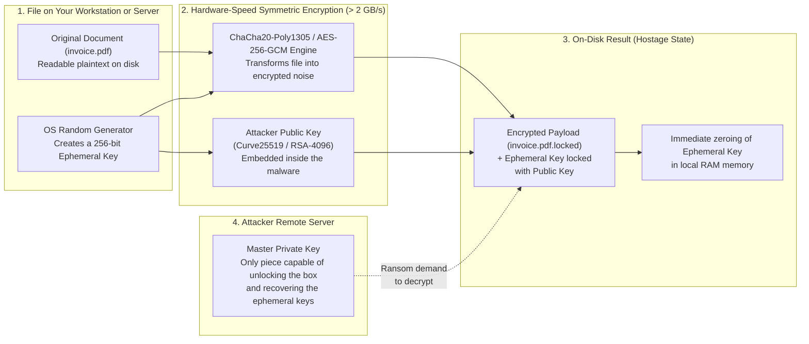
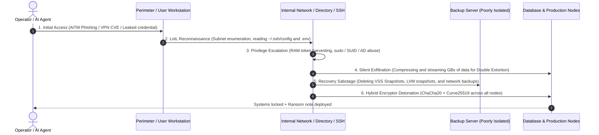
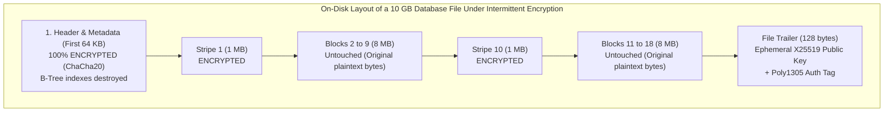
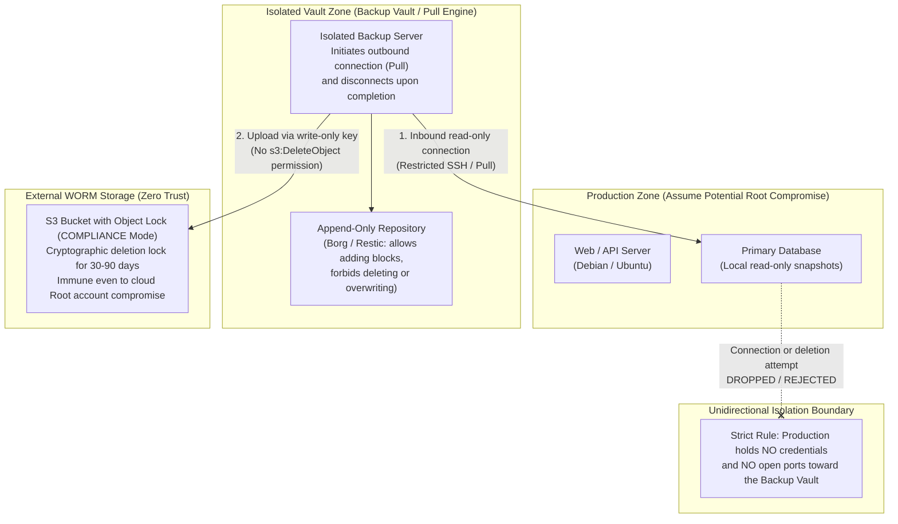

> [!IMPORTANT]
> **Executive Summary:**  
> Threat intelligence data published by Check Point Research reveals that October 2026 reached an all-time high with **1,063 publicly confirmed** ransomware attacks in a single month, representing a **35% year-over-year increase** compared to October 2025, alongside a global average of **2,550 weekly cyberattacks** per organization (**+32% YoY**). The primary driver behind this escalation is the transition of artificial intelligence agents from passive phishing composition to autonomous live intrusion operations, compressing lateral movement time prior to encryption from days down to **under 45 minutes**. Because modern encryption engines combine high-speed symmetric stream ciphers (`ChaCha20-Poly1305` or `AES-256-GCM`) with asymmetric key exchange (`Curve25519` or `RSA-4096`), mathematical reversal without the private key is computationally infeasible; operational continuity requires a **3-2-1-1-0** backup architecture enforcing WORM storage, Air Gap isolation, *append-only* repositories, and Linux kernel capability bounding.

---

## Conceptual Model: How Ransomware Takes Data Hostage from Scratch

To understand why neither technology enterprises nor government agencies can simply "uninstall the virus" or "guess the password" after suffering a Ransomware attack, it is essential to distinguish between conventional malware and cryptographic extortion:

* **Why deleting the malicious program does not restore your files:** When traditional malware infects a computer, it typically hides folders or locks the screen interface; booting from a rescue drive and deleting the malicious executable restores normal operation. Ransomware operates fundamentally differently: it reads every original document, photograph, or database, applies an irreversible mathematical transformation to its bytes, and overwrites or destroys the original disk sectors. Removing the ransomware binary after it finishes executing is equivalent to evicting an intruder who just changed the combinations on every vault inside a bank: the intruder is gone, but the vaults remain locked without the new combination.
* **The single-key dilemma (Why attackers do not use one fixed secret key):** If a ransomware author hardcoded a single secret key inside the malicious program to encrypt victim files, a security analyst could disassemble that binary in a laboratory, extract the embedded key within minutes, and release a free decryptor for every victim worldwide.
* **The speed dilemma (Why attackers do not use pure asymmetric cryptography):** To prevent analysts from extracting the decryption key from the binary, attackers use public-key cryptography: they embed only an open lock cylinder (their **Public Key**) inside the malware while keeping the only piece capable of opening it (their **Private Key**) on their own remote server. However, asymmetric algorithms such as RSA or Curve25519 are designed to protect tiny data blocks; attempting to directly encrypt a **500 GB** database with an asymmetric algorithm would take hours of full CPU load, alerting monitoring systems long before completion.
* **The real attack architecture (Two-Stage Hybrid Encryption):** To achieve both extreme throughput and cryptographic irreversibility, ransomware combines both paradigms on every individual file across your drive:



1. **Per-file disposable key generation:** For each individual file, the ransomware requests a random **256-bit** symmetric key from the operating system that exists only in volatile RAM for a few milliseconds.
2. **High-speed content transformation:** Using that disposable key, it encrypts the file contents with stream ciphers like `ChaCha20-Poly1305` or `AES-256-GCM` accelerated by CPU hardware instructions (`AES-NI`), exceeding **2 GB per second**.
3. **Asymmetric wrapping and RAM scrubbing:** Before moving to the next file, the ransomware takes that 32-byte disposable key, encrypts it using the attacker's **Public Key** (`Curve25519` or `RSA-4096`), appends that sealed envelope to the end of the hijacked file, and overwrites the plaintext key in local RAM with zeros.

Once the process completes, not even the malicious binary remaining on your machine can reverse what it just did: the only mathematical key capable of opening the envelopes attached to your files resides outside your network.

---

## Essential Glossary of Digital Extortion, Cryptography, and Resilience

| Term | Concise Technical Definition |
|---|---|
| Ransomware | Malicious software that encrypts files or entire storage volumes using hybrid cryptography and demands financial payment in exchange for the private decryption key. |
| Hybrid Encryption | Cryptographic scheme combining the speed of symmetric ciphers (`AES` / `ChaCha20`) for bulk data with the security of asymmetric cryptography (`Curve25519` / `RSA`) to protect session keys. |
| Intermittent Encryption | Technique where malware encrypts only the file header and alternating stripes (for example, 1 MB out of every 10 MB) to corrupt terabytes of data in seconds with minimal CPU load. |
| Double and Triple Extortion | Operational model where attackers exfiltrate sensitive data before encrypting disks, threatening to leak it publicly (double) or directly extorting the victim's clients and partners (triple). |
| Breakout Time | Elapsed time from when an intruder compromises the first machine in an organization until they begin moving laterally toward other critical servers across the network. |
| Lateral Movement | Techniques used by an attacker after compromising an initial endpoint to pivot across internal servers, databases, and backup repositories within the same network. |
| Living off the Land (LotL) | Intrusion strategy that avoids downloading detectable malware binaries by relying instead on legitimate administrative tools pre-installed in the OS (`ssh`, `bash`, `curl`, `PowerShell`). |
| 3-2-1-1-0 Rule | Data protection standard requiring 3 copies of data, on 2 different storage media types, 1 copy offsite, 1 copy immutable or offline, and 0 errors during automated recovery verification. |
| WORM (Write Once, Read Many) | Storage architecture that allows data to be written once and cryptographically or physically prevents anyone (including root administrators) from deleting or altering it until retention expires. |
| Air Gap | Physical or strict logical isolation where a backup storage target has no active network link to production servers, preventing remote intrusions from reaching it. |
| Push vs. Pull Backup | In a *Push* model the production server sends backups to the storage server (vulnerable if production is compromised); in a *Pull* model an isolated vault initiates read-only extraction without granting production reverse access. |
| Kernel Capabilities | Linux kernel security mechanism that partitions absolute `root` power into granular privileges (such as `CAP_LINUX_IMMUTABLE`) that can be dropped to protect critical files. |

---

## 1. Anatomy of the October 2026 Record ("Black October") and the Shift in Scale

The monthly threat intelligence report published by Check Point Research documented an unprecedented figure in October 2026: **1,063 organizations** suffered publicly confirmed ransomware attacks posted on extortion Data Leak Sites over a 31-day window. Because public extortion trackers only count victims that initially refused to pay and had their data listed, the true operational volume of incidents is substantially higher.

```mermaid
xychart-beta
    title "Year-over-Year Evolution and Impact Metrics (October 2025 vs October 2026)"
    x-axis ["Ransomware Attacks / Month", "Global Attacks / Week (x10)", "Education Sector / Week (x10)"]
    y-axis "Recorded Volume" 0 --> 1200
    bar [787, 193, 449]
    bar [1063, 255, 593]
```



### 1.1 Quantitative Breakdown of the Global Threat Surface

| Intelligence Indicator (October 2026) | Verified Figure | Variation / Operational Impact |
|---|---|---|
| Publicly reported ransomware attacks in the month | **1,063 public incidents** | **35% year-over-year increase** compared to October 2025 (all-time monthly record). |
| Average cyberattacks per organization | **2,550 weekly attacks** | Sustained **32% year-over-year increase** across enterprise and government networks. |
| Regions with sharpest year-over-year acceleration | Europe (**+39% YoY**) and Latin America | Heavy concentration in municipal utilities, transportation, retail, aviation, and finance. |
| Industrial sectors most targeted by extortion | Manufacturing, Business Services, Retail | Sectors with near-zero tolerance for physical operational downtime across supply chains. |
| Sector with highest raw intrusion volume | Education and Research | Average of **5,934 weekly attacks** per institution due to open networks and high device turnover. |
| Enterprise GenAI data leakage exposure | **1 in every 35 prompts** | **90%** of organizations using generative AI tools exposed internal code snippets, keys, or sensitive data. |

### 1.2 Industrialization of the RaaS (Ransomware-as-a-Service) Economy

Behind these numbers are not isolated hackers writing custom malware for each target, but a specialized supply chain divided into three distinct operational tiers:

1. **Initial Access Brokers (IABs):** Specialized groups that continuously scan the internet for unpatched perimeter vulnerabilities (critical CVE flaws in VPN appliances, exposed admin dashboards, or leaked credentials) and harvest active sessions via phishing. Once they breach a network, they do not encrypt anything; instead, they auction that access on underground marketplaces.
2. **Platform Developers (RaaS Operators):** Criminal engineering teams that maintain high-performance encryption payloads in compiled languages (Rust, Go, and C++), operate Tor negotiation portals, and provide data exfiltration infrastructure in exchange for a **15% to 25%** cut of each collected ransom.
3. **Affiliates and Agent-Assisted Operators:** Actors who purchase initial access, infiltrate the corporate network, locate and destroy backup repositories, exfiltrate sensitive records, and detonate the RaaS encryptor. During October 2026, intelligence analysts highlighted how emerging groups leveraging automated tooling (such as the *n0n* extortion group, which entered the global top three within its first month of operations, alongside affiliates of *INC* and *The Gentlemen*) multiplied the number of concurrent intrusions a single operator can execute.

---

## 2. Step-by-Step Anatomy of a Complete Intrusion: From Initial Access to Hostage Note

A ransomware incident does not happen the instant someone clicks a malicious link; disk encryption is merely the **final step** of a silent intrusion divided into six distinct phases:



### Phase 1: Initial Access
Every intrusion begins through one of three primary entry vectors:
* **Real-Time Proxy Phishing (*AiTM Phishing*):** An employee receives an urgent notification mimicking their identity provider (Microsoft 365, Google Workspace, or corporate SSO). When they enter their password and 6-digit TOTP code, a reverse proxy controlled by the attacker relays those credentials to the real service in real time and captures the resulting **authenticated session cookie**, bypassing multifactor authentication without needing the password again.
* **Leaked or Reused Credentials (*Infostealers*):** A developer or sysadmin infects a personal home computer by running unverified software; an information-stealing trojan extracts browser cookies, `.env` files, or unencrypted SSH keys from `~/.ssh/`, granting direct access to corporate cloud infrastructure.
* **Unpatched Perimeter Services:** A cloud instance leaves port `22` open with password authentication enabled (`PasswordAuthentication yes`) or runs a public-facing service with an unpatched remote code execution flaw.

### Phase 2: Silent Reconnaissance (*Living off the Land*)
Once inside the first machine, the intruder avoids downloading external hacking binaries that would immediately trigger antivirus or EDR alerts. Instead, they rely exclusively on built-in operating system utilities (*Living off the Land*):
* On Linux servers, the operator runs `ip addr`, `ip route`, `ss -tulpn`, `cat ~/.ssh/known_hosts`, `env`, and searches for configuration files (`find / -name "*.env" 2>/dev/null`) to map out which internal servers this host communicates with.
* On Windows environments, they query Active Directory using native utilities (`nltest`, `net group`, `PowerShell`) to locate domain controllers and network storage arrays.

### Phase 3: Privilege Escalation and Credential Harvesting
With the network topology mapped, the attacker seeks full administrative privileges (`root` on Linux or `Domain Admin` on Windows):
* They inspect overly permissive `sudo -l` rules, vulnerable `SUID` binaries, exposed Docker sockets (`/var/run/docker.sock`, which grant immediate `root` equivalence on the host), or cleartext AWS/Cloudflare API keys stored in application directories.

### Phase 4: Lateral Movement to Core Infrastructure
Using newly harvested administrative keys or credentials, the attacker pivots from host to host over standard SSH or SMB/RDP connections. To a conventional network firewall, this lateral movement appears indistinguishable from routine late-night system administration.

### Phase 5: Data Exfiltration (The Double Extortion Trap)
In the early days of ransomware, organizations with clean backups simply wiped their servers, restored from backup, and refused to pay. To eliminate this defense, modern groups enforce **Double and Triple Extortion**:
* Before encrypting a single file, the attacker silently compresses customer databases, financial records, medical files, or proprietary source code and streams them to external cloud storage using legitimate transfer tools (`rclone`, `curl`, or SFTP tunnels).
* Consequently, even if the victim restores their servers the next morning from backups, the extortionists threaten to publish the stolen records online or notify data protection regulators and customers unless the ransom is paid.

### Phase 6: Backup Sabotage and Mass Encryption Detonation
This is the decisive strike executed moments before displaying the ransom note:
1. The attacker locates every backup target accessible from the production environment (mounted NFS/SMB shares, permanently attached external drives, S3 credentials with `s3:DeleteObject` permissions, and local OS snapshots).
2. They execute purge commands to destroy all local recovery points:
   * On Windows, they wipe Volume Shadow Copies (`vssadmin delete shadows /all /quiet`) and disable boot recovery via `bcdedit`.
   * On Linux, they delete Logical Volume Manager snapshots (`lvremove`), ZFS/Btrfs snapshots, and wipe remote backup directories reachable via SSH.
3. Only after confirming that the victim cannot restore their data do they deploy and execute the encryption binary simultaneously across all nodes, stopping database daemons first (`systemctl stop postgresql mysql mariadb`) so physical table files can be encrypted cleanly without open file locks.

---

## 3. What Changes When the Attacker Is an Autonomous AI Agent

The most critical shift documented in late-2026 security telemetry is the evolution of the attack operator. Historically, while the file-encryption binary was automated, the intermediate intrusion stages (network reconnaissance, parsing configuration files, hunting for credentials, and lateral pivoting) required a human operator sitting at a keyboard interpreting terminal outputs.

When extortion syndicates wire an **AI Agent** to a remote shell session via an autonomous tool-execution loop (*ReAct Loop*: Observe $\to$ Reason $\to$ Execute command $\to$ Parse output), the incident timeline compresses dramatically:

| Intrusion Stage | Traditional Human Operator | Automated AI Agent | Defense Impact |
|---|---|---|---|
| Initial host reconnaissance | **15 to 45 minutes** running manual commands and reading long terminal outputs. | **Under 10 seconds** parsing process trees, network interfaces, and environment variables in parallel. | Host mapping completes before a human SOC analyst even opens a low-priority alert. |
| Secret and credential hunting | Manual inspection of common paths (`~/.ssh`, `.env`, bash history). | Semantic scanning across hundreds of code files, logs, and configs identifying tokens on the fly. | Any forgotten credential inside a secondary script or comment is discovered in seconds. |
| Adaptation to missing tools | If a binary is missing (e.g. no `python` or `nc` installed), the human must manually test alternatives. | The agent reads `command not found` on `stderr` and immediately rewrites the payload using `awk`, `bash /dev/tcp`, or `perl`. | Defenses relying on removing a single utility fail to halt the execution chain. |
| Total Breakout Time | **2 to 10 days** from initial breach to full network compromise. | **Under 45 minutes** from initial foothold to locating backup repositories. | Manual human response arrives too late; containment and backup isolation must be structural and pre-configured. |

---

## 4. Internal Cryptography of the Encryptor: Intermittent Encryption and On-Disk Layout

A common technical question among developers and sysadmins is: *"If I have a 200 GB database and a monitoring alert that triggers on sustained 100% CPU usage, how does ransomware corrupt all 200 GB in a few seconds without pegging the processor for half an hour?"*

The engineering answer is **Intermittent Encryption**.

### 4.1 Why Encrypting 100% of a File Is Unnecessary to Destroy It
Structured file formats (SQLite databases, PostgreSQL data files, virtual machine disks `.vmdk` / `.qcow2`, `.tar.gz` archives, PDF documents, or media containers) store their **Magic Header**, B-Tree index tables, and internal pointer maps within the first few kilobytes of the file.



Instead of reading and encrypting all 10,000 megabytes sequentially, modern ransomware engines apply a *Header + Stride* algorithm:
1. **Header destruction:** The engine fully encrypts the first **64 KB to 1 MB** of the file. This step alone destroys the format signature and index tree, rendering the file unrecognizable to any database engine or parser.
2. **Block striding (`lseek`):** It invokes the `lseek(fd, offset, SEEK_CUR)` system call to jump forward (for instance, skipping 8 MB without touching the disk), encrypts the next 1 MB stripe, skips another 8 MB, and repeats until reaching the end of the file.
3. **Cryptographic trailer injection:** It appends a 128-byte footer containing the ephemeral `X25519` public key (required for the holder of the master private key to derive the shared secret via Elliptic-Curve Diffie-Hellman) alongside the message authentication tag (`Poly1305` or `GCM Tag`).

Through this technique, the encryptor renders **10 GB of data unusable by writing only ~1.1 GB to disk**, multiplying destruction speed tenfold while keeping overall file entropy low enough to evade security sensors looking for continuous random-byte writes.

---

## 5. Why Traditional Backups Fail and the 3-2-1-1-0 Architecture

The most expensive architectural mistake made by both small teams and large enterprises is confusing **having an automated backup** with **having a backup that survives a compromised administrator**.

### 5.1 The Fatal Trap of Network-Connected "Push" Backups
In a classic (and vulnerable) setup, the production server administrator schedules a nightly `cron` job that runs a script like this:

```bash
# VULNERABLE ANTI-PATTERN (Push model with write and delete access from production)
rsync -avz --delete /var/lib/postgresql/ backup-user@10.0.0.50:/mnt/backups/production/
```

Or permanently mounts a network backup share at `/mnt/backups` or stores AWS S3 keys in `/root/.aws/credentials` with full permissions (`s3:*`).

**What happens during a ransomware intrusion:**
When the attacker or automated agent escalates to `root` on the production server, the very first files they inspect are `/etc/crontab`, `/etc/fstab`, and shell histories. They immediately discover that the production server holds an unencrypted SSH key to `10.0.0.50` or cloud credentials with deletion rights. The attacker simply runs:

```bash
# The attacker uses the backup script's own connection to wipe all backups before encrypting production
ssh backup-user@10.0.0.50 "rm -rf /mnt/backups/production/*"
```

Within five seconds, months of historical backups are cleanly erased over the exact channel designed to protect the company.

### 5.2 The Architectural Fix: Flow Inversion ("Pull" Model) + 3-2-1-1-0 Rule

For a backup to survive even the worst-case scenario—where an attacker holds complete `root` control over every production server—the architecture must invert the direction of trust:



Under the **3-2-1-1-0** standard:
* **3 copies of data:** Live production data plus two independent backup copies.
* **2 different storage media or technologies:** For example, dedicated local block/NAS storage plus external object storage.
* **1 offsite copy:** Hosted in a separate geographic region or independent cloud provider so backups survive if the primary cloud control plane is compromised.
* **1 Immutable (WORM) or Air-Gapped copy:** A copy where deletion and overwrite operations (`DELETE` / `OVERWRITE`) are mathematically or physically blocked, even for someone holding administrator credentials.
* **0 errors during restoration testing:** A backup that has never been tested via a clean-room restore onto a fresh server is not a verified backup.

---

## 6. Practical Defense and Immutable Backup Implementation on Linux (Debian and Ubuntu)

Below are four reproducible technical mechanisms for Debian (12 / 13) and Ubuntu Server (22.04 / 24.04 LTS) to lock down critical files, build repositories that forbid history deletion, and enforce WORM immutability.

### Step 6.1: Filesystem Immutability Attributes (`chattr`) and Kernel Capability Bounding

Native Linux filesystems (`ext4`, `xfs`, `btrfs`) support inode-level kernel flags that operate beneath standard `chmod 400` or `600` permissions. While a `root` process bypasses any `chmod` mode and can delete any regular file, the kernel blocks modification or deletion of any file flagged as **immutable (`+i`)** or **append-only (`+a`)**.

```bash
# 1. Mark a critical configuration file or local backup archive as IMMUTABLE (+i)
# Not even root can modify, rename, hard-link, or delete this file while +i is set
sudo chattr +i /etc/ssh/sshd_config.d/99-hardening.conf

# 2. Mark an audit log or sequential vault file as APPEND-ONLY (+a)
# Services can append new lines at the end, but no process can truncate or alter existing lines
sudo chattr +a /var/log/auth.log

# 3. Inspect active inode attributes using lsattr
lsattr /etc/ssh/sshd_config.d/99-hardening.conf /var/log/auth.log
```

The terminal output confirms the active `i` and `a` flags on the filesystem:

```text
----i---------e------- /etc/ssh/sshd_config.d/99-hardening.conf
-----a--------e------- /var/log/auth.log
```

If a malicious script or an operator running as `root` attempts to delete or overwrite that file (`sudo rm -f /etc/ssh/sshd_config.d/99-hardening.conf`), the Linux kernel rejects the `unlink()` system call with `Operation not permitted`.

#### Hardening further: Dropping `CAP_LINUX_IMMUTABLE` from services
A natural follow-up question is: *"What if an attacker who escalates to `root` inside my web service simply runs `chattr -i` to remove the flag?"*
On modern Linux systems managed by systemd, the ability to set or clear the `+i` and `+a` flags is governed by a specific kernel capability named `CAP_LINUX_IMMUTABLE`. By removing that capability from your application unit's `CapabilityBoundingSet` and enabling filesystem protection, no child process spawned by that service—even if it escalates to UID `0` (`root`)—can ever execute `chattr -i`:

```ini
# /etc/systemd/system/my-app.service.d/hardening.conf
[Service]
# Strip the kernel capability required to alter immutable attributes (+i / +a) for this service and all children
CapabilityBoundingSet=~CAP_LINUX_IMMUTABLE CAP_SYS_RAWIO CAP_SYS_MODULE

# Mount base OS directories (/usr, /boot, /etc) read-only inside the service namespace
ProtectSystem=strict
ProtectHome=read-only
NoNewPrivileges=yes
PrivateTmp=yes
```

Reload systemd to enforce the capability boundary:

```bash
sudo systemctl daemon-reload
sudo systemctl restart my-app
```

---

### Step 6.2: *Append-Only* SSH Backup Repositories with BorgBackup

When a production server needs to send encrypted backups to a Linux backup server, you can prevent a compromised production host from deleting historical backups by enforcing `--append-only` mode directly inside the backup server's `~/.ssh/authorized_keys` file.

1. **On the backup server (Debian / Ubuntu Vault):** Create a dedicated unprivileged user (`backup-vault`) and a directory to store the repository:

```bash
# On the Backup Vault server
sudo adduser --disabled-password --gecos "" backup-vault
sudo mkdir -p /var/backups/repos/prod-server
sudo chown -R backup-vault:backup-vault /var/backups/repos
```

2. **Cryptographic command restriction in `authorized_keys`:** Inside `/home/backup-vault/.ssh/authorized_keys` on the backup server, prepend the production server's public SSH key with `command="..."` and `restrict`:

```text
# /home/backup-vault/.ssh/authorized_keys on the backup server
command="borg serve --append-only --restrict-to-path /var/backups/repos/prod-server",restrict ssh-ed25519 AAAAC3NzaC1lZDI1NTE5AAAAIKt8N2xPqL9mR4vW7yB1nC5vX0zL3kJ6hG8fD2sA4pQ1 prod-backup-key
```

**How this protects your data during a live breach:**
* The `restrict` directive disables interactive shells, port forwarding, and arbitrary command execution (`rm`, `sh`, `bash`).
* Whenever the production server connects over SSH, the backup server ignores whatever command the client requests and forcibly runs `borg serve --append-only`.
* If an attacker completely compromises the production server and runs `borg delete` or `borg prune` to wipe your backup history, the backup server operates strictly in append-only mode: **no historical data blocks are ever deleted from disk**. Once the breach is discovered, the administrator logs into the isolated backup vault and rolls back the transaction log to recover 100% of prior snapshots.

---

### Step 6.3: Immutable Cloud Storage (WORM with S3 Object Lock in *Compliance* Mode)

To satisfy the offsite immutability requirement (using AWS S3, Cloudflare R2, Wasabi, or an offsite MinIO cluster), combine **S3 Object Lock** in `COMPLIANCE` mode with least-privilege credentials:

1. **Write-Only IAM Policy for the server:** The credentials used to upload backups should only grant `s3:PutObject` and `s3:ListBucket`—**never `s3:DeleteObject`**.
2. **WORM Retention in `COMPLIANCE` Mode:** Even if an attacker steals the root cloud administrator credentials, `COMPLIANCE` mode enforces at the storage engine level that no object version can be deleted or overwritten until its retention timer expires (for example, **30 days**).

```bash
# 1. Create a bucket with Object Lock and versioning enabled at creation
aws s3api create-bucket \
  --bucket doicela-immutable-backups-prod \
  --region us-east-1 \
  --object-lock-enabled-for-bucket

# 2. Apply a WORM policy in COMPLIANCE mode with a mandatory 30-day retention period
aws s3api put-object-lock-configuration \
  --bucket doicela-immutable-backups-prod \
  --object-lock-configuration '{
    "ObjectLockEnabled": "Enabled",
    "Rule": {
      "DefaultRetention": {
        "Mode": "COMPLIANCE",
        "Days": 30
      }
    }
  }'
```

> [!WARNING]
> **Critical distinction between `GOVERNANCE` mode and `COMPLIANCE` mode:**  
> Under `GOVERNANCE` mode, a user holding the `s3:BypassGovernanceRetention` permission or the cloud root account can override the lock and delete files if their credentials are compromised. Under `COMPLIANCE` mode, **no one**—not even the root account owner or cloud support staff—can delete or overwrite a protected backup version until the 30-day retention clock expires.

---

### Step 6.4: Early Intrusion and Encryption Detection on Linux with `auditd`

Because automated agents enumerate credentials and tamper with configurations within seconds before launching encryption, the Linux kernel auditing subsystem (`auditd`) can monitor in real time any attempt to read decoy files (*Canary files*) or modify critical binaries:

```bash
# 1. Install the Linux kernel audit daemon on Debian / Ubuntu
sudo apt update && sudo apt install -y auditd audispd-plugins

# 2. Define persistent rules to detect suspicious access and immutability tampering
sudo tee /etc/audit/rules.d/99-ransomware-defense.rules > /dev/null << 'EOF'
# Monitor any modification to SSH and sudoers configurations
-w /etc/ssh/sshd_config -p wa -k ssh_config_tamper
-w /etc/ssh/sshd_config.d/ -p wa -k ssh_config_tamper
-w /etc/sudoers -p wa -k sudoers_tamper
-w /etc/sudoers.d/ -p wa -k sudoers_tamper

# Monitor system calls attempting to alter extended inode attributes (chattr -i / -a)
-a always,exit -F arch=b64 -S ioctl -F a1=0x40086602 -k chattr_execution

# Monitor any read or write access to a decoy Canary file placed in the backup directory
-w /var/backups/.00_canary_credentials.env -p rwa -k canary_triggered
EOF

# 3. Load the rules into the kernel and verify active watches
sudo augenrules --load
sudo auditctl -l
```

If any process or autonomous agent reads the decoy file `/var/backups/.00_canary_credentials.env` during reconnaissance, the kernel immediately logs the exact process ID (`pid`), executable path (`exe`), working directory (`cwd`), and original login user ID (`auid`) in `/var/log/audit/audit.log`, allowing immediate session termination:

```bash
# Query alerts triggered on the decoy Canary file in real time
sudo ausearch -k canary_triggered -i
```

---

## 7. Quick Reference Guide: Hardening, Immutability, and Auditing Commands

| Command or Directive | Operational Purpose Against Ransomware |
|---|---|
| chattr +i /path/to/file | Blocks any modification, renaming, or deletion of the file in the Linux kernel, even by `root`. |
| chattr +a /var/log/file.log | Enforces *append-only* mode: allows appending new log entries while preventing deletion or alteration of prior lines. |
| lsattr -a /path/to/dir | Lists extended inode attributes (`i`, `a`, `e`) to audit which files have kernel-level protection enabled. |
| CapabilityBoundingSet=~CAP_LINUX_IMMUTABLE | Systemd directive preventing a compromised service (even running as UID 0) from stripping the `+i` flag via `chattr -i`. |
| borg serve --append-only | Restricts a remote SSH backup repository so an infected production server can only append new backups without deleting old ones. |
| Mode: COMPLIANCE (S3 Object Lock) | Guarantees WORM immutability on cloud object storage for the configured retention period, immune to admin credential theft. |
| ausearch -k canary_triggered -i | Queries the Linux kernel audit log to identify which process or user accessed a decoy file or tampered with critical configs. |
| ss -tupn \| grep ESTAB | Displays all active outbound TCP connections in real time with process name and `pid` to spot data exfiltration or C2 traffic. |

---

## Conclusion and Resilience Verification Checklist

The record **1,063 ransomware attacks** in October 2026 and the deployment of autonomous agents as live intrusion operators confirm that security cannot rely solely on manual human response after an alert fires. When the window between initial access and encryptor detonation drops below an hour, data survival is determined by pre-existing system architecture:

- [x] **Elimination of Initial Access Vectors:** Password authentication disabled on SSH (`PasswordAuthentication no`), exclusive use of Ed25519 keys or phishing-resistant FIDO2 tokens, and continuous patching of internet-facing appliances.
- [x] **Structural Backup Isolation (3-2-1-1-0 Rule):** Removal of *Push* scripts holding deletion permissions from production; adoption of *Pull* extraction or SSH repositories locked in `--append-only` mode.
- [x] **Verified WORM Immutability:** At least one offsite backup protected by WORM storage (such as S3 Object Lock in `COMPLIANCE` mode) or physical Air Gap isolation, preventing premature deletion even if root cloud credentials are stolen.
- [x] **Linux Kernel-Space Hardening (Debian and Ubuntu):** Critical configurations locked with `chattr +i`, audit logs protected with `chattr +a`, and systemd services sandboxed without `CAP_LINUX_IMMUTABLE`.
- [x] **Scheduled Clean-Room Recovery Drills:** Regular automated restoration tests onto isolated instances to guarantee **0 integrity errors** before an actual incident occurs.
