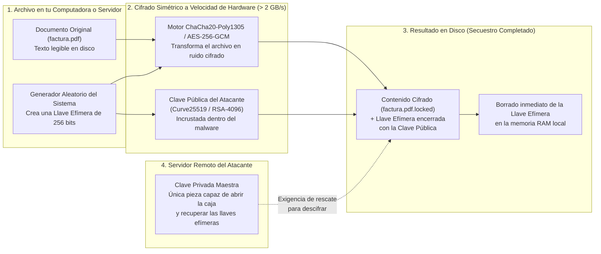
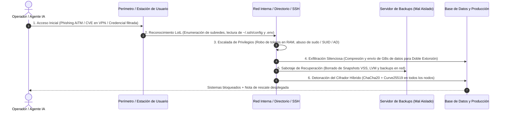
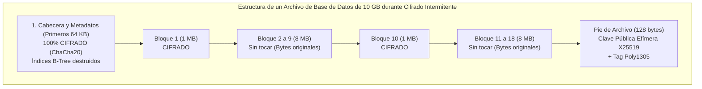
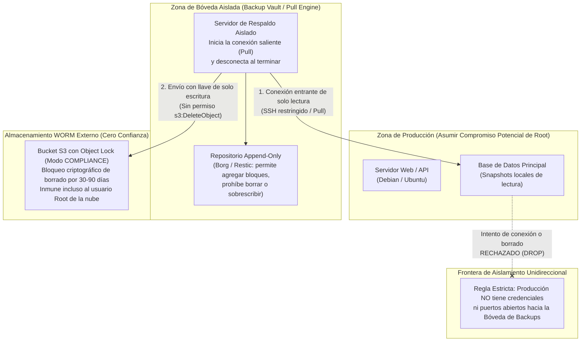

> [!IMPORTANT]
> **Resumen Ejecutivo:**  
> Los datos de inteligencia de amenazas publicados por Check Point Research revelan que octubre de 2026 alcanzó un máximo histórico con **1,063 ataques** de ransomware confirmados públicamente en un solo mes, lo que representa un incremento del **35% interanual** frente a octubre de 2025, acompañado de un promedio global de **2,550 ataques semanales** por organización (**+32% interanual**). El factor determinante de esta escalada es la transición de los agentes de inteligencia artificial desde tareas pasivas de redacción de correos hacia la ejecución autónoma de intrusiones en vivo, comprimiendo el tiempo de movimiento lateral previo al cifrado de días a **menos de 45 minutos**. Debido a que los motores de cifrado modernos combinan algoritmos simétricos de flujo (`ChaCha20-Poly1305` o `AES-256-GCM`) con intercambio asimétrico de claves (`Curve25519` o `RSA-4096`), la reversión matemática sin la clave privada es computacionalmente inviable; la continuidad operativa depende de una arquitectura de respaldos bajo la regla **3-2-1-1-0** con almacenamiento WORM, aislamiento Air Gap, repositorios *append-only* y bloqueo de capacidades en el kernel de Linux.

---

## Modelo Conceptual: Cómo Secuestra tus Datos el Ransomware desde Cero

Para comprender por qué ni las empresas tecnológicas ni los organismos gubernamentales pueden simplemente "desinstalar el virus" o "adivinar la contraseña" tras sufrir un ataque de Ransomware, es necesario distinguir entre un programa dañino común y un secuestro criptográfico:

* **Por qué borrar el programa malicioso no devuelve tus archivos:** Cuando un virus tradicional infecta un equipo, suele ocultar carpetas o bloquear la pantalla; si arrancas la computadora con un disco de rescate y eliminas el archivo ejecutable malicioso, el sistema vuelve a la normalidad. El ransomware opera de forma distinta: lee cada documento, fotografía o base de datos original, aplica una transformación matemática irreversible sobre sus bytes y sobrescribe o destruye los sectores originales del disco. Eliminar el binario del ransomware después de que terminó de trabajar equivale a expulsar de un banco al intruso que acaba de cambiar las combinaciones de todas las bóvedas: el intruso ya no está dentro del edificio, pero ninguna bóveda se puede abrir sin la combinación nueva.
* **El dilema de la cerradura única (Por qué el atacante no usa una sola clave fija):** Si el creador del ransomware programara una clave secreta fija dentro del archivo malicioso para cifrar tus documentos, cualquier ingeniero de seguridad podría abrir ese programa en un laboratorio, extraer la clave oculta en minutos y publicar un desbloqueador gratuito para todas las víctimas del mundo.
* **El dilema de la velocidad (Por qué no usa solo criptografía asimétrica):** Para evitar que le extraigan la clave del programa, el atacante utiliza criptografía de clave pública: incluye dentro del malware únicamente un cilindro de cerradura abierto (su **Clave Pública**) y guarda bajo llave en su propio servidor remoto la única pieza capaz de abrirlo (su **Clave Privada**). Sin embargo, los algoritmos asimétricos como RSA o Curve25519 están diseñados para proteger bloques diminutos de datos; si intentaran cifrar directamente una base de datos de **500 GB**, el procesador tardaría muchas horas y los sistemas de monitoreo detendrían el proceso antes de que causara daño.
* **La arquitectura real del ataque (Cifrado Híbrido en Dos Etapas):** Para lograr velocidad extrema e irreversibilidad simultánea, el ransomware combina ambos mundos en cada archivo que encuentra en tu disco duro:



1. **Generación de una llave descartable por archivo:** Para cada documento individual, el ransomware solicita al sistema operativo una llave simétrica aleatoria de **256 bits** que vive únicamente en la memoria RAM durante unos milisegundos.
2. **Transformación ultrarrápida del contenido:** Con esa llave descartable, cifra el contenido del archivo empleando motores como `ChaCha20-Poly1305` o `AES-256-GCM` apoyados por las instrucciones físicas del procesador (`AES-NI`), alcanzando velocidades superiores a **2 GB por segundo**.
3. **Encapsulado asimétrico y destrucción del rastro en RAM:** Antes de pasar al siguiente archivo, el ransomware toma esa pequeña llave descartable de 32 bytes, la cifra usando la **Clave Pública** del atacante (`Curve25519` o `RSA-4096`), guarda ese sobre sellado al final del propio archivo secuestrado y borra con ceros la llave en la memoria RAM de tu equipo.

Cuando el proceso termina, ni siquiera el propio programa malicioso que sigue en tu computadora tiene forma de revertir lo que acaba de hacer: la única llave matemática capaz de abrir los sobres adjuntos a tus archivos se encuentra fuera de tu red.

---

## Glosario Esencial de Extorsión Digital, Criptografía y Resiliencia

| Término | Definición Técnica Sencilla |
|---|---|
| Ransomware | Software malicioso que cifra archivos o sistemas completos mediante criptografía híbrida e impide el acceso a los datos hasta que se pague un rescate económico a cambio de la clave privada. |
| Cifrado Híbrido | Esquema criptográfico que une la velocidad del cifrado simétrico (`AES` / `ChaCha20`) para procesar grandes volúmenes de datos con la seguridad del cifrado asimétrico (`Curve25519` / `RSA`) para proteger las claves de sesión. |
| Cifrado Intermitente | Técnica donde el malware solo cifra la cabecera y fragmentos alternos de cada archivo grande (por ejemplo, 1 MB de cada 10 MB) para inutilizar terabytes de datos en segundos sin saturar el procesador. |
| Doble y Triple Extorsión | Modalidad en la que el atacante, antes de cifrar los discos, roba una copia de la información confidencial para amenazar con publicarla en internet (doble) o extorsionar directamente a clientes y socios de la víctima (triple). |
| Breakout Time | Tiempo transcurrido desde que un intruso logra entrar al primer equipo de una organización hasta que consigue desplazarse lateralmente hacia otros servidores críticos de la red. |
| Movimiento Lateral | Conjunto de técnicas que utiliza un atacante tras comprometer un equipo inicial para saltar hacia otros servidores internos, bases de datos y sistemas de respaldo dentro de la misma red. |
| Living off the Land (LotL) | Estrategia de intrusión que evita descargar programas maliciosos detectables y utiliza en su lugar herramientas administrativas legítimas ya instaladas en el sistema operativo (`ssh`, `bash`, `curl`, `PowerShell`). |
| Regla 3-2-1-1-0 | Estándar de protección de datos que exige 3 copias de la información, en 2 tecnologías distintas, 1 fuera del sitio físico, 1 copia inmutable o desconectada de la red y 0 errores en pruebas de recuperación. |
| WORM (Write Once, Read Many) | Tecnología de almacenamiento que permite escribir un archivo una sola vez e impide por hardware o criptografía que nadie (ni siquiera el administrador principal) pueda borrarlo o modificarlo hasta que venza su fecha de retención. |
| Air Gap | Aislamiento físico o lógico estricto donde la unidad de copias de seguridad no tiene conexión de red activa con los servidores de producción, impidiendo que un ataque remoto la alcance. |
| Backup Push vs. Pull | En un esquema *Push* el servidor de producción envía su copia al servidor de respaldos (vulnerable si producción es hackeado); en un esquema *Pull* es una bóveda aislada la que entra a leer los datos sin que producción tenga permiso de acceso inverso. |
| Capacidades de Kernel (Capabilities) | Mecanismo del kernel de Linux que divide el poder absoluto del usuario `root` en privilegios individuales aislados (como `CAP_LINUX_IMMUTABLE`) que pueden bloquearse para proteger archivos críticos. |

---

## 1. Radiografía del Récord de Octubre de 2026 ("Octubre Negro") y el Cambio de Escala

El informe mensual de inteligencia de amenazas publicado por Check Point Research documentó en octubre de 2026 una cifra sin precedentes en la historia del cibercrimen industrializado: **1,063 organizaciones** sufrieron ataques de ransomware confirmados y publicados en sitios de filtración (*Data Leak Sites*) en el transcurso de 31 días. Dado que las estadísticas de extorsión pública solo contabilizan a las víctimas que se negaron inicialmente a pagar y cuyos datos fueron expuestos, el volumen real de incidentes operativos es sustancialmente mayor.

```mermaid
xychart-beta
    title "Evolución Interanual y Métricas de Impacto (Octubre 2025 vs Octubre 2026)"
    x-axis ["Ataques Ransomware / Mes", "Ataques Globales / Semana (x10)", "Sector Educación / Semana (x10)"]
    y-axis "Volumen Registrado" 0 --> 1200
    bar [787, 193, 449]
    bar [1063, 255, 593]
```



### 1.1 Desglose Cuantitativo de la Superficie de Amenaza Global

| Indicador de Inteligencia (Octubre 2026) | Cifra Verificada | Variación / Impacto Operativo |
|---|---|---|
| Ataques de ransomware reportados en el mes | **1,063 incidentes públicos** | Incremento del **35% interanual** respecto a octubre de 2025 (máximo histórico mensual). |
| Promedio de ciberataques por organización | **2,550 ataques semanales** | Aumento del **32% interanual** sostenido sobre redes corporativas y gubernamentales. |
| Región con mayor aceleración interanual | Europa (**+39% YoY**) y Latinoamérica | Alta concentración en servicios públicos municipales, transporte, comercio, aviación y finanzas. |
| Sectores industriales más golpeados por extorsión | Manufactura, Servicios y Consumo | Sectores con baja tolerancia al tiempo de inactividad física (*downtime* en líneas de producción y logística). |
| Sector con mayor volumen bruto de intentos de intrusión | Educación e Investigación | Promedio de **5,934 ataques semanales** por institución debido a redes abiertas y alta rotación de dispositivos. |
| Riesgo de fuga interna en herramientas de IA | **1 de cada 35 prompts** corporativos | El **90%** de las empresas con uso activo de IA generativa expusieron fragmentos de código, claves o datos internos. |

### 1.2 La Industrialización del Modelo RaaS (Ransomware-as-a-Service)

Detrás de estas cifras no operan individuos aislados que programan un virus desde cero para cada ataque, sino una cadena de suministro dividida en tres roles especializados:

1. **Corredores de Acceso Inicial (*Initial Access Brokers — IABs*):** Grupos dedicados exclusivamente a escanear internet buscando servidores con vulnerabilidades sin parchar (CVE críticos en dispositivos VPN, paneles de administración expuestos o llaves filtradas) y robar sesiones mediante campañas de *phishing*. Una vez que logran entrar a una empresa, no cifran nada: ponen a la venta ese acceso en foros clandestinos.
2. **Desarrolladores de Plataforma (*RaaS Operators*):** Equipos de ingeniería criminal que mantienen el código fuente del cifrador en lenguajes compilados de alto rendimiento (Rust, Go y C++), administran los paneles de negociación en la red Tor y proporcionan la infraestructura de exfiltración a cambio de una comisión del **15% al 25%** de cada rescate cobrado.
3. **Afiliados y Operadores con Agentes (*Affiliates*):** Quienes compran el acceso inicial, penetran en la red interna de la empresa, localizan y destruyen las copias de seguridad, roban la información confidencial y detonan el cifrador proporcionado por la plataforma RaaS. Durante octubre de 2026, el reporte destacó cómo grupos emergentes apoyados por automatización (como el colectivo *n0n*, que escaló al top 3 mundial en su primer mes de actividad, junto con afiliados de *INC* y *The Gentlemen*) multiplicaron la cantidad de intrusiones simultáneas que un solo operador puede ejecutar.

---

## 2. Anatomía Paso a Paso de un Ataque Completo: Del Correo Inicial al Secuestro del Servidor

Un ataque de ransomware no ocurre en el segundo en que alguien abre un archivo adjunto; el cifrado de los discos es únicamente el **último paso** de una intrusión silenciosa dividida en seis fases bien definidas:



### Fase 1: Acceso Inicial (*Initial Access*)
Todo comienza por una de tres puertas de entrada principales:
* **Suplantación con Proxies en Tiempo Real (*AiTM Phishing*):** El empleado recibe una notificación urgente e idéntica a su plataforma de trabajo (Microsoft 365, Google Workspace o panel corporativo). Al introducir su contraseña y el código temporal de 6 dígitos de su teléfono, un servidor intermedio del atacante retransmite esos datos al servicio real y captura la **cookie de sesión autenticada**, permitiendo al intruso entrar sin volver a pedir contraseña ni segundo factor.
* **Credenciales Reutilizadas o Filtradas (*Infostealers*):** Un desarrollador o administrador infectó su computadora personal en casa al instalar software no verificado; un ladrón de información (*stealer*) extrajo las sesiones guardadas en su navegador, archivos `.env` o llaves SSH sin *passphrase*, dando acceso directo a la infraestructura de la empresa.
* **Explotación de Servicios Expuestos:** Un servidor en la nube dejó abierto el puerto `22` con autenticación por contraseña (`PasswordAuthentication yes`) o ejecuta un servicio web con una vulnerabilidad pública sin actualizar.

### Fase 2: Reconocimiento Silencioso (*Living off the Land*)
Una vez dentro del primer equipo, el intruso evita descargar programas extraños que harían saltar las alarmas del antivirus o del sistema EDR. En su lugar, utiliza los propios comandos nativos del sistema operativo (*Living off the Land*):
* En servidores Linux ejecuta `ip addr`, `ip route`, `ss -tulpn`, `cat ~/.ssh/known_hosts`, `env` y busca archivos de configuración (`find / -name "*.env" 2>/dev/null`) para descubrir a qué otros servidores se conecta esa máquina.
* En entornos Windows consulta el Directorio Activo mediante herramientas integradas (`nltest`, `net group`, `PowerShell`) para localizar los controladores de dominio y los servidores de almacenamiento.

### Fase 3: Escalada de Privilegios y Cosecha de Credenciales
Con el mapa de la red en mano, el atacante busca obtener permisos de administrador total (`root` en Linux o `Domain Admin` en Windows):
* Inspecciona permisos `sudo -l` mal restringidos, binarios con bit `SUID` vulnerables, sockets de Docker expuestos (`/var/run/docker.sock`, que equivalen a acceso `root` directo al servidor anfitrión) o claves de API de AWS/Cloudflare almacenadas en texto claro.

### Fase 4: Movimiento Lateral hacia el Corazón del Sistema
Usando las llaves o contraseñas de administrador recién capturadas, el atacante salta de máquina en máquina a través de conexiones SSH o SMB/RDP completamente válidas. A ojos de un firewall tradicional, este tráfico parece el trabajo normal del administrador de sistemas a medianoche.

### Fase 5: Exfiltración de Datos (La Trampa de la Doble Extorsión)
En los primeros años del ransomware, si una empresa tenía una copia de seguridad limpia, simplemente formateaba sus servidores, restauraba la copia y no pagaba un centavo. Para contrarrestar esto, los grupos actuales implementan la **Doble y Triple Extorsión**:
* Antes de tocar o cifrar un solo archivo, el atacante comprime en silencio las bases de datos de clientes, contratos financieros, historias clínicas o código fuente propietario y los transfiere hacia servidores de almacenamiento en la nube controlados por ellos (usando herramientas legítimas como `rclone`, `curl` o túneles SFTP).
* De este modo, aunque la empresa recupere sus servidores al día siguiente con sus copias de seguridad, el atacante amenaza con publicar toda la información privada en internet o notificar a los reguladores de protección de datos y a los clientes afectados si no se realiza el pago.

### Fase 6: Destrucción de Respaldos Conectados y Detonación Masiva
Este es el paso crítico final antes de mostrar la pantalla de rescate:
1. El atacante localiza todas las copias de seguridad a las que el servidor de producción tiene acceso (carpetas compartidas por red, discos externos montados permanentemente, credenciales de S3 con permisos de borrado `s3:DeleteObject` e instantáneas locales del sistema operativo).
2. Ejecuta comandos de purga para destruir cualquier punto de restauración local:
   * En Windows elimina las copias de sombra de volumen (*Volume Shadow Copies*): `vssadmin delete shadows /all /quiet` y desactiva la recuperación de arranque con `bcdedit`.
   * En Linux elimina instantáneas de volúmenes lógicos (`lvremove`), snapshots de ZFS/Btrfs y vacía los directorios de backup locales o remotos accesibles por SSH.
3. Solo cuando ha verificado que la víctima no tiene cómo restaurar sus datos, despliega y ejecuta el binario cifrador de forma simultánea en todos los servidores de la red, apagando primero los motores de bases de datos (`systemctl stop postgresql mysql mariadb`) para poder cifrar en caliente los archivos físicos de las tablas sin que estén bloqueados en memoria.

---

## 3. Qué Cambia Cuando el Atacante es un Agente de IA Autónomo

El hallazgo más relevante documentado en los reportes de seguridad de finales de 2026 es el cambio en la naturaleza del operador. Tradicionalmente, aunque el malware de cifrado era automático, las fases intermedias (reconocimiento de red, lectura de archivos de configuración, búsqueda de credenciales y movimiento lateral) requerían a un operador humano sentado frente a un teclado interpretando lo que veía en pantalla.

Cuando los sindicatos de extorsión conectan un **Agente de IA** a una sesión de consola remota mediante un bucle autónomo de herramientas (*ReAct Loop*: Observar $\to$ Razonar $\to$ Ejecutar comando $\to$ Leer salida), el perfil del incidente cambia de forma drástica:

| Fase de la Intrusión | Operador Humano Tradicional | Agente de IA Automatizado | Impacto para la Defensa |
|---|---|---|---|
| Reconocimiento inicial del servidor | **15 a 45 minutos** ejecutando comandos manuales y leyendo salidas largas en consola. | **Menos de 10 segundos** procesando en paralelo el árbol de procesos, interfaces de red y variables de entorno. | El análisis ocurre antes de que un analista del SOC humano abra una alerta de nivel bajo. |
| Búsqueda de secretos y credenciales | Búsqueda manual en rutas conocidas (`~/.ssh`, `.env`, historial de bash). | Escaneo semántico de cientos de archivos de código, logs y configuraciones identificando tokens ocultos al vuelo. | Cualquier credencial olvidada en un script secundario o comentario es localizada en segundos. |
| Adaptación a errores del entorno | Si falta un comando (ej. no está instalado `python` ni `nc`), el humano debe buscar otra herramienta. | El agente lee el error `command not found` en `stderr` y reescribe inmediatamente el comando usando `awk`, `bash /dev/tcp` o `perl`. | Los bloqueos basados en eliminar una sola herramienta dejan de detener la cadena de ejecución. |
| Tiempo total de ruptura (*Breakout Time*) | Entre **2 y 10 días** desde la entrada inicial hasta el dominio de la red. | **Menos de 45 minutos** desde el primer acceso hasta la localización de los respaldos. | La respuesta humana manual llega tarde; la contención y el aislamiento de respaldos deben ser estructurales y previos al ataque. |

---

## 4. Ingeniería Interna del Cifrador: Cifrado Intermitente y Estructura en Disco

Una duda frecuente entre desarrolladores y administradores de sistemas es: *"Si tengo una base de datos de 200 GB y un sistema de monitoreo que vigila el uso de CPU al 100%, ¿por qué el ransomware logra destruir los 200 GB en pocos segundos sin que el procesador colapse durante media hora?"*

La respuesta técnica se llama **Cifrado Intermitente (*Intermittent Encryption*)**.

### 4.1 Por Qué No Hace Falta Cifrar el 100% de un Archivo para Destruirlo
Los formatos de archivos estructurados (bases de datos SQLite, PostgreSQL `.ibd`, imágenes de máquinas virtuales `.vmdk` / `.qcow2`, archivos comprimidos `.tar.gz`, documentos PDF o videos) almacenan en sus primeros kilobytes los **bytes de firma de formato (*Magic Bytes / File Signature*)**, la tabla de índices B-Tree y el mapa de punteros internos.



En lugar de leer y cifrar los 10,000 megabytes completos del archivo, el motor del ransomware aplica una estrategia de salto (*Header + Stride*):
1. **Destrucción de cabecera:** Cifra íntegramente los primeros **64 KB a 1 MB** del archivo. Con solo este paso, ningún motor de base de datos ni programa lector puede reconocer el formato ni localizar dónde empieza o termina cada registro.
2. **Salto de bloques (*Stride*):** Usa la llamada al sistema `lseek(fd, offset, SEEK_CUR)` para saltar, por ejemplo, 8 MB hacia adelante sin tocar el disco, cifra el siguiente bloque de 1 MB, vuelve a saltar otros 8 MB y repite el ciclo hasta el final.
3. **Inyección del pie criptográfico (*Trailer*):** Añade al final del archivo los bytes que contienen la clave pública efímera `X25519` (necesaria para que el poseedor de la clave privada maestra calcule el secreto compartido mediante Diffie-Hellman de curva elíptica) y el código de autenticación de mensaje (`Poly1305` o `GCM Tag`).

Con esta técnica, el ransomware inutiliza **10 GB de datos escribiendo apenas ~1.1 GB en disco**, multiplicando por diez su velocidad de destrucción y manteniendo baja la entropía promedio del archivo para burlar a los sensores de seguridad que buscan escritura continua de datos aleatorios.

---

## 5. Por Qué Fallan los Backups Tradicionales y la Arquitectura 3-2-1-1-0

El error de arquitectura más costoso que cometen tanto pequeñas empresas como grandes corporaciones consiste en confundir **tener una copia de seguridad automática** con **tener una copia de seguridad inmune a un administrador comprometido**.

### 5.1 La Trampa Mortal del Respaldo "Push" Conectado en Red
En la configuración clásica (y peligrosa), el administrador del servidor de producción crea una tarea programada (`cron`) que ejecuta cada madrugada un script como este:

```bash
# ANTI-PATRÓN VULNERABLE (Modelo Push con acceso de escritura y borrado desde producción)
rsync -avz --delete /var/lib/postgresql/ backup-user@10.0.0.50:/mnt/backups/produccion/
```

O bien monta de forma permanente una carpeta compartida del servidor de respaldos en `/mnt/backups` o configura claves de AWS S3 en `/root/.aws/credentials` con permisos totales (`s3:*`).

**Qué sucede cuando entra el ransomware:**
Cuando el atacante o el agente automatizado consigue privilegios de `root` en el servidor de producción, lo primero que hace es leer `/etc/crontab`, `/etc/fstab` y el historial de comandos. Descubre que el propio servidor de producción tiene una llave SSH sin *passphrase* hacia `10.0.0.50` o credenciales de nube con permiso de borrado. El atacante simplemente ejecuta:

```bash
# El atacante usa la misma conexión del backup para destruir el respaldo antes de cifrar producción
ssh backup-user@10.0.0.50 "rm -rf /mnt/backups/produccion/*"
```

En cinco segundos, meses de respaldos quedan eliminados limpiamente utilizando el mismo canal que la empresa diseñó para protegerse.

### 5.2 La Solución Arquitectónica: Inversión de Flujo (Modelo "Pull") + Regla 3-2-1-1-0

Para que una copia de seguridad sobreviva incluso en el peor escenario posible —aquel donde el atacante tiene control `root` absoluto sobre todos tus servidores de producción—, la arquitectura debe invertir la dirección de la confianza:



Bajo la regla **3-2-1-1-0**:
* **3 copias de los datos:** Los datos vivos de producción más dos copias de respaldo independientes.
* **2 medios o tecnologías distintas:** Por ejemplo, almacenamiento en bloque/NAS dedicado y almacenamiento de objetos externo.
* **1 copia fuera del centro de datos (*Offsite*):** En otra región geográfica o proveedor de nube distinto al de producción, para sobrevivir si la cuenta principal del proveedor cloud es comprometida.
* **1 copia Inmutable (WORM) o con Air Gap:** Una copia donde esté matemáticamente o físicamente bloqueada la operación de borrado (`DELETE` / `OVERWRITE`), incluso para alguien que posea las llaves de administrador.
* **0 errores en pruebas de restauración:** Un respaldo que nunca se ha probado restaurar en un servidor limpio desde cero no es un respaldo verificado.

---

## 6. Implementación Práctica de Defensa y Respaldos Inmutables en Linux (Debian y Ubuntu)

A continuación se detallan cuatro mecanismos técnicos concretos y reproducibles en servidores Debian (12 / 13) y Ubuntu Server (22.04 / 24.04 LTS) para blindar archivos críticos, construir repositorios que impidan el borrado de historiales y configurar inmutabilidad WORM.

### Paso 6.1: Atributos de Inmutabilidad en el Sistema de Archivos (`chattr`) y Bloqueo de Capacidades del Kernel

Los sistemas de archivos nativos de Linux (`ext4`, `xfs`, `btrfs`) incorporan banderas a nivel de inodo en el kernel que van mucho más allá de los permisos clásicos `chmod 400` o `600`. Mientras que un proceso con usuario `root` ignora cualquier `chmod` y puede borrar cualquier archivo normal, el kernel bloquea la modificación o eliminación de cualquier archivo que tenga activo el atributo **inmutable (`+i`)** o **solo adición (`+a`, *append-only*)**.

```bash
# 1. Marcar un archivo de configuración crítico o respaldo local como INMUTABLE (+i)
# Ni siquiera root podrá modificarlo, renombrarlo, crear enlaces duros ni borrarlo
sudo chattr +i /etc/ssh/sshd_config.d/99-hardening.conf

# 2. Marcar un archivo de registro (log) o bóveda secuencial como APPEND-ONLY (+a)
# El sistema puede seguir escribiendo líneas nuevas al final, pero nadie puede borrar ni alterar lo ya escrito
sudo chattr +a /var/log/auth.log

# 3. Verificar los atributos activos en el inodo con lsattr
lsattr /etc/ssh/sshd_config.d/99-hardening.conf /var/log/auth.log
```

La salida en terminal mostrará las banderas `i` y `a` activas en el sistema de archivos:

```text
----i---------e------- /etc/ssh/sshd_config.d/99-hardening.conf
-----a--------e------- /var/log/auth.log
```

Si un script malicioso o un operador con permisos de `root` intenta borrar o sobrescribir ese archivo (`sudo rm -f /etc/ssh/sshd_config.d/99-hardening.conf`), el kernel de Linux rechazará la llamada al sistema `unlink()` devolviendo `Operation not permitted`.

#### Blindaje adicional: Quitar a los servicios la capacidad `CAP_LINUX_IMMUTABLE`
Podrías preguntarte: *"¿Y si el atacante que escaló a `root` dentro de mi servicio web ejecuta `chattr -i` para quitar la protección?"*
En Linux moderno con systemd, el poder de poner o quitar la bandera `+i` y `+a` depende de una capacidad específica del kernel llamada `CAP_LINUX_IMMUTABLE`. Si en la unidad de servicio de tu aplicación (`systemd`) eliminas esa capacidad del conjunto límite (*Capability Bounding Set*) y activas la protección del sistema de archivos, ningún proceso hijo de ese servicio —incluso si lograra escalar a UID `0` (`root`)— podrá ejecutar `chattr -i` jamás:

```ini
# /etc/systemd/system/mi-aplicacion.service.d/hardening.conf
[Service]
# Elimina del kernel la capacidad de modificar atributos inmutables (+i / +a) para este servicio y todos sus hijos
CapabilityBoundingSet=~CAP_LINUX_IMMUTABLE CAP_SYS_RAWIO CAP_SYS_MODULE

# Monta el sistema de archivos base (/usr, /boot, /etc) como solo lectura para el servicio
ProtectSystem=strict
ProtectHome=read-only
NoNewPrivileges=yes
PrivateTmp=yes
```

Recarga systemd para aplicar el aislamiento de capacidades:

```bash
sudo systemctl daemon-reload
sudo systemctl restart mi-aplicacion
```

---

### Paso 6.2: Repositorios de Backup en Modo *Append-Only* por SSH con BorgBackup

Cuando el servidor de producción necesita enviar copias cifradas hacia un servidor de respaldos en Linux pero quieres impedir que un atacante que comprometa producción pueda borrar las copias anteriores, la solución técnica consiste en forzar el modo `--append-only` directamente en el archivo `~/.ssh/authorized_keys` del servidor de respaldos.

1. **En el servidor de respaldos (Bóveda Debian / Ubuntu):** Crea un usuario dedicado sin privilegios de administración (`backup-vault`) y un directorio para almacenar el repositorio:

```bash
# En el servidor de respaldos (Bóveda)
sudo adduser --disabled-password --gecos "" backup-vault
sudo mkdir -p /var/backups/repos/servidor-prod
sudo chown -R backup-vault:backup-vault /var/backups/repos
```

2. **Restricción criptográfica del comando en `authorized_keys`:** En el archivo `/home/backup-vault/.ssh/authorized_keys` del servidor de respaldos, pega la clave pública SSH del servidor de producción precedida por la directiva `command="..."` y `restrict`:

```text
# /home/backup-vault/.ssh/authorized_keys en el servidor de respaldos
command="borg serve --append-only --restrict-to-path /var/backups/repos/servidor-prod",restrict ssh-ed25519 AAAAC3NzaC1lZDI1NTE5AAAAIKt8N2xPqL9mR4vW7yB1nC5vX0zL3kJ6hG8fD2sA4pQ1 prod-backup-key
```

**Cómo protege esto tus datos durante un ataque real:**
* La directiva `restrict` bloquea cualquier intento de abrir una consola interactiva, reenviar puertos o ejecutar comandos arbitrarios (`rm`, `sh`, `bash`).
* Cuando el servidor de producción se conecta por SSH, el servidor de respaldos ignora cualquier comando que pida el cliente y ejecuta obligatoriamente `borg serve --append-only`.
* Si un atacante toma control total del servidor de producción y ejecuta `borg delete` o `borg prune` para destruir tus copias históricas, el servidor de respaldos acepta las transacciones en modo de solo adición (*append-only*): **ningún bloque histórico previo se borra del disco**. Cuando el incidente se detecta, el administrador entra físicamente o desde su estación de gestión aislada al servidor de respaldos y revierte la transacción maliciosa recuperando el 100% de las copias previas.

---

### Paso 6.3: Almacenamiento Inmutable en la Nube (WORM con S3 Object Lock en Modo *Compliance*)

Para cumplir el requisito de tener una copia externa (*Offsite*) con inmutabilidad garantizada a nivel de infraestructura (AWS S3, Cloudflare R2, Wasabi o MinIO en otro centro de datos), se utiliza el estándar **S3 Object Lock** en modo `COMPLIANCE` combinando dos defensas:

1. **Póliza de Mínimo Privilegio (IAM Write-Only para el servidor):** Las credenciales configuradas en el servidor para subir respaldos solo deben tener permiso de escritura (`s3:PutObject`) y listado (`s3:ListBucket`), **jamás `s3:DeleteObject`**.
2. **Retención WORM en Modo `COMPLIANCE`:** Incluso si el atacante robara las credenciales del administrador principal de la nube, el modo `COMPLIANCE` impide por diseño en el motor de almacenamiento que cualquier versión de un archivo sea eliminada o modificada antes de que se cumpla el plazo de retención (por ejemplo, **30 días**).

```bash
# 1. Crear un bucket con Object Lock y versionado habilitados desde su origen
aws s3api create-bucket \
  --bucket doicela-backups-inmutables-prod \
  --region us-east-1 \
  --object-lock-enabled-for-bucket

# 2. Aplicar política WORM en modo COMPLIANCE con retención obligatoria de 30 días
aws s3api put-object-lock-configuration \
  --bucket doicela-backups-inmutables-prod \
  --object-lock-configuration '{
    "ObjectLockEnabled": "Enabled",
    "Rule": {
      "DefaultRetention": {
        "Mode": "COMPLIANCE",
        "Days": 30
      }
    }
  }'
```

> [!WARNING]
> **Diferencia crítica entre modo `GOVERNANCE` y modo `COMPLIANCE`:**  
> En el modo `GOVERNANCE`, un usuario con el permiso administrativo `s3:BypassGovernanceRetention` o el propietario raíz de la cuenta puede desactivar la protección y borrar los archivos si sus credenciales son robadas. En el modo `COMPLIANCE`, **nadie en el planeta** —ni el usuario `root` de la cuenta de AWS ni el soporte técnico del proveedor— puede eliminar ni sobrescribir un respaldo protegido hasta que el contador de 30 días llegue a cero.

---

### Paso 6.4: Detección Temprana de Intrusión y Cifrado en Linux con `auditd`

Dado que los agentes automatizados enumeran credenciales y modifican configuraciones en cuestión de segundos antes de lanzar el cifrado, el subsistema de auditoría del kernel de Linux (`auditd`) permite vigilar en tiempo real cualquier intento de lectura de archivos trampa (*Canary files*) o modificación de binarios críticos:

```bash
# 1. Instalar el demonio de auditoría del kernel en Debian / Ubuntu
sudo apt update && sudo apt install -y auditd audispd-plugins

# 2. Definir reglas persistentes para detectar accesos sospechosos y cambios de inmutabilidad
sudo tee /etc/audit/rules.d/99-ransomware-defense.rules > /dev/null << 'EOF'
# Vigilar cualquier modificación en configuraciones de SSH y sudoers
-w /etc/ssh/sshd_config -p wa -k ssh_config_tamper
-w /etc/ssh/sshd_config.d/ -p wa -k ssh_config_tamper
-w /etc/sudoers -p wa -k sudoers_tamper
-w /etc/sudoers.d/ -p wa -k sudoers_tamper

# Vigilar llamadas al sistema que intenten alterar atributos extendidos (chattr -i / -a)
-a always,exit -F arch=b64 -S ioctl -F a1=0x40086602 -k chattr_execution

# Vigilar acceso a un archivo señuelo (Canary) colocado en la raíz de datos
-w /var/backups/.00_canary_credentials.env -p rwa -k canary_triggered
EOF

# 3. Cargar las reglas en el kernel y verificar el estado
sudo augenrules --load
sudo auditctl -l
```

Si cualquier proceso o agente lee el archivo señuelo `/var/backups/.00_canary_credentials.env` durante un reconocimiento automatizado, el kernel registra de inmediato en `/var/log/audit/audit.log` el identificador exacto del proceso (`pid`), el ejecutable (`exe`), la ruta de trabajo (`cwd`) y el usuario original de inicio de sesión (`auid`), permitiendo cortar la sesión en el acto:

```bash
# Consultar alertas disparadas sobre el archivo señuelo en tiempo real
sudo ausearch -k canary_triggered -i
```

---

## 7. Guía de Referencia Rápida: Comandos de Blindaje, Inmutabilidad y Auditoría

| Comando o Configuración | Propósito Operativo contra Ransomware |
|---|---|
| chattr +i /ruta/archivo | Bloquea en el kernel cualquier intento de modificación, renombrado o borrado del archivo, incluso por parte del usuario `root`. |
| chattr +a /var/log/archivo.log | Fuerza el modo *append-only*: permite agregar nuevos registros al final del archivo pero impide borrar o alterar el historial previo. |
| lsattr -a /ruta/directorio | Lista los atributos extendidos de inodo (`i`, `a`, `e`) para auditar qué archivos cuentan con protección de kernel. |
| CapabilityBoundingSet=~CAP_LINUX_IMMUTABLE | Directiva de systemd que impide que un servicio comprometido (incluso con UID 0) pueda quitar la bandera `+i` mediante `chattr -i`. |
| borg serve --append-only | Restringe un repositorio remoto de backups por SSH para que un servidor de producción infectado solo pueda añadir copias nuevas sin borrar las antiguas. |
| Mode: COMPLIANCE (S3 Object Lock) | Garantiza inmutabilidad WORM en almacenamiento de objetos en la nube durante los días fijados, inmune al robo de credenciales de administrador. |
| ausearch -k canary_triggered -i | Consulta en el subsistema de auditoría del kernel de Linux qué proceso o usuario tocó un archivo señuelo o modificó configuraciones críticas. |
| ss -tupn \| grep ESTAB | Muestra en tiempo real todas las conexiones TCP salientes activas con el nombre e ID del proceso (`pid`) para detectar exfiltración de datos o C2. |

---

## Conclusión y Checklist de Verificación de Resiliencia

El récord de **1,063 ataques** de ransomware en octubre de 2026 y la adopción de agentes autónomos como operadores de intrusión confirman que la seguridad no puede depender únicamente de reaccionar manualmente cuando suena una alarma. Cuando el tiempo entre el acceso inicial y la detonación del cifrador cae por debajo de una hora, la supervivencia de los datos se decide por la arquitectura previa del sistema:

- [x] **Eliminación de Vectores de Acceso Inicial:** Autenticación por contraseña deshabilitada en SSH (`PasswordAuthentication no`), uso exclusivo de claves Ed25519 o tokens FIDO2 resistentes a *phishing* y actualización continua de servicios perimetrales expuestos.
- [x] **Aislamiento Estructural de Copias de Seguridad (Regla 3-2-1-1-0):** Erradicación de scripts *Push* con permisos de borrado desde producción; adopción de extracción *Pull* o repositorios restringidos en modo `--append-only`.
- [x] **Inmutabilidad WORM Verificada:** Al menos una copia externa protegida mediante almacenamiento WORM (como S3 Object Lock en modo `COMPLIANCE`) o desconectada físicamente (*Air Gap*), donde ni siquiera el robo de la cuenta raíz permita ejecutar un borrado prematuro.
- [x] **Blindaje en Espacio de Kernel Linux (Debian y Ubuntu):** Configuraciones críticas protegidas con `chattr +i`, logs en modo `chattr +a` y servicios encapsulados en systemd sin la capacidad `CAP_LINUX_IMMUTABLE`.
- [x] **Simulacros Periódicos de Restauración Limpia:** Pruebas programadas de recuperación completa desde cero en un entorno aislado para garantizar **0 errores** de integridad antes de que ocurra una contingencia real.
