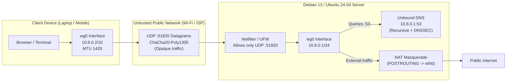
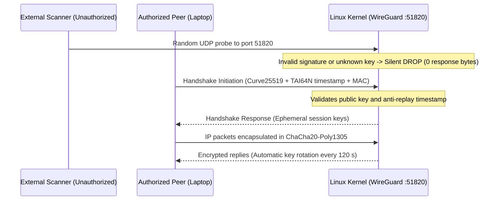

> [!IMPORTANT]
> **Executive Summary:**  
> Subscribing to a commercial VPN does not eliminate traffic observation—it merely moves the vantage point from your local ISP to a third-party vendor whose infrastructure you cannot audit. This project documents the architecture, reproducible deployment, and production operation of a self-hosted private VPN built on WireGuard over Debian 13 and Ubuntu 24.04 LTS, running entirely inside Linux kernel space with Noise (`IKpsk2`) cryptography, local recursive DNS resolution via Unbound to eliminate leaks, Dual-Stack IPv4/IPv6 routing, and perimeter hardening with UFW and Netfilter. The result is a silent tunnel invisible to external port scans with a resident memory footprint under **15 MB RAM**, added latency below **2 ms**, and line-rate Gigabit throughput without user-space context switches.

---

## Conceptual Model: What Actually Happens on Public Networks and How a Private Tunnel Works

Whenever you join a public Wi-Fi network (at an airport, coffee shop, or hotel) or browse over a local ISP, every packet leaving your device exposes observable metadata before reaching its destination. Even when websites use HTTPS, the access point and carrier can inspect:

* **Plaintext DNS queries:** Every domain you visit is logged if your device resolves names through the DHCP-assigned DNS server.
* **SNI (Server Name Indication):** The target hostname exchanged during standard TLS negotiation.
* **Traffic volume, destination, and timing patterns:** Destination IP addresses, session durations, and target ports.

A real-world analogy clarifies the shift. Browsing without a tunnel is like mailing sealed envelopes through a local post office: nobody reads the letter inside (HTTPS), yet every clerk sees the sender, recipient, envelope thickness, and dispatch time. A self-hosted WireGuard tunnel places all of your envelopes inside an opaque armored courier bag traveling directly from your device to your own Linux server; the intermediate network only sees encrypted UDP datagrams flowing to a single endpoint, while your server unseals the bag, resolves domains internally, and delivers requests to the Internet from its own network interface.

### Why WireGuard Over OpenVPN or IPsec

Unlike legacy VPN stacks built on heavy user-space daemons and sprawling cipher-negotiation state machines, WireGuard was designed for and merged directly into the mainline Linux kernel (since **5.6**) with a minimal attack surface: roughly **4,000 auditable lines of code** compared to hundreds of thousands in OpenVPN or strongSwan.

| Technical Criterion | OpenVPN (TLS/UDP) | IPsec / IKEv2 (strongSwan) | WireGuard (Linux Kernel) |
|---|---|---|---|
| Execution space | User space (`tun` + memory copies) | Kernel + user-space IKE daemon | 100% inside Linux kernel space |
| Codebase size | ~100,000+ lines (+ OpenSSL) | ~400,000+ lines | ~4,000 auditable lines |
| Cryptographic agility | Negotiable (prone to downgrade if misconfigured) | Complex suite and profile matrix | Fixed, versioned primitives (Noise `IKpsk2`) |
| Scan visibility | Responds on open TCP/UDP ports | Responds to IKE probes on port `500`/`4500` | Complete silence (DROP on unauthenticated packets) |
| Mobile reconnect time | 2 to 8 seconds on Wi-Fi to 4G/5G handoff | 1 to 4 seconds | Instantaneous (seamless key-based *roaming*) |
| Baseline memory footprint | 35 to 80 MB per instance | 40 to 90 MB | < 15 MB including Unbound DNS resolver |

---

## Technical Glossary of VPN Architecture

To follow every configuration directive and network diagnostic cleanly without hidden prerequisites, these are the core terms used throughout the deployment:

| Term | Technical Definition | Role in This Project |
|---|---|---|
| Virtual interface (`wg0`) | Kernel-managed network adapter that encrypts and decrypts IP packets on the fly. | Accepts client IP packets and encapsulates them into encrypted UDP datagrams. |
| Peer | Authorized VPN node uniquely identified by its Curve25519 public key. | Replaces passwords and sprawling PKI chains with concise cryptographic key pairs. |
| Cryptokey Routing | Internal kernel table binding each public key to the CIDR prefixes it is permitted to send and receive. | Merges authentication and routing: any packet from an IP not bound to that key is dropped by the kernel. |
| Noise Handshake (`IKpsk2`) | Single round-trip (1-RTT) authenticated key exchange with an optional pre-shared symmetric key for post-quantum resistance. | Establishes ephemeral session keys rotated every **120 seconds** for Perfect Forward Secrecy. |
| IP Forwarding | Linux kernel capability to route packets arriving on one interface (`wg0`) out through another (`eth0`). | Without `net.ipv4.ip_forward=1`, packets reach the server but never leave toward the Internet. |
| NAT Masquerade | Rewriting the private tunnel source IP (`10.8.0.x`) to the server's public IP upon egress. | Allows remote hosts to return replies to the VPS, which translates them back to the proper peer via Conntrack. |
| MTU (Maximum Transmission Unit) | Maximum IP packet size in bytes that can traverse a link without fragmentation. | Accounting for UDP + WireGuard overhead (**60 bytes** in IPv4, **80 bytes** in IPv6) prevents stalled HTTPS transfers. |
| Split Tunnel vs Full Tunnel | Routing only private subnets (`10.8.0.0/24`) versus all traffic (`0.0.0.0/0`). | Lets you choose between complete privacy on public Wi-Fi (Full) or low-overhead private server access (Split). |
| Recursive resolver (Unbound) | Local DNS server querying root nameservers directly with DNSSEC validation and zero commercial intermediaries. | Eliminates ISP DNS leaks and keeps domain lookups strictly inside your own host. |

---

## Tunnel Architecture, Routing, and Silent Handshake

Every packet follows a deterministic path from the client device to the Internet with zero user-space proxy daemons duplicating buffers or exposing unnecessary ports.



### Cryptographic Anatomy and Silent Authentication (Stealth)

WireGuard enforces a fixed, modern cryptographic suite:

* **Key exchange:** Curve25519 (ECDH) optionally combined with a 256-bit symmetric `PresharedKey` for defense-in-depth against *harvest now, decrypt later* quantum threats.
* **Authenticated encryption (AEAD):** ChaCha20 for confidentiality and Poly1305 for per-packet integrity, delivering strong software performance even on ARM CPUs lacking AES-NI instructions.
* **Hashing and key derivation:** BLAKE2s and HKDF to derive ephemeral session keys rotated automatically every few minutes.

A decisive operational property is complete silence toward unauthorized scanners. When Nmap or Masscan probes UDP port `51820`, the kernel validates the cryptographic signature of the very first packet against registered public keys. Any packet failing verification triggers an immediate silent DROP with zero response bytes—rendering the port indistinguishable from a closed or filtered host.



---

## Addressing and Subnet Design (Dual-Stack IPv4/IPv6)

Planning the CIDR layout before creating configuration files prevents future collisions with home LANs (`192.168.1.0/24`), corporate networks (`10.0.0.0/24`), and Docker bridges (`172.17.0.0/16`).

| Component | IPv4 Subnet (RFC 1918) | IPv6 ULA Subnet (RFC 4193) | Purpose |
|---|---|---|---|
| Full tunnel network | `10.8.0.0/24` | `fd42:42:42::/64` | Isolated private space for up to **253 concurrent peers**. |
| Server interface (`wg0`) | `10.8.0.1/24` | `fd42:42:42::1/64` | Tunnel gateway and exclusive bind address for Unbound DNS. |
| Peer 1 (Primary laptop) | `10.8.0.2/32` | `fd42:42:42::2/128` | Administration and engineering workstation. |
| Peer 2 (Mobile phone) | `10.8.0.3/32` | `fd42:42:42::3/128` | Encrypted browsing on Wi-Fi and cellular networks with seamless *roaming*. |
| Peer 3 (Backup / Tablet) | `10.8.0.4/32` | `fd42:42:42::4/128` | Secondary access revocable independently. |

> [!NOTE]
> **Why Dual-Stack IPv6 ULA (`fd42:...`) prevents silent leaks:** If a client joins a Wi-Fi network with native IPv6 connectivity while your tunnel only routes `0.0.0.0/0` (IPv4), the OS will send IPv6 traffic outside the VPN directly through the local gateway. Including `::/0` in a Dual-Stack tunnel closes that silent bypass completely.

---

## Step-by-Step Deployment on Debian 13 and Ubuntu 24.04 LTS

Every command below is validated for Debian/Ubuntu servers using systemd and UFW.

### Step 1: Installation and Key Generation With Strict Permissions

Never generate private keys under default permissions (`0644`), which allow any local user to read them. Setting `umask 077` inside a subshell ensures every key file is created with strict `0600` (`root`-only) permissions from the first byte.

```bash
# Update package indexes and install WireGuard tools plus QR generator
sudo apt update && sudo apt install -y wireguard wireguard-tools qrencode

# Identify your exact default egress network interface (e.g. eth0, ens5, enp1s0)
ip -br route show default

# Generate server keypair and pre-shared key (PSK) for the first client
sudo install -d -m 700 /etc/wireguard/keys
sudo bash -c 'umask 077
  wg genkey | tee /etc/wireguard/keys/server.key | wg pubkey > /etc/wireguard/keys/server.pub
  wg genkey | tee /etc/wireguard/keys/laptop.key | wg pubkey > /etc/wireguard/keys/laptop.pub
  wg genpsk > /etc/wireguard/keys/laptop.psk
'

# Verify strict permissions (must show -rw------- root root)
sudo ls -la /etc/wireguard/keys
```

### Step 2: Enable IP Forwarding and Tune Kernel UDP Buffers

Linux disables packet forwarding between interfaces by default. Raising UDP socket receive/send ceilings and enabling BBR congestion control also improves throughput over mobile links with intermittent packet loss.

```bash
# /etc/sysctl.d/99-wireguard.conf — Kernel routing and network tuning
sudo tee /etc/sysctl.d/99-wireguard.conf > /dev/null <<'EOF'
# Enable IPv4 and IPv6 forwarding between wg0 and the external interface
net.ipv4.ip_forward = 1
net.ipv6.conf.all.forwarding = 1

# Enable BBR congestion control for high-latency or mobile tunnels
net.core.default_qdisc = fq
net.ipv4.tcp_congestion_control = bbr

# Expand UDP socket buffers to prevent drops during encrypted traffic bursts
net.core.rmem_max = 4194304
net.core.wmem_max = 4194304
EOF

# Apply settings immediately and confirm
sudo sysctl --system
sysctl net.ipv4.ip_forward net.ipv6.conf.all.forwarding net.ipv4.tcp_congestion_control
```

### Step 3: Configure the Server Interface (`/etc/wireguard/wg0.conf`)

Replace `eth0` with the public interface name discovered in Step 1 and paste the keys generated under `/etc/wireguard/keys/`. Setting `SaveConfig = false` ensures manual edits are never overwritten on service stop.

```ini
# /etc/wireguard/wg0.conf — Required permissions: chmod 600
[Interface]
Address = 10.8.0.1/24, fd42:42:42::1/64
ListenPort = 51820
PrivateKey = <CONTENTS_OF_server.key>
MTU = 1420
SaveConfig = false

# NAT Masquerade and TCP MSS Clamping rules attached to interface lifecycle
PostUp = iptables -A FORWARD -i %i -j ACCEPT; iptables -A FORWARD -o %i -j ACCEPT; iptables -t nat -A POSTROUTING -s 10.8.0.0/24 -o eth0 -j MASQUERADE; iptables -t mangle -A FORWARD -i %i -p tcp --tcp-flags SYN,RST SYN -j TCPMSS --clamp-mss-to-pmtu
PostDown = iptables -D FORWARD -i %i -j ACCEPT; iptables -D FORWARD -o %i -j ACCEPT; iptables -t nat -D POSTROUTING -s 10.8.0.0/24 -o eth0 -j MASQUERADE; iptables -t mangle -D FORWARD -i %i -p tcp --tcp-flags SYN,RST SYN -j TCPMSS --clamp-mss-to-pmtu

# Peer 1: Primary laptop
[Peer]
PublicKey = <CONTENTS_OF_laptop.pub>
PresharedKey = <CONTENTS_OF_laptop.psk>
AllowedIPs = 10.8.0.2/32, fd42:42:42::2/128
```

Lock down file permissions and enable the persistent systemd unit:

```bash
sudo chmod 600 /etc/wireguard/wg0.conf
sudo systemctl enable --now wg-quick@wg0
sudo systemctl status wg-quick@wg0 --no-pager
```

### Step 4: Clean UFW Integration and Scoped Forwarding Policy

When UFW manages Netfilter, its default forwarding policy (`DEFAULT_FORWARD_POLICY`) is DROP. Rather than opening forwarding globally, allow only UDP `51820` externally and scope routed forwarding strictly to traffic arriving on `wg0`.

```bash
# 1. Open only the WireGuard UDP port on the public interface
sudo ufw allow 51820/udp comment 'WireGuard VPN'

# 2. Permit forwarding strictly from the VPN subnet out through eth0
sudo ufw route allow in on wg0 out on eth0 from 10.8.0.0/24 to any comment 'WireGuard NAT forward'

# 3. Allow local DNS queries strictly from connected VPN peers
sudo ufw allow in on wg0 to 10.8.0.1 port 53 proto udp comment 'Unbound DNS for VPN peers'
sudo ufw allow in on wg0 to 10.8.0.1 port 53 proto tcp comment 'Unbound DNS TCP for VPN peers'

# 4. Reload and audit active firewall rules
sudo ufw reload
sudo ufw status verbose
```

---

## Preventing DNS Leaks With a Local Recursive Resolver (Unbound)

Encrypting HTTP traffic achieves little if the client still sends DNS queries to a café router or an external profiling resolver. Running **Unbound** directly on the VPS bound exclusively to `10.8.0.1` keeps every lookup inside your infrastructure while guaranteeing port `53` is never exposed to the public Internet (preventing DNS amplification abuse).

```bash
# Install Unbound and official IANA root hints
sudo apt install -y unbound dns-root-data
```

Create a dedicated configuration file at `/etc/unbound/unbound.conf.d/wireguard.conf`:

```ini
# /etc/unbound/unbound.conf.d/wireguard.conf
server:
    # Bind strictly to loopback and the internal VPN gateway address
    interface: 127.0.0.1
    interface: 10.8.0.1
    port: 53
    do-ip4: yes
    do-ip6: yes
    do-udp: yes
    do-tcp: yes

    # Strict ACL: refuse any source outside localhost and the VPN subnet
    access-control: 127.0.0.0/8 allow
    access-control: 10.8.0.0/24 allow
    access-control: 0.0.0.0/0 refuse

    # Privacy, QNAME minimization, and DNSSEC hardening
    qname-minimisation: yes
    hide-identity: yes
    hide-version: yes
    harden-glue: yes
    harden-dnssec-stripped: yes
    prefetch: yes

    # Bounded memory budget for 1 GB RAM VPS hosts
    num-threads: 1
    msg-cache-size: 8m
    rrset-cache-size: 16m
```

Validate syntax, start Unbound, and confirm it is **not** bound to `0.0.0.0`:

```bash
sudo unbound-checkconf
sudo systemctl enable --now unbound
sudo ss -ulnp | grep ':53'
# Expected output: only 127.0.0.1:53 and 10.8.0.1:53 (never 0.0.0.0:53)
```

---

## Client Configuration, Split Tunneling, and QR Provisioning

Each client requires only a ~15-line plaintext profile. The client's `AllowedIPs` directive controls whether it operates as a **Full Tunnel** (all Internet traffic exits via the VPS) or a **Split Tunnel** (only private management subnets traverse the tunnel).

### Full Tunnel Profile for Desktop and Mobile (`laptop.conf`)

```ini
# laptop.conf — Full Dual-Stack profile with zero DNS leaks
[Interface]
PrivateKey = <CONTENTS_OF_laptop.key>
Address = 10.8.0.2/32, fd42:42:42::2/128
DNS = 10.8.0.1
MTU = 1420

[Peer]
PublicKey = <CONTENTS_OF_server.pub>
PresharedKey = <CONTENTS_OF_laptop.psk>
Endpoint = vpn.yourdomain.com:51820
# Dual-Stack Full Tunnel:
AllowedIPs = 0.0.0.0/0, ::/0
# Keep NAT mappings alive behind home routers or mobile CGNAT every 25 s
PersistentKeepalive = 25
```

For **Split Tunnel** administration of private servers without routing video calls or heavy downloads through the VPS, replace `AllowedIPs` with the internal tunnel CIDR (`AllowedIPs = 10.8.0.0/24`).

To provision iOS or Android devices without sending private keys over email or messaging apps:

```bash
# Render an ephemeral QR code directly inside the SSH terminal
qrencode -t ansiutf8 < laptop.conf
```

---

## Production Operations: Live Key Rotation and Zero-Downtime Peer Revocation

In production, a phone can be lost or a laptop compromised. Instead of restarting `wg0` and dropping every active user session, WireGuard supports **live revocation and configuration reload** with **0 ms downtime** for healthy peers:

```bash
# 1. Immediately evict a compromised peer from kernel memory
sudo wg set wg0 peer <COMPROMISED_PUBLIC_KEY> remove

# 2. Remove the matching [Peer] block from /etc/wireguard/wg0.conf for persistence
# 3. Synchronize config live without restarting the interface
sudo wg syncconf wg0 <(sudo wg-quick strip wg0)
```

> [!TIP]
> **Purge client private keys from the server:** Once the client profile is delivered or the QR code is scanned, delete `/etc/wireguard/keys/laptop.key` from the VPS. The server only needs the peer's public key (`laptop.pub`) and `PresharedKey`; keeping client private keys off the server sharply reduces blast radius if the host is ever compromised.

---

## Forensic Audit, Diagnostics, and Production Edge Cases

Seeing a "Connected" indicator in a GUI does not prove traffic is routed securely or free of leaks. Run this end-to-end audit sequence across both server and client:

```bash
# On the server: verify recent handshakes, live byte counters, and active endpoints
sudo wg show

# On the server: confirm encrypted UDP datagrams arrive on port 51820
sudo tcpdump -ni eth0 udp port 51820 -nn -c 10

# On the server: confirm decrypted IP packets traverse the virtual wg0 interface
sudo tcpdump -ni wg0 -nn -c 10

# From the connected client: verify egress public IP and active DNS resolver
curl -s https://ifconfig.me && echo ""
dig +short example.com @10.8.0.1
```

### Production Edge-Case Diagnostic Matrix

| Production Symptom | Root Cause | Exact Verification and Fix |
|---|---|---|
| Handshake succeeds but no Internet access | `ip_forward = 0`, wrong egress interface in `MASQUERADE` (`eth0` vs `ens5`), or UFW dropping `FORWARD`. | Check `sysctl net.ipv4.ip_forward` and `sudo iptables -t nat -L POSTROUTING -v -n`; fix interface name in `wg0.conf` and `ufw route allow`. |
| Pages load partially or SSH hangs on large output | Oversized packets dropped on CGNAT or PPPoE links (*Path MTU Blackhole*). | Lower client MTU to `1280` or `1360` and retain `--clamp-mss-to-pmtu` in server `PostUp`. |
| Handshake never completes (`latest handshake` empty) | UDP port `51820` blocked in cloud firewall (AWS Lightsail / Security Group) or mismatched public keys. | Verify inbound UDP `51820` in cloud console and trace arrival with `sudo tcpdump -ni eth0 udp port 51820`. |
| Websites expose client's real country despite VPN | DNS leaking to local router or IPv6 traffic bypassing `wg0`. | Confirm `DNS = 10.8.0.1` and `AllowedIPs = 0.0.0.0/0, ::/0` on the client; verify Unbound answers on `10.8.0.1:53`. |
| Tunnel connects but Docker breaks forwarding | Docker switches the iptables `FORWARD` chain policy to DROP on startup. | Insert explicit `-I FORWARD -i wg0 -j ACCEPT` rules in `PostUp` or inside the `DOCKER-USER` chain. |
| Mobile tunnel stalls after 3 minutes idle | Carrier CGNAT expires the idle UDP translation entry. | Keep `PersistentKeepalive = 25` enabled in the mobile client's `[Peer]` block. |

---

## Security and Final Validation Checklist

- [x] Strict `0600` permissions verified on `/etc/wireguard/wg0.conf` and `/etc/wireguard/keys/*`.
- [x] Client private keys deleted from the server after initial provisioning (only `PublicKey` and `PresharedKey` retained).
- [x] `net.ipv4.ip_forward = 1`, `net.ipv6.conf.all.forwarding = 1`, and BBR active and persistent in `/etc/sysctl.d/99-wireguard.conf`.
- [x] NAT Masquerade and TCP MSS Clamping (`--clamp-mss-to-pmtu`) verified in `PostUp` / `PostDown`.
- [x] UDP port `51820` opened exclusively at the perimeter firewall with complete silence confirmed against unauthenticated probes.
- [x] Unbound DNS bound exclusively to `127.0.0.1:53` and `10.8.0.1:53`, unreachable from the server's public IP.
- [x] Live peer revocation and reload validated via `wg syncconf` with **0 ms** downtime for active peers.
