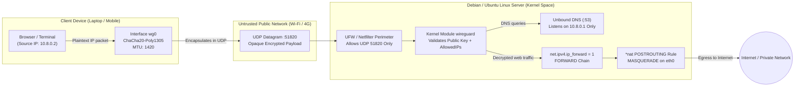
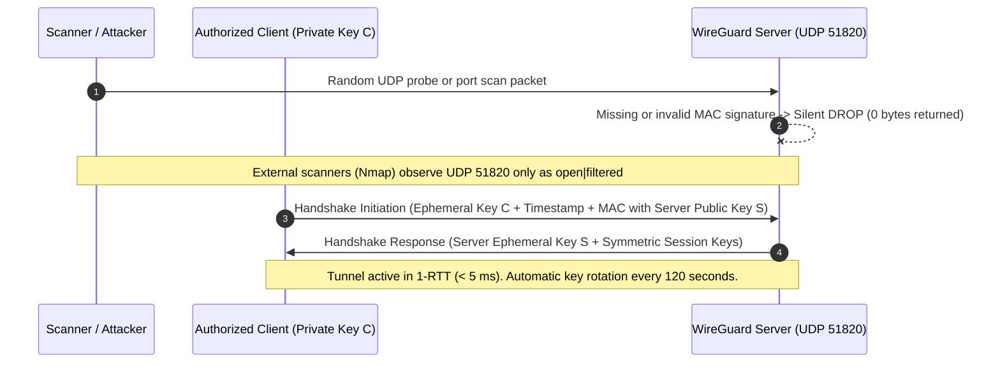

> [!IMPORTANT]
> **Executive Summary:**  
> Subscribing to a commercial VPN does not eliminate interception risk or metadata logging; it simply shifts trust from your ISP to an opaque third party observing all outbound traffic. Deploying a self-hosted WireGuard node on Debian or Ubuntu solves this by executing encryption directly inside Linux kernel space in under **4,000 lines of code**, achieving a memory footprint below **10 MB RAM**, near-zero UDP latency, and modern cryptography powered by the Noise_IKpsk2 protocol (Curve25519, ChaCha20-Poly1305, and BLAKE2s). This engineering guide covers full tunnel architecture, Cryptokey Routing, clean UFW and Netfilter integration, DNS leak prevention with a private Unbound resolver, and zero-trace desktop/mobile client provisioning.

---

## Conceptual Model: What Happens on Public Networks and How a Private Tunnel Works

When a device joins public Wi-Fi in an airport, coffee shop, or hotel, the local router and network operator control the first hop of every packet. Even when visiting HTTPS websites, body payloads are encrypted, yet the local network still observes visited domains through plaintext DNS queries, the target hostname inside TLS ClientHello (SNI), packet sizes, and exact connection timestamps.

A self-hosted Virtual Private Network operates as an armored envelope inside an opaque container stretching from your laptop or phone to a server under your exclusive control (such as a cloud VPS or a Linux board on your home network):

* **Encapsulation on the origin device:** Before an IP packet leaves your Wi-Fi or cellular radio, the virtual `wg0` interface encrypts both the payload and inner IP headers, wrapping the result inside a standard UDP datagram.
* **Opaque transit over untrusted links:** Coffee shop routers and intermediate ISPs observe only encrypted UDP datagrams traveling toward a single destination IP and port (`51820`). They cannot inspect queried domains, inject unencrypted ads, or alter a single bit without invalidating the cryptographic authentication tag.
* **Kernel decapsulation and egress:** Your server receives the UDP datagram, verifies its cryptographic signature directly inside the Linux kernel, extracts the original IP packet, and forwards it to the Internet while rewriting the private tunnel IP to its own public IP via NAT Masquerade.

### Why WireGuard Over OpenVPN or IPsec

For over two decades, VPN deployments relied on heavy user-space daemons such as OpenVPN or complex negotiation stacks like IPsec. WireGuard redesigned the data plane around auditable minimalism and fixed cryptographic primitives:

| Technical Parameter | WireGuard | OpenVPN | IPsec (strongSwan / IKEv2) |
|---|---|---|---|
| Codebase size | ~4,000 lines (auditable by one engineer) | > 100,000 lines + OpenSSL | > 400,000 lines |
| Execution plane | Native Linux kernel space | User space (`tun` + context switches) | Hybrid (Kernel XFRM + IKE daemon) |
| Cryptographic primitives | Fixed & modern (Curve25519, ChaCha20-Poly1305, BLAKE2s) | Negotiable (misconfiguration *downgrade* risk) | Negotiable (multiple legacy suites) |
| Idle memory footprint | < 10 MB RAM, 0% CPU when idle | ~30 - 80 MB per process | ~25 - 50 MB |
| Network roaming (Wi-Fi to 4G) | Seamless and instantaneous without reconnect | Requires TLS renegotiation (3 - 10 s) | Requires MOBIKE and frequent reconnects |
| Port scanner visibility | Stealth: silently drops unauthenticated packets | Responds to TLS handshake probes | Responds to IKE probes |

---

## Core VPN Architecture Glossary

| Term | Operational Definition |
|---|---|
| Virtual interface wg0 | Logical Linux kernel network device responsible for encrypting outbound traffic and decrypting valid inbound UDP datagrams from authorized peers. |
| Cryptokey Routing (AllowedIPs) | WireGuard's bidirectional routing table binding a public key to specific CIDR subnets: it defines both outbound routing targets and allowed inbound source IPs. |
| Noise_IKpsk2 protocol | Authenticated key exchange completed in a single round-trip (*1-RTT*) providing Perfect Forward Secrecy and optional Pre-Shared Key mixing. |
| NAT Masquerade | Dynamic source address translation in Netfilter rewriting the client private tunnel IP (`10.8.0.2`) to the server public IP on the egress interface. |
| Full Tunnel vs. Split Tunnel | In full tunnel mode (`0.0.0.0/0, ::/0`), all Internet traffic traverses the VPN; in split tunnel mode (`10.8.0.0/24`), only private resource traffic uses the tunnel. |
| MTU | Maximum unfragmented packet size in bytes; subtracting UDP and WireGuard encapsulation headers, setting `1420` bytes prevents silent stalls on cellular links. |

---

## Tunnel Architecture, Routing, and Silent Handshake

The diagram below traces the exact path of an IP packet from the client browser out to the Internet through the Linux server kernel and UFW rules:



### Silent Authentication Anatomy (Stealth)

An open TCP port running OpenVPN or SSH responds to any Internet scanner sending a `SYN` packet. WireGuard inverts this behavior by enforcing silent cryptographic authentication before returning a single byte:



---

## Step-by-Step Deployment on Debian and Ubuntu

This entire procedure is verified for Debian GNU/Linux (12 / 13) and Ubuntu Server LTS (22.04 / 24.04) using exclusively the standard `apt`, systemd, and UFW stack.

### Step 1: Installation and Key Generation with Strict Permissions

Never generate private keys with world-readable permissions (`0644`). Setting `umask 077` inside a subshell before invoking `wg genkey` ensures every file is created readable solely by `root` (`0600`):

```bash
# 1. Install WireGuard tools and QR code generator for mobile devices
sudo apt update && sudo apt install -y wireguard wireguard-tools qrencode

# 2. Create working directory with strict permissions
sudo mkdir -p /etc/wireguard/clients
sudo chmod 700 /etc/wireguard

# 3. Generate Curve25519 key pairs and a 256-bit Pre-Shared Key (PSK)
sudo bash -c '
  umask 077
  wg genkey | tee /etc/wireguard/server_private.key | wg pubkey > /etc/wireguard/server_public.key
  wg genkey | tee /etc/wireguard/clients/laptop_private.key | wg pubkey > /etc/wireguard/clients/laptop_public.key
  wg genpsk > /etc/wireguard/clients/laptop.psk
'
```

> [!TIP]
> The `laptop.psk` file mixes a 256-bit symmetric pre-shared key into the `Noise_IKpsk2` handshake. Even if an adversary records encrypted traffic today and breaks Curve25519 decades later using quantum computing, past sessions remain undecipherable (*Harvest Now, Decrypt Later*).

### Step 2: Enable Kernel IP Forwarding and Tune UDP Buffers

By default, Linux drops packets arriving on one interface (`wg0`) destined for another (`eth0`). Create a persistent configuration in `/etc/sysctl.d/99-wireguard.conf` enabling packet forwarding, automatic MTU probing, and tuned UDP receive/send buffers:

```bash
sudo tee /etc/sysctl.d/99-wireguard.conf > /dev/null << 'EOF'
# Enable packet forwarding between VPN tunnel and public interface
net.ipv4.ip_forward = 1
net.ipv6.conf.all.forwarding = 1

# Automatic MTU probing to avoid black-hole stalls on PPPoE/LTE links
net.ipv4.tcp_mtu_probing = 1

# Moderate UDP socket buffer increase for traffic bursts
net.core.rmem_max = 26214400
net.core.wmem_max = 26214400
EOF

# Apply parameters live without rebooting
sudo sysctl --system
```

### Step 3: Configure the Server Interface (`/etc/wireguard/wg0.conf`)

First, verify the exact name of the primary network interface connected to the Internet on your server (typically `eth0`, `ens3`, or `enp1s0`):

```bash
ip -o -4 route show to default | awk '{print $5}'
```

Create `/etc/wireguard/wg0.conf` using the private subnet `10.8.0.0/24` (avoid `192.168.1.0/24` to prevent collisions with home or hotel routers when connecting remotely). Explicitly set `SaveConfig = false` so systemd never overwrites your comments or structure on service shutdown:

```ini
# /etc/wireguard/wg0.conf
[Interface]
Address = 10.8.0.1/24
ListenPort = 51820
MTU = 1420
SaveConfig = false
PrivateKey = <CONTENT_OF_/etc/wireguard/server_private.key>

# Client 1: Workstation / Laptop
[Peer]
PublicKey = <CONTENT_OF_/etc/wireguard/clients/laptop_public.key>
PresharedKey = <CONTENT_OF_/etc/wireguard/clients/laptop.psk>
AllowedIPs = 10.8.0.2/32
```

Restrict permissions to `600`:

```bash
sudo chmod 600 /etc/wireguard/wg0.conf
```

### Step 4: Clean Integration with UFW and NAT Masquerade

Instead of mixing ad-hoc `PostUp` rules that fight against UFW, place source address translation directly inside the `*nat` table of `/etc/ufw/before.rules` and enable UFW forwarding. Replace `eth0` with the interface name detected in Step 3:

```bash
# 1. Allow packet forwarding in UFW
sudo sed -i 's/^DEFAULT_FORWARD_POLICY="DROP"/DEFAULT_FORWARD_POLICY="ACCEPT"/' /etc/default/ufw

# 2. Prepend the *nat section to /etc/ufw/before.rules if not already present
sudo tee /etc/ufw/before.rules.tmp > /dev/null << 'EOF'
# NAT Masquerade rules for WireGuard VPN subnet
*nat
:POSTROUTING ACCEPT [0:0]
-A POSTROUTING -s 10.8.0.0/24 -o eth0 -j MASQUERADE
COMMIT

EOF
sudo cat /etc/ufw/before.rules | sudo tee -a /etc/ufw/before.rules.tmp > /dev/null
sudo mv /etc/ufw/before.rules.tmp /etc/ufw/before.rules
sudo chmod 640 /etc/ufw/before.rules
```

Open UDP port `51820`, allow routed traffic between `wg0` and `eth0`, reload UFW, and start `wg-quick@wg0`:

```bash
sudo ufw allow 51820/udp comment 'WireGuard VPN'
sudo ufw route allow in on wg0 out on eth0
sudo ufw reload

sudo systemctl enable --now wg-quick@wg0
```

---

## DNS Leak Prevention with a Private Local Resolver (Unbound)

Encrypting IP packets while the operating system continues querying the local router's DNS server (`192.168.1.1`) leaks every visited domain to the Wi-Fi owner (**DNS Leak**). Routing queries to public resolvers inside the tunnel fixes the local leak, but still exposes domain lookups to that external provider.

The cleanest architecture deploys a private recursive DNS resolver using Unbound listening exclusively on the internal tunnel IP (`10.8.0.1`), keeping port `53` completely closed to the public Internet:

```bash
# 1. Install Unbound on the VPN server
sudo apt install -y unbound

# 2. Bind exclusively to the internal tunnel address 10.8.0.1
sudo tee /etc/unbound/unbound.conf.d/wireguard-dns.conf > /dev/null << 'EOF'
server:
    interface: 10.8.0.1
    port: 53
    do-ip4: yes
    do-ip6: no
    do-udp: yes
    do-tcp: yes

    # Accept DNS queries solely from the private VPN tunnel subnet
    access-control: 127.0.0.1/32 allow
    access-control: 10.8.0.0/24 allow
    access-control: 0.0.0.0/0 refuse

    # Privacy and hardening
    hide-identity: yes
    hide-version: yes
    qname-minimisation: yes
    harden-glue: yes
    harden-dnssec-stripped: yes
    prefetch: yes
EOF

# 3. Allow DNS queries exclusively from wg0 in UFW
sudo ufw allow in on wg0 to 10.8.0.1 port 53 proto udp comment 'Private VPN Unbound DNS'
sudo ufw allow in on wg0 to 10.8.0.1 port 53 proto tcp comment 'Private VPN Unbound DNS'
sudo systemctl enable --now unbound
```

---

## Client Configuration, Split Tunneling, and QR Provisioning

Depending on your operational goal, configure clients in full tunnel mode (private browsing on untrusted Wi-Fi) or split tunnel mode (exclusive access to internal admin dashboards or databases):

| Routing Profile | Client `AllowedIPs` Value | Behavior and Use Case |
|---|---|---|
| Full Tunnel (Secure Browsing) | `0.0.0.0/0, ::/0` | All IPv4 and IPv6 traffic exits encrypted through the VPN server; requires `DNS = 10.8.0.1`. |
| Split Tunnel (Private Subnet Only) | `10.8.0.0/24` | Only packets destined for `10.8.0.x` enter the tunnel; general web browsing uses your local ISP directly. |
| Split Tunnel + Cloud VPC | `10.8.0.0/24, 172.16.0.0/12` | Grants private access to internal dashboards or cloud VPCs without routing streaming or bulk downloads. |

### Full Profile for Desktop and Mobile (`laptop.conf`)

```ini
# /etc/wireguard/clients/laptop.conf
[Interface]
PrivateKey = <CONTENT_OF_/etc/wireguard/clients/laptop_private.key>
Address = 10.8.0.2/32
MTU = 1420

# Point to the private Unbound recursive resolver inside the tunnel (zero DNS Leaks)
DNS = 10.8.0.1

[Peer]
PublicKey = <CONTENT_OF_/etc/wireguard/server_public.key>
PresharedKey = <CONTENT_OF_/etc/wireguard/clients/laptop.psk>
Endpoint = <SERVER_PUBLIC_IP>:51820

# Full Tunnel IPv4 & IPv6 (prevents out-of-tunnel IPv6 leaks)
AllowedIPs = 0.0.0.0/0, ::/0

# Keep NAT mappings alive behind mobile routers and CGNAT every 25 seconds
PersistentKeepalive = 25
```

To import the profile into the official WireGuard iOS or Android app without sending private keys over messaging apps or email, render the QR code directly in your SSH terminal:

```bash
sudo qrencode -t ansiutf8 < /etc/wireguard/clients/laptop.conf
```

---

## Forensic Auditing, Diagnostics, and Edge-Case Resolution

Once connected, use the following low-level diagnostics to verify there are no DNS leaks, forwarding blocks, or packet fragmentation issues:

| Diagnostic Command | Operational Purpose and Expected Output |
|---|---|
| sudo wg show | Displays active peers, current remote endpoint, time since last handshake (< 2 min), and `received / sent` byte counters. |
| sudo ss -ulnp \| grep 51820 | Confirms the kernel UDP socket is listening properly on port `51820`. |
| sudo tcpdump -ni wg0 | Captures decrypted inner IP packets flowing across the virtual tunnel interface in real time. |
| sudo iptables -t nat -L POSTROUTING -v -n | Verifies that packets from `10.8.0.0/24` increment the `MASQUERADE` rule byte and packet counters. |
| curl -s https://ifconfig.me | Run on the connected client: must return exclusively the VPN server public IP. |
| sudo wg syncconf wg0 <(wg-quick strip wg0) | Applies newly added or revoked peers live without dropping active sessions for other connected clients. |

### Production Edge-Case Troubleshooting

1. **Handshake succeeds, but client cannot load web pages:**
   * Common cause: `DEFAULT_FORWARD_POLICY` in `/etc/default/ufw` is still `DROP`, or the interface name (`eth0`) in `/etc/ufw/before.rules` does not match the server's actual NIC (`ens3` or `enp1s0`).
2. **Slow loading, stalled images, or TLS hangs on 4G/5G cellular or PPPoE links:**
   * Cause: The carrier physical link has an MTU smaller than `1500` bytes (often `1480` or `1492`), causing `1420`-byte inner packets plus UDP headers to exceed the path limit and drop silently. Lower `MTU = 1360` or `MTU = 1280` on both ends.
3. **Connectivity drops after minutes of mobile inactivity:**
   * Cause: Carrier-grade NAT (CGNAT) expires idle UDP state tables within 30 to 60 seconds. Keeping `PersistentKeepalive = 25` on the client sends a minimal authenticated datagram every 25 seconds to preserve NAT mappings.
4. **IP address conflicts when connecting from an office LAN:**
   * Cause: Using `192.168.1.0/24` or `192.168.0.0/24` as the VPN tunnel range collides with local office routers. Using `10.8.0.0/24` or an uncommon range like `10.214.0.0/24` eliminates route overlaps.

---

## Security and Validation Checklist

- [x] **Strict Cryptographic Permissions:** Private keys and `/etc/wireguard/wg0.conf` restricted with `chmod 600` and `umask 077` owned solely by `root`.
- [x] **Post-Quantum Defense (`PSK`):** Every peer configured with a unique 256-bit `PresharedKey` mixed into `Noise_IKpsk2`.
- [x] **Clean UFW Integration:** `MASQUERADE` rule declared in `/etc/ufw/before.rules`, `DEFAULT_FORWARD_POLICY="ACCEPT"` active, and only UDP port `51820` exposed externally.
- [x] **Leak-Free Private DNS Resolver:** Unbound listening exclusively on `10.8.0.1:53` with `access-control` restricted to `10.8.0.0/24` and full `::/0` routing enforced in *Full Tunnel* profiles.
- [x] **Zero-Downtime Peer Reloads:** Peer additions and revocations applied live via `wg syncconf` without restarting `wg-quick@wg0`.
- [x] **End-to-End Audit Verified:** Handshake confirmed via `wg show`, active NAT counters verified, and public egress IP validated externally from the client.
