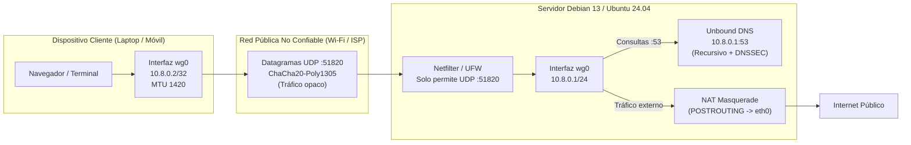
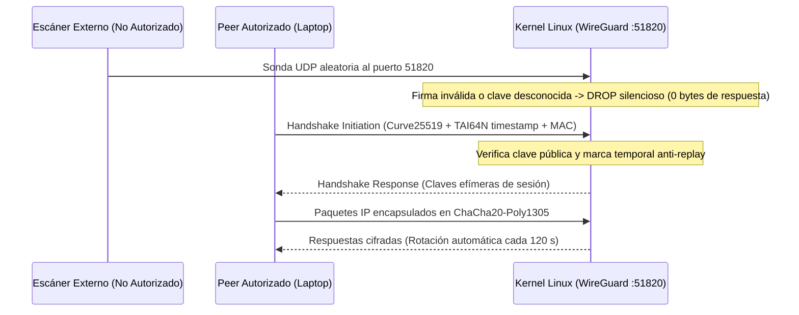

> [!IMPORTANT]
> **Resumen Ejecutivo:**  
> Contratar una VPN comercial no elimina la exposición de tu tráfico: simplemente traslada el punto de observación desde tu proveedor de Internet hacia un tercero cuya infraestructura no puedes auditar. Este proyecto documenta la arquitectura, el despliegue reproducible y la operación en producción de un servidor VPN privado autoalojado con WireGuard sobre Debian 13 y Ubuntu 24.04 LTS, operando íntegramente en espacio de kernel Linux con criptografía Noise (`IKpsk2`), resolución DNS recursiva local con Unbound para erradicar fugas, enrutamiento Dual-Stack IPv4/IPv6 y endurecimiento perimetral con UFW y Netfilter. El resultado es un túnel silencioso ante escaneos externos con consumo residente inferior a **15 MB de RAM**, latencia agregada menor a **2 ms** y capacidad de saturar enlaces Gigabit sin cambios de contexto entre espacio de usuario y kernel.

---

## Modelo Conceptual: Qué Ocurre Realmente en una Red Pública y Cómo Opera un Túnel Propio

Cuando te conectas a una red Wi-Fi pública (un aeropuerto, una cafetería o un hotel) o navegas desde un operador local, cada paquete que abandona tu dispositivo viaja con metadatos visibles antes de llegar a destino. Incluso cuando el sitio web usa HTTPS, el punto de acceso y el operador pueden observar:

* **Consultas DNS en texto claro:** Cada dominio que visitas queda registrado si el equipo resuelve nombres mediante el servidor DNS asignado por DHCP.
* **SNI (Server Name Indication):** El nombre de dominio al que te conectas durante la negociación TLS tradicional.
* **Patrones de volumen, destino y horarios:** Direcciones IP de destino, duración de las sesiones y puertos utilizados.

Una analogía cotidiana ayuda a visualizar la diferencia. Navegar sin túnel es como enviar cartas en sobres cerrados a través de una oficina postal local: nadie lee el texto interior (HTTPS), pero cualquier empleado ve el remitente, el destinatario, el grosor del sobre y a qué hora lo envías. Un túnel WireGuard autoalojado equivale a colocar todos tus sobres dentro de una valija blindada e indescifrable que sale desde tu dispositivo directo hasta tu propio servidor Linux; la red intermedia solo ve paquetes UDP cifrados entre tu equipo y un único destino, mientras tu servidor abre la valija, resuelve los nombres internamente y entrega cada petición a Internet desde su propia interfaz.

### Por Qué WireGuard Frente a OpenVPN o IPsec

A diferencia de soluciones históricas basadas en demonios pesados en espacio de usuario y negociación compleja de cifrados, WireGuard fue diseñado e integrado directamente en el kernel oficial de Linux (desde la versión **5.6**) con una superficie de ataque mínima: alrededor de **4.000 líneas de código** auditables frente a cientos de miles en OpenVPN o strongSwan.

| Criterio Técnico | OpenVPN (TLS/UDP) | IPsec / IKEv2 (strongSwan) | WireGuard (Kernel Linux) |
|---|---|---|---|
| Espacio de ejecución | Espacio de usuario (`tun` + copias de memoria) | Kernel + demonio IKE en espacio de usuario | 100% en espacio de kernel Linux |
| Tamaño de base de código | ~100.000+ líneas (+ OpenSSL) | ~400.000+ líneas | ~4.000 líneas auditables |
| Agilidad criptográfica | Negociable (vulnerable a degradación si se configura mal) | Múltiples suites y perfiles complejos | Primitivas fijas y versionadas (Noise `IKpsk2`) |
| Visibilidad ante escaneos | Responde al puerto abierto en escaneos TCP/UDP | Responde a paquetes IKE en puerto `500`/`4500` | Silencio total (DROP ante cualquier paquete sin firma válida) |
| Tiempo de reconexión móvil | 2 a 8 segundos al cambiar de Wi-Fi a 4G/5G | 1 a 4 segundos | Instantáneo (*roaming* transparente por clave pública) |
| Consumo base de memoria | 35 a 80 MB por instancia | 40 a 90 MB | < 15 MB incluyendo resolver DNS Unbound |

---

## Glosario Técnico de Arquitectura VPN

Para seguir cada directiva de configuración y diagnóstico de red sin lagunas previas, estos son los conceptos clave que intervienen en el despliegue:

| Término | Definición Técnica | Papel en Este Proyecto |
|---|---|---|
| Interfaz virtual (`wg0`) | Adaptador de red creado por el kernel Linux que cifra y descifra paquetes al vuelo. | Recibe tráfico IP de los clientes y lo encapsula en datagramas UDP cifrados. |
| Peer | Nodo autorizado en la malla VPN identificado unívocamente por su clave pública Curve25519. | Reemplaza contraseñas y certificados complejos por pares de claves criptográficas. |
| Cryptokey Routing | Tabla interna que asocia cada clave pública con los prefijos CIDR que tiene permitido enviar y recibir. | Unifica autenticación y enrutamiento: si un paquete viene de una IP no asociada a esa clave, el kernel lo descarta. |
| Handshake Noise (`IKpsk2`) | Intercambio autenticado de un solo viaje (1-RTT) con secreto precompartido opcional resistente a ataques post-cuánticos. | Establece claves efímeras de sesión cada **120 segundos** para garantizar secreto hacia adelante (*Perfect Forward Secrecy*). |
| IP Forwarding | Capacidad del kernel Linux para reenviar paquetes recibidos en una interfaz (`wg0`) hacia otra (`eth0`). | Sin habilitar `net.ipv4.ip_forward=1`, los paquetes llegan al servidor pero nunca salen a Internet. |
| NAT Masquerade | Reescritura de la dirección IP privada de origen del túnel (`10.8.0.x`) por la IP pública del servidor al salir a Internet. | Permite que servidores remotos devuelvan la respuesta al VPS, que luego la traduce de vuelta hacia el cliente correcto vía Conntrack. |
| MTU (Maximum Transmission Unit) | Tamaño máximo en bytes de un paquete IP que puede atravesar un enlace sin fragmentarse. | Al sumar encabezados UDP + WireGuard (**60 bytes** en IPv4, **80 bytes** en IPv6), un MTU mal ajustado rompe conexiones HTTPS largas. |
| Split Tunnel vs Full Tunnel | Enrutamiento selectivo de solo ciertas subredes (`10.8.0.0/24`) frente a todo el tráfico (`0.0.0.0/0`). | Permite elegir entre máxima privacidad en Wi-Fi pública (Full) o acceso rápido solo a servidores privados (Split). |
| Resolver recursivo (Unbound) | Servidor DNS local que consulta directamente a los servidores raíz con validación DNSSEC sin intermediarios comerciales. | Elimina fugas DNS hacia el ISP y bloquea la exposición de dominios consultados. |

---

## Arquitectura del Túnel, Enrutamiento y Handshake Silencioso

Todo el tráfico del proyecto fluye por un recorrido determinista desde el dispositivo cliente hasta Internet, sin demonios intermedios en espacio de usuario que dupliquen memoria ni abran puertos innecesarios.



### Anatomía Criptográfica y Autenticación Silenciosa (Stealth)

WireGuard utiliza una suite criptográfica fija y moderna:

* **Intercambio de claves:** Curve25519 (ECDH) combinado opcionalmente con una clave simétrica precompartida (`PresharedKey` de 256 bits) para resistencia adicional frente a futuras amenazas cuánticas de tipo *harvest now, decrypt later*.
* **Cifrado autenticado (AEAD):** ChaCha20 para confidencialidad y Poly1305 para integridad de cada paquete, con excelente rendimiento por software incluso en procesadores ARM sin aceleración AES-NI.
* **Hashing y derivación:** BLAKE2s y HKDF para derivar claves de sesión efímeras rotadas automáticamente cada pocos minutos.

Una propiedad crítica en producción es su comportamiento silencioso ante atacantes externos. Si un escáner masivo como Nmap o Masscan envía sondas al puerto UDP `51820`, el kernel verifica la firma criptográfica del primer paquete contra la lista de claves públicas registradas. Si el paquete no está autenticado por un peer conocido, el kernel aplica DROP silencioso sin responder absolutamente nada: el puerto aparece como `open|filtered` o indistinguible de un puerto cerrado.



---

## Diseño de Direccionamiento y Subredes (Dual-Stack IPv4/IPv6)

Antes de escribir un solo archivo de configuración, planificar el esquema CIDR evita colisiones futuras con redes domésticas (`192.168.1.0/24`), redes corporativas (`10.0.0.0/24`) o puentes de Docker (`172.17.0.0/16`).

| Elemento | Subred IPv4 (RFC 1918) | Subred IPv6 ULA (RFC 4193) | Propósito |
|---|---|---|---|
| Red completa del túnel | `10.8.0.0/24` | `fd42:42:42::/64` | Espacio privado aislado para hasta **253 peers** simultáneos. |
| Interfaz servidor (`wg0`) | `10.8.0.1/24` | `fd42:42:42::1/64` | Gateway del túnel y dirección de escucha exclusiva de Unbound DNS. |
| Peer 1 (Laptop principal) | `10.8.0.2/32` | `fd42:42:42::2/128` | Estación de trabajo de administración y desarrollo. |
| Peer 2 (Teléfono móvil) | `10.8.0.3/32` | `fd42:42:42::3/128` | Navegación cifrada en redes Wi-Fi y datos móviles con *roaming* transparente. |
| Peer 3 (Respaldo / Tablet) | `10.8.0.4/32` | `fd42:42:42::4/128` | Acceso secundario revocable de forma independiente. |

> [!NOTE]
> **Por qué usar IPv6 ULA (`fd42:...`) o deshabilitar fugas IPv6 en clientes:** Si un cliente navega en una red Wi-Fi con soporte IPv6 nativo pero tu túnel solo enruta `0.0.0.0/0` (IPv4), el sistema operativo enviará el tráfico IPv6 fuera de la VPN directamente por la red local. Incluir `::/0` en el túnel Dual-Stack (o enrutarlo correctamente hacia el VPS) cierra por completo esa fuga silenciosa.

---

## Despliegue Paso a Paso en Debian 13 y Ubuntu 24.04 LTS

Todos los comandos están validados para servidores basados en la familia Debian/Ubuntu con systemd y UFW.

### Paso 1: Instalación y Generación de Llaves con Aislamiento de Permisos

Nunca generes llaves privadas con permisos por defecto (`0644`), ya que cualquier usuario local podría leerlas. Fijamos `umask 077` en una subshell aislada para que cada archivo nazca con permisos estrictos `0600` (solo `root`).

```bash
# Actualizar repositorios e instalar utilidades de WireGuard y generador QR
sudo apt update && sudo apt install -y wireguard wireguard-tools qrencode

# Verificar el nombre exacto de la interfaz de salida hacia Internet (ej. eth0, ens5, enp1s0)
ip -br route show default

# Generar par de claves del servidor y clave precompartida (PSK) para el primer cliente
sudo install -d -m 700 /etc/wireguard/keys
sudo bash -c 'umask 077
  wg genkey | tee /etc/wireguard/keys/server.key | wg pubkey > /etc/wireguard/keys/server.pub
  wg genkey | tee /etc/wireguard/keys/laptop.key | wg pubkey > /etc/wireguard/keys/laptop.pub
  wg genpsk > /etc/wireguard/keys/laptop.psk
'

# Verificar permisos estrictos (deben mostrar -rw------- root root)
sudo ls -la /etc/wireguard/keys
```

### Paso 2: Habilitar IP Forwarding y Ajustar Buffers UDP del Kernel

El kernel Linux bloquea el reenvío de paquetes entre interfaces por defecto. Además, ajustar las colas de recepción/envío UDP y activar control de congestión BBR mejora drásticamente el rendimiento en enlaces móviles con pérdida intermitente de paquetes.

```bash
# /etc/sysctl.d/99-wireguard.conf — Enrutamiento y optimización de red en kernel
sudo tee /etc/sysctl.d/99-wireguard.conf > /dev/null <<'EOF'
# Habilitar reenvío de paquetes IPv4 e IPv6 entre wg0 y la interfaz externa
net.ipv4.ip_forward = 1
net.ipv6.conf.all.forwarding = 1

# Control de congestión BBR para túneles sobre enlaces de alta latencia o móviles
net.core.default_qdisc = fq
net.ipv4.tcp_congestion_control = bbr

# Ampliar buffers UDP para evitar descartes en ráfagas de tráfico cifrado
net.core.rmem_max = 4194304
net.core.wmem_max = 4194304
EOF

# Aplicar parámetros inmediatamente y verificar
sudo sysctl --system
sysctl net.ipv4.ip_forward net.ipv6.conf.all.forwarding net.ipv4.tcp_congestion_control
```

### Paso 3: Configurar la Interfaz del Servidor (`/etc/wireguard/wg0.conf`)

Reemplaza `eth0` por el nombre de tu interfaz de red pública detectada en el Paso 1, e inserta las claves generadas en `/etc/wireguard/keys/`. Observa el uso de `SaveConfig = false` para evitar que ediciones manuales se sobreescriban al reiniciar el servicio.

```ini
# /etc/wireguard/wg0.conf — Permisos obligatorios: chmod 600
[Interface]
Address = 10.8.0.1/24, fd42:42:42::1/64
ListenPort = 51820
PrivateKey = <CONTENIDO_DE_server.key>
MTU = 1420
SaveConfig = false

# Reglas de NAT Masquerade y TCP MSS Clamping al levantar la interfaz
PostUp = iptables -A FORWARD -i %i -j ACCEPT; iptables -A FORWARD -o %i -j ACCEPT; iptables -t nat -A POSTROUTING -s 10.8.0.0/24 -o eth0 -j MASQUERADE; iptables -t mangle -A FORWARD -i %i -p tcp --tcp-flags SYN,RST SYN -j TCPMSS --clamp-mss-to-pmtu
PostDown = iptables -D FORWARD -i %i -j ACCEPT; iptables -D FORWARD -o %i -j ACCEPT; iptables -t nat -D POSTROUTING -s 10.8.0.0/24 -o eth0 -j MASQUERADE; iptables -t mangle -D FORWARD -i %i -p tcp --tcp-flags SYN,RST SYN -j TCPMSS --clamp-mss-to-pmtu

# Peer 1: Laptop principal
[Peer]
PublicKey = <CONTENIDO_DE_laptop.pub>
PresharedKey = <CONTENIDO_DE_laptop.psk>
AllowedIPs = 10.8.0.2/32, fd42:42:42::2/128
```

Asegura los permisos del archivo y habilita la unidad systemd persistente:

```bash
sudo chmod 600 /etc/wireguard/wg0.conf
sudo systemctl enable --now wg-quick@wg0
sudo systemctl status wg-quick@wg0 --no-pager
```

### Paso 4: Integración Limpia con UFW y Política de Enrutamiento

Si el servidor utiliza UFW como fachada de Netfilter, su política predeterminada de reenvío (`DEFAULT_FORWARD_POLICY`) es DROP. Debes abrir exclusivamente el puerto UDP `51820` hacia el exterior y permitir explícitamente el reenvío únicamente desde la interfaz `wg0`, evitando abrir `DEFAULT_FORWARD_POLICY="ACCEPT"` globalmente.

```bash
# 1. Permitir exclusivamente el puerto UDP del túnel en la interfaz pública
sudo ufw allow 51820/udp comment 'WireGuard VPN'

# 2. Permitir el reenvío solo para tráfico originado en el túnel hacia eth0
sudo ufw route allow in on wg0 out on eth0 from 10.8.0.0/24 to any comment 'WireGuard NAT forward'

# 3. Permitir consultas DNS locales exclusivamente desde clientes conectados al túnel
sudo ufw allow in on wg0 to 10.8.0.1 port 53 proto udp comment 'Unbound DNS para peers VPN'
sudo ufw allow in on wg0 to 10.8.0.1 port 53 proto tcp comment 'Unbound DNS TCP para peers VPN'

# 4. Recargar y auditar reglas activas
sudo ufw reload
sudo ufw status verbose
```

---

## Prevención de Fugas DNS con Resolver Privado Local (Unbound)

De nada sirve cifrar el tráfico HTTP si el cliente envía sus consultas DNS al router del café o a un tercero que perfila tu historial de navegación. Instalar **Unbound** directamente en el VPS y enlazarlo exclusivamente a `10.8.0.1` garantiza que ninguna consulta DNS abandone tu infraestructura hacia terceros comerciales y que el puerto `53` jamás quede expuesto a Internet (previniendo ataques de amplificación DNS).

```bash
# Instalar Unbound y descargar los root hints oficiales de IANA
sudo apt install -y unbound dns-root-data
```

Crea una configuración dedicada en `/etc/unbound/unbound.conf.d/wireguard.conf`:

```ini
# /etc/unbound/unbound.conf.d/wireguard.conf
server:
    # Escuchar únicamente en loopback y en la interfaz interna del túnel VPN
    interface: 127.0.0.1
    interface: 10.8.0.1
    port: 53
    do-ip4: yes
    do-ip6: yes
    do-udp: yes
    do-tcp: yes

    # Control de acceso estricto: rechazar cualquier IP fuera del host y del túnel
    access-control: 127.0.0.0/8 allow
    access-control: 10.8.0.0/24 allow
    access-control: 0.0.0.0/0 refuse

    # Privacidad, minimización de consultas y endurecimiento
    qname-minimisation: yes
    hide-identity: yes
    hide-version: yes
    harden-glue: yes
    harden-dnssec-stripped: yes
    prefetch: yes

    # Presupuesto acotado de memoria para VPS de 1 GB RAM
    num-threads: 1
    msg-cache-size: 8m
    rrset-cache-size: 16m
```

Valida la sintaxis, reinicia Unbound y comprueba que **no escucha** en `0.0.0.0`:

```bash
sudo unbound-checkconf
sudo systemctl enable --now unbound
sudo ss -ulnp | grep ':53'
# Salida esperada: solo 127.0.0.1:53 y 10.8.0.1:53 (nunca 0.0.0.0:53)
```

---

## Configuración de Clientes, Split Tunnel y Provisión QR

El cliente solo necesita un archivo de texto plano de ~15 líneas. La directiva `AllowedIPs` del lado del cliente decide si opera en modo **Full Tunnel** (todo Internet pasa por el VPS) o **Split Tunnel** (solo el acceso a tu red privada o servidores internos pasa por el túnel).

### Perfil Full Tunnel para Escritorio y Móvil (`laptop.conf`)

```ini
# laptop.conf — Perfil completo sin fugas DNS ni IPv6
[Interface]
PrivateKey = <CONTENIDO_DE_laptop.key>
Address = 10.8.0.2/32, fd42:42:42::2/128
DNS = 10.8.0.1
MTU = 1420

[Peer]
PublicKey = <CONTENIDO_DE_server.pub>
PresharedKey = <CONTENIDO_DE_laptop.psk>
Endpoint = vpn.tudominio.com:51820
# Full Tunnel Dual-Stack:
AllowedIPs = 0.0.0.0/0, ::/0
# Mantener vivo el mapeo NAT en routers domésticos o CGNAT móvil cada 25 s
PersistentKeepalive = 25
```

Si prefieres **Split Tunnel** para administrar tus servidores privados sin desviar tráfico de videollamadas o descargas pesadas, sustituye únicamente `AllowedIPs` por la subred interna del túnel (`AllowedIPs = 10.8.0.0/24`).

Para importar el perfil en iOS o Android sin transferir archivos privados por correo ni mensajería:

```bash
# Renderizar código QR efímero directamente en la terminal SSH
qrencode -t ansiutf8 < laptop.conf
```

---

## Operación en Producción: Rotación de Claves y Revocación Sin Corte

En un entorno real, un teléfono puede perderse o un equipo portátil puede quedar comprometido. A diferencia de configuraciones estáticas que obligan a reiniciar la interfaz `wg0` desconectando a todos los usuarios activos, WireGuard permite revocar o rotar un peer **en caliente** con **0 ms de interrupción** para los demás clientes:

```bash
# 1. Revocar inmediatamente un peer comprometido en memoria del kernel
sudo wg set wg0 peer <CLAVE_PUBLICA_COMPROMETIDA> remove

# 2. Eliminar el bloque [Peer] correspondiente en /etc/wireguard/wg0.conf para persistencia
# 3. Aplicar cambios de configuración sin reiniciar la interfaz (cero cortes a otros peers)
sudo wg syncconf wg0 <(sudo wg-quick strip wg0)
```

> [!TIP]
> **Limpieza de claves privadas de clientes en el servidor:** Una vez entregado el perfil o escaneado el código QR en el dispositivo del usuario, elimina `/etc/wireguard/keys/laptop.key` del servidor. El servidor solo necesita la clave pública (`laptop.pub`) y la `PresharedKey`; no almacenar claves privadas de clientes en el VPS reduce drásticamente el radio de impacto ante un compromiso del host.

---

## Auditoría Forense, Diagnóstico y Resolución de Casos Límite

Verificar que el túnel está "conectado" en la interfaz gráfica no prueba que sea seguro ni que enrute bien. Esta secuencia audita la conexión de extremo a extremo desde el servidor y desde el cliente:

```bash
# En el servidor: comprobar handshakes recientes, tráfico cifrado real y endpoints activos
sudo wg show

# En el servidor: verificar que llegan datagramas UDP cifrados en el puerto 51820
sudo tcpdump -ni eth0 udp port 51820 -nn -c 10

# En el servidor: confirmar que el tráfico descifrado fluye por la interfaz virtual wg0
sudo tcpdump -ni wg0 -nn -c 10

# Desde el cliente conectado: verificar IP pública de salida y resolver DNS activo
curl -s https://ifconfig.me && echo ""
dig +short example.com @10.8.0.1
```

### Matriz de Diagnóstico de Casos Límite en Producción

| Síntoma en Producción | Causa Raíz Habitual | Verificación y Solución Exacta |
|---|---|---|
| Handshake exitoso pero sin acceso a Internet | `ip_forward = 0`, regla `MASQUERADE` con interfaz incorrecta (`eth0` vs `ens5`) o UFW bloqueando `FORWARD`. | Ejecutar `sysctl net.ipv4.ip_forward` y `sudo iptables -t nat -L POSTROUTING -v -n`; corregir nombre de interfaz en `wg0.conf` y regla `ufw route allow`. |
| Sitios cargan a medias o SSH se congela al listar archivos | Paquetes grandes descartados por MTU excedido en redes móviles CGNAT o PPPoE (*Path MTU Blackhole*). | Reducir `MTU = 1280` o `1360` en el cliente y mantener la regla `--clamp-mss-to-pmtu` en `PostUp` del servidor. |
| Handshake nunca ocurre (`latest handshake` vacío) | Puerto UDP `51820` cerrado en el firewall del proveedor cloud (AWS Lightsail / Security Group) o clave pública desalineada. | Verificar reglas entrantes UDP `51820` en la consola cloud y capturar llegada con `sudo tcpdump -ni eth0 udp port 51820`. |
| Sitios web muestran el país real del cliente pese a VPN activa | Fuga DNS hacia el router local o tráfico IPv6 saliendo por fuera de `wg0`. | Confirmar `DNS = 10.8.0.1` y `AllowedIPs = 0.0.0.0/0, ::/0` en el cliente; validar que Unbound responda en `10.8.0.1:53`. |
| El túnel funciona pero Docker bloquea el reenvío | Docker cambia la política de la cadena `FORWARD` de iptables a DROP al arrancar. | Asegurar reglas explícitas `-I FORWARD -i wg0 -j ACCEPT` en `PostUp` o en la cadena `DOCKER-USER`. |
| La conexión móvil muere tras 3 minutos de inactividad | El router CGNAT del operador elimina el mapeo UDP por inactividad. | Mantener `PersistentKeepalive = 25` en el bloque `[Peer]` del cliente móvil. |

---

## Checklist de Seguridad y Validación Final

- [x] Permisos estrictos `0600` verificados en `/etc/wireguard/wg0.conf` y `/etc/wireguard/keys/*`.
- [x] Claves privadas de clientes eliminadas del servidor tras su provisión inicial (solo se conserva `PublicKey` y `PresharedKey`).
- [x] `net.ipv4.ip_forward = 1`, `net.ipv6.conf.all.forwarding = 1` y BBR activos y persistentes en `/etc/sysctl.d/99-wireguard.conf`.
- [x] Reglas de NAT Masquerade y TCP MSS Clamping (`--clamp-mss-to-pmtu`) verificadas en `PostUp` / `PostDown`.
- [x] Puerto UDP `51820` abierto únicamente en el firewall perimetral y silencio total confirmado ante sondas no autenticadas.
- [x] Unbound DNS enlazado exclusivamente a `127.0.0.1:53` y `10.8.0.1:53`, inaccesible desde la IP pública del servidor.
- [x] Rotación y revocación en caliente probadas mediante `wg syncconf` con **0 ms** de corte para peers activos.
