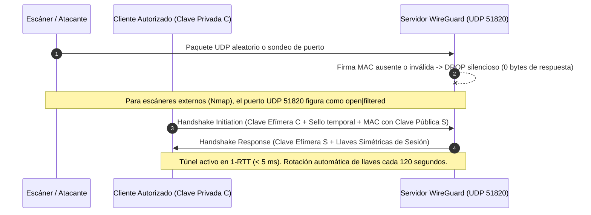

> [!IMPORTANT]
> **Resumen Ejecutivo:**  
> Contratar una VPN comercial no elimina el riesgo de interceptación ni el registro de metadatos; únicamente traslada la confianza desde tu proveedor de internet hacia un tercero opaco que observa todo tu tráfico saliente. Desplegar un nodo propio con WireGuard sobre Debian o Ubuntu resuelve este problema ejecutando el cifrado directamente en el espacio de kernel de Linux en menos de **4,000 líneas de código**, logrando una huella operativa inferior a **10 MB de RAM**, latencia mínima sobre UDP y seguridad criptográfica moderna mediante el protocolo Noise_IKpsk2 (Curve25519, ChaCha20-Poly1305 y BLAKE2s). Este caso de ingeniería detalla la arquitectura completa del túnel, el enrutamiento por clave criptográfica, la integración limpia con UFW y Netfilter, la prevención de fugas DNS con un resolver privado Unbound y la provisión sin rastros de clientes de escritorio y móviles.

---

## Modelo Conceptual: Qué Ocurre Realmente en una Red Pública y Cómo Opera un Túnel Propio

Cuando un dispositivo se conecta a una red Wi-Fi abierta en un aeropuerto, cafetería o hotel, el router local y el proveedor de red controlan el primer salto de cada paquete. Incluso si visitas sitios web con HTTPS, el contenido del cuerpo viaja cifrado, pero la red local sigue observando qué dominios consultas mediante tráfico DNS en texto claro, el nombre del servidor destino en el saludo TLS (campo SNI), el volumen de datos intercambiado y la hora exacta de cada conexión.

Una red privada virtual propia funciona como un sobre blindado dentro de una caja opaca desde tu computadora o teléfono hasta un servidor bajo tu control exclusivo (por ejemplo, un servidor privado virtual en la nube o una placa Linux en tu red doméstica):

* **Encapsulación en el dispositivo origen:** Antes de que un paquete IP salga por la tarjeta Wi-Fi o celular, la interfaz virtual `wg0` cifra por completo tanto la carga útil como las cabeceras internas y envuelve el resultado dentro de un datagrama UDP estándar.
* **Tránsito opaco por redes no confiables:** Los routers intermedios de la cafetería y los operadores locales solo observan datagramas UDP cifrados viajando hacia una única dirección IP y puerto (`51820`). No pueden inspeccionar los dominios consultados, inyectar anuncios HTTP ni alterar un solo bit sin invalidar la etiqueta de autenticación criptográfica.
* **Desencapsulación y salida en kernel:** Tu servidor recibe el datagrama UDP, valida su firma criptográfica directamente dentro del kernel de Linux, extrae el paquete IP original y lo reenvía hacia Internet sustituyendo la IP privada del túnel por su propia IP pública mediante NAT Masquerade.

### Por qué WireGuard Frente a OpenVPN o IPsec

Durante más de veinte años, los despliegues VPN dependieron de demonios en espacio de usuario como OpenVPN o pilas complejas de negociación como IPsec. WireGuard replanteó el plano de datos bajo el principio de minimalismo auditable y primitivas criptográficas fijas:

| Parámetro Técnico | WireGuard | OpenVPN | IPsec (strongSwan / IKEv2) |
|---|---|---|---|
| Base de código fuente | ~4,000 líneas (auditable por una persona) | > 100,000 líneas + OpenSSL | > 400,000 líneas |
| Plano de ejecución | Espacio de kernel Linux nativo | Espacio de usuario (`tun` + cambios de contexto) | Mixto (Kernel XFRM + demonio IKE) |
| Primitivas criptográficas | Fijas y modernas (Curve25519, ChaCha20-Poly1305, BLAKE2s) | Negociables (riesgo de *downgrade* por mala configuración) | Negociables (múltiples suites heredadas) |
| Consumo en reposo | < 10 MB de RAM, 0% CPU sin tráfico | ~30 - 80 MB por proceso | ~25 - 50 MB |
| Cambio de red (Wi-Fi a 4G) | Transparente e instantáneo sin reconexión | Requiere renegociación TLS (3 a 10 s) | Requiere MOBIKE y reconexión frecuente |
| Visibilidad ante escáneres | Silencioso: descarta paquetes sin firma sin responder | Responde al saludo TLS en el puerto abierto | Responde paquetes IKE visibles al escaneo |

---

## Glosario Técnico de Arquitectura VPN

| Término | Definición Operativa |
|---|---|
| Interfaz virtual wg0 | Dispositivo de red lógico en el kernel de Linux encargado de cifrar el tráfico saliente y descifrar los datagramas UDP válidos provenientes de los pares autorizados. |
| Cryptokey Routing (AllowedIPs) | Tabla bidireccional propia de WireGuard que asocia una clave pública con subredes CIDR específicas: define qué tráfico se envía a un par y qué IP de origen se acepta de él. |
| Protocolo Noise_IKpsk2 | Esquema de intercambio autenticado de llaves en un único viaje de ida y vuelta (*1-RTT*) con secreto perfecto hacia adelante y mezcla opcional de clave precompartida. |
| NAT Masquerade | Traducción dinámica de direcciones en Netfilter que reescribe la IP privada del cliente (`10.8.0.2`) por la IP pública del servidor en la interfaz de salida. |
| Full Tunnel vs. Split Tunnel | En modo completo (`0.0.0.0/0, ::/0`), todo el tráfico de Internet pasa por el túnel; en modo dividido (`10.8.0.0/24`), solo viaja por el túnel el acceso a recursos privados. |
| MTU | Tamaño máximo en bytes de un paquete sin fragmentación; al descontar las cabeceras de encapsulación UDP y WireGuard, fijar `1420` bytes evita cortes silenciosos en redes móviles. |

---

## Arquitectura del Túnel, Enrutamiento y Handshake Silencioso

El siguiente diagrama detalla la trayectoria exacta de un paquete IP desde el navegador del cliente hasta Internet atravesando el espacio de kernel del servidor Linux y las reglas de UFW:

```mermaid
flowchart LR
    subgraph Cliente ["Dispositivo Cliente (Laptop / Móvil)"]
        App["Navegador / Terminal\n(IP origen: 10.8.0.2)"]
        WGClient["Interfaz wg0\nChaCha20-Poly1305\nMTU: 1420"]
    end

    subgraph RedPublica ["Red Pública No Confiable (Wi-Fi / 4G)"]
        UDP["Datagrama UDP :51820\nCarga Cifrada Opaca"]
    end

    subgraph Servidor ["Servidor Linux Debian / Ubuntu (Espacio de Kernel)"]
        UFW["Perímetro UFW / Netfilter\nPermite únicamente UDP 51820"]
        WGServer["Módulo Kernel wireguard\nValida Clave Pública + AllowedIPs"]
        Unbound["Unbound DNS (:53)\nEscucha solo en 10.8.0.1"]
        Routing["net.ipv4.ip_forward = 1\nCadena FORWARD"]
        NAT["Regla *nat POSTROUTING\nMASQUERADE en eth0"]
    end

    App -->|"Paquete IP plano"| WGClient
    WGClient -->|"Encapsula en UDP"| UDP
    UDP --> UFW
    UFW --> WGServer
    WGServer -->|"Consultas DNS"| Unbound
    WGServer -->|"Tráfico web descifrado"| Routing
    Routing --> NAT
    NAT -->|"Salida a Internet"| Internet(("Internet / Red Privada"))
```



### Anatomía de la Autenticación Silenciosa (Stealth)

Un puerto TCP abierto con OpenVPN o SSH responde siempre a cualquier escáner de Internet que envíe un paquete `SYN`. WireGuard invierte este comportamiento mediante autenticación silenciosa antes de responder un solo byte:



---

## Despliegue Paso a Paso en Debian y Ubuntu

Todo el procedimiento está verificado para Debian GNU/Linux (12 / 13) y Ubuntu Server LTS (22.04 / 24.04) utilizando exclusivamente el stack estándar `apt`, systemd y UFW.

### Paso 1: Instalación y Generación de Llaves con Aislamiento de Permisos

Nunca generes claves privadas con permisos de lectura global (`0644`). Al fijar `umask 077` dentro de una subshell antes de ejecutar `wg genkey`, cada archivo nace con permisos exclusivos para `root` (`0600`):

```bash
# 1. Instalar módulo/herramientas de WireGuard y generador QR para clientes móviles
sudo apt update && sudo apt install -y wireguard wireguard-tools qrencode

# 2. Preparar directorio de configuración con permisos estrictos
sudo mkdir -p /etc/wireguard/clients
sudo chmod 700 /etc/wireguard

# 3. Generar llaves asimétricas Curve25519 y clave precompartida (PSK) de 256 bits
sudo bash -c '
  umask 077
  wg genkey | tee /etc/wireguard/server_private.key | wg pubkey > /etc/wireguard/server_public.key
  wg genkey | tee /etc/wireguard/clients/laptop_private.key | wg pubkey > /etc/wireguard/clients/laptop_public.key
  wg genpsk > /etc/wireguard/clients/laptop.psk
'
```

> [!TIP]
> El archivo `laptop.psk` introduce una clave simétrica precompartida de 256 bits dentro del intercambio `Noise_IKpsk2`. Incluso si un adversario captura hoy el tráfico cifrado y décadas después logra romper Curve25519 con computación cuántica, seguirá sin poder descifrar las sesiones pasadas (*Harvest Now, Decrypt Later*).

### Paso 2: Habilitar IP Forwarding y Ajustar Buffers UDP del Kernel

Por defecto, Linux bloquea el tránsito de paquetes entre distintas interfaces (`wg0` hacia `eth0`). Crea un archivo persistente en `/etc/sysctl.d/99-wireguard.conf` habilitando el reenvío y ajustando los buffers de recepción UDP junto con sondeo automático de MTU:

```bash
sudo tee /etc/sysctl.d/99-wireguard.conf > /dev/null << 'EOF'
# Reenvío de paquetes entre túnel VPN e interfaz pública
net.ipv4.ip_forward = 1
net.ipv6.conf.all.forwarding = 1

# Sondeo automático de MTU para evitar agujeros negros en enlaces PPPoE/LTE
net.ipv4.tcp_mtu_probing = 1

# Incremento moderado de buffers UDP en memoria para ráfagas de tráfico
net.core.rmem_max = 26214400
net.core.wmem_max = 26214400
EOF

# Aplicar parámetros en caliente sin reiniciar
sudo sysctl --system
```

### Paso 3: Configurar la Interfaz del Servidor (`/etc/wireguard/wg0.conf`)

Primero, identifica el nombre exacto de la interfaz conectada a Internet en tu servidor (habitualmente `eth0`, `ens3` o `enp1s0`):

```bash
ip -o -4 route show to default | awk '{print $5}'
```

Crea el archivo `/etc/wireguard/wg0.conf` utilizando una subred privada `10.8.0.0/24` (evita `192.168.1.0/24` para no colisionar con routers domésticos o de hoteles cuando te conectes remotamente). Incluye explícitamente `SaveConfig = false` para evitar que systemd sobrescriba tus comentarios o reglas al detener el servicio:

```ini
# /etc/wireguard/wg0.conf
[Interface]
Address = 10.8.0.1/24
ListenPort = 51820
MTU = 1420
SaveConfig = false
PrivateKey = <CONTENIDO_DE_/etc/wireguard/server_private.key>

# Cliente 1: Estación de trabajo / Laptop
[Peer]
PublicKey = <CONTENIDO_DE_/etc/wireguard/clients/laptop_public.key>
PresharedKey = <CONTENIDO_DE_/etc/wireguard/clients/laptop.psk>
AllowedIPs = 10.8.0.2/32
```

Protege el archivo con permisos `600`:

```bash
sudo chmod 600 /etc/wireguard/wg0.conf
```

### Paso 4: Integración Limpia con UFW y NAT Masquerade

En lugar de mezclar reglas manuales dispersas en `PostUp` que compiten con UFW, integra la traducción de direcciones directamente en la tabla `*nat` de `/etc/ufw/before.rules` y habilita la política de reenvío de UFW. Sustituye `eth0` por el nombre de tu interfaz detectado en el Paso 3:

```bash
# 1. Permitir reenvío de paquetes en UFW
sudo sed -i 's/^DEFAULT_FORWARD_POLICY="DROP"/DEFAULT_FORWARD_POLICY="ACCEPT"/' /etc/default/ufw

# 2. Verificar que /etc/ufw/before.rules no tenga ya la sección *nat y añadirla al inicio
sudo tee /etc/ufw/before.rules.tmp > /dev/null << 'EOF'
# Reglas NAT Masquerade para subred VPN WireGuard
*nat
:POSTROUTING ACCEPT [0:0]
-A POSTROUTING -s 10.8.0.0/24 -o eth0 -j MASQUERADE
COMMIT

EOF
sudo cat /etc/ufw/before.rules | sudo tee -a /etc/ufw/before.rules.tmp > /dev/null
sudo mv /etc/ufw/before.rules.tmp /etc/ufw/before.rules
sudo chmod 640 /etc/ufw/before.rules
```

Abre el puerto UDP `51820`, habilita el enrutamiento explícito entre `wg0` y `eth0`, recarga UFW y levanta el servicio `wg-quick@wg0`:

```bash
sudo ufw allow 51820/udp comment 'WireGuard VPN'
sudo ufw route allow in on wg0 out on eth0
sudo ufw reload

sudo systemctl enable --now wg-quick@wg0
```

---

## Prevención de Fugas DNS con Resolver Privado Local (Unbound)

Cifrar el tráfico IP mientras el sistema operativo sigue consultando el servidor DNS del router local (`192.168.1.1`) expone cada dominio visitado al dueño de la red Wi-Fi (**DNS Leak**). Enviar las consultas a proveedores públicos dentro del túnel resuelve la fuga local, pero permite que ese proveedor observe tus dominios.

La arquitectura más limpia consiste en desplegar un resolver DNS recursivo propio con Unbound escuchando exclusivamente en la IP interna del túnel (`10.8.0.1`), sin abrir el puerto `53` hacia Internet:

```bash
# 1. Instalar Unbound en el servidor VPN
sudo apt install -y unbound

# 2. Configurar escucha exclusiva en la interfaz del túnel 10.8.0.1
sudo tee /etc/unbound/unbound.conf.d/wireguard-dns.conf > /dev/null << 'EOF'
server:
    interface: 10.8.0.1
    port: 53
    do-ip4: yes
    do-ip6: no
    do-udp: yes
    do-tcp: yes

    # Permitir consultas únicamente desde la subred privada del túnel VPN
    access-control: 127.0.0.1/32 allow
    access-control: 10.8.0.0/24 allow
    access-control: 0.0.0.0/0 refuse

    # Privacidad y endurecimiento
    hide-identity: yes
    hide-version: yes
    qname-minimisation: yes
    harden-glue: yes
    harden-dnssec-stripped: yes
    prefetch: yes
EOF

# 3. Permitir consultas DNS únicamente desde la interfaz wg0 en UFW
sudo ufw allow in on wg0 to 10.8.0.1 port 53 proto udp comment 'Unbound DNS privado VPN'
sudo ufw allow in on wg0 to 10.8.0.1 port 53 proto tcp comment 'Unbound DNS privado VPN'
sudo systemctl enable --now unbound
```

---

## Configuración de Clientes, Split Tunnel y Provisión QR

Dependiendo del objetivo de uso, puedes configurar el cliente en modo completo (navegación privada en redes públicas) o en modo dividido (acceso exclusivo a servicios administrativos o bases de datos internas):

| Perfil de Enrutamiento | Valor de `AllowedIPs` en Cliente | Comportamiento y Caso de Uso |
|---|---|---|
| Full Tunnel (Navegación Segura) | `0.0.0.0/0, ::/0` | Todo el tráfico IPv4 e IPv6 sale cifrado por el servidor VPN; requiere `DNS = 10.8.0.1`. |
| Split Tunnel (Solo Red Privada) | `10.8.0.0/24` | Solo los paquetes hacia `10.8.0.x` usan el túnel; la navegación web usa tu conexión local directa. |
| Split Tunnel + Red Interna Cloud | `10.8.0.0/24, 172.16.0.0/12` | Permite administrar paneles internos o VPC privadas sin redirigir streaming ni descargas generales. |

### Perfil Completo para Escritorio y Móvil (`laptop.conf`)

```ini
# /etc/wireguard/clients/laptop.conf
[Interface]
PrivateKey = <CONTENIDO_DE_/etc/wireguard/clients/laptop_private.key>
Address = 10.8.0.2/32
MTU = 1420

# Apunta al resolver recursivo privado Unbound dentro del túnel (cero DNS Leaks)
DNS = 10.8.0.1

[Peer]
PublicKey = <CONTENIDO_DE_/etc/wireguard/server_public.key>
PresharedKey = <CONTENIDO_DE_/etc/wireguard/clients/laptop.psk>
Endpoint = <IP_PUBLICA_DEL_SERVIDOR>:51820

# Full Tunnel IPv4 e IPv6 (evita fugas por tráfico IPv6 fuera del túnel)
AllowedIPs = 0.0.0.0/0, ::/0

# Mantiene viva la asignación NAT en routers móviles y CGNAT cada 25 segundos
PersistentKeepalive = 25
```

Para importar la configuración en la aplicación oficial de WireGuard en iOS o Android sin enviar claves privadas por correo ni aplicaciones de mensajería, genera el código QR directamente en tu terminal SSH:

```bash
sudo qrencode -t ansiutf8 < /etc/wireguard/clients/laptop.conf
```

---

## Auditoría Forense, Diagnóstico y Resolución de Edge Cases

Una vez conectado el cliente, utiliza las siguientes herramientas de bajo nivel para verificar que no existan fugas, bloqueos de enrutamiento ni errores de fragmentación:

| Comando de Diagnóstico | Propósito Operativo y Resultado Esperado |
|---|---|
| sudo wg show | Muestra pares activos, endpoint remoto actual, tiempo desde el último handshake (< 2 min) y bytes `received / sent`. |
| sudo ss -ulnp \| grep 51820 | Confirma que el socket UDP del kernel está escuchando correctamente en el puerto `51820`. |
| sudo tcpdump -ni wg0 | Captura en tiempo real paquetes IP internos ya descifrados circulando por el túnel virtual. |
| sudo iptables -t nat -L POSTROUTING -v -n | Verifica que los paquetes de `10.8.0.0/24` están incrementando el contador de la regla `MASQUERADE`. |
| curl -s https://ifconfig.me | Ejecutado en el cliente conectado: debe devolver exclusivamente la IP pública del servidor VPN. |
| sudo wg syncconf wg0 <(wg-quick strip wg0) | Recarga pares agregados o revocados en caliente sin desconectar las sesiones activas de otros clientes. |

### Resolución de Casos Límite en Producción

1. **Handshake activo pero el cliente no carga páginas web:**
   * Causa habitual: `DEFAULT_FORWARD_POLICY` en `/etc/default/ufw` sigue en `DROP` o el nombre de la interfaz (`eth0`) en `/etc/ufw/before.rules` no coincide con la interfaz física real del servidor (`ens3` o `enp1s0`).
2. **Carga lenta, imágenes cortadas o fallos TLS en redes celulares 4G/5G o PPPoE:**
   * Causa: El enlace físico del operador móvil tiene una MTU menor a `1500` bytes (habitualmente `1480` o `1492`), provocando que paquetes de `1420` bytes más cabeceras UDP superen el límite y sean descartados silenciosamente. Reduce `MTU = 1360` o `MTU = 1280` en ambos extremos.
3. **Pérdida de conectividad tras minutos de inactividad en móvil:**
   * Causa: Los operadores celulares bajo CGNAT expiran las tablas de estado UDP tras 30 a 60 segundos sin tráfico. Mantener `PersistentKeepalive = 25` en el cliente envía un datagrama mínimo autenticado cada 25 segundos para preservar el mapeo NAT.
4. **Conflicto de direcciones IP al conectarse desde la red local de una oficina:**
   * Causa: Usar `192.168.1.0/24` o `192.168.0.0/24` como rango del túnel VPN provoca colisiones con el router local. Utilizar `10.8.0.0/24` o una subred menos común como `10.214.0.0/24` elimina por completo el solapamiento de rutas.

---

## Checklist de Seguridad y Validación Final

- [x] **Permisos Criptográficos Estrictos:** Claves privadas y `/etc/wireguard/wg0.conf` protegidos con `chmod 600` y `umask 077` exclusivamente para `root`.
- [x] **Defensa Post-Cuántica (`PSK`):** Cada par configurado con `PresharedKey` única de 256 bits mezclada en `Noise_IKpsk2`.
- [x] **Integración Limpia con UFW:** Regla `MASQUERADE` declarada en `/etc/ufw/before.rules`, `DEFAULT_FORWARD_POLICY="ACCEPT"` activo y puerto único UDP `51820` expuesto al exterior.
- [x] **Resolver DNS Propio Sin Fugas:** Unbound escuchando únicamente en `10.8.0.1:53` con `access-control` restringido a `10.8.0.0/24` y enrutamiento completo `::/0` en perfiles *Full Tunnel*.
- [x] **Recarga Sin Cortes Operativos:** Altas y bajas de clientes aplicadas en caliente mediante `wg syncconf` sin reiniciar `wg-quick@wg0`.
- [x] **Auditoría End-to-End Validada:** Handshake confirmado con `wg show`, contadores NAT activos e IP pública de salida verificada desde el cliente.
