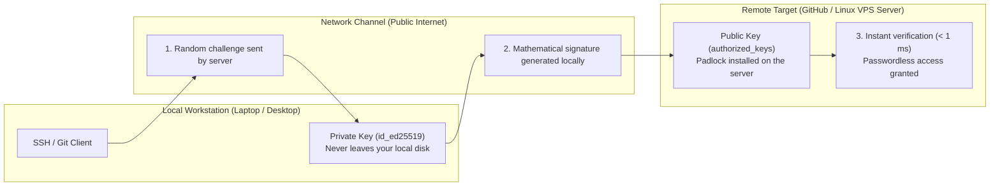
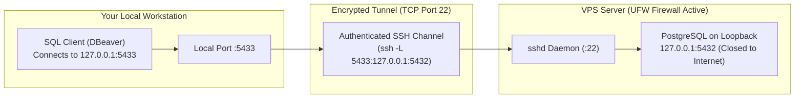

> [!IMPORTANT]
> **Executive Summary:**  
> Traditional password-based authentication exposes servers and source code accounts to automated brute-force and dictionary attacks. Transitioning to elliptic-curve cryptography with Ed25519 replaces passwords with **256-bit** mathematical signatures verified in **under 1 ms** using compact **68-character** public keys. By combining asymmetric keys with declarative profiles in `~/.ssh/config` and encrypted tunnels via Port Forwarding, any developer can authenticate to GitHub and Linux servers in a second, manage remote databases bound to `127.0.0.1` without opening public firewall ports, and operate under a Zero Trust architecture.

---

## Conceptual Model: Anatomy of Asymmetric Authentication

Unlike a conventional password —which travels across the network or is stored as a shared secret—, public-key cryptography splits identity into two complementary mathematical halves:



* **Public Key:** Equivalent to an open mechanical padlock that you can hand out to anyone or install across multiple servers (GitHub, GitLab, Debian or Ubuntu VPS instances). Inspecting the padlock does not allow an attacker to unlock it.
* **Private Key:** Equivalent to the physical titanium key kept exclusively on your workstation with restricted file permissions (`0600`). It is never transmitted over the internet.
* **Challenge and Signature:** When you run `ssh` or `git push`, the server issues a random challenge. Your workstation mathematically signs it using your private key and returns the signature; the server uses your public key to verify authenticity without ever seeing your private key.

---

## Essential Cryptography & Remote Connection Glossary

| Term | Clear Technical Definition |
|---|---|
| Ed25519 | Modern digital signature algorithm built on the Curve25519 elliptic curve, delivering security equivalent to 3072-bit RSA with significantly smaller and faster keys. |
| Passphrase | Secret phrase that encrypts your private key file at rest on your local drive, protecting your key if someone gains physical access to your machine. |
| Known Hosts | Local registry file (`~/.ssh/known_hosts`) storing the cryptographic fingerprint of every visited server to alert you if a connection is intercepted. |
| Authorized Keys | File on the remote server (`~/.ssh/authorized_keys`) listing all public keys authorized to log into that specific user account. |
| Port Forwarding | Technique that creates an encrypted conduit inside an SSH session to connect a port on your local workstation directly to an internal service on the remote server. |

---

## 1. Modern Cryptography: Why Ed25519 Replaces RSA

For decades, the default standard for generating SSH keys was RSA (`ssh-keygen -t rsa`). However, achieving modern security margins with RSA requires **3072-bit** or **4096-bit** keys, resulting in bulky files and slower verification times.

| Algorithm | Key Size | Public String Length | Verification Speed | Recommended Status |
|---|---|---|---|---|
| Ed25519 | 256 bits | 68 characters | Very high (**< 1 ms**) | Current standard for all new deployments |
| ECDSA (NIST P-256) | 256 bits | 140 characters | High | Acceptable, but sensitive to weak random number generators |
| RSA 4096 | 4096 bits | 725 characters | Moderate / Slow | Legacy fallback for older systems without modern support |
| RSA 1024 / DSA | 1024 bits | 220 characters | Obsolete | Insecure and disabled in modern OpenSSH |

### Step 1.1: Generate Your Key Pair with `ssh-keygen`

Open your terminal on Linux, macOS, or PowerShell / Git Bash on Windows and execute the following command:

```bash
# Generate an Ed25519 key pair with 100 KDF rounds
ssh-keygen -t ed25519 -a 100 -C "jorge@doiceladev.com"
```

Breakdown of the flags used:
* `-t ed25519`: Specifies the Ed25519 elliptic-curve algorithm.
* `-a 100`: Applies **100 rounds** of the `bcrypt` key derivation function (KDF) when encrypting your private key on disk, making it orders of magnitude more resistant against offline *passphrase* cracking.
* `-C "comment"`: Appends an identifying label at the end of the public key (helpful for tracking which laptop or workstation owns each key).

When executed, the interactive prompt displays the following output:

```text
Generating public/private ed25519 key pair.
Enter file in which to save the key (/home/user/.ssh/id_ed25519): [Press Enter]
Enter passphrase (empty for no passphrase): [Type a strong passphrase]
Enter same passphrase again: [Repeat passphrase]
Your identification has been saved in /home/user/.ssh/id_ed25519
Your public key has been saved in /home/user/.ssh/id_ed25519.pub
The key fingerprint is:
SHA256:8xK9pL2mN4vQ7wR1tY5uI0oP3aS6dF8gH2jK4lZ9xC0 jorge@doiceladev.com
```

### Step 1.2: Inspect the Generated Files

The command creates two files inside your `~/.ssh/` directory:

* **Private Key (`~/.ssh/id_ed25519`):** Secret and non-transferable; must never be shared or committed to any repository.
* **Public Key (`~/.ssh/id_ed25519.pub`):** Ready to be installed on GitHub or your remote servers.

To view the contents of your public key without opening a text editor:

```bash
# Display only the public key (.pub) to copy it
cat ~/.ssh/id_ed25519.pub
```

```text
ssh-ed25519 AAAAC3NzaC1lZDI1NTE5AAAAIKt8N2xPqL9mR4vW7yB1nC5vX0zL3kJ6hG8fD2sA4pQ1 jorge@doiceladev.com
```

---

## 2. Managing Your Passphrase with `ssh-agent`

Protecting your private key with a *passphrase* is a fundamental security rule, but typing it twenty times a day during `git pull` or `git push` interrupts your workflow. The `ssh-agent` daemon solves this by caching the decrypted key in your user session's RAM.

### On Linux and macOS

```bash
# 1. Start the agent in the background for the current session
eval "$(ssh-agent -s)"

# 2. Add your private key to the agent (prompts for your passphrase once)
ssh-add ~/.ssh/id_ed25519

# 3. Verify which keys are currently loaded in memory
ssh-add -l
```

### On Windows (PowerShell as Administrator)

On Windows 10 and Windows 11, the native OpenSSH agent service can be configured to start automatically with the operating system:

```powershell
# Enable and start the native Windows ssh-agent service
Get-Service ssh-agent | Set-Service -StartupType Automatic
Start-Service ssh-agent

# Register your key with the Windows agent
ssh-add $HOME\.ssh\id_ed25519
```

---

## 3. Deploying Your Public Key to GitHub and Linux Servers

Once your key pair is generated, the next step is installing the public half (`.pub`) on the services you connect to.

### 3.1 Passwordless Authentication on GitHub

1. Copy the output of `cat ~/.ssh/id_ed25519.pub`.
2. On GitHub, navigate to **Settings → SSH and GPG keys → New SSH key**.
3. Assign a descriptive title (e.g., `Primary Debian Workstation`) and paste the line starting with `ssh-ed25519`.
4. Verify your authentication from the terminal:

```bash
# Test SSH authentication against GitHub
ssh -T git@github.com
```

```text
Hi username! You've successfully authenticated, but GitHub does not provide shell access.
```

### 3.2 Installing on a Linux Server (Debian / Ubuntu)

If you have a cloud VPS or local server that currently accepts password login, the `ssh-copy-id` utility uploads your public key and sets the exact directory permissions in a single command:

```bash
# Automatically copy your public key to the remote server
ssh-copy-id -i ~/.ssh/id_ed25519.pub user@203.0.113.10
```

If you prefer manual installation or are provisioning the server via a web console, run this sequence on the remote server to enforce strict permissions:

```bash
# Create the .ssh directory with owner-only permissions (700)
mkdir -p ~/.ssh
chmod 700 ~/.ssh

# Append your public key to authorized_keys and lock down permissions (600)
echo "ssh-ed25519 AAAAC3NzaC1lZDI1NTE5AAAAI... jorge@doiceladev.com" >> ~/.ssh/authorized_keys
chmod 600 ~/.ssh/authorized_keys
```

> [!NOTE]
> The first time you connect to a new server, your client records its cryptographic fingerprint in Known Hosts (`~/.ssh/known_hosts`). If that fingerprint unexpectedly changes in the future, the client will block the connection to protect you against server impersonation.

---

## 4. Terminal Productivity: Profiles and Aliases in `~/.ssh/config`

Typing long commands like `ssh -i ~/.ssh/id_ed25519 -p 2222 admin@203.0.113.10` every day is error-prone. The `~/.ssh/config` file lets you declare named profiles with short aliases, keep connections alive, and reuse sessions.

Create or edit `~/.ssh/config` on your local machine:

```ini
# ~/.ssh/config
# Global defaults for all connections
Host *
    AddKeysToAgent yes
    IdentitiesOnly yes
    ServerAliveInterval 60
    ServerAliveCountMax 3
    Compression yes

# Profile 1: Production Cloud VPS (connect by typing: ssh prod)
Host prod
    HostName 203.0.113.10
    User admin
    Port 22
    IdentityFile ~/.ssh/id_ed25519

# Profile 2: Local Lab Server on custom port (connect by typing: ssh lab)
Host lab
    HostName 192.168.1.50
    User developer
    Port 2222
    IdentityFile ~/.ssh/id_ed25519

# Profile 3: GitHub Account
Host github.com
    HostName github.com
    User git
    IdentityFile ~/.ssh/id_ed25519
```

Ensure owner-only read and write permissions are set on the configuration file:

```bash
# Enforce strict permissions on the local config file
chmod 600 ~/.ssh/config
```

### What each key directive accomplishes:
* **Direct Alias (`Host prod`):** You can now connect simply by running `ssh prod` or transfer files with `scp archive.tar.gz prod:/tmp/` without memorizing IP addresses or ports.
* **Drop Prevention (`ServerAliveInterval 60`):** Sends a heartbeat packet every **60 seconds** over the encrypted tunnel, preventing NAT routers or firewalls from dropping your terminal when idle.
* **Key Isolation (`IdentitiesOnly yes`):** Instructs the client to present strictly the `IdentityFile` declared for that host, preventing your agent from offering every key in memory and tripping the server's `MaxAuthTries` limit.

---

## 5. Secure SSH Tunnels: Accessing Databases Bound to `127.0.0.1` (Port Forwarding)

In a hardened server architecture (as covered in our Netfilter and UFW guide), databases such as PostgreSQL, MySQL, or Redis must never be exposed on `0.0.0.0` to the public internet; they should listen strictly on the internal `127.0.0.1` (*loopback*) interface.

How do you connect a graphical client on your laptop (such as DBeaver, DataGrip, or pgAdmin) to that remote database when the port is closed externally? Through local Port Forwarding:



### Opening the Tunnel in a Single Command

Run the following command in your terminal using the `prod` alias configured in the previous step:

```bash
# Forward local port 5433 on your PC to internal port 5432 on the VPS server
ssh -L 5433:127.0.0.1:5432 prod -N
```

Breakdown of the `-L [local_port]:[remote_target]:[remote_port]` syntax:
* `5433`: The port opened on your own workstation (`127.0.0.1:5433`). Using `5433` avoids collisions if you already run a local PostgreSQL instance on `5432`.
* `127.0.0.1:5432`: The destination address and port that the VPS server connects to internally once traffic exits the tunnel.
* `-N`: Instructs SSH not to execute an interactive remote shell, dedicating the connection solely to forwarding tunnel packets while the window stays open (press `Ctrl + C` when finished to close the tunnel).

> [!TIP]
> You can also declare the tunnel permanently inside your `~/.ssh/config` file by adding `LocalForward 5433 127.0.0.1:5432` under `Host prod`. Whenever you connect with `ssh prod`, your remote database becomes automatically reachable at `localhost:5433`.

---

## 6. Server Hardening: Disabling Passwords in `sshd_config`

Once you have verified passwordless login to your Linux server using your Ed25519 key, the final security step on Debian and Ubuntu is disabling password authentication in the server daemon to completely neutralize brute-force attacks.

> [!CAUTION]
> **Mandatory Pre-Flight Verification:**  
> Keep your current SSH session open in one terminal window and open a **second terminal** to confirm you can log in directly with your key. Never disable `PasswordAuthentication` before confirming that public-key login succeeds.

Edit `/etc/ssh/sshd_config` on the remote server:

```ini
# /etc/ssh/sshd_config
# Disable cleartext password authentication
PasswordAuthentication no

# Allow authentication exclusively via public-key cryptography
PubkeyAuthentication yes

# Prevent the root account from logging in with a password
PermitRootLogin prohibit-password

# Limit the maximum number of authentication attempts per connection
MaxAuthTries 3
```

Before reloading the service, always validate the configuration syntax to prevent accidental lockouts and apply changes via systemd:

```bash
# 1. Validate configuration syntax (if no errors are returned, it is safe to proceed)
sudo sshd -t

# 2. Reload the SSH service on Debian / Ubuntu without dropping active sessions
sudo systemctl reload ssh
```

---

## 7. Troubleshooting Common Issues & Permission Audits

OpenSSH enforces strict file ownership by design: if the permissions on your `~/.ssh` folder or key files are too permissive (allowing other local users to read your private key), it will refuse to use the key and display this classic warning:

```text
@@@@@@@@@@@@@@@@@@@@@@@@@@@@@@@@@@@@@@@@@@@@@@@@@@@@@@@@@@@
@         WARNING: UNPROTECTED PRIVATE KEY FILE!          @
@@@@@@@@@@@@@@@@@@@@@@@@@@@@@@@@@@@@@@@@@@@@@@@@@@@@@@@@@@@
Permissions 0644 for '/home/user/.ssh/id_ed25519' are too open.
It is required that your private key files are NOT accessible by others.
This private key will be ignored.
```

### Exact Permission Matrix for `~/.ssh`

To fix any permission mismatch, apply the standard octal values on your local workstation and remote server:

| File or Directory Path | Octal Mode | Symbolic Equivalent | Fix Command |
|---|---|---|---|
| ~/.ssh | `700` | `drwx------` | `chmod 700 ~/.ssh` |
| ~/.ssh/id_ed25519 | `600` | `-rw-------` | `chmod 600 ~/.ssh/id_ed25519` |
| ~/.ssh/config | `600` | `-rw-------` | `chmod 600 ~/.ssh/config` |
| ~/.ssh/id_ed25519.pub | `644` | `-rw-r--r--` | `chmod 644 ~/.ssh/id_ed25519.pub` |
| ~/.ssh/authorized_keys | `600` | `-rw-------` | `chmod 600 ~/.ssh/authorized_keys` |

### Live Debugging with Verbose Mode (`-vvv`)

If a connection fails and you are unsure whether the server is rejecting the key, looking at the wrong file, or blocking the port, append the `-v` flag (or `-vvv` for maximum trace detail):

```bash
# Inspect step-by-step which keys the client offers and how the server responds
ssh -vvv prod
```

---

## 8. Daily Operational Command Reference

| Command | Operational Purpose |
|---|---|
| ssh-keygen -t ed25519 -a 100 -C "email" | Generates a new Ed25519 key pair protected with 100 KDF rounds. |
| ssh-copy-id -i ~/.ssh/id_ed25519.pub user@ip | Installs your public key on a remote server and sets permissions automatically. |
| ssh-add ~/.ssh/id_ed25519 | Loads your private key into `ssh-agent` memory to avoid retyping your *passphrase*. |
| ssh-keygen -p -f ~/.ssh/id_ed25519 | Changes or adds a *passphrase* to an existing private key without altering the key itself. |
| ssh -L 5433:127.0.0.1:5432 prod -N | Establishes an encrypted local tunnel to internal port `5432` on the remote server. |
| ssh-keygen -R 203.0.113.10 | Removes an outdated host fingerprint from `known_hosts` after reinstalling a VPS. |
| sudo sshd -t && sudo systemctl reload ssh | Validates SSH server syntax and safely reloads the daemon configuration. |

---

## Conclusion and Verification Checklist

Completing this setup ensures both your daily development workflow and server administration operate with speed and cryptographic security:

- [x] **Modern Ed25519 Keys:** Key pair generated with `ssh-keygen -t ed25519 -a 100` replacing legacy RSA keys.
- [x] **Disk and Memory Protection:** Private key encrypted at rest with a *passphrase* and managed in session via `ssh-agent`.
- [x] **Audited Permissions:** Directory `~/.ssh` set to `700` and sensitive files (`id_ed25519`, `config`, `authorized_keys`) restricted to `600`.
- [x] **Declarative Profiles:** File `~/.ssh/config` configured with short aliases, `IdentitiesOnly yes`, and `ServerAliveInterval 60`.
- [x] **Zero Exposed Database Ports:** Local Port Forwarding (`ssh -L`) used to manage databases on `127.0.0.1` without opening public ports.
- [x] **Hardened Server Daemon:** Password authentication disabled (`PasswordAuthentication no`) after verifying public-key login.
