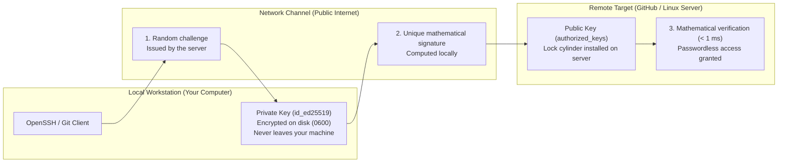
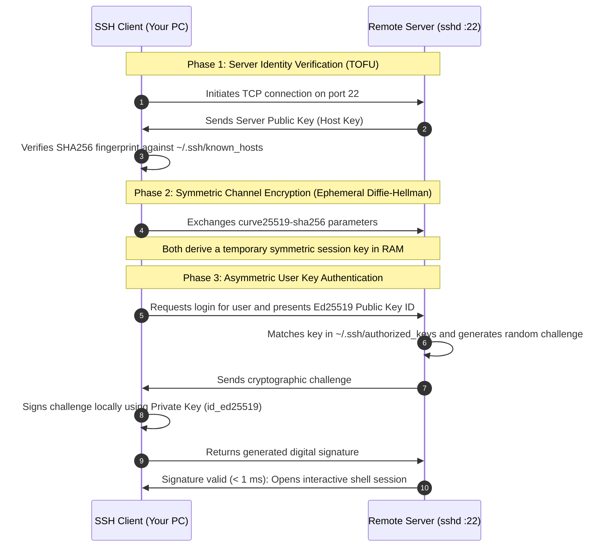
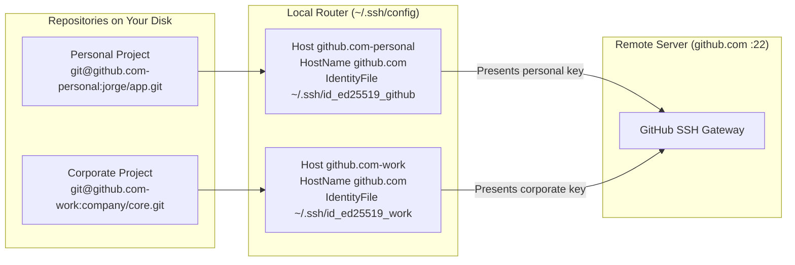

> [!IMPORTANT]
> **Executive Summary:**  
> Traditional password-based authentication exposes remote servers and source code platforms to automated brute-force, dictionary, and credential-stuffing attacks. Adopting elliptic-curve asymmetric cryptography with Ed25519 replaces passwords with **256-bit** digital signatures verified in **under 1 ms** using compact **68-character** public keys. By combining at-rest key derivation via KDF (`bcrypt` with **100 rounds**), in-memory session caching with `ssh-agent`, declarative multi-account profiles in `~/.ssh/config`, TCP connection multiplexing reducing handshake latency to **under 10 ms**, cryptographic Git commit signing, and daemon hardening on Debian and Ubuntu, engineers establish a frictionless workflow under a Zero Trust architecture.

---

## Conceptual Model: From Shared Passwords to Asymmetric Identity

To understand from scratch how SSH key authentication works, it helps to contrast it against a traditional password mechanism:

* **The Flaw of Traditional Passwords (Shared Secret):** When you authenticate using a password, both you and the remote server must hold the exact same secret. If an attacker intercepts the channel, installs a keylogger, or breaches the server's database, your credential is compromised. Furthermore, automated bots across the internet can test thousands of password combinations per second against exposed ports.
* **The Key-Pair Architecture (Asymmetric Cryptography):** Rather than sharing a secret, your workstation generates two mathematically linked halves with opposite roles: a **mechanical lock cylinder (Public Key)** and a **physical titanium key (Private Key)**.



1. **Public Key (`.pub` — The Lock Cylinder):** A short text string that you can freely copy and install on GitHub, GitLab, or your Debian and Ubuntu servers. Anyone can inspect this lock cylinder, but it is mathematically infeasible to reverse-engineer how to open it.
2. **Private Key (The Physical Key):** A strictly secret file that stays inside your local computer. It never traverses the network wire and is never transmitted to the server during login.
3. **Challenge-Response Mechanism:** When you initiate a connection, the server never asks for your private key. Instead, it generates a one-time random number (*challenge*) and sends it to you. Your computer signs that challenge locally using your private key and returns only the resulting signature. The server uses your installed public key to verify in **under 1 ms** that only the holder of the corresponding private key could have produced that exact signature.

---

## Essential Cryptography & SSH Protocol Glossary

| Term | Clear Technical Definition |
|---|---|
| SSH (Secure Shell) | Cryptographic network protocol designed to administer remote servers and transfer files securely over an encrypted channel on TCP port `22`. |
| Asymmetric Cryptography | Cryptographic system utilizing a mathematically linked key pair: a public key to verify or encrypt, and a private key to sign or decrypt. |
| Ed25519 | Digital signature algorithm built on the Curve25519 elliptic curve, providing security equivalent to 3072-bit RSA with compact keys and constant-time execution. |
| Passphrase | Secret security phrase that encrypts your private key file at rest on your local drive, protecting the key if your computer is stolen or accessed physically. |
| KDF | Key derivation function that applies multiple computational rounds (`bcrypt`) to transform your *passphrase* into a brute-force-resistant encryption key. |
| TOFU | Trust On First Use model where your client records a server's host fingerprint on initial connection and alerts you if that identity changes in the future. |
| Known Hosts | Local registry file (`~/.ssh/known_hosts`) where your computer stores verified cryptographic fingerprints of every server you have connected to. |
| Authorized Keys | File located on the remote server (`~/.ssh/authorized_keys`) containing the list of public keys authorized to log into that specific user account. |

---

## 1. Anatomy of the SSH Handshake: What Happens When You Connect

A common source of confusion when starting out is that an SSH connection involves **two distinct pairs of keys**: the server's own machine keys (*Host Keys*) and your personal identity keys (*User Keys*). Session establishment unfolds across three sequential phases:



### Phase 1: Server Identification (Why It Asks `Are you sure you want to continue connecting?`)
The first time you connect to a newly provisioned server, your workstation does not yet recognize it. The server presents its public machine key and your terminal displays its cryptographic fingerprint:

```text
The authenticity of host '203.0.113.10 (203.0.113.10)' can't be established.
ED25519 key fingerprint is SHA256:4bN9vX2pL8mK1qW7rT5yU0iO3pA6sD8fG2hJ4kL9zX1.
Are you sure you want to continue connecting (yes/no/[fingerprint])?
```

When you type `yes`, you apply the TOFU model: your client saves that fingerprint inside Known Hosts (`~/.ssh/known_hosts`). On every subsequent connection, your workstation silently verifies that the server still presents that exact fingerprint, preventing a third party from intercepting your traffic and impersonating the server.

### Phase 2: Ephemeral Symmetric Tunnel Negotiation
Before asking who you are, the client and server execute an ephemeral key agreement (*Elliptic Curve Diffie-Hellman* via `curve25519-sha256`). This creates a one-time encryption key that exists strictly in RAM while the terminal window remains open and is destroyed upon disconnect, ensuring *Perfect Forward Secrecy*.

### Phase 3: Passwordless User Authentication
With the channel encrypted, your client informs the server which public key you wish to authenticate with. The server locates that line inside `~/.ssh/authorized_keys`, issues the mathematical challenge, and validates the signature produced by your local private key.

---

## 2. Algorithm Comparison and Internal Key Anatomy

Historically, tutorials recommended generating keys with the RSA algorithm (`ssh-keygen -t rsa`). However, RSA relies on prime-number factorization; matching modern security margins requires **3072-bit** or **4096-bit** keys, producing large files and slower cryptographic operations.

OpenSSH introduced native support for Ed25519 in 2014, designed by Daniel J. Bernstein over the Curve25519 elliptic curve.

| Algorithm | Key Size | Public Key Length | Verification Speed | Side-Channel Resistance | Technical Status in OpenSSH |
|---|---|---|---|---|---|
| Ed25519 | 256 bits | 68 characters | Very high (**< 1 ms**) | Immune by design (constant-time) | Default standard for all deployments |
| Ed25519-SK | 256 bits + Hardware | 88 characters | Bound to physical touch | Key isolated inside FIDO2 chip | Standard for hardware tokens (YubiKey) |
| ECDSA (NIST P-256) | 256 bits | 140 characters | High | Sensitive to weak RNG implementations | Supported for enterprise compatibility |
| RSA 3072 / 4096 | 3072 - 4096 bits | 540 - 725 characters | Moderate | Requires software blinding | Legacy systems lacking Ed25519 support |
| RSA 1024 / DSA | 1024 bits | 220 characters | Obsolete | Vulnerable to modern factorization | Disabled by default in OpenSSH 8.8+ |

### Anatomy of an Ed25519 Public Key (`.pub`)

When you inspect a `.pub` file, you see a single line of text divided into three space-separated fields:

```text
ssh-ed25519 AAAAC3NzaC1lZDI1NTE5AAAAIKt8N2xPqL9mR4vW7yB1nC5vX0zL3kJ6hG8fD2sA4pQ1 jorge@workstation-debian
└────┬────┘ └─────────────────────────────────┬────────────────────────────────┘ └───────────┬──────────┘
  1. Type                     2. Base64 Public Key Payload (68 chars)               3. Comment / Label
```

1. **Algorithm Identifier (`ssh-ed25519`):** Instructs the server which mathematical engine to use when verifying signatures.
2. **Base64 Public Payload:** Encodes the header length and the exact **32 bytes (256 bits)** of the public elliptic-curve coordinate.
3. **Comment (`-C`):** Human-readable metadata that does not affect cryptography; it helps you identify at a glance which workstation or engineer owns that key inside the server's `authorized_keys` file.

### Anatomy of a Private Key and At-Rest Encryption (KDF)

Unlike the public key, the private key file (`id_ed25519`) has the following block structure (delimited with a hyphen to avoid false positives in security secret scanners):

```text
-----BEGIN OPENSSH PRIVATE-KEY-----
b3BlbnNzaC1rZXktdjEAAAAABG5vbmUAAAAEbm9uZQAAAAAAAAABAAAAMwAAAAtzc2gtZW
QyNTUxOQAAACBLfDdsT6y/ZkWLd8ZbnF9Yz9pL3kJ6hG8fD2sA4pQ1AAAAkOit7Lvor...
-----END OPENSSH PRIVATE-KEY-----
```

If you leave the *passphrase* empty during generation, the block above stores your private key in cleartext (`cipher: none`): any malware or intruder that copies that file can immediately access all of your servers. Conversely, when you set a strong *passphrase* combined with the `-a 100` flag, OpenSSH encrypts the private block with `aes256-ctr` or `chacha20-poly1305` by stretching your phrase through **100 rounds** of KDF (`bcrypt-pbkdf`), making offline brute-force cracking infeasible even if the file is exfiltrated.

---

## 3. Step-by-Step Key Generation and Lifecycle Management with `ssh-keygen`

### Step 3.1: Initial Environment Check from Scratch

Before generating any key, verify that your OpenSSH client is installed and inspect whether existing keys already reside in your user directory so you do not overwrite them accidentally.

Open your terminal on Linux, macOS, or PowerShell on Windows:

```bash
# 1. Check the installed OpenSSH version
ssh -V

# 2. List the current contents of the ~/.ssh directory (if it exists)
ls -la ~/.ssh
```

* If `ls -la ~/.ssh` returns `No such file or directory`, you have never generated a key on this workstation; `ssh-keygen` will create the folder automatically with the appropriate permissions.
* If you already see files named `id_rsa` or `id_ed25519`, name your new keys with a descriptive suffix to keep identities cleanly isolated.

### Step 3.2: Purpose-Driven Naming Convention (`-f`)

A core engineering practice is separating your keys by domain of responsibility rather than relying on a single generic file for everything:

* `~/.ssh/id_ed25519_github`: For your personal GitHub or GitLab account.
* `~/.ssh/id_ed25519_work`: For company or client repositories and cloud environments.
* `~/.ssh/id_ed25519_vps`: For administering your own Linux production servers.

Execute the command specifying the algorithm, derivation rounds, output file path, and identifying comment:

```bash
# Generate a dedicated Ed25519 key pair for VPS servers
ssh-keygen -t ed25519 -a 100 -f ~/.ssh/id_ed25519_vps -C "jorge@primary-laptop-2026"
```

Breakdown of each parameter:
* `-t ed25519`: Selects the Ed25519 elliptic-curve algorithm.
* `-a 100`: Executes **100 rounds** of KDF when encrypting the private key on disk.
* `-f ~/.ssh/id_ed25519_vps`: Defines the exact output filename (prevents overwriting existing keys).
* `-C "jorge@primary-laptop-2026"`: Records who created the key and on which device.

The interactive prompt will ask strictly for your *passphrase*:

```text
Generating public/private ed25519 key pair.
Enter passphrase (empty for no passphrase): [Type your strong passphrase — nothing will echo on screen]
Enter same passphrase again: [Retype passphrase and press Enter]
Your identification has been saved in /home/user/.ssh/id_ed25519_vps
Your public key has been saved in /home/user/.ssh/id_ed25519_vps.pub
The key fingerprint is:
SHA256:8xK9pL2mN4vQ7wR1tY5uI0oP3aS6dF8gH2jK4lZ9xC0 jorge@primary-laptop-2026
```

Verify the newly created files and print your public key so you can copy it:

```bash
# Display only the public key (.pub) on screen
cat ~/.ssh/id_ed25519_vps.pub
```

```text
ssh-ed25519 AAAAC3NzaC1lZDI1NTE5AAAAIKt8N2xPqL9mR4vW7yB1nC5vX0zL3kJ6hG8fD2sA4pQ1 jorge@primary-laptop-2026
```

### Step 3.3: Key Maintenance Operations Without Regenerating Keys

Three common operational tasks can be performed directly on your existing key without generating a new pair or re-uploading anything to your servers:

#### 1. Add or rotate the Passphrase of an existing key (`-p`)
If you previously created a key without a *passphrase* or wish to rotate your secret phrase, the following command re-encrypts the local private file **while keeping the public key unchanged**:

```bash
# Change or add a passphrase and apply 100 KDF rounds without altering the public key
ssh-keygen -p -a 100 -f ~/.ssh/id_ed25519_vps
```

#### 2. Audit the cryptographic fingerprint of a key file (`-lf`)
To verify whether the key on your laptop matches the `SHA256` fingerprint displayed on GitHub's dashboard or a remote server:

```bash
# Inspect the SHA256 fingerprint and bit length of a key
ssh-keygen -lf ~/.ssh/id_ed25519_vps.pub
```

```text
256 SHA256:8xK9pL2mN4vQ7wR1tY5uI0oP3aS6dF8gH2jK4lZ9xC0 jorge@primary-laptop-2026 (ED25519)
```

#### 3. Recover a deleted `.pub` file from the private key (`-y`)
A public key can always be mathematically derived from its private key (though never the reverse). If you accidentally deleted your `.pub` file, regenerate it as follows:

```bash
# Extract the public key from the private key and save it to its .pub file
ssh-keygen -y -f ~/.ssh/id_ed25519_vps > ~/.ssh/id_ed25519_vps.pub
chmod 644 ~/.ssh/id_ed25519_vps.pub
```

---

## 4. `ssh-agent` Architecture: Frictionless Sessions on Linux, macOS, and Windows

Protecting your key on disk with a strong *passphrase* is essential, but typing it manually on every `git push`, `scp`, or SSH login disrupts concentration.

The `ssh-agent` daemon acts as an in-memory vault: you unlock your key with your *passphrase* **once** at the start of your session, the agent holds the decrypted key in RAM, and exposes a local Unix socket (defined in the `SSH_AUTH_SOCK` environment variable) to sign challenges automatically without prompting you again.

### 4.1 Configuration on Linux (Debian, Ubuntu, and Derivatives)

To start the agent in your current shell and load your keys:

```bash
# 1. Start the ssh-agent daemon and export its socket variables to the session
eval "$(ssh-agent -s)"

# 2. Load the private key into agent memory (prompts for passphrase once)
ssh-add ~/.ssh/id_ed25519_vps

# 3. Load a key with an automatic RAM expiration lifetime (e.g., expires in 8 hours)
ssh-add -t 8h ~/.ssh/id_ed25519_vps

# 4. List the fingerprints of all keys currently active in the agent
ssh-add -l
```

To ensure the agent starts automatically whenever you open a terminal on Linux without spawning duplicate background processes, append this block to your `~/.bashrc` or `~/.zshrc`:

```bash
# ~/.bashrc
# Reuse active ssh-agent instance or initialize a new one if none exists
if [ -z "$SSH_AUTH_SOCK" ]; then
  export SSH_AUTH_SOCK="$HOME/.ssh/ssh-agent.sock"
  if ! ssh-add -l >/dev/null 2>&1; then
    rm -f "$SSH_AUTH_SOCK"
    eval "$(ssh-agent -a "$SSH_AUTH_SOCK" -s)" >/dev/null
  fi
fi
```

### 4.2 Configuration on macOS (Apple Keychain Integration)

On macOS, OpenSSH integrates natively with the system Keychain:

```bash
# Store the passphrase inside the native macOS Keychain
ssh-add --apple-use-keychain ~/.ssh/id_ed25519_vps
```

To have macOS automatically reload keys from Keychain across reboots, include the directives `UseKeychain yes` and `AddKeysToAgent yes` inside your `~/.ssh/config` file.

### 4.3 Configuration on Windows 10 / 11 (Native PowerShell Service)

Windows ships with an official OpenSSH implementation managed as an operating system service. Open PowerShell **as Administrator** once and enable the service:

```powershell
# Configure the native Windows ssh-agent service for automatic startup and start it
Get-Service ssh-agent | Set-Service -StartupType Automatic
Start-Service ssh-agent

# Register your private key with the Windows agent (persists across reboots)
ssh-add $HOME\.ssh\id_ed25519_vps

# Verify that the key is registered in memory
ssh-add -l
```

---

## 5. Deploying Public Keys to GitHub and Linux Servers

With your key pair generated and loaded into `ssh-agent`, the next step is installing the public lock cylinder (`.pub`) on your remote targets.

### 5.1 Passwordless Authentication on GitHub and GitLab

1. Display and copy your public key string:
   ```bash
   cat ~/.ssh/id_ed25519_github.pub
   ```
2. On GitHub, navigate to **Settings → SSH and GPG keys → New SSH key**.
3. Under **Title**, enter a clear device identifier (e.g., `Debian Office Workstation`).
4. Under **Key type**, keep **Authentication Key** selected, paste the full line starting with `ssh-ed25519`, and save.
5. Verify the cryptographic handshake from your terminal:

```bash
# Test SSH authentication against GitHub
ssh -T git@github.com
```

```text
Hi username! You've successfully authenticated, but GitHub does not provide shell access.
```

> [!TIP]
> If you previously cloned a repository over `https://` (which prompts for tokens or credentials) and want to switch it to SSH so it uses your key automatically, run inside the project directory:
> `git remote set-url origin git@github.com:username/repository.git`

### 5.2 Installing on a Linux Server (Debian / Ubuntu)

When you provision a Debian or Ubuntu server that initially uses password login, you need to append your `.pub` line into the server's `~/.ssh/authorized_keys` file.

#### Method A: Automated with `ssh-copy-id` (Recommended on Linux and macOS)

The `ssh-copy-id` utility connects to the remote host, creates `~/.ssh` if missing, enforces exact octal permissions, and appends your public key to `authorized_keys` without overwriting existing keys:

```bash
# Install specifically the indicated public key (-i) onto the remote server
ssh-copy-id -i ~/.ssh/id_ed25519_vps.pub admin@203.0.113.10
```

#### Method B: From Windows PowerShell or Manual Installation

Windows does not bundle `ssh-copy-id` by default, but you can achieve the exact same result in a single PowerShell one-liner by piping your public key over SSH:

```powershell
# Pipe the public key from Windows and install it with strict permissions on Linux
Get-Content $HOME\.ssh\id_ed25519_vps.pub | ssh admin@203.0.113.10 "mkdir -p ~/.ssh && chmod 700 ~/.ssh && cat >> ~/.ssh/authorized_keys && chmod 600 ~/.ssh/authorized_keys"
```

If you are already logged into the remote server (for example, via a cloud provider's web console), run these commands directly:

```bash
# 1. Create the .ssh directory and restrict access exclusively to your user (700)
mkdir -p ~/.ssh
chmod 700 ~/.ssh

# 2. Append your public key to authorized_keys (one complete key per line)
echo "ssh-ed25519 AAAAC3NzaC1lZDI1NTE5AAAAI... jorge@primary-laptop-2026" >> ~/.ssh/authorized_keys

# 3. Restrict file read and write permissions strictly to your user (600)
chmod 600 ~/.ssh/authorized_keys
```

---

## 6. Declarative Client Configuration (`~/.ssh/config`): Aliases, Multi-Account, and Multiplexing

As you manage multiple servers and source code accounts, typing long commands like `ssh -i ~/.ssh/id_ed25519_vps -p 2222 admin@203.0.113.10` becomes tedious and error-prone. Your local `~/.ssh/config` file operates as a declarative router for identities and connection parameters.

### 6.1 Creating Server Aliases and Global Directives

Create `~/.ssh/config` (if it does not exist) and lock down its permissions to `600`:

```bash
touch ~/.ssh/config
chmod 600 ~/.ssh/config
```

Structure a clean, modular configuration file:

```ini
# ~/.ssh/config
# ── 1. Infrastructure Servers ────────────────────────────────────────────────

# Connect simply by typing: ssh prod
Host prod
    HostName 203.0.113.10
    User admin
    Port 22
    IdentityFile ~/.ssh/id_ed25519_vps

# Local laboratory server on a custom port (connect by typing: ssh lab)
Host lab
    HostName 192.168.1.50
    User developer
    Port 2222
    IdentityFile ~/.ssh/id_ed25519_vps

# ── 2. Global Default Rules (Applied across all Hosts) ───────────────────────
Host *
    AddKeysToAgent yes
    IdentitiesOnly yes
    ServerAliveInterval 60
    ServerAliveCountMax 3
    HashKnownHosts yes
    Compression yes
```

* **`AddKeysToAgent yes`:** Whenever you use a key for the first time after booting your workstation, it is automatically loaded into `ssh-agent` without needing to run `ssh-add` manually.
* **`IdentitiesOnly yes`:** By default, `ssh-agent` offers every key loaded in RAM one by one. If you hold 5 keys in memory, the remote server will drop the connection with `Too many authentication failures` before reaching the right key. Setting `IdentitiesOnly yes` forces the client to present **exclusively** the `IdentityFile` declared for that `Host` block.
* **`ServerAliveInterval 60` and `ServerAliveCountMax 3`:** Sends an encrypted heartbeat packet every **60 seconds** when the terminal is idle, preventing NAT routers or firewalls from freezing your session.

### 6.2 Real-World Scenario: Multiple GitHub Accounts (Personal + Work) on the Same PC

One of the most frequent obstacles in software engineering arises when using both a personal GitHub account and a corporate GitHub account on the same machine: GitHub does not allow registering the same SSH key across two accounts, and during `git push` the client defaults to offering the wrong key.

The architectural solution is defining two `Host` blocks with virtual aliases in `~/.ssh/config` that both point to `HostName github.com`, while binding each alias to its dedicated `IdentityFile`:



Add these two blocks to your `~/.ssh/config` file:

```ini
# ~/.ssh/config
# Personal GitHub Account
Host github.com-personal
    HostName github.com
    User git
    IdentityFile ~/.ssh/id_ed25519_github
    IdentitiesOnly yes

# Work / Corporate GitHub Account
Host github.com-work
    HostName github.com
    User git
    IdentityFile ~/.ssh/id_ed25519_work
    IdentitiesOnly yes
```

Now, when cloning or configuring a work repository, simply replace `github.com` with the alias `github.com-work` in the Git remote URL:

```bash
# Clone a corporate repository automatically using your work key
git clone git@github.com-work:company-org/billing-api.git

# Clone a personal repository automatically using your personal key
git clone git@github.com-personal:your-username/portfolio.git
```

### 6.3 TCP Connection Multiplexing (`ControlMaster` and `ControlPersist`)

Every time you open a new terminal tab to your server or run `git fetch`, `scp`, or `rsync`, OpenSSH must establish a new TCP socket, negotiate encryption, and verify keys—taking between **400 ms and 900 ms**.

On Linux and macOS, **connection multiplexing** allows the first connection to open a local master Unix socket so that all subsequent sessions piggyback over the already authenticated channel, cutting connection time to **under 10 ms**:

```bash
# 1. Create the dedicated directory for multiplexing sockets
mkdir -p ~/.ssh/sockets
chmod 700 ~/.ssh/sockets
```

Add these three lines inside your `Host` blocks in `~/.ssh/config`:

```ini
# ~/.ssh/config
Host prod
    HostName 203.0.113.10
    User admin
    IdentityFile ~/.ssh/id_ed25519_vps
    ControlMaster auto
    ControlPath ~/.ssh/sockets/%r@%h-%p
    ControlPersist 10m
```

* **`ControlMaster auto`:** Reuses an existing master connection if active, or transparently creates a new one on first connect.
* **`ControlPath ~/.ssh/sockets/%r@%h-%p`:** Local Unix socket path uniquely templated by remote user (`%r`), host (`%h`), and port (`%p`).
* **`ControlPersist 10m`:** Keeps the master connection alive in the background for **10 minutes** after you close your last terminal window, making subsequent connections instantaneous.

### 6.4 Local Topology Privacy (`HashKnownHosts yes`)

By default, `~/.ssh/known_hosts` stores the domain names and IP addresses of every server you visit in plain text. If malicious software reads your local directory, it immediately obtains a complete inventory of your infrastructure.

Enabling `HashKnownHosts yes` in `~/.ssh/config` (and applying it retroactively to existing entries via `ssh-keygen -H`) hashes every hostname using HMAC-SHA1. Your client can still verify every server on connect, but anyone inspecting the file cannot enumerate the IP addresses stored inside.

---

## 7. Cryptographic Git Commit Signing with Your SSH Key (`Verified` Badge)

In collaborative software engineering, anyone can run `git config user.email "colleague@company.com"` and author a commit impersonating someone else. To guarantee author authenticity, Git supports signing commits cryptographically.

Starting with Git 2.34+, you no longer need to install or maintain complex GPG keyrings: you can sign commits directly using the exact same Ed25519 key you use for SSH authentication:

```bash
# 1. Instruct Git to use SSH format instead of GPG
git config --global gpg.format ssh

# 2. Point Git to your Ed25519 public key as the signing key
git config --global user.signingkey ~/.ssh/id_ed25519_github.pub

# 3. Automatically sign all future commits without needing the -S flag
git config --global commit.gpgsign true

# 4. Automatically sign release tags as well
git config --global tag.gpgSign true
```

### Enabling the `Verified` Badge on GitHub and Verifying Locally

1. On GitHub, go to **Settings → SSH and GPG keys → New SSH key**.
2. Paste your `.pub` public key, and in the **Key type** dropdown select **Signing Key** (you can register the same key once as an *Authentication Key* and once as a *Signing Key*).
3. So that `git log --show-signature` can also verify signatures locally in your terminal, register your key in an `allowed_signers` file:

```bash
# Create a local allowed_signers file and link it in Git
echo "$(git config --get user.email) namespaces=\"git\" $(cat ~/.ssh/id_ed25519_github.pub)" >> ~/.ssh/allowed_signers
git config --global gpg.ssh.allowedSignersFile ~/.ssh/allowed_signers

# Create a test commit and verify the cryptographic signature locally
git commit --allow-empty -m "chore: verify cryptographic commit signature with ssh ed25519 key"
git log -1 --show-signature
```

```text
commit 9f4c2a1b8e7d6c5a4b3f2e1d0c9b8a7f6e5d4c3b
Good "git" signature for jorge@doiceladev.com with ED25519 key SHA256:8xK9pL2mN4vQ7wR1tY5uI0oP3aS6dF8gH2jK4lZ9xC0
Author: Jorge Doicela <jorge@doiceladev.com>
```

---

## 8. DevSecOps Security: `authorized_keys` Restrictions, FIDO2 Keys, and `sshd_config` Hardening

### 8.1 Per-Key Restrictions on the Server (`~/.ssh/authorized_keys`)

When you add a public key to your server's `~/.ssh/authorized_keys` file for an automated pipeline (such as GitHub Actions or a backup cron job), that key should not hold the same unrestricted privileges as a human administrator.

OpenSSH allows prepending restriction directives on the same line as the public key inside `~/.ssh/authorized_keys` on the remote server:

```text
# ~/.ssh/authorized_keys (on the remote server)
from="192.0.2.50,198.51.100.0/24",no-port-forwarding,no-X11-forwarding,no-agent-forwarding,no-pty ssh-ed25519 AAAAC3NzaC1lZDI1NTE5AAAAI... deploy-ci@github-actions
```

* **`from="192.0.2.50,198.51.100.0/24"`:** The key is accepted strictly if the connection originates from that specific IP address or CIDR block; if the key is leaked and used from another network, the server rejects it immediately.
* **`no-port-forwarding` / `no-X11-forwarding` / `no-agent-forwarding`:** Prevents the key from being used to forward internal ports or relay credentials.
* **`no-pty`:** Prevents allocation of an interactive shell (`tty`), suited for automated deployment accounts.

### 8.2 Hardware-Backed Security Keys (`ed25519-sk` with FIDO2)

For critical production infrastructure, OpenSSH 8.2+ supports keys bound directly to physical USB/NFC hardware tokens compliant with the FIDO2 standard (such as a YubiKey):

```bash
# Generate an Ed25519 key backed by a physical FIDO2 hardware token
ssh-keygen -t ed25519-sk -O resident -O verify-required -C "jorge@primary-yubikey"
```

With `ed25519-sk`, the private key material resides inside the hardware token's secure element and can never be copied as a regular file. On every SSH connection attempt, the token flashes, requiring both the device PIN and a physical finger touch.

### 8.3 Hardening the Server Daemon (`/etc/ssh/sshd_config`)

Once you have verified passwordless login with your Ed25519 key on a Debian or Ubuntu server, the mandatory next step is configuring the server daemon (`sshd`) to reject password authentication altogether—neutralizing internet brute-force attacks.

> [!CAUTION]
> **Remote Anti-Lockout Protocol:**  
> Never close your active terminal window after editing `/etc/ssh/sshd_config`. Keep your current SSH session open as a safety net, validate the syntax with `sudo sshd -t`, reload the service, and open a **second separate terminal window** to verify you can still log in before disconnecting.

On Debian 12/13 and Ubuntu 22.04/24.04, rather than modifying the base `/etc/ssh/sshd_config` file directly (which often triggers merge prompts during `apt` package upgrades), best practice is creating a modular drop-in file inside `/etc/ssh/sshd_config.d/`:

```ini
# /etc/ssh/sshd_config.d/99-hardening.conf
# 1. Allow authentication exclusively via public-key cryptography
PubkeyAuthentication yes
AuthenticationMethods publickey

# 2. Disable all cleartext password authentication variants
PasswordAuthentication no
KbdInteractiveAuthentication no
ChallengeResponseAuthentication no
PermitEmptyPasswords no

# 3. Prohibit direct login as the root superuser
PermitRootLogin no

# 4. Connection attempt limits and grace periods against socket exhaustion
MaxAuthTries 3
LoginGraceTime 20
MaxStartups 10:30:60

# 5. Disable unnecessary graphical forwarding features
X11Forwarding no
PermitUserEnvironment no

# 6. Restrict cryptographic algorithms to modern constant-time suites
KexAlgorithms curve25519-sha256,curve25519-sha256@libssh.org
Ciphers chacha20-poly1305@openssh.com,aes256-gcm@openssh.com
MACs hmac-sha2-512-etm@openssh.com,hmac-sha2-256-etm@openssh.com
HostKeyAlgorithms ssh-ed25519,rsa-sha2-512,rsa-sha2-256
```

Apply and verify the server configuration safely:

```bash
# 1. Verify configuration syntax for errors (should return no output)
sudo sshd -t

# 2. Audit the effective runtime values after merging drop-in files
sudo sshd -T | grep -E "passwordauthentication|permitrootlogin|pubkeyauthentication|maxauthtries"

# 3. Reload the service via systemd without dropping active SSH sessions
sudo systemctl reload ssh
```

```text
passwordauthentication no
permitrootlogin no
pubkeyauthentication yes
maxauthtries 3
```

---

## 9. Forensic Troubleshooting, Permission Audits, and Error Resolution

### 9.1 The `WARNING: UNPROTECTED PRIVATE KEY FILE!` Error

OpenSSH enforces a strict ownership policy: if your `~/.ssh` directory or private key file has overly permissive modes (allowing other local operating system users to read or modify your files), it will refuse to load the key and display this error:

```text
@@@@@@@@@@@@@@@@@@@@@@@@@@@@@@@@@@@@@@@@@@@@@@@@@@@@@@@@@@@
@         WARNING: UNPROTECTED PRIVATE KEY FILE!          @
@@@@@@@@@@@@@@@@@@@@@@@@@@@@@@@@@@@@@@@@@@@@@@@@@@@@@@@@@@@
Permissions 0644 for '/home/user/.ssh/id_ed25519_vps' are too open.
It is required that your private key files are NOT accessible by others.
This private key will be ignored.
Load key "/home/user/.ssh/id_ed25519_vps": bad permissions
Permission denied (publickey).
```

Similarly, on the remote server, if `/home/user` or `~/.ssh/authorized_keys` grants write permissions to the group or other users (`777` or `666`), the `sshd` daemon will silently reject key authentication because another user could have tampered with your authorized keys.

#### Canonical Octal Permission Matrix for `~/.ssh`

Run these commands on both your local workstation and remote server to restore exact permissions and file ownership:

| File or Directory Path | Octal Mode | Symbolic Equivalent | Exact Fix Command |
|---|---|---|---|
| ~ (User home directory) | `750` or `755` | `drwxr-x---` | `chmod 750 ~` |
| ~/.ssh | `700` | `drwx------` | `chmod 700 ~/.ssh` |
| ~/.ssh/id_ed25519_* (Private keys) | `600` | `-rw-------` | `chmod 600 ~/.ssh/id_ed25519*` |
| ~/.ssh/config | `600` | `-rw-------` | `chmod 600 ~/.ssh/config` |
| ~/.ssh/authorized_keys | `600` | `-rw-------` | `chmod 600 ~/.ssh/authorized_keys` |
| ~/.ssh/id_ed25519_*.pub (Public keys) | `644` | `-rw-r--r--` | `chmod 644 ~/.ssh/*.pub` |
| ~/.ssh/known_hosts | `600` or `644` | `-rw-------` | `chmod 600 ~/.ssh/known_hosts` |
| Directory ownership | Current user | `user:user` | `chown -R $USER:$USER ~/.ssh` |

### 9.2 The `REMOTE HOST IDENTIFICATION HAS CHANGED!` Error

If you reinstall the operating system on your cloud VPS from scratch while keeping the same IP address, the server generates a brand-new machine key (*Host Key*). On your next connection attempt, your computer detects that the fingerprint no longer matches the entry recorded in `known_hosts` and blocks access:

```text
@@@@@@@@@@@@@@@@@@@@@@@@@@@@@@@@@@@@@@@@@@@@@@@@@@@@@@@@@@@
@    WARNING: REMOTE HOST IDENTIFICATION HAS CHANGED!     @
@@@@@@@@@@@@@@@@@@@@@@@@@@@@@@@@@@@@@@@@@@@@@@@@@@@@@@@@@@@
IT IS POSSIBLE THAT SOMEONE IS DOING SOMETHING NASTY!
Host key verification failed.
```

If you just reinstalled or rebuilt that server yourself and know why the host key changed, remove only the outdated entry for that IP using `ssh-keygen -R` (without deleting your entire `known_hosts` file):

```bash
# Surgically remove the outdated fingerprint for a specific IP or domain
ssh-keygen -R 203.0.113.10
```

### 9.3 Live Debugging on Client (`-vvv`) and Server (`journalctl`)

When a connection returns `Permission denied (publickey)` and you need to pinpoint the exact cause:

```bash
# 1. On your local workstation: connect with triple verbosity (-vvv)
ssh -vvv prod
```

Inspect the output for `debug1: Offering public key:` (to confirm which key file your client is presenting) and `debug1: Authentications that can continue:`.

If you have access to the server (via an active terminal or web console), stream the daemon logs in real time via systemd:

```bash
# 2. On the Debian / Ubuntu server: stream live SSH authentication logs
sudo journalctl -u ssh -f -n 50
```

The log will reveal the exact server-side rejection reason (for example: `Authentication refused: bad ownership or modes for directory /home/admin/.ssh`).

---

## 10. Quick Reference Guide and Operational Commands

| Command | Operational Purpose |
|---|---|
| ssh-keygen -t ed25519 -a 100 -f ~/.ssh/id_ed25519_vps -C "comment" | Generates a named Ed25519 key pair protected with **100 rounds** of KDF derivation. |
| ssh-keygen -p -a 100 -f ~/.ssh/id_ed25519_vps | Changes or adds a *passphrase* to an existing private key without altering the public key. |
| ssh-keygen -lf ~/.ssh/id_ed25519_vps.pub | Displays the `SHA256` cryptographic fingerprint and algorithm of a key for auditing. |
| ssh-keygen -y -f ~/.ssh/id_ed25519_vps > ~/.ssh/id_ed25519_vps.pub | Regenerates the `.pub` public key file from its corresponding private key. |
| ssh-add ~/.ssh/id_ed25519_vps | Loads a private key into `ssh-agent` RAM for the active session. |
| ssh-add -l / ssh-add -D | Lists keys currently loaded in memory (`-l`) or flushes all keys from the agent (`-D`). |
| ssh-copy-id -i ~/.ssh/id_ed25519_vps.pub user@ip | Installs a public key onto a Linux server and sets `700`/`600` permissions automatically. |
| ssh-keygen -R 203.0.113.10 | Purges an outdated host fingerprint from `~/.ssh/known_hosts` after reinstalling a VPS. |
| sudo sshd -t && sudo systemctl reload ssh | Validates SSH server syntax and reloads daemon configuration without dropping live sessions. |

---

## Conclusion and Verification Checklist

Completing this implementation ensures both your cryptographic identity management and server access meet production security and productivity standards:

- [x] **Ed25519 Cryptography with KDF:** Keys generated via `ssh-keygen -t ed25519 -a 100` and isolated by purpose (`_github`, `_work`, `_vps`).
- [x] **At-Rest and In-Memory Protection:** Private keys encrypted on disk with a *passphrase* and managed in session via `ssh-agent`.
- [x] **Audited POSIX Permissions:** Directory `~/.ssh` locked to `700` and sensitive files (`id_ed25519*`, `config`, `authorized_keys`) restricted to `600`.
- [x] **Multi-Account Routing in `~/.ssh/config`:** Declarative aliases configured with `IdentitiesOnly yes`, `ServerAliveInterval 60`, and `HashKnownHosts yes`.
- [x] **Active Connection Multiplexing:** TCP sessions reused via `ControlMaster auto` and `ControlPersist` for **< 10 ms** logins.
- [x] **Cryptographic Git Authorship:** Commits and tags natively signed with `gpg.format ssh` and verified via `allowed_signers`.
- [x] **Hardened Server Daemon on Debian and Ubuntu:** Modular drop-in `/etc/ssh/sshd_config.d/99-hardening.conf` enforcing `PasswordAuthentication no` and `PermitRootLogin no`, verified with `sudo sshd -t`.
