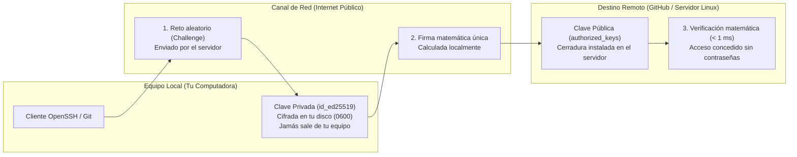
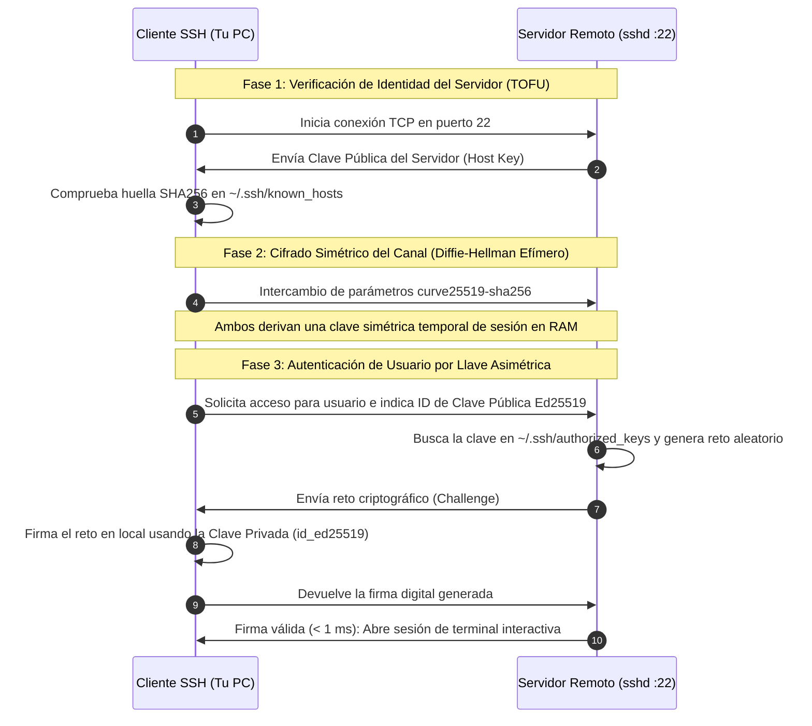
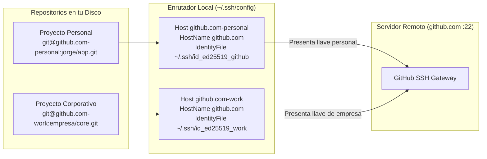

> [!IMPORTANT]
> **Resumen Ejecutivo:**  
> La autenticación mediante contraseñas tradicionales expone a los servidores y plataformas de código a ataques automatizados de fuerza bruta, diccionarios y reutilización de credenciales. La adopción de criptografía asimétrica sobre curva elíptica con Ed25519 sustituye las contraseñas por firmas digitales de **256 bits** que se verifican en **menos de 1 ms** empleando claves públicas compactas de **68 caracteres**. Al integrar derivación de claves en reposo mediante KDF (`bcrypt` con **100 rondas**), gestión de sesiones en memoria con `ssh-agent`, perfiles declarativos multi-cuenta en `~/.ssh/config`, multiplexación de conexiones TCP que reduce la latencia de apertura a **menos de 10 ms**, firma criptográfica de commits en Git y endurecimiento del servicio en Debian y Ubuntu, se establece un flujo de trabajo ágil bajo una arquitectura Zero Trust.

---

## Modelo Conceptual: De Contraseñas Compartidas a Identidad Asimétrica

Para comprender desde cero cómo funciona la autenticación por llaves en SSH, conviene contrastarla con el mecanismo de una contraseña tradicional:

* **El problema de la contraseña tradicional (Secreto Compartido):** Cuando te conectas con una contraseña, tanto tú como el servidor remoto deben conocer exactamente el mismo secreto. Si alguien intercepta la comunicación, instala un teclado malicioso o vulnera la base de datos del servidor, obtiene tu credencial. Además, un atacante en internet puede probar miles de combinaciones por segundo contra el puerto del servidor.
* **La arquitectura de par de llaves (Criptografía Asimétrica):** En lugar de compartir un secreto, generas en tu propia computadora dos piezas matemáticas vinculadas entre sí pero con funciones opuestas: un **cilindro de cerradura (Clave Pública)** y una **llave física tallada en titanio (Clave Privada)**.



1. **Clave Pública (`.pub` — El Cilindro de la Cerradura):** Es un texto corto que puedes copiar y entregar libremente a GitHub, GitLab o a tus servidores en Debian y Ubuntu. Cualquier persona puede ver esta cerradura, pero es matemáticamente imposible deducir cómo abrirla a partir de ella.
2. **Clave Privada (La Llave Física):** Es un archivo estrictamente secreto que permanece guardado dentro de tu computadora local. Nunca viaja por el cable de red ni se envía al servidor durante el inicio de sesión.
3. **Mecanismo de Reto y Firma (*Challenge-Response*):** Cuando intentas entrar al servidor, éste no te pide tu llave privada. En su lugar, genera un número aleatorio irrepetible (*reto*) y te lo envía. Tu computadora firma ese número usando tu clave privada y devuelve únicamente la firma resultante. El servidor usa tu clave pública instalada para comprobar en **menos de 1 ms** que solo el poseedor de la llave privada pudo haber generado esa firma exacta.

---

## Glosario Esencial de Criptografía y Protocolo SSH

| Término | Definición Técnica Sencilla |
|---|---|
| SSH (Secure Shell) | Protocolo de red criptográfico que permite administrar servidores remotos y transferir archivos a través de un canal seguro sobre el puerto `22` TCP. |
| Criptografía Asimétrica | Sistema criptográfico que utiliza un par de claves vinculadas matemáticamente: una pública para verificar o cifrar, y una privada para firmar o descifrar. |
| Ed25519 | Algoritmo de firma digital de curva elíptica basado en Curve25519 que proporciona seguridad equivalente a RSA de 3072 bits con claves compactas y tiempo constante. |
| Passphrase | Frase de seguridad que cifra el archivo de tu clave privada dentro de tu disco duro local; protege la llave si alguien roba o accede físicamente a tu computadora. |
| KDF | Función de derivación de clave que aplica múltiples rondas de cómputo (`bcrypt`) para transformar tu *passphrase* en una llave de cifrado resistente a fuerza bruta. |
| TOFU | Modelo de confianza en el primer uso donde tu cliente registra la huella del servidor en la primera conexión y alerta si dicha identidad cambia posteriormente. |
| Known Hosts | Archivo local (`~/.ssh/known_hosts`) donde tu computadora guarda las huellas criptográficas verificadas de cada servidor al que te has conectado. |
| Authorized Keys | Archivo ubicado en el servidor remoto (`~/.ssh/authorized_keys`) que contiene la lista de claves públicas autorizadas para acceder a esa cuenta de usuario. |

---

## 1. Anatomía del Handshake SSH: Qué Ocurre al Conectarse

Un punto que suele causar confusión al empezar es que durante una conexión SSH intervienen **dos pares de llaves distintos**: las llaves del propio servidor (*Host Keys*) y las llaves de tu usuario (*User Keys*). El establecimiento de la sesión ocurre en tres fases secuenciales:



### Fase 1: Identificación del Servidor (Por qué pregunta `Are you sure you want to continue connecting?`)
La primera vez que te conectas a un servidor nuevo, tu computadora aún no lo conoce. El servidor presenta su propia clave pública de máquina y tu terminal muestra su huella digital (*fingerprint*):

```text
The authenticity of host '203.0.113.10 (203.0.113.10)' can't be established.
ED25519 key fingerprint is SHA256:4bN9vX2pL8mK1qW7rT5yU0iO3pA6sD8fG2hJ4kL9zX1.
Are you sure you want to continue connecting (yes/no/[fingerprint])?
```

Al escribir `yes`, aplicas el modelo TOFU: tu cliente guarda esa huella en el archivo Known Hosts (`~/.ssh/known_hosts`). En todas las conexiones futuras, tu computadora verificará en silencio que el servidor siga teniendo exactamente esa misma huella, impidiendo que un tercero intercepte tu red y suplante al servidor.

### Fase 2: Creación del Túnel Simétrico Efímero
Antes de pedirte quién eres, el cliente y el servidor ejecutan un acuerdo matemático de claves efímeras (*Elliptic Curve Diffie-Hellman* mediante `curve25519-sha256`). Esto genera una llave de cifrado única que dura únicamente mientras la ventana de terminal esté abierta y se destruye al desconectar, garantizando secreto perfecto hacia adelante (*Perfect Forward Secrecy*).

### Fase 3: Autenticación de tu Usuario sin Contraseña
Con el canal ya cifrado, tu cliente le informa al servidor qué clave pública deseas utilizar. El servidor busca esa línea en su archivo `~/.ssh/authorized_keys`, emite el reto matemático y valida la firma generada por tu clave privada local.

---

## 2. Comparativa de Algoritmos y Anatomía Interna de las Llaves

Históricamente, muchos manuales recomendaban generar llaves con el algoritmo RSA (`ssh-keygen -t rsa`). Sin embargo, RSA basa su seguridad en la factorización de números primos grandes; para resistir la capacidad de cómputo actual, requiere claves de **3072 bits** o **4096 bits**, generando archivos extensos y operaciones criptográficas más pesadas.

OpenSSH introdujo en 2014 el soporte nativo para Ed25519, diseñado por Daniel J. Bernstein sobre la curva elíptica Curve25519.

| Algoritmo | Tamaño de Clave | Longitud de Clave Pública | Velocidad de Verificación | Resistencia a Canal Lateral | Estado Técnico en OpenSSH |
|---|---|---|---|---|---|
| Ed25519 | 256 bits | 68 caracteres | Muy alta (**< 1 ms**) | Inmune por diseño (tiempo constante) | Estándar predeterminado para todo despliegue |
| Ed25519-SK | 256 bits + Hardware | 88 caracteres | Depende de toque físico | Clave aislada en chip FIDO2 | Estándar para tokens físicos (YubiKey) |
| ECDSA (NIST P-256) | 256 bits | 140 caracteres | Alta | Sensible a generadores aleatorios débiles | Soportado por compatibilidad empresarial |
| RSA 3072 / 4096 | 3072 - 4096 bits | 540 - 725 caracteres | Moderada | Requiere mitigación por software | Solo para equipos antiguos sin soporte Ed25519 |
| RSA 1024 / DSA | 1024 bits | 220 caracteres | Obsoleto | Vulnerable a factorización moderna | Deshabilitado por defecto en OpenSSH 8.8+ |

### Anatomía de una Clave Pública Ed25519 (`.pub`)

Cuando abres un archivo `.pub`, observas una sola línea de texto dividida en tres campos separados por un espacio:

```text
ssh-ed25519 AAAAC3NzaC1lZDI1NTE5AAAAIKt8N2xPqL9mR4vW7yB1nC5vX0zL3kJ6hG8fD2sA4pQ1 jorge@workstation-debian
└────┬────┘ └─────────────────────────────────┬────────────────────────────────┘ └───────────┬──────────┘
  1. Tipo                     2. Clave Pública en Base64 (68 caracteres)              3. Comentario / Etiqueta
```

1. **Identificador de Algoritmo (`ssh-ed25519`):** Indica al servidor qué motor matemático debe emplear para verificar las firmas.
2. **Material Público en Base64:** Codifica la longitud del encabezado y los **32 bytes (256 bits)** exactos de la coordenada pública sobre la curva elíptica.
3. **Comentario (`-C`):** Texto informativo que no altera la criptografía; sirve para que identifiques de un vistazo a qué dispositivo o empleado pertenece esa llave dentro del archivo `authorized_keys` del servidor.

### Anatomía de una Clave Privada y el Cifrado en Reposo (KDF)

A diferencia de la clave pública, el archivo privado (`id_ed25519`) tiene la siguiente estructura en bloque (documentada con guión para evitar falsos positivos en analizadores de seguridad):

```text
-----BEGIN OPENSSH PRIVATE-KEY-----
b3BlbnNzaC1rZXktdjEAAAAABG5vbmUAAAAEbm9uZQAAAAAAAAABAAAAMwAAAAtzc2gtZW
QyNTUxOQAAACBLfDdsT6y/ZkWLd8ZbnF9Yz9pL3kJ6hG8fD2sA4pQ1AAAAkOit7Lvor...
-----END OPENSSH PRIVATE-KEY-----
```

Si dejas la *passphrase* en blanco al crear la llave, el bloque anterior contiene la clave privada en claro (`cipher: none`): cualquier programa o intruso que copie ese archivo podrá entrar inmediatamente a todos tus servidores. En cambio, cuando defines una *passphrase* combinada con la bandera `-a 100`, OpenSSH cifra ese bloque con `aes256-ctr` o `chacha20-poly1305` derivando tu frase mediante **100 rondas** de KDF (`bcrypt-pbkdf`), haciendo inviable su descifrado por fuerza bruta incluso si el archivo cae en manos de terceros.

---

## 3. Generación Paso a Paso y Ciclo de Vida de Claves con `ssh-keygen`

### Paso 3.1: Diagnóstico Inicial desde Cero

Antes de generar cualquier llave, verifica que dispones del cliente OpenSSH instalado y revisa si ya existen llaves previas en tu carpeta de usuario para no sobrescribirlas accidentalmente.

Abre tu terminal en Linux, macOS o PowerShell en Windows:

```bash
# 1. Comprobar la versión instalada de OpenSSH
ssh -V

# 2. Listar el contenido actual del directorio ~/.ssh (si existe)
ls -la ~/.ssh
```

* Si el comando `ls -la ~/.ssh` devuelve `No such file or directory`, significa que nunca has generado una llave en este equipo; la utilidad `ssh-keygen` creará la carpeta automáticamente con los permisos correctos.
* Si ya ves archivos llamados `id_rsa` o `id_ed25519`, es recomendable nombrar tus nuevas llaves con un sufijo descriptivo para mantenerlas separadas.

### Paso 3.2: Aislamiento de Claves por Propósito (`-f`)

Un principio fundamental de administración es separar tus llaves según su ámbito de responsabilidad en lugar de utilizar un único archivo genérico para todo:

* `~/.ssh/id_ed25519_github`: Para tu cuenta personal de GitHub o GitLab.
* `~/.ssh/id_ed25519_work`: Para repositorios e infraestructura de tu empresa o clientes.
* `~/.ssh/id_ed25519_vps`: Para la administración de tus propios servidores Linux.

Ejecuta el comando especificando el algoritmo, las rondas de derivación, la ruta del archivo y el comentario identificativo:

```bash
# Generar un par de claves Ed25519 dedicado para servidores VPS
ssh-keygen -t ed25519 -a 100 -f ~/.ssh/id_ed25519_vps -C "jorge@laptop-principal-2026"
```

Desglose de cada parámetro:
* `-t ed25519`: Selecciona el algoritmo de curva elíptica Ed25519.
* `-a 100`: Ejecuta **100 rondas** de KDF al cifrar la clave privada en disco.
* `-f ~/.ssh/id_ed25519_vps`: Define el nombre exacto del archivo de salida (evita pisar otras llaves).
* `-C "jorge@laptop-principal-2026"`: Registra quién creó la llave y desde qué equipo.

El asistente te pedirá únicamente tu frase de paso (*passphrase*):

```text
Generating public/private ed25519 key pair.
Enter passphrase (empty for no passphrase): [Escribe tu passphrase segura — no se verá en pantalla]
Enter same passphrase again: [Vuelve a escribirla y presiona Enter]
Your identification has been saved in /home/usuario/.ssh/id_ed25519_vps
Your public key has been saved in /home/usuario/.ssh/id_ed25519_vps.pub
The key fingerprint is:
SHA256:8xK9pL2mN4vQ7wR1tY5uI0oP3aS6dF8gH2jK4lZ9xC0 jorge@laptop-principal-2026
```

Verifica los dos archivos recién creados y muestra tu clave pública para poder copiarla:

```bash
# Mostrar en pantalla únicamente la clave pública (.pub)
cat ~/.ssh/id_ed25519_vps.pub
```

```text
ssh-ed25519 AAAAC3NzaC1lZDI1NTE5AAAAIKt8N2xPqL9mR4vW7yB1nC5vX0zL3kJ6hG8fD2sA4pQ1 jorge@laptop-principal-2026
```

### Paso 3.3: Operaciones de Mantenimiento sin Regenerar Llaves

Con frecuencia surgen tres necesidades operativas que pueden resolverse sobre tu llave actual sin necesidad de crear una nueva ni volver a subirla a tus servidores:

#### 1. Añadir o cambiar la Passphrase de una llave existente (`-p`)
Si creaste una llave sin *passphrase* en el pasado o deseas rotar tu frase de seguridad, el siguiente comando vuelve a cifrar el archivo privado en local **manteniendo intacta la clave pública**:

```bash
# Cambiar o agregar passphrase y aplicar 100 rondas KDF sin alterar la clave pública
ssh-keygen -p -a 100 -f ~/.ssh/id_ed25519_vps
```

#### 2. Auditar la huella criptográfica de un archivo (`-lf`)
Para comparar si la llave de tu laptop coincide con la huella `SHA256` que muestra el panel de GitHub o un servidor:

```bash
# Consultar la huella SHA256 y el tamaño de bits de una clave
ssh-keygen -lf ~/.ssh/id_ed25519_vps.pub
```

```text
256 SHA256:8xK9pL2mN4vQ7wR1tY5uI0oP3aS6dF8gH2jK4lZ9xC0 jorge@laptop-principal-2026 (ED25519)
```

#### 3. Recuperar el archivo `.pub` a partir de la clave privada (`-y`)
Una clave pública siempre puede recalcularse matemáticamente desde su clave privada (pero jamás al revés). Si borraste por accidente tu archivo `.pub`, regenéralo así:

```bash
# Extraer la clave pública desde la clave privada y guardarla en su archivo .pub
ssh-keygen -y -f ~/.ssh/id_ed25519_vps > ~/.ssh/id_ed25519_vps.pub
chmod 644 ~/.ssh/id_ed25519_vps.pub
```

---

## 4. Arquitectura de `ssh-agent`: Sesión sin Fricción en Linux, macOS y Windows

Tener una *passphrase* robusta protege tu llave en disco, pero escribirla manualmente en cada `git push`, `scp` o conexión SSH interrumpe el flujo de trabajo.

El demonio `ssh-agent` actúa como una bóveda temporal en memoria RAM: le entregas tu *passphrase* **una sola vez** al iniciar tu jornada, el agente mantiene la clave descifrada en memoria y expone un socket local seguro (definido en la variable de entorno `SSH_AUTH_SOCK`) para responder a las solicitudes de firma de tu terminal sin volver a pedirte la frase.

### 4.1 Configuración en Linux (Debian, Ubuntu y Derivados)

Para iniciar el agente en tu sesión actual y cargar tus llaves:

```bash
# 1. Iniciar el demonio ssh-agent y exportar sus variables de socket a la sesión
eval "$(ssh-agent -s)"

# 2. Cargar la clave privada en la memoria del agente (pide passphrase una sola vez)
ssh-add ~/.ssh/id_ed25519_vps

# 3. Cargar una llave con límite de vida en RAM (ej. expira automáticamente en 8 horas)
ssh-add -t 8h ~/.ssh/id_ed25519_vps

# 4. Listar las huellas de todas las llaves activas actualmente en el agente
ssh-add -l
```

Para que el agente arranque automáticamente al abrir cualquier terminal en Linux sin crear procesos duplicados, añade este bloque al final de tu archivo `~/.bashrc` o `~/.zshrc`:

```bash
# ~/.bashrc
# Reutilizar instancia activa de ssh-agent o iniciar una nueva si no existe
if [ -z "$SSH_AUTH_SOCK" ]; then
  export SSH_AUTH_SOCK="$HOME/.ssh/ssh-agent.sock"
  if ! ssh-add -l >/dev/null 2>&1; then
    rm -f "$SSH_AUTH_SOCK"
    eval "$(ssh-agent -a "$SSH_AUTH_SOCK" -s)" >/dev/null
  fi
fi
```

### 4.2 Configuración en macOS (Integración con Apple Keychain)

En macOS, el agente de OpenSSH se integra nativamente con el llavero del sistema (*Keychain*):

```bash
# Almacenar la passphrase en el llavero nativo de macOS
ssh-add --apple-use-keychain ~/.ssh/id_ed25519_vps
```

Para que macOS cargue la llave desde el llavero automáticamente tras reiniciar la computadora, incluye las directivas `UseKeychain yes` y `AddKeysToAgent yes` dentro de tu archivo `~/.ssh/config`.

### 4.3 Configuración en Windows 10 / 11 (PowerShell Nativo)

Windows incluye una implementación oficial de OpenSSH gobernada como un servicio del sistema operativo. Abre una ventana de PowerShell **como Administrador** por única vez y habilita el servicio:

```powershell
# Configurar el servicio ssh-agent de Windows para inicio automático y arrancarlo
Get-Service ssh-agent | Set-Service -StartupType Automatic
Start-Service ssh-agent

# Registrar tu clave privada en el agente de Windows (persiste entre reinicios)
ssh-add $HOME\.ssh\id_ed25519_vps

# Comprobar que la llave quedó registrada
ssh-add -l
```

---

## 5. Despliegue de Claves Públicas en GitHub y Servidores Linux

Con tu llave generada y cargada en `ssh-agent`, el siguiente paso es instalar la cerradura pública (`.pub`) en los destinos remotos.

### 5.1 Autenticación en GitHub y GitLab

1. Muestra y copia el texto de tu clave pública:
   ```bash
   cat ~/.ssh/id_ed25519_github.pub
   ```
2. En GitHub, accede a **Settings → SSH and GPG keys → New SSH key**.
3. En **Title**, escribe un identificador claro del equipo (ej. `Workstation Debian Oficina`).
4. En **Key type**, selecciona **Authentication Key**, pega el contenido completo que inicia con `ssh-ed25519` y guarda.
5. Verifica la conexión desde tu terminal:

```bash
# Validar el apretón de manos criptográfico contra GitHub
ssh -T git@github.com
```

```text
Hi username! You've successfully authenticated, but GitHub does not provide shell access.
```

> [!TIP]
> Si ya tenías un repositorio clonado mediante `https://` (que pide token o credenciales) y deseas pasarlo a SSH para que use tu llave automáticamente, ejecuta dentro de la carpeta del proyecto:
> `git remote set-url origin git@github.com:usuario/repositorio.git`

### 5.2 Instalación en un Servidor Linux (Debian / Ubuntu)

Cuando alquilas o instalas un servidor en Debian o Ubuntu al que inicialmente accedes mediante contraseña, necesitas agregar tu línea `.pub` dentro del archivo `~/.ssh/authorized_keys` de ese servidor.

#### Método A: Automático con `ssh-copy-id` (Recomendado en Linux y macOS)

La herramienta `ssh-copy-id` se conecta al servidor, crea la carpeta `~/.ssh` si no existe, aplica los permisos octales exactos y añade tu clave pública al final de `authorized_keys` sin borrar otras llaves previas:

```bash
# Instalar específicamente la clave pública indicada (-i) en el servidor remoto
ssh-copy-id -i ~/.ssh/id_ed25519_vps.pub admin@203.0.113.10
```

#### Método B: Desde Windows PowerShell o Instalación Manual

Windows no incluye el script `ssh-copy-id` por defecto, pero puedes lograr exactamente el mismo resultado en una sola línea desde PowerShell enviando tu clave pública por tubería (*pipe*):

```powershell
# Enviar la clave pública desde Windows e instalarla con permisos seguros en Linux
Get-Content $HOME\.ssh\id_ed25519_vps.pub | ssh admin@203.0.113.10 "mkdir -p ~/.ssh && chmod 700 ~/.ssh && cat >> ~/.ssh/authorized_keys && chmod 600 ~/.ssh/authorized_keys"
```

Si ya estás dentro del servidor remoto (por ejemplo, a través de la consola web de tu proveedor cloud), ejecuta directamente estos comandos:

```bash
# 1. Crear el directorio .ssh y restringir su acceso exclusivamente a tu usuario (700)
mkdir -p ~/.ssh
chmod 700 ~/.ssh

# 2. Agregar tu clave pública al archivo authorized_keys (una clave completa por línea)
echo "ssh-ed25519 AAAAC3NzaC1lZDI1NTE5AAAAI... jorge@laptop-principal-2026" >> ~/.ssh/authorized_keys

# 3. Restringir lectura y escritura del archivo únicamente a tu usuario (600)
chmod 600 ~/.ssh/authorized_keys
```

---

## 6. Configuración Declarativa del Cliente (`~/.ssh/config`): Alias, Multi-Cuenta y Multiplexación

A medida que administras varios servidores y cuentas de código, escribir comandos como `ssh -i ~/.ssh/id_ed25519_vps -p 2222 admin@203.0.113.10` resulta lento y propenso a fallos. El archivo `~/.ssh/config` en tu computadora local actúa como un enrutador declarativo de identidades y parámetros de red.

### 6.1 Creación de Alias de Servidores y Directivas Globales

Crea el archivo `~/.ssh/config` (si no existe) y asígnale permisos `600`:

```bash
touch ~/.ssh/config
chmod 600 ~/.ssh/config
```

Estructura un archivo de configuración limpio y modular:

```ini
# ~/.ssh/config
# ── 1. Servidores de Infraestructura ─────────────────────────────────────────

# Entrar escribiendo simplemente: ssh prod
Host prod
    HostName 203.0.113.10
    User admin
    Port 22
    IdentityFile ~/.ssh/id_ed25519_vps

# Servidor de laboratorio local en puerto no estándar (entrar con: ssh lab)
Host lab
    HostName 192.168.1.50
    User desarrollador
    Port 2222
    IdentityFile ~/.ssh/id_ed25519_vps

# ── 2. Reglas Globales por Defecto (Se aplican a todos los Hosts) ────────────
Host *
    AddKeysToAgent yes
    IdentitiesOnly yes
    ServerAliveInterval 60
    ServerAliveCountMax 3
    HashKnownHosts yes
    Compression yes
```

* **`AddKeysToAgent yes`:** Cada vez que utilices una llave por primera vez tras encender el equipo, se cargará automáticamente en `ssh-agent` sin que tengas que ejecutar `ssh-add` a mano.
* **`IdentitiesOnly yes`:** Por defecto, el agente SSH ofrece al servidor todas las llaves cargadas en memoria una por una. Si tienes 5 llaves cargadas, el servidor cortará la conexión con `Too many authentication failures` antes de llegar a la llave correcta. Con `IdentitiesOnly yes`, obligas al cliente a usar **exclusivamente** el `IdentityFile` declarado en ese bloque `Host`.
* **`ServerAliveInterval 60` y `ServerAliveCountMax 3`:** Envía un paquete de latido cifrado cada **60 segundos** si la terminal está inactiva, evitando que los firewalls o routers domésticos congelen tu sesión.

### 6.2 Caso Real: Múltiples Cuentas de GitHub (Personal y Trabajo) en la Misma PC

Uno de los conflictos más frecuentes en el desarrollo de software ocurre cuando necesitas usar tu cuenta de GitHub personal y una cuenta de GitHub corporativa en la misma computadora: GitHub no permite registrar la misma llave SSH en dos cuentas distintas, y al hacer `git push` el cliente envía por defecto la llave equivocada.

La solución limpia consiste en definir dos bloques `Host` con alias virtuales en `~/.ssh/config` que apunten al mismo `HostName github.com`, pero entregando cada uno su respectivo `IdentityFile`:



Añade estos dos bloques a tu archivo `~/.ssh/config`:

```ini
# ~/.ssh/config
# Cuenta de GitHub Personal
Host github.com-personal
    HostName github.com
    User git
    IdentityFile ~/.ssh/id_ed25519_github
    IdentitiesOnly yes

# Cuenta de GitHub Trabajo / Empresa
Host github.com-work
    HostName github.com
    User git
    IdentityFile ~/.ssh/id_ed25519_work
    IdentitiesOnly yes
```

Ahora, al clonar o configurar un repositorio de tu trabajo, simplemente sustituyes `github.com` por el alias `github.com-work` en la URL de Git:

```bash
# Clonar un repositorio corporativo usando automáticamente la llave de trabajo
git clone git@github.com-work:nombre-empresa/api-facturacion.git

# Clonar un repositorio personal usando automáticamente la llave personal
git clone git@github.com-personal:tu-usuario/portafolio.git
```

### 6.3 Multiplexación de Conexiones TCP (`ControlMaster` y `ControlPersist`)

Cada vez que abres una nueva pestaña hacia tu servidor o ejecutas un comando `git fetch`, `scp` o `rsync`, OpenSSH debe abrir un socket TCP, negociar cifrado y validar llaves, lo que toma entre **400 ms y 900 ms**.

En sistemas Linux y macOS, la **multiplexación** permite que la primera conexión cree un socket local maestro y que todas las sesiones subsiguientes viajen por ese canal ya autenticado, reduciendo el tiempo de apertura a **menos de 10 ms**:

```bash
# 1. Crear el directorio dedicado para los sockets de multiplexación
mkdir -p ~/.ssh/sockets
chmod 700 ~/.ssh/sockets
```

Agrega estas tres líneas dentro de tu bloque `Host *` (o en los bloques de tus servidores) en `~/.ssh/config`:

```ini
# ~/.ssh/config
Host prod
    HostName 203.0.113.10
    User admin
    IdentityFile ~/.ssh/id_ed25519_vps
    ControlMaster auto
    ControlPath ~/.ssh/sockets/%r@%h-%p
    ControlPersist 10m
```

* **`ControlMaster auto`:** Reutiliza una conexión maestra si ya existe, o crea una nueva automáticamente si es la primera vez.
* **`ControlPath ~/.ssh/sockets/%r@%h-%p`:** Ruta del socket Unix local identificada por usuario remoto (`%r`), host (`%h`) y puerto (`%p`).
* **`ControlPersist 10m`:** Mantiene la conexión maestra viva en segundo plano durante **10 minutos** después de que cierres tu última ventana de terminal, permitiendo reconexiones instantáneas.

### 6.4 Privacidad de Topología Local (`HashKnownHosts yes`)

Por defecto, el archivo `~/.ssh/known_hosts` guarda en texto claro los dominios y direcciones IP de todos los servidores a los que te has conectado. Si un atacante logra leer tu archivo local, obtiene una lista inmediata de toda tu infraestructura.

Al activar `HashKnownHosts yes` en `~/.ssh/config` (y puedes aplicarlo a las entradas existentes ejecutando `ssh-keygen -H`), OpenSSH aplica un hash criptográfico HMAC-SHA1 a cada nombre de host. Tu cliente sigue pudiendo verificar cada servidor al conectarse, pero nadie que abra el archivo podrá enumerar las direcciones IP contenidas en él.

---

## 7. Firma Criptográfica de Commits en Git con tu Clave SSH (`Verified`)

En entornos de ingeniería de software, cualquiera puede configurar `git config user.email "otro@empresa.com"` y crear un commit aparentando ser otra persona. Para garantizar la autenticidad del autor, Git permite firmar criptográficamente cada commit.

Desde Git 2.34+, ya no es necesario instalar ni mantener anillos de claves GPG complejos: puedes firmar tus commits directamente con la misma clave Ed25519 que usas para conectarte por SSH:

```bash
# 1. Indicar a Git que utilice el formato SSH en lugar de GPG
git config --global gpg.format ssh

# 2. Apuntar a tu clave pública Ed25519 como llave de firma
git config --global user.signingkey ~/.ssh/id_ed25519_github.pub

# 3. Firmar automáticamente todos los commits futuros sin tener que pasar -S
git config --global commit.gpgsign true

# 4. Firmar automáticamente también los tags de versiones
git config --global tag.gpgSign true
```

### Cómo activar la insignia `Verified` en GitHub y verificar en local

1. En GitHub, ve a **Settings → SSH and GPG keys → New SSH key**.
2. Pega tu misma clave pública `.pub`, pero en el desplegable **Key type** selecciona **Signing Key** (puedes tener la misma llave registrada una vez como *Authentication Key* y otra como *Signing Key*).
3. Para que el comando `git log --show-signature` también verifique las firmas en tu propia terminal local, registra tu llave en un archivo de firmantes autorizados (`allowed_signers`):

```bash
# Crear archivo local de firmantes autorizados y vincularlo en Git
echo "$(git config --get user.email) namespaces=\"git\" $(cat ~/.ssh/id_ed25519_github.pub)" >> ~/.ssh/allowed_signers
git config --global gpg.ssh.allowedSignersFile ~/.ssh/allowed_signers

# Hacer un commit de prueba y verificar la firma criptográfica localmente
git commit --allow-empty -m "chore: validar firma criptografica con clave ssh ed25519"
git log -1 --show-signature
```

```text
commit 9f4c2a1b8e7d6c5a4b3f2e1d0c9b8a7f6e5d4c3b
Good "git" signature for jorge@doiceladev.com with ED25519 key SHA256:8xK9pL2mN4vQ7wR1tY5uI0oP3aS6dF8gH2jK4lZ9xC0
Author: Jorge Doicela <jorge@doiceladev.com>
```

---

## 8. Seguridad DevSecOps: Restricciones en `authorized_keys`, Llaves FIDO2 y Bastionado de `sshd_config`

### 8.1 Restricciones por Llave en el Servidor (`~/.ssh/authorized_keys`)

Cuando agregas una clave pública al archivo `~/.ssh/authorized_keys` de tu servidor para que un pipeline automatizado (como GitHub Actions o un script de respaldos) se conecte por SSH, esa llave no necesita los mismos permisos que un administrador humano.

OpenSSH permite anteponer directivas de restricción en la misma línea de la clave pública dentro de `~/.ssh/authorized_keys` en el servidor:

```text
# ~/.ssh/authorized_keys (en el servidor remoto)
from="192.0.2.50,198.51.100.0/24",no-port-forwarding,no-X11-forwarding,no-agent-forwarding,no-pty ssh-ed25519 AAAAC3NzaC1lZDI1NTE5AAAAI... deploy-ci@github-actions
```

* **`from="192.0.2.50,198.51.100.0/24"`:** La llave solo será aceptada si la conexión proviene de esa IP o rango CIDR específico; si alguien roba la llave e intenta usarla desde otro país o red, el servidor la rechaza de inmediato.
* **`no-port-forwarding` / `no-X11-forwarding` / `no-agent-forwarding`:** Impide que esa llave sea utilizada para redirigir puertos internos o reenviar credenciales.
* **`no-pty`:** Impide la asignación de una terminal interactiva (`tty`), ideal para cuentas de ejecución automatizada.

### 8.2 Llaves Vinculadas a Hardware Físico (`ed25519-sk` con FIDO2)

Para servidores de infraestructura crítica, OpenSSH 8.2+ soporta llaves vinculadas directamente a llaves físicas de seguridad por USB/NFC compatibles con el estándar FIDO2 (como YubiKey):

```bash
# Generar clave Ed25519 respaldada por un token físico de hardware FIDO2
ssh-keygen -t ed25519-sk -O resident -O verify-required -C "jorge@yubikey-principal"
```

Con `ed25519-sk`, la clave matemática reside dentro del chip seguro del dispositivo físico y nunca puede ser copiada como un archivo común. En cada intento de conexión SSH, el token parpadea exigiendo el PIN del dispositivo y un toque físico presencial con el dedo.

### 8.3 Endurecimiento del Demonio del Servidor (`/etc/ssh/sshd_config`)

Una vez verificado el acceso con tu clave Ed25519 en un servidor Debian o Ubuntu, el paso obligatorio es configurar el demonio del servidor (`sshd`) para rechazar por completo la autenticación mediante contraseñas, neutralizando los ataques de fuerza bruta en internet.

> [!CAUTION]
> **Protocolo Anti-Bloqueo Remoto (*Anti-Lockout*):**  
> Jamás cierres tu ventana de terminal actual tras editar `/etc/ssh/sshd_config`. Mantén tu sesión activa abierta como respaldo, valida la sintaxis con `sudo sshd -t`, recarga el servicio y abre una **segunda ventana de terminal** aparte para comprobar que entras sin problemas antes de desconectarte.

En Debian 12/13 y Ubuntu 22.04/24.04, en lugar de modificar directamente el archivo base `/etc/ssh/sshd_config` (lo que suele causar conflictos durante las actualizaciones de paquetes con `apt`), la práctica recomendada es crear un archivo modular dentro del directorio `/etc/ssh/sshd_config.d/`:

```ini
# /etc/ssh/sshd_config.d/99-hardening.conf
# 1. Permitir exclusivamente autenticación por clave pública
PubkeyAuthentication yes
AuthenticationMethods publickey

# 2. Desactivar todas las variantes de autenticación por contraseña de texto
PasswordAuthentication no
KbdInteractiveAuthentication no
ChallengeResponseAuthentication no
PermitEmptyPasswords no

# 3. Prohibir el acceso directo como superusuario root
PermitRootLogin no

# 4. Límites de intentos y tiempos de gracia contra saturación de sockets
MaxAuthTries 3
LoginGraceTime 20
MaxStartups 10:30:60

# 5. Desactivar funciones innecesarias de reenvío gráfico
X11Forwarding no
PermitUserEnvironment no

# 6. Restricción de algoritmos criptográficos a suites modernas de tiempo constante
KexAlgorithms curve25519-sha256,curve25519-sha256@libssh.org
Ciphers chacha20-poly1305@openssh.com,aes256-gcm@openssh.com
MACs hmac-sha2-512-etm@openssh.com,hmac-sha2-256-etm@openssh.com
HostKeyAlgorithms ssh-ed25519,rsa-sha2-512,rsa-sha2-256
```

Aplica y verifica la configuración en el servidor de forma segura:

```bash
# 1. Comprobar que la sintaxis no contenga errores (no debe arrojar ningún mensaje)
sudo sshd -t

# 2. Auditar los valores efectivos que aplicará el demonio tras fusionar los archivos
sudo sshd -T | grep -E "passwordauthentication|permitrootlogin|pubkeyauthentication|maxauthtries"

# 3. Recargar el servicio mediante systemd sin cortar las sesiones SSH activas
sudo systemctl reload ssh
```

```text
passwordauthentication no
permitrootlogin no
pubkeyauthentication yes
maxauthtries 3
```

---

## 9. Diagnóstico Forense, Auditoría de Permisos y Resolución de Errores

### 9.1 El Error `WARNING: UNPROTECTED PRIVATE KEY FILE!`

OpenSSH incorpora una política de seguridad innegociable: si tu carpeta `~/.ssh` o tu archivo de clave privada tienen permisos demasiado permisivos (que permitan a otros usuarios del sistema operativo leer o modificar tus archivos), ignorará la llave y mostrará este mensaje:

```text
@@@@@@@@@@@@@@@@@@@@@@@@@@@@@@@@@@@@@@@@@@@@@@@@@@@@@@@@@@@
@         WARNING: UNPROTECTED PRIVATE KEY FILE!          @
@@@@@@@@@@@@@@@@@@@@@@@@@@@@@@@@@@@@@@@@@@@@@@@@@@@@@@@@@@@
Permissions 0644 for '/home/usuario/.ssh/id_ed25519_vps' are too open.
It is required that your private key files are NOT accessible by others.
This private key will be ignored.
Load key "/home/usuario/.ssh/id_ed25519_vps": bad permissions
Permission denied (publickey).
```

Del mismo modo, en el servidor remoto, si el directorio `/home/usuario` o `~/.ssh/authorized_keys` tienen permisos de escritura para el grupo u otros usuarios (`777` o `666`), el demonio `sshd` rechazará el inicio de sesión en silencio porque un tercero podría haber inyectado su propia llave en tu archivo.

#### Matriz Canónica de Permisos Octales en `~/.ssh`

Ejecuta estos comandos tanto en tu computadora local como en el servidor remoto para restaurar los permisos exactos y la propiedad de los archivos:

| Ruta del Archivo o Directorio | Permiso Octal | Representación Simbólica | Comando Exacto de Corrección |
|---|---|---|---|
| ~ (Carpeta de usuario) | `750` o `755` | `drwxr-x---` | `chmod 750 ~` |
| ~/.ssh | `700` | `drwx------` | `chmod 700 ~/.ssh` |
| ~/.ssh/id_ed25519_* (Privadas) | `600` | `-rw-------` | `chmod 600 ~/.ssh/id_ed25519*` |
| ~/.ssh/config | `600` | `-rw-------` | `chmod 600 ~/.ssh/config` |
| ~/.ssh/authorized_keys | `600` | `-rw-------` | `chmod 600 ~/.ssh/authorized_keys` |
| ~/.ssh/id_ed25519_*.pub (Públicas) | `644` | `-rw-r--r--` | `chmod 644 ~/.ssh/*.pub` |
| ~/.ssh/known_hosts | `600` o `644` | `-rw-------` | `chmod 600 ~/.ssh/known_hosts` |
| Propiedad del directorio | Usuario actual | `usuario:usuario` | `chown -R $USER:$USER ~/.ssh` |

### 9.2 El Error `REMOTE HOST IDENTIFICATION HAS CHANGED!`

Si reinstalas el sistema operativo de tu servidor VPS desde cero conservando la misma dirección IP, el servidor generará una nueva llave de máquina (*Host Key*). Al intentar conectarte, tu computadora notará que la huella ya no coincide con la guardada en `known_hosts` y bloqueará el acceso:

```text
@@@@@@@@@@@@@@@@@@@@@@@@@@@@@@@@@@@@@@@@@@@@@@@@@@@@@@@@@@@
@    WARNING: REMOTE HOST IDENTIFICATION HAS CHANGED!     @
@@@@@@@@@@@@@@@@@@@@@@@@@@@@@@@@@@@@@@@@@@@@@@@@@@@@@@@@@@@
IT IS POSSIBLE THAT SOMEONE IS DOING SOMETHING NASTY!
Host key verification failed.
```

Si tú mismo acabas de reinstalar o reconstruir ese servidor y sabes por qué cambió la llave, elimina únicamente el registro antiguo de esa IP con `ssh-keygen -R` (sin borrar todo tu archivo `known_hosts`):

```bash
# Eliminar de forma quirúrgica la huella antigua de una IP o dominio específico
ssh-keygen -R 203.0.113.10
```

### 9.3 Depuración en Vivo en Cliente (`-vvv`) y Servidor (`journalctl`)

Cuando una conexión responde `Permission denied (publickey)` y deseas saber con exactitud qué está ocurriendo:

```bash
# 1. En tu computadora local: ejecutar con triple verbosidad (-vvv)
ssh -vvv prod
```

Busca en la salida las líneas `debug1: Offering public key:` (para confirmar qué archivo está presentando tu cliente) y `debug1: Authentications that can continue:`.

Si tienes acceso al servidor (por otra terminal activa o consola web), inspecciona los registros del demonio en tiempo real mediante systemd:

```bash
# 2. En el servidor Debian / Ubuntu: auditar logs de autenticación SSH en vivo
sudo journalctl -u ssh -f -n 50
```

Allí verás el motivo exacto del rechazo del lado del servidor (por ejemplo: `Authentication refused: bad ownership or modes for directory /home/admin/.ssh`).

---

## 10. Guía de Referencia Rápida y Comandos Operativos

| Comando | Propósito Operativo |
|---|---|
| ssh-keygen -t ed25519 -a 100 -f ~/.ssh/id_ed25519_vps -C "comentario" | Genera un par de claves Ed25519 con nombre dedicado y **100 rondas** de derivación KDF. |
| ssh-keygen -p -a 100 -f ~/.ssh/id_ed25519_vps | Cambia o añade una *passphrase* a una clave privada existente sin alterar la clave pública. |
| ssh-keygen -lf ~/.ssh/id_ed25519_vps.pub | Muestra la huella criptográfica `SHA256` y el algoritmo de una llave para auditoría. |
| ssh-keygen -y -f ~/.ssh/id_ed25519_vps > ~/.ssh/id_ed25519_vps.pub | Regenera el archivo de clave pública `.pub` a partir de su clave privada correspondiente. |
| ssh-add ~/.ssh/id_ed25519_vps | Carga una clave privada en la memoria de `ssh-agent` para la sesión activa. |
| ssh-add -l / ssh-add -D | Lista las llaves cargadas actualmente en memoria (`-l`) o vacía todas las llaves del agente (`-D`). |
| ssh-copy-id -i ~/.ssh/id_ed25519_vps.pub user@ip | Instala la clave pública en un servidor Linux configurando permisos `700`/`600` automáticamente. |
| ssh-keygen -R 203.0.113.10 | Purga la huella antigua de un servidor en `~/.ssh/known_hosts` tras reinstalar un VPS. |
| sudo sshd -t && sudo systemctl reload ssh | Valida la sintaxis del servidor SSH y recarga su configuración sin desconectar sesiones vivas. |

---

## Conclusión y Checklist de Validación

Al completar esta implementación, la gestión de tu identidad criptográfica y el acceso a tus servidores cumplen con los estándares de seguridad y productividad en producción:

- [x] **Criptografía Ed25519 con KDF:** Llaves generadas con `ssh-keygen -t ed25519 -a 100` y separadas por propósito (`_github`, `_work`, `_vps`).
- [x] **Protección en Reposo y Memoria:** Clave privada cifrada en disco con *passphrase* y administrada en sesión mediante `ssh-agent`.
- [x] **Permisos POSIX Auditados:** Directorio `~/.ssh` asegurado en `700` y archivos privados (`id_ed25519*`, `config`, `authorized_keys`) en `600`.
- [x] **Enrutamiento Multi-Cuenta en `~/.ssh/config`:** Alias declarativos con `IdentitiesOnly yes`, `ServerAliveInterval 60` y `HashKnownHosts yes`.
- [x] **Multiplexación Activa:** Reutilización de sesiones TCP mediante `ControlMaster auto` y `ControlPersist` para conexiones en **< 10 ms**.
- [x] **Autoría Criptográfica en Git:** Commits y tags firmados nativamente con `gpg.format ssh` y verificados con `allowed_signers`.
- [x] **Servidor Endurecido en Debian y Ubuntu:** Configuración modular en `/etc/ssh/sshd_config.d/99-hardening.conf` con `PasswordAuthentication no` y `PermitRootLogin no` validada con `sudo sshd -t`.
