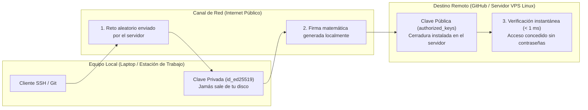
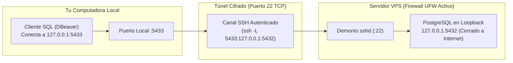

> [!IMPORTANT]
> **Resumen Ejecutivo:**  
> La autenticación mediante contraseñas tradicionales expone a los servidores y cuentas de código a ataques automatizados de fuerza bruta y diccionarios. La transición hacia criptografía de curva elíptica con Ed25519 reemplaza las contraseñas por firmas matemáticas de **256 bits** que se verifican en **menos de 1 ms** con claves públicas compactas de apenas **68 caracteres**. Al combinar claves asimétricas con perfiles declarativos en `~/.ssh/config` y túneles cifrados mediante Port Forwarding, cualquier desarrollador puede autenticarse en GitHub y servidores Linux en un segundo, administrar bases de datos remotas aisladas en `127.0.0.1` sin abrir puertos públicos en el firewall y operar bajo una arquitectura Zero Trust.

---

## Modelo Conceptual: Anatomía de la Autenticación Asimétrica

A diferencia de una contraseña convencional —que viaja por la red o se almacena como un secreto compartido—, la criptografía de clave pública divide la identidad en dos piezas matemáticas complementarias:



* **Clave Pública:** Equivalente a un candado o cerradura abierta que puedes entregar a cualquier persona o instalar en múltiples servidores (GitHub, GitLab, instancias VPS en Debian o Ubuntu). Conocer la cerradura no permite abrirla.
* **Clave Privada:** Equivalente a la llave física única tallada en titanio que permanece guardada exclusivamente en tu computadora con permisos restringidos (`0600`). Nunca se transmite por internet.
* **Reto y Firma:** Cuando ejecutas `ssh` o `git push`, el servidor envía un mensaje aleatorio. Tu computadora lo firma matemáticamente con tu clave privada y devuelve la firma; el servidor comprueba con la clave pública que la firma es auténtica sin haber visto jamás tu llave privada.

---

## Glosario Esencial de Criptografía y Conexiones Remotas

| Término | Definición Técnica Sencilla |
|---|---|
| Ed25519 | Algoritmo moderno de firma digital basado en la curva elíptica Curve25519 que ofrece seguridad equivalente a RSA de 3072 bits con claves mucho más cortas y rápidas. |
| Passphrase | Frase de paso que cifra el archivo de tu clave privada en el disco local; protege tu llave en caso de que alguien robe o acceda físicamente a tu computadora. |
| Known Hosts | Archivo local (`~/.ssh/known_hosts`) que guarda la huella digital de cada servidor visitado para alertarte si alguien intenta interceptar la conexión. |
| Authorized Keys | Archivo en el servidor remoto (`~/.ssh/authorized_keys`) que lista todas las claves públicas autorizadas para iniciar sesión en esa cuenta de usuario. |
| Port Forwarding | Técnica que crea un conducto cifrado dentro de la sesión SSH para conectar un puerto de tu computadora local directamente con un servicio interno del servidor remoto. |

---

## 1. Criptografía Moderna: Por qué Ed25519 sustituye a RSA

Durante décadas, el estándar predeterminado para generar llaves fue RSA (`ssh-keygen -t rsa`). Sin embargo, para alcanzar niveles de seguridad aceptables hoy en día, RSA requiere claves de **3072 bits** o **4096 bits**, lo que produce archivos extensos y lentos de procesar.

| Algoritmo | Tamaño de Clave | Longitud del Texto Público | Velocidad de Verificación | Estado Recomendado |
|---|---|---|---|---|
| Ed25519 | 256 bits | 68 caracteres | Muy alta (**< 1 ms**) | Estándar actual para todo uso nuevo |
| ECDSA (NIST P-256) | 256 bits | 140 caracteres | Alta | Aceptable, pero sensible a generadores aleatorios débiles |
| RSA 4096 | 4096 bits | 725 caracteres | Moderada / Lenta | Solo para sistemas antiguos sin soporte moderno |
| RSA 1024 / DSA | 1024 bits | 220 caracteres | Obsoleto | Inseguro y deshabilitado en OpenSSH moderno |

### Paso 1.1: Generar tu Par de Claves con `ssh-keygen`

Abre tu terminal en Linux, macOS o PowerShell / Git Bash en Windows y ejecuta el siguiente comando:

```bash
# Generar clave Ed25519 con 100 rondas de derivación de clave (KDF)
ssh-keygen -t ed25519 -a 100 -C "jorge@doiceladev.com"
```

Desglose de las banderas utilizadas:
* `-t ed25519`: Especifica el algoritmo de curva elíptica Ed25519.
* `-a 100`: Aplica **100 rondas** de la función de derivación `bcrypt` al cifrar tu clave privada en disco, haciendo que sea órdenes de magnitud más resistente si un atacante intenta adivinar tu *passphrase*.
* `-C "comentario"`: Añade una etiqueta identificativa al final de la clave pública (útil para recordar a qué laptop o equipo pertenece cada llave).

Al ejecutar el comando, el asistente interactivo mostrará la siguiente salida:

```text
Generating public/private ed25519 key pair.
Enter file in which to save the key (/home/usuario/.ssh/id_ed25519): [Presiona Enter]
Enter passphrase (empty for no passphrase): [Escribe una frase segura]
Enter same passphrase again: [Repite la frase]
Your identification has been saved in /home/usuario/.ssh/id_ed25519
Your public key has been saved in /home/usuario/.ssh/id_ed25519.pub
The key fingerprint is:
SHA256:8xK9pL2mN4vQ7wR1tY5uI0oP3aS6dF8gH2jK4lZ9xC0 jorge@doiceladev.com
```

### Paso 1.2: Inspeccionar los Archivos Generados

El comando habrá creado dos archivos dentro de tu directorio `~/.ssh/`:

* **Clave Privada (`~/.ssh/id_ed25519`):** Secreta e intransferible; jamás debe compartirse ni subirse a ningún repositorio.
* **Clave Pública (`~/.ssh/id_ed25519.pub`):** Lista para instalar en GitHub o en tus servidores remotos.

Para visualizar el contenido de tu clave pública sin abrir editores de texto:

```bash
# Mostrar únicamente la clave pública (.pub) para copiarla
cat ~/.ssh/id_ed25519.pub
```

```text
ssh-ed25519 AAAAC3NzaC1lZDI1NTE5AAAAIKt8N2xPqL9mR4vW7yB1nC5vX0zL3kJ6hG8fD2sA4pQ1 jorge@doiceladev.com
```

---

## 2. Gestión de la Frase de Paso con `ssh-agent`

Proteger tu clave privada con una *passphrase* es una regla básica de seguridad, pero escribirla veinte veces al día al hacer `git pull` o `git push` reduce la fluidez de trabajo. El demonio `ssh-agent` resuelve esto manteniendo la llave descifrada en la memoria RAM de tu sesión de usuario.

### En Linux y macOS

```bash
# 1. Iniciar el agente en segundo plano en la sesión actual
eval "$(ssh-agent -s)"

# 2. Agregar tu llave privada al agente (te pedirá la passphrase una sola vez)
ssh-add ~/.ssh/id_ed25519

# 3. Verificar qué llaves están cargadas actualmente en memoria
ssh-add -l
```

### En Windows (PowerShell como Administrador)

En Windows 10 y Windows 11, el servicio nativo de OpenSSH puede configurarse para arrancar automáticamente con el sistema:

```powershell
# Habilitar e iniciar el servicio ssh-agent nativo de Windows
Get-Service ssh-agent | Set-Service -StartupType Automatic
Start-Service ssh-agent

# Registrar la llave en el agente de Windows
ssh-add $HOME\.ssh\id_ed25519
```

---

## 3. Despliegue de la Clave Pública en GitHub y Servidores Linux

Una vez generada tu llave, el siguiente paso es instalar la parte pública (`.pub`) en los servicios a los que deseas conectarte.

### 3.1 Autenticación en GitHub sin Contraseñas

1. Copia la salida de `cat ~/.ssh/id_ed25519.pub`.
2. En GitHub, dirígete a **Settings → SSH and GPG keys → New SSH key**.
3. Asigna un nombre descriptivo (ej. `Laptop Principal Debian`) y pega la línea que comienza con `ssh-ed25519`.
4. Comprueba la autenticación desde tu terminal:

```bash
# Probar autenticación contra GitHub
ssh -T git@github.com
```

```text
Hi usuario! You've successfully authenticated, but GitHub does not provide shell access.
```

### 3.2 Instalación en un Servidor Linux (Debian / Ubuntu)

Si cuentas con un servidor VPS o un equipo en tu red local al que aún entras con contraseña, la utilidad `ssh-copy-id` instala tu clave pública y configura los permisos automáticamente en un solo paso:

```bash
# Copiar automáticamente la clave pública al servidor remoto
ssh-copy-id -i ~/.ssh/id_ed25519.pub usuario@203.0.113.10
```

Si prefieres hacerlo de forma manual o estás aprovisionando el servidor desde una consola web, ejecuta esta secuencia en el servidor remoto asegurando los permisos exactos:

```bash
# Crear el directorio .ssh con permisos exclusivos para el propietario (700)
mkdir -p ~/.ssh
chmod 700 ~/.ssh

# Añadir tu clave pública al archivo de llaves autorizadas y blindar permisos (600)
echo "ssh-ed25519 AAAAC3NzaC1lZDI1NTE5AAAAI... jorge@doiceladev.com" >> ~/.ssh/authorized_keys
chmod 600 ~/.ssh/authorized_keys
```

> [!NOTE]
> La primera vez que te conectes a un servidor nuevo, el cliente registrará su huella criptográfica en el archivo Known Hosts (`~/.ssh/known_hosts`). Si en el futuro esa huella cambia inesperadamente, el cliente bloqueará la conexión para protegerte frente a una suplantación de servidor.

---

## 4. Productividad en Terminal: Perfiles y Alias en `~/.ssh/config`

Escribir comandos largos como `ssh -i ~/.ssh/id_ed25519 -p 2222 admin@203.0.113.10` en cada jornada es propenso a errores. El archivo `~/.ssh/config` permite declarar perfiles con alias cortos, mantener las conexiones vivas y reutilizar sesiones.

Crea o edita el archivo `~/.ssh/config` en tu computadora local:

```ini
# ~/.ssh/config
# Configuración global para todas las conexiones
Host *
    AddKeysToAgent yes
    IdentitiesOnly yes
    ServerAliveInterval 60
    ServerAliveCountMax 3
    Compression yes

# Perfil 1: Servidor VPS de Producción (entrar escribiendo: ssh prod)
Host prod
    HostName 203.0.113.10
    User admin
    Port 22
    IdentityFile ~/.ssh/id_ed25519

# Perfil 2: Servidor de Laboratorio Local en puerto personalizado (entrar con: ssh lab)
Host lab
    HostName 192.168.1.50
    User desarrollador
    Port 2222
    IdentityFile ~/.ssh/id_ed25519

# Perfil 3: Cuenta de GitHub
Host github.com
    HostName github.com
    User git
    IdentityFile ~/.ssh/id_ed25519
```

Asegúrate de aplicar permisos de lectura y escritura exclusivos para tu usuario sobre el archivo de configuración:

```bash
# Fijar permisos seguros en el archivo de configuración local
chmod 600 ~/.ssh/config
```

### Qué hace cada directiva clave:
* **Alias directo (`Host prod`):** Ahora basta con ejecutar `ssh prod` o copiar archivos con `scp archivo.tar.gz prod:/tmp/` sin recordar direcciones IP ni puertos.
* **Prevención de desconexiones (`ServerAliveInterval 60`):** Envía un paquete de latido (*keep-alive*) cada **60 segundos** a través del túnel cifrado, evitando que los routers o firewalls cierren tu terminal cuando dejas la ventana inactiva.
* **Aislamiento de llaves (`IdentitiesOnly yes`):** Ordena al cliente usar estrictamente el `IdentityFile` declarado para ese perfil, evitando que el agente pruebe todas tus llaves una por una y agote el límite de intentos (`MaxAuthTries`) del servidor.

---

## 5. Túneles SSH Seguros: Acceso a Bases de Datos en `127.0.0.1` (Port Forwarding)

En una arquitectura profesional de servidores (como vimos en la guía de Netfilter y UFW), bases de datos como PostgreSQL, MySQL o Redis jamás deben exponerse en `0.0.0.0` al internet público; deben escuchar únicamente en la interfaz interna `127.0.0.1` (*loopback*).

¿Cómo te conectas entonces desde un cliente gráfico en tu laptop (como DBeaver, DataGrip o pgAdmin) a esa base de datos remota si el puerto está cerrado al exterior? Mediante Port Forwarding local:



### Cómo levantar el túnel en un solo comando

Ejecuta el siguiente comando en tu terminal usando el alias `prod` que definimos en el paso anterior:

```bash
# Redirigir el puerto 5433 de tu PC al puerto 5432 interno del servidor VPS
ssh -L 5433:127.0.0.1:5432 prod -N
```

Desglose de la sintaxis `-L [puerto_local]:[destino_remoto]:[puerto_remoto]`:
* `5433`: El puerto que se abrirá en tu propia computadora (`127.0.0.1:5433`). Elegimos `5433` para no chocar si ya tienes un PostgreSQL instalado localmente en el `5432`.
* `127.0.0.1:5432`: La dirección y puerto a los que el servidor VPS se conectará desde adentro una vez que el tráfico salga del túnel.
* `-N`: Indica a SSH que no ejecute una consola de comandos interactiva, dedicando la conexión exclusivamente a transportar los paquetes del túnel mientras la ventana permanezca abierta (presiona `Ctrl + C` cuando termines de trabajar para cerrar el túnel).

> [!TIP]
> También puedes dejar declarado el túnel de forma permanente dentro de tu archivo `~/.ssh/config` añadiendo la línea `LocalForward 5433 127.0.0.1:5432` debajo de `Host prod`. Así, cada vez que entres al servidor con `ssh prod`, tu base de datos estará disponible automáticamente en `localhost:5433`.

---

## 6. Endurecimiento del Servidor: Deshabilitar Contraseñas en `sshd_config`

Una vez que has comprobado que puedes entrar a tu servidor Linux con tu clave Ed25519 sin necesidad de contraseña, el paso definitivo de seguridad en Debian y Ubuntu es desactivar la autenticación por contraseña en el demonio del servidor para anular por completo los ataques de fuerza bruta.

> [!CAUTION]
> **Verificación Obligatoria Antes de Aplicar:**  
> Mantén abierta tu sesión SSH actual en una ventana de terminal y abre una **segunda terminal** para verificar que entras directamente con tu llave. Nunca desactives `PasswordAuthentication` sin haber confirmado antes que tu clave pública funciona.

Edita el archivo `/etc/ssh/sshd_config` en el servidor remoto:

```ini
# /etc/ssh/sshd_config
# Desactivar el inicio de sesión mediante contraseñas de texto
PasswordAuthentication no

# Permitir exclusivamente autenticación mediante criptografía de clave pública
PubkeyAuthentication yes

# Impedir que el usuario root inicie sesión con contraseña
PermitRootLogin prohibit-password

# Limitar el número máximo de intentos de autenticación por conexión
MaxAuthTries 3
```

Antes de recargar el servicio, valida siempre que no existan errores tipográficos en el archivo de configuración e implementa el cambio mediante systemd:

```bash
# 1. Validar la sintaxis de configuración (si no devuelve errores, es seguro continuar)
sudo sshd -t

# 2. Recargar el servicio SSH en Debian / Ubuntu sin cortar sesiones activas
sudo systemctl reload ssh
```

---

## 7. Diagnóstico de Problemas Comunes y Auditoría de Permisos

OpenSSH es estricto por diseño: si los permisos de tu carpeta `~/.ssh` o de tus archivos son demasiado abiertos (permitiendo que otros usuarios del sistema lean tu llave privada), rechazará usar la clave y mostrará este error clásico:

```text
@@@@@@@@@@@@@@@@@@@@@@@@@@@@@@@@@@@@@@@@@@@@@@@@@@@@@@@@@@@
@         WARNING: UNPROTECTED PRIVATE KEY FILE!          @
@@@@@@@@@@@@@@@@@@@@@@@@@@@@@@@@@@@@@@@@@@@@@@@@@@@@@@@@@@@
Permissions 0644 for '/home/usuario/.ssh/id_ed25519' are too open.
It is required that your private key files are NOT accessible by others.
This private key will be ignored.
```

### Tabla de Permisos Exactos en `~/.ssh`

Para resolver cualquier conflicto de permisos, aplica los valores octales estándar en tu máquina local y en el servidor:

| Ruta del Archivo o Directorio | Permiso Octal | Equivalente Simbólico | Comando de Corrección |
|---|---|---|---|
| ~/.ssh | `700` | `drwx------` | `chmod 700 ~/.ssh` |
| ~/.ssh/id_ed25519 | `600` | `-rw-------` | `chmod 600 ~/.ssh/id_ed25519` |
| ~/.ssh/config | `600` | `-rw-------` | `chmod 600 ~/.ssh/config` |
| ~/.ssh/id_ed25519.pub | `644` | `-rw-r--r--` | `chmod 644 ~/.ssh/id_ed25519.pub` |
| ~/.ssh/authorized_keys | `600` | `-rw-------` | `chmod 600 ~/.ssh/authorized_keys` |

### Depuración en Vivo con Modo Verboso (`-vvv`)

Si una conexión falla y no sabes si el servidor está rechazando la llave, buscando el archivo equivocado o bloqueando el puerto, añade la bandera `-v` (o `-vvv` para máximo nivel de detalle):

```bash
# Inspeccionar paso a paso qué llaves ofrece el cliente y cómo responde el servidor
ssh -vvv prod
```

---

## 8. Guía de Referencia Rápida y Comandos Diarios

| Comando | Propósito Operativo |
|---|---|
| ssh-keygen -t ed25519 -a 100 -C "correo" | Genera un nuevo par de claves Ed25519 protegidas con 100 rondas KDF. |
| ssh-copy-id -i ~/.ssh/id_ed25519.pub user@ip | Instala tu clave pública en un servidor remoto configurando permisos automáticamente. |
| ssh-add ~/.ssh/id_ed25519 | Carga tu clave privada en la memoria de `ssh-agent` para no repetir la *passphrase*. |
| ssh-keygen -p -f ~/.ssh/id_ed25519 | Cambia o añade una *passphrase* a una clave privada existente sin cambiar la llave. |
| ssh -L 5433:127.0.0.1:5432 prod -N | Crea un túnel cifrado local hacia el puerto `5432` interno del servidor remoto. |
| ssh-keygen -R 203.0.113.10 | Elimina la huella antigua de una IP en `known_hosts` tras reinstalar un servidor VPS. |
| sudo sshd -t && sudo systemctl reload ssh | Verifica la sintaxis del servidor SSH y recarga la configuración de forma segura. |

---

## Conclusión y Checklist de Validación

Al completar esta configuración, tanto tu flujo diario de desarrollo como la administración de tus servidores operan con rapidez y seguridad criptográfica:

- [x] **Claves Modernas Ed25519:** Par de claves generado con `ssh-keygen -t ed25519 -a 100` sustituyendo llaves RSA antiguas.
- [x] **Protección en Disco y Memoria:** Clave privada cifrada con *passphrase* y gestionada en sesión mediante `ssh-agent`.
- [x] **Permisos Auditados:** Directorio `~/.ssh` en `700` y archivos sensibles (`id_ed25519`, `config`, `authorized_keys`) restringidos a `600`.
- [x] **Perfiles Declarativos:** Archivo `~/.ssh/config` configurado con alias cortos, `IdentitiesOnly yes` y `ServerAliveInterval 60`.
- [x] **Acceso sin Puertos Expuestos:** Uso de Port Forwarding (`ssh -L`) para administrar bases de datos en `127.0.0.1` sin abrirlas a internet.
- [x] **Servidor Endurecido:** Autenticación por contraseña deshabilitada (`PasswordAuthentication no`) tras validar el acceso con llave pública.
